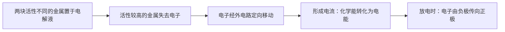
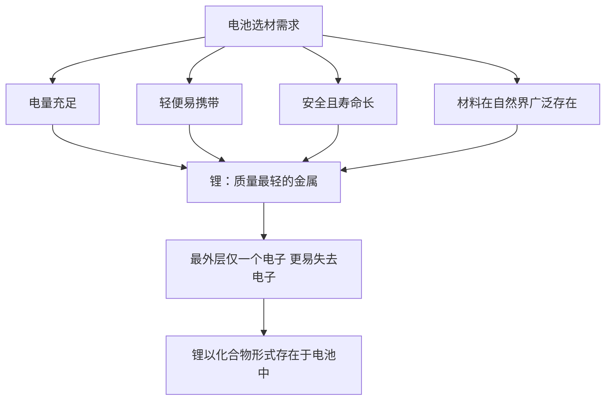
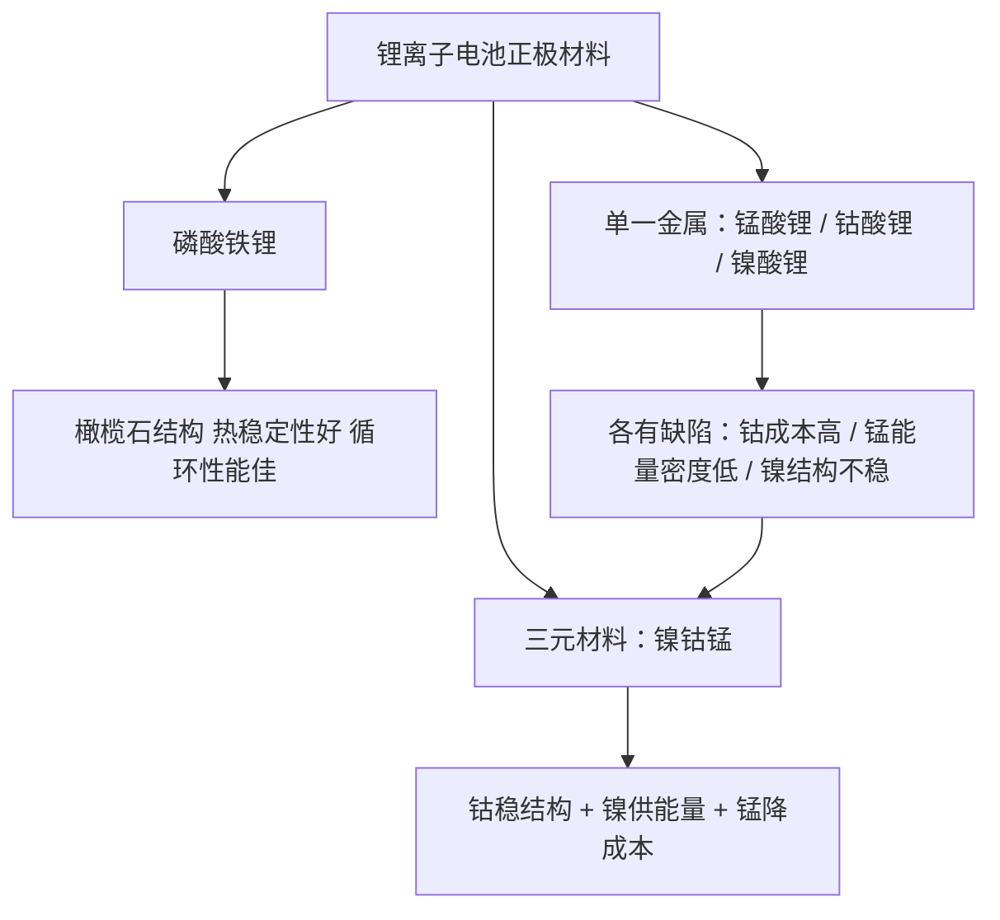
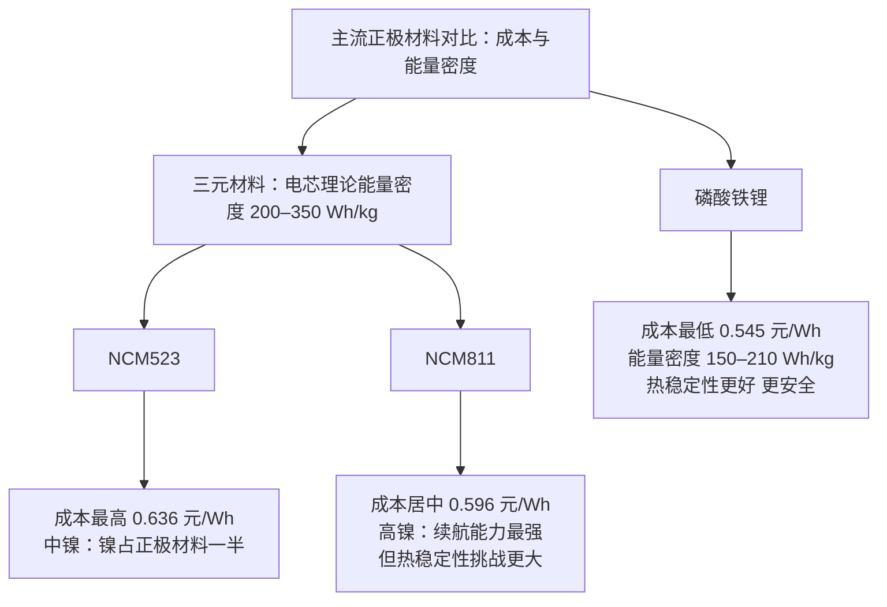
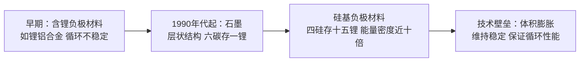
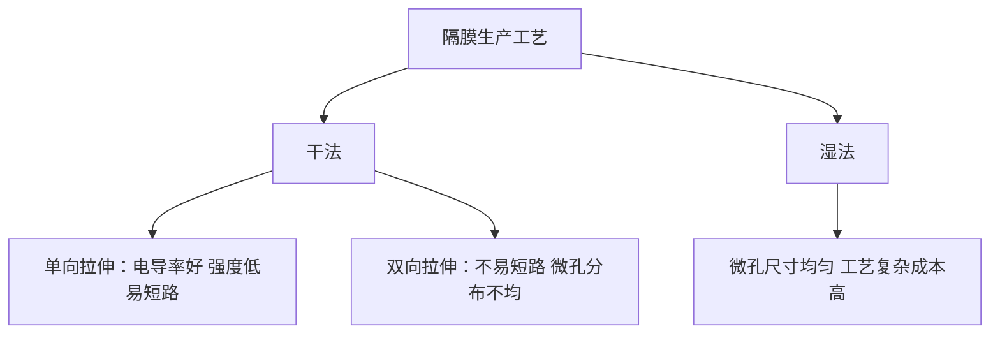
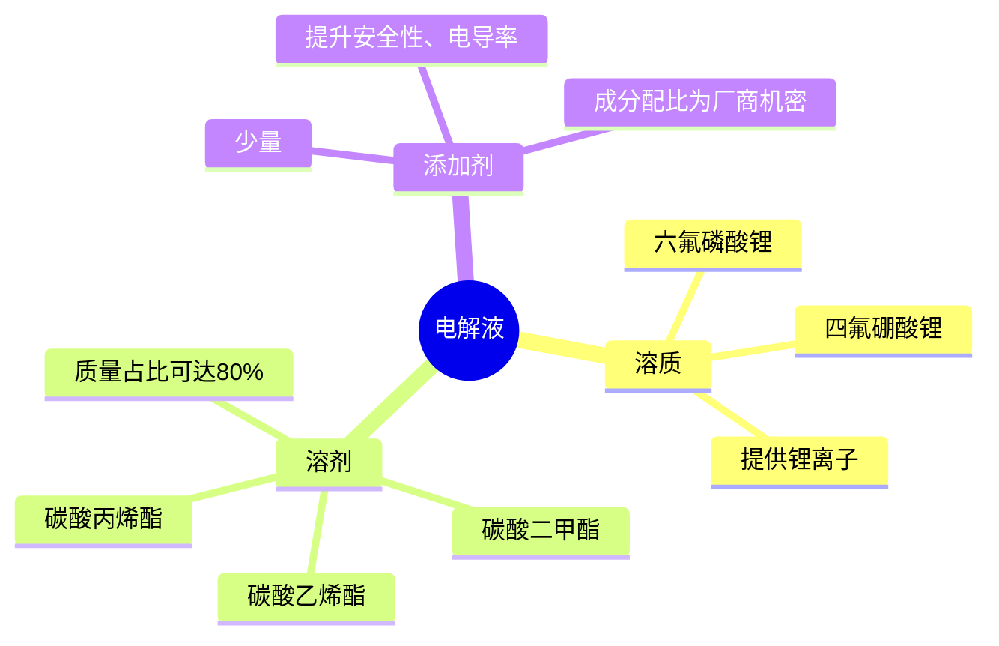
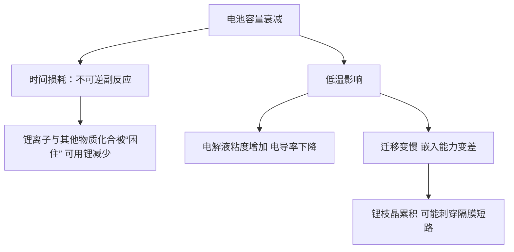
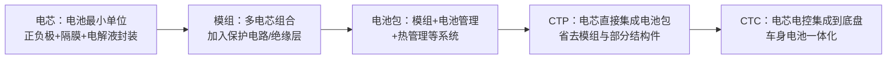
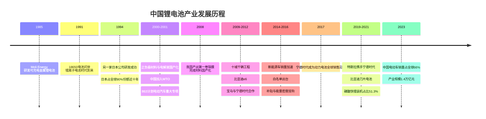

## 引言

冬天一到，新能源汽车的续航里程常常骤减，原本半小时能充满的电也需要一个小时甚至更久；而当气温回升，一切又恢复正常。车并没有坏——这背后的原因，要从电池说起。

## 一、电池的基本工作原理

电池基本的运作原理，是将化学能转化为电能。中学实验里，将两块活性不同的金属放进电解液中，活性较高的金属会分离出带有正电荷的离子；为了维持电荷平衡，带有负电荷的电子会被迫离开、去往活性较低的金属一侧，当这些电子定向移动时便形成了电流，继而产生电能。

我们把失去电子的一极称为负极，得到电子的一极称为正极。当电池放电时，电子由负极传向正极产生电流，为电子设备提供能源——这就是电池最朴素的工作原理。

## 二、为什么是锂：材料选择

想象一下我们对电池的需求是什么：首先要有足够的电量；其次要轻便，方便携带出行；同时要足够安全、使用寿命长；而且制造电池所需的材料在自然界中广泛存在。

从原子结构来看，原子由质子、中子和带有负电荷的电子组成。外层电子数越小，该原子就越容易失去电子；外层电子数越大，则更容易得到电子。为什么用锂做电池？答案就在锂原子的质量上：在元素周期表上，锂是质量最轻的金属；同时锂原子最外层电子数只有一个，更容易失去电子。

从材料本身的性质来说，这种材料必须在失去锂离子后还能形成稳定的化合价，以保障电池的安全与稳定。也因此，锂在电池中无法单独存在，还需要和其他物质以化合物的形式共存，于是寻找合适的含锂化合物就成了科学家工作的重点。

## 三、正极材料：磷酸铁锂与三元

1997 年，来自德克萨斯大学奥斯汀分校的三位老师发现了磷酸铁锂这种材料：在充电的时候可以很好地释放锂离子，在电池放电时还可以将锂离子再吸收回来，在持续充放电的循环过程里，整个化学过程是完全可逆的。失去锂离子的磷酸铁锂转变为磷酸铁，而在这个转变过程里，两种物质的晶体结构并未发生多大改变，并且呈现橄榄石结构，不会出现结构坍塌或变形。这就可以让磷酸铁锂电池在充放电的过程中维持良好的热稳定性和循环性能，从而保证电池的使用安全和寿命。此外，锂和铁在地球上广泛分布、简单易得。所有这些特性都让磷酸铁锂脱颖而出，支撑起了锂离子电池正极材料的半壁江山。

另一种与之匹敌的正极材料就是三元材料。所谓三元，指的是含有镍、钴、锰三种金属物质的金属化合物。其实，还有单一金属物质的锰酸锂、钴酸锂、镍酸锂，都可以和磷酸铁锂一样，在一定的电化学条件下实现对锂离子的吸收与释放，实现放电与充电的功能。纵观锂离子电池的发展历史，钴酸锂更是正极材料的老前辈，它是第一种被商业化的正极材料。

那又何须出现包含镍、钴、锰三种金属的三元材料呢？三元材料的出现，是对过去单一正极材料缺陷的补充：钴酸锂虽然能量密度高、续航时间长，但全球超三分之二的钴产量被刚果垄断，钴的成本极高，限制了钴酸锂电池的商业化发展；锰酸锂虽然热稳定性好，但能量密度低、使用寿命也有限；镍酸锂的能量密度高，但在充放电的过程中极易发生晶体结构的变化，循环性能降低。所以，无论是锰、钴还是镍，作为单一的正极材料都有无可避免的缺陷，但如果可以将三者融合到一起便可以取长补短：钴可以稳定材料的晶体结构、提升循环性能；镍作为活性金属，会提供较大的能量密度；而锰作为非活性金属则可以稳定材料内部反应，同时还能降低生产成本。由此，三元锂离子电池就可以在实现安全稳定的前提下，满足现代新能源汽车和其他电子设备等高续航的需求。

事情到这里还没有万事大吉，摆在人们面前的问题是：镍、钴、锰这三种物质到底该如何分配比例？早期三者所占的比例是一样的，用这种材料做成的电池被称为 NCM333 电池，这种电池的循环稳定性和安全性能都比较均衡，但钴所占的比例依然比较高、提升了生产成本。别忘了，镍的主要作用是为电池提供能量密度、保证电池的续航时间，因此人们将目光投在了镍身上——三元锂电池的发展，就是由低镍到高镍的发展。我国第一代应用于动力电池的三元正极材料是 NCM523，这种 5 系电池为中镍电池，相较于 NCM333，5 系电池中的镍在正极材料中占一半的比例，能给电池提供更长的续航时间；而高镍电池更进一步，镍的比例可达八成，也就是 NCM811 等 8 系电池。镍的高比例为电池带来了无可比拟的续航能力，但热稳定性的挑战也接踵而至，这也是接下来高镍电池想要进一步发展所需要攻克的技术难题。

目前磷酸铁锂电池和三元电池虽然市场占有比不同，但都是厂商比较钟爱的电池，无论是从经济方面还是从性能方面考虑，它们都有各自的优势与劣势：磷酸铁锂的成本比三元材料低，约为 0.545 元/Wh，而三元电池中的 NCM523 和 NCM811 分别为 0.636 元/Wh 和 0.596 元/Wh，并且磷酸铁锂的热稳定性更好、比三元锂电池更安全；但三元锂电池的优势便在于它的电芯理论能量密度更高，可达 200–350 Wh/kg，意味着续航能力更强，相比之下磷酸铁锂电芯的理论能量密度则在 150–210 Wh/kg。

## 四、负极材料：石墨与硅基

不管是磷酸铁锂还是三元锂离子电池，当电池充电的时候，正极材料都需要释放锂离子和电子，那么它们跑到哪里去了呢？这就来到负极材料了：它需要在充电的时候给离开正极材料的锂离子提供存储空间，这就要求负极材料的化学结构要足够稳定、要有充足的空间让锂离子"待着"，还要具备良好的导电性，方便电子流入流出负极。

这种理想的材料就是石墨。石墨的结构为层状结构，还有很多微孔，会让锂离子嵌入其中：可嵌入的锂离子越多，充电容量就越高；相反，释放的锂离子越多，放电容量就越高，因此负极材料同样影响着电池的循环性能。目前市场上的负极材料以人造石墨和天然石墨为主：天然石墨便宜量大，但颗粒大小不一、循环性能较差，因此主要用于小型锂电池或一般的电子产品；而人造石墨虽然价格偏高，但颗粒大小均衡、循环性能较好，主要用在新能源车动力电池或中高端电子设备电池上。但人们并不是一开始就发现石墨可以作为负极材料的——在电池发展早期，负极材料主要是含锂负极材料，比如锂铝合金等，但这些材料循环性能不稳定，直到二十世纪九十年代，石墨才开始作为负极材料被大规模使用。

尽管石墨的层状结构用来存储锂离子非常理想，可以提供给锂离子的空间却比较有限：当锂离子进入石墨层的时候，会与石墨形成化合物，每一个由碳原子组成的六边形"房子"里可以嵌入一个锂离子，也就是六个碳原子可以储存一个锂离子，这样石墨的能量密度就比较低。于是人们继续寻找可以存储更多锂离子的负极材料，就这样，硅基负极材料跃入了视野：当锂离子嵌入硅时可以发现，每四个硅原子形成的"房子"里可以储存十五个锂离子，能量密度是石墨的近十倍。但可容纳锂离子数量的提升，随之带来的是充放电过程中体积的膨胀，影响电池的使用安全和寿命，也因此，硅基负极材料的主要技术壁垒就在于如何维持体积的稳定、保证循环性能。

## 五、隔膜

现在我们有了正极和负极，但不能让它们直接接触，否则电池会短路、引起爆炸或着火，因此还需要用隔膜将两极分隔开。隔膜在分隔开正极、负极的同时，还能允许锂离子通过，保证电池可以正常充放电；同时隔膜还要尽可能薄、减少内阻，并且不能轻易发生变形。

目前隔膜的主要材料是聚乙烯和聚丙烯，隔膜的生产工艺有两种：干法生产工艺和湿法生产工艺，各有优缺点。湿法生产工艺的微孔尺寸和分布较为均匀，但工艺复杂、成本高；干法生产工艺又分单向拉伸和双向拉伸——单向拉伸锂离子电导率好，但强度低、易发生短路；双向拉伸虽然不容易发生短路，微孔尺寸分布却不均匀。隔膜看似不起眼，却是整个锂离子电池生产环节中非常有技术壁垒的一环。

## 六、电解液

为了进一步提升电池的运行效率与安全，我们还需要一种物质，那就是电解液。电解液的主要作用是平衡电荷，在电池充放电的过程中允许锂离子通过。为了让锂离子在电解液中游得快一点、提升电池的运行效率，我们需要给电解液"动点手脚"：在电解液里放入能够提供锂离子的溶质，目前市面上的主要溶质为六氟磷酸锂、四氟硼酸锂等锂盐——当负极的锂离子离开石墨层进入电解液时，靠近正极的锂离子会被"挤"出来进入正极，大大增加了锂离子流通的效率。

这还不够，离子还可以游得再快一点，这就轮到溶剂登场了。溶剂在电解液中的质量占比可高达 80%，它需要为锂离子提供良好的流动性，当然了，还有安全性，目前常用的溶剂有碳酸乙烯酯、碳酸丙烯酯、碳酸二甲酯等。此外，电解液中含有少量的添加剂，可以在一定程度上提升电解液的性能，比如提升安全性、电导率等；与溶剂、溶质不同，添加剂的成分配比是各个电解液供应商的机密所在。

## 七、电池容量为什么会衰减

我们使用各种设备以及给设备充电时，靠的就是正负极材料、隔膜和电解液的相互配合，电池内部一直在不间断地进行着反应。在这个过程中，锂离子会不可避免地与电池内部的其他物质发生化学反应、形成化合物，这个过程是不可逆的——也就是说，这些锂离子被困在了这些物质中，无法参与电池的充放电过程，久而久之，电池内部的锂离子数量减少，电池容量也就变少了。

还有一种情况与时间带来的消耗无关，但也同样会降低电池的续航能力，那就是开头提到的低温。低温尤其是零度以下时，电解液的粘度增加、离子电导率会下降，同时锂离子的迁移速度也会变慢，这就导致锂离子在正负极之间的游移要比在常温条件下困难。但低温带来的问题还不止这些：由于锂离子的活性降低，嵌入能力也会变差，当它不能正确插入石墨层之间，反而累积在电池内部，容易形成锂枝晶，降低电池内可用锂离子的含量，甚至还能刺穿隔膜引发短路——这些锂无法被继续使用，这就是"无用锂"的意思。这些改变带来的最直观影响，就是电池续航能力的减弱。其实一块崭新的锂离子电池从投入使用开始，可用的锂离子就在不可避免地减少；而不论是在新能源汽车上还是各种电子设备中，电池的空间总是有限的，为了在有限的空间中最大化电池的使用效率，厂商们付出了很大的努力。

## 八、电池封装：从电芯到电池包

锂离子电池生产的下一环节是封装。封装是将电芯打包成模组、再将模组打包成电池包的过程，而我们所说的圆柱、方形和软包这三种封装方式，指的就是电芯的封装。

电芯是组成电池的最小单位：将正极、负极、电解液和隔膜通过钢壳、铝壳或铝塑膜等封起来，便形成了电芯。其实电芯已经可以提供电能了，那为什么还需要模组和电池包？单节电芯仅能提供 3–5 伏的电压，所能提供的容量可能都不够一辆新能源汽车起步。为了给汽车提供更足的动力，我们需要组合很多个电芯获得更大的电压和容量，然后加入保护电路、绝缘层等辅助性部件，就形成了模组；最后将模组、电池管理系统、热管理系统、各种电器系统都封装好，就形成了成品电池包，也就是我们最终用到的锂离子电池。

现在市场上能见到的封装方式有三种：圆柱、方形和软包。圆柱封装其实是把圆柱形的电芯排列在模组里，它最大的劣势就在于空间利用率并不高，每个单节电芯之间都有很大的空隙，对于寸土寸金的电池空间来说，这无疑会降低电池整体的能量密度；但圆柱封装的标准比较统一，市场主流的有三种规格——18650、21700、4680，前两个数字代表直径，三四位数字代表高度，末位的 0 代表该电池为圆柱形电池，标准统一意味着行业的规范化、加工技术更为统一。方形封装的空间利用率要比圆柱封装高，也因此模组的能量密度略胜一筹，但目前市场上方形封装的生产效率相对较低。而软包从电芯的封装材料上就与方形和圆柱不同：软包采用的是铝塑膜，整体质量要轻便许多，但软包电池在极端条件下容易膨胀变形，也就意味着在集成电池包时需要另一层外壳做支撑，这又是一项技术与成本的投入。这三种封装方式各有优劣，并没有孰强孰弱之分。

封装好后的电池一般会安装到汽车底盘下面或者后排座位后面。伴随着科技的进步以及对续航要求的提高，安装方式又出现了革新：首先是 CTP 技术，这种形式将电芯直接集成到电池包内，省去了模组与一部分结构件，从而提升了电池包的体积利用率和体积能量密度；而接下来出现的 CTC 技术更进一步，同样也是省去模组，将电芯、电控系统集成到底盘，实现车身与电池的一体化设计。无论是 CTP 还是 CTC，它们的诉求都是一样的，那就是减重、增加续航。

## 九、中国锂电池产业的发展

以上就是整个锂离子电池的产业链。一块锂电池的诞生涉及的环节比较多，从矿产、化学材料到最终成品，需要整个产业链的配合才能完成，并不是某一个环节的企业可以包打天下。贯穿锂离子电池生产链的每个环节都有多家企业布局：除了三元正极材料竞争比较分散之外，其他环节都有诸如湖南裕能、天赐材料、贝瑞特、上海恩捷、中兴新材等在细分领域的龙头老大，且近些年的发展越来越有向这些龙头集中的趋势。无论是上游原材料生产、中游原材料加工、下游封装制造和回收，我国均有企业参与部署。以负极材料为例，2023 年我国负极材料出货量达 143.3 万吨，占世界总出货量的 92.1%，位居世界第一；整个行业的总产值为 1.4 万亿元，产业规模占据世界的 41%，位居世界第一。

但为了实现这样的成绩，我们走过了漫长的路程。1985 年，加拿大公司 Moli Energy 首次研发可充电金属锂电池并迅速将其商业化，虽然几年后的爆炸起火事故让 Moli Energy 公司不得不召回其所有产品，但锂离子电池凭借其更高的能量密度、更高的电压和更轻的重量，迅速进入全世界电池生产商的试验。1991 年，日本某跨国公司正式对外发布大名鼎鼎的 18650 电池并应用到自家生产的摄像机中，这款全新的锂离子可充电电池有着 4.1 伏的电压、80 Wh/kg 的质量能量密度、200 Wh/L 的体积能量密度，以压倒性的优势宣告了属于锂离子电池时代的到来。1994 年，另一家日本公司也成功研发了可充电的锂离子电池，在此后将近十年的时间里，日本一直稳坐消费锂离子电池的龙头地位，占全球锂离子电池市场份额的 90%。

进入二十一世纪，以手机为代表的消费电子终端产品高速发展。这一时期，韩国瞄准了锂电池市场，通过不断购买锂电池专利的方式入局；而此时的日本由于战略失误以及对投入锂电池的决心不足，放缓了对锂离子电池的支持。2001 年中国加入 WTO，全球制造业加工产能开始陆续向中国转移，国内的各个企业也开始奋起直追：2000 年负极材料和正极材料国产化，2001 年电解液国产化，此时还差一步才能彻底实现电池材料的国产化——那就是隔膜。生产隔膜的技术和装备被其他国家列为限制出口名单，早先中国想要跟他们购买隔膜还需要签订苛刻的使用协议；2008 年我国成功产出第一卷隔膜，至此我国彻底完成了电池材料的国产化，降低了国产锂离子电池原材料的采购成本。与此同时，凭借庞大的劳动力人口，中国的锂电池产品迅速有了抢夺日系企业蛋糕的资本，在移动设备领域突飞猛进。

此时，全球市场的目光已经投注到了看似与锂电池毫不相关的领域上——新能源汽车。2001 年，中国"十五"启动 863 计划电动汽车重大专项，正式提出发展新能源汽车是我国汽车工业崛起的机遇；2007 年 6 月，比亚迪公司凭借先前在移动设备领域的经验，迅速搭建了磷酸铁锂动力电池生产基地；与此同时，曾毓群也看到了新能源汽车的发展机遇，于 2008 年主导成立了动力电池部门；2009 年中国"十城千辆"工程落地，新能源车的补贴滚滚而来，但由于国内行业整体突破有限，我国车企只能与美日韩企业合作；2010 年，比亚迪公司推出了纯电动车 e6，采用自主研发的 ET-POWER 铁电池技术；2012 年，宝马宣布与宁德时代合作，2014 年 G38 电池的成功让该电池企业在动力电池行业开始站稳脚跟；2014 年中国新能源汽车销量加速，一年内销售了 7.5 万辆，而到了 2015 年，这一数字已经增长到了 33 万辆。

就在此时，日韩企业对于国内锂电池厂商的围剿再度袭来。我国厂商刚起步时都选择了较为成熟的磷酸铁锂电池，到了新能源车爆发的时期，国内的用车需求从原本的公共事业用车到私家车慢慢转变，磷酸铁锂的续航短板也慢慢暴露了出来，远不如三元锂电池；但当时三元锂电池的技术核心掌握在美国公司手中，而他们只把专利授权给了日韩厂商，国内生产厂商显得捉襟见肘。为了挤掉国产厂商，日韩更是打起了价格战，此举也引发业内人士公开质疑：日韩在国内搞垄断，先赔个十亿把价格打下来，将国内企业杀死在摇篮里。就在这时，2015 年 4 月，一份名为《汽车动力蓄电池行业规范条件》的公告从北京传出，文件明确了各个新能源汽车厂商想要获得相应补贴，必须与名单内的企业合作，而前四批的名单中几乎看不到日韩厂商的身影，一时间我国车企纷纷选择了三元材料的宁德时代。在政策的加持下，中国锂电池行业获得了难得的追赶期：2016 年 12 月，四部委出台了新能源车补贴新规，能量密度越高、续航里程越长，获得的补贴就越多，三元锂离子电池迅速抢占上风；政策与市场的倾斜也为国内的厂商提供了一个产能与技术爬坡的绝佳窗口，2017 年宁德时代成为动力锂离子电池全球销售冠军。

此后，美国车企特斯拉与日本电池供应商也因为电池价格问题开始产生隔阂：2019 年 11 月，特斯拉宣布与我国行业龙头宁德时代合作；2020 年，宁德时代正式成为特斯拉的动力锂电池供应商，股价也随之上涨。同年 3 月，我国车企比亚迪对外发布了划时代的产品——刀片电池。刀片电池的问世让具备价格优势的磷酸铁锂电池市场再度回暖：2021 年 7 月，磷酸铁锂电池占总装机量的 51.3%，再度超过三元锂电池。2020 年，虽然白名单制度的补贴已经不复存在，但已经站稳中国市场的国内厂商开始放眼全球市场，中国锂电池的出海行动开始了。除了产品的出海外，中国企业还通过海外投资建厂、生态合作、收购甚至技术授权等多种方式拓展和完善海外市场的布局：宁德时代位于德国图林根州的工厂已顺利实现锂离子电池电芯量产，位于匈牙利的第二个欧洲工厂项目也已经正式启动，其他电池生产商也分别开始在泰国、美国等国家投资建厂。与中国企业相比，日韩在供应链配套、成本控制等方面的劣势就显现出来了，这也导致他们近几年的市场份额不断下降。

2023 年，全球电动车销量 1319 万辆，其中中国销售电动车超 900 万辆，占全球市场的 66%；全球动力电池装机 662 GWh，增长 25%。据不完全统计，我国锂电池企业海外建厂的规划产能总计超 600 GWh。而日韩老牌厂商在经历了 2008 年全球金融危机后几乎元气尽失：曾经以 18650 电池开创了锂离子电池行业的某日本公司，在 2016 年将电池业务卖给了日本一家电子元件生产商——在推出世界第一款商用锂离子电池的二十五年之后，以区区 1.6 亿美元的价格向自己开创的这个行业说了再见。

2024 年，苹果公司宣布取消持续了长达十年的电动车项目，紧接着，其他车企要么纷纷宣告将放弃原本的全面电动化，要么暂时放缓了对电动车领域的投入。而放眼全球，新能源汽车的火爆对锂电池行业来说既是机遇也是挑战：正极材料中 9 系超高镍、磷酸锰铁锂正逐渐落地；电解液方面，半固态、固态电池在十年以后有望商业化铺开。这些都是给二线企业甚至是跨界玩家提供了一定弯道超车的机遇。中国锂电池厂商能否在未来继续占据龙头的地位？多方竞争下的锂电池行业格局将会如何发展？让我们拭目以待。

