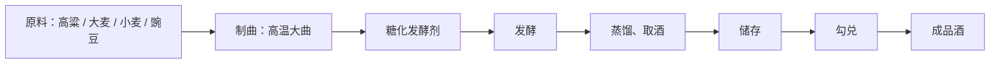
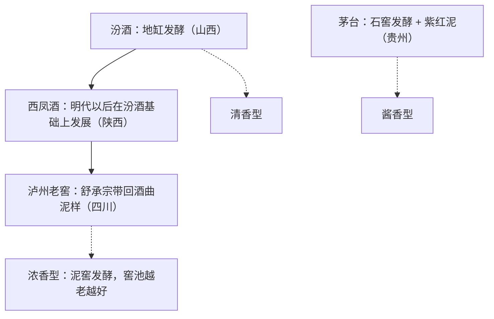
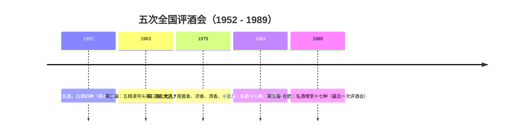
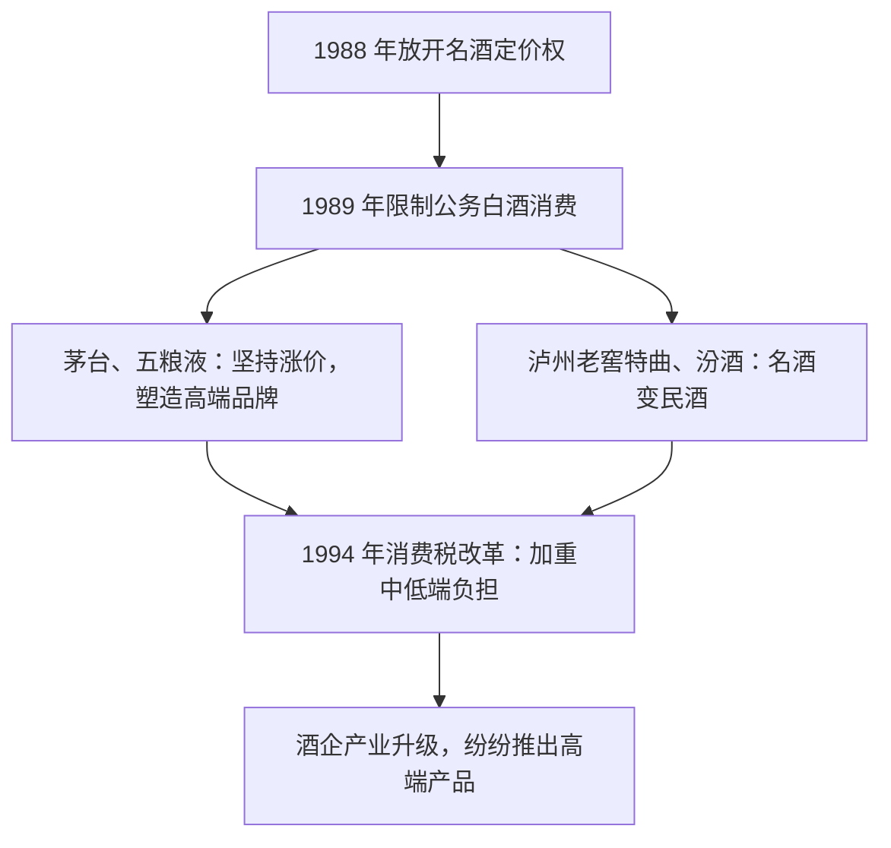
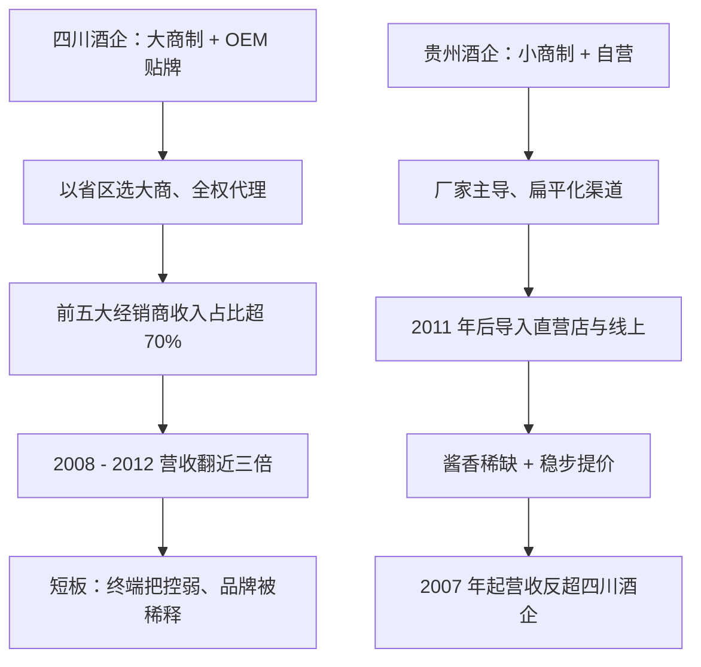
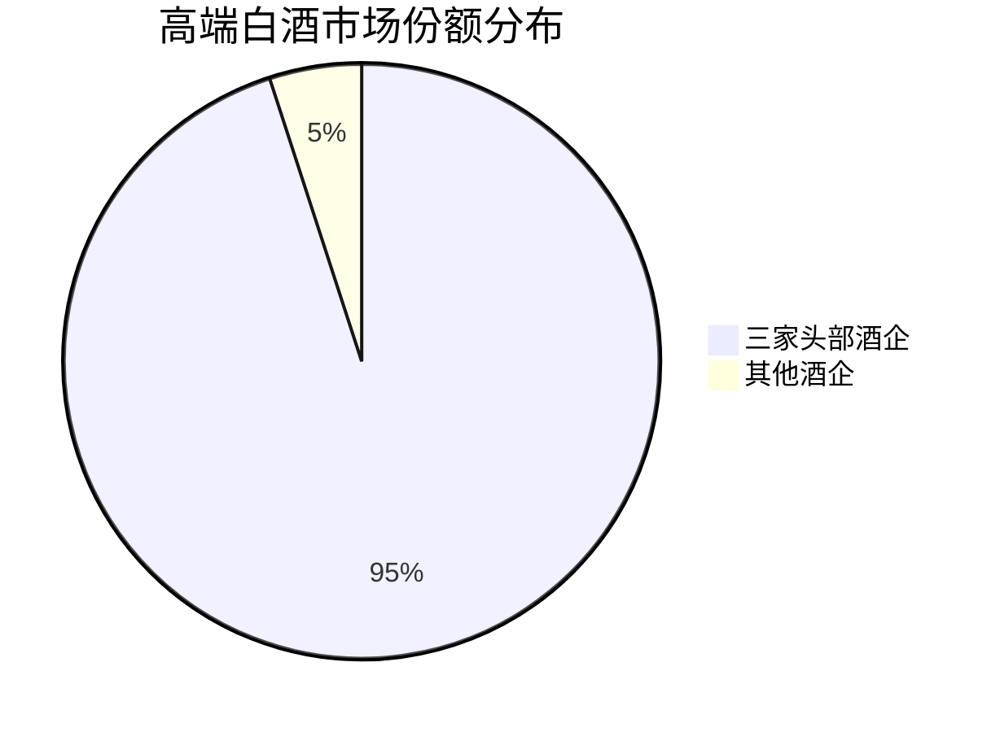
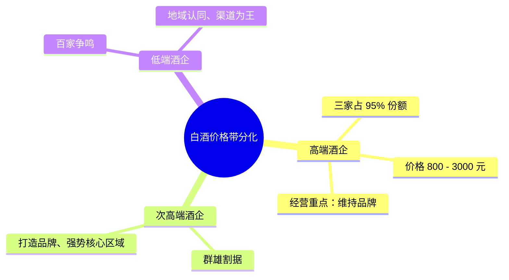
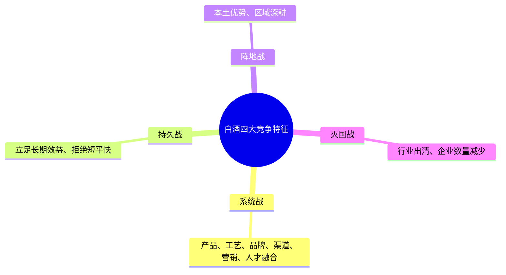

## 一、白酒：中国文化的社交载体

"对酒当歌，人生几何"，"晚来天欲雪，能饮一杯无"——曹操与白居易的这两句诗风格截然不同，前者豪放豁达，后者静谧悠远，却都用酒抒发了自己的情感。无论是叙志还是抒情，酒都是中国文化里重要的表达意象。

而最能代表中国酒文化的无疑是白酒。作为世界六大蒸馏酒之一的白酒，无论是在宴请、聚会，还是商务场合里，它都是中国人重要的社交载体。如今的白酒行业基本形成了以清香、酱香、浓香为主、多种香型并存的产品格局，各家酒厂也都各显神通，竞争态势愈演愈烈。

白酒行业是如何一步步演化成今天的格局，背后又有多少你追我赶、成王败寇的商业故事，未来的竞争在产品、渠道、品牌三个维度上又会有怎样的变化——一切都要从酿酒说起。

## 二、酿酒：一门微生物的艺术

酿酒是一种利用微生物的艺术，白酒也不例外。白酒制作需要以高粱、大麦、小麦或豌豆作为原料，然后根据不同的工艺制作高温大曲，并以此作为糖化发酵剂，最后经过发酵、蒸馏、取酒、储存和勾兑共计八个步骤产出成品酒。

"橘生淮南则为橘，生于淮北则为枳"，这句话道出了土地、气候对作物的影响。对于依赖粮食和水的酒厂而言，当地的水土、气候、温度、生态环境决定了微生物菌群的不同，进而决定了酿造工艺的不同和酒成品的特色。

## 三、三大香型的起源：地缸、泥窖与石窖

白酒三大主流香型的差异，早在各自的发源地就埋下了伏笔。清香型的源头在山西汾阳杏花村，这里曾出土了距今约六千年的小口尖底瓮，被认为是中国最早的人工酿酒工具；一千五百年前，汾酒就已经被端上了帝王将相的饭桌，北齐武成帝给河南康舒王的书信中写道"吾饮汾清二杯，劝汝于邺酌两杯"。

汾酒是少有的需要三种酒曲酿成的白酒，根据控制条件的不同可分别制出清茬曲、红心曲和后火曲三种大曲，并以三比三比四的配比使用。磨碎的大曲与高粱混合后，放入被埋入地中的小地缸发酵，通过蒸馏等一系列步骤产出成品酒，整个周期历时十到十一个月。

明代万历年间以后，陕西西凤酒在山西汾酒的基础上发展而来。明末清初，一位叫舒承宗的泸州人在陕西略阳担任军职，卸甲归田时他带着当地的酒曲和泥样回到家乡，创立了舒聚源。四川气候比陕西更加温润潮湿，发酵用的窖池里微生物更加活跃，并且窖池越老、连续不间断酿造的时间越长，微生物菌群的种类越多、活性越强，酿造出来的白酒风味也越丰富，"酒好全凭窖池老"说的就是这类酒。而舒聚源就是泸州老窖的前身。

"蜀盐走贵州，秦商聚茅台"道出了茅台镇因赤水河航运、商贩络绎不绝的景象。来自山西和陕西的盐商在茅台镇驻扎，也带来了对白酒的需求，众多酒坊应运而起，于是就有了"酒冠黔人国"的美誉。与汾酒的地缸、川酒的泥窖不同，茅台镇酿酒采用的是石窖，窖底部和封口用当地特色的紫红泥，这也为茅台镇的酒提供了独一无二的微生物菌群。从投料开始，茅台酒的基酒制造需要一年，制造完成后需要存放三年才能与老酒勾兑，再存放一年才能投入市场。各个酒厂为之依赖的粮食、地理条件，以及酿酒匠人对传统工艺的坚守和优化，就已经为各自出产的酒赋予了独一无二的特色，并隐隐为之后各自的命运埋下了伏笔。

## 四、五次评酒会：名酒时代的开启

二十世纪五十年代到八十年代末，中国举办了五次评酒会。这五次评酒会通过对酒进行不同维度的打分，让不同地域的好酒与酒企在全国脱颖而出，也为接下来几十年白酒行业的格局定下了基础。

新中国成立之初，白酒一度颇受重视。在那时由于计划经济，各个白酒的价格差距并不大，这个时期的各个酒企也尚在发展阶段，白酒种类虽然丰富，但没有明确的分类与制作标准。为了振兴酒业、提升酒类质量，一九五二年政府决定办一场评酒活动，当时共计一百零八份酒样被送往北京试验酒厂，根据市场销售信誉和化验分析结果，评选出了八种名酒，其中白酒四种，分别是贵州茅台酒、山西汾酒、泸州大曲酒和陕西西凤酒。这一次评酒会开启了中国名酒时代，也让这些品牌在全国一炮而红。

到了一九六三年第二次评酒会再次开幕，评委会从酒的色、香、味三个维度打分，其中"香"的评定让浓香型白酒占据优势。这届的头筹由五粮液斩获，其余七款白酒分别是古井贡酒、泸州老窖特曲酒、全兴大曲酒、茅台酒、西凤酒、汾酒和董酒，八款酒称为"老八大名酒"，具备很强的全国化品牌记忆。

第二次评酒会直接促成了中国白酒香气的确认，进一步分化了不同的白酒产品。香气较为内敛但价位突出的茅台酒从第一次评酒会的第一名下滑至第五名，此次失利让茅台酒于两年后正式提出了香型的概念，进行差异化的工艺查定和确认，并直接影响了第三次评酒会的选拔规则。第三次评酒会于一九七九年在大连举办，当时共有三百一十三份酒样参与评选，样品按酱香型、浓香型、清香型和米香型四个大类各自点评。这次评酒会在全国掀起了一场明确香型的风潮，豉香、芝麻香、凤香、特香、药香、老白干香、兼香等香型都在此时如雨后春笋般浮现出来。

一九八四年第四次评酒会拉开帷幕，共评选出国家名酒十三种、优质酒二十七种。也是同年，粮食产量提升，国家不再对酒企实施粮食管控，白酒税率也降至百分之三十，一批名酒企业纷纷开始产能扩张。一九四九年我国白酒产量仅为十点八万吨，到了一九八八年这个数字已经飙升至四百六十七万吨。

## 五、市场化与名酒分化：两条道路

在这个背景下，以汾酒为代表的清香型白酒显出了自己的优势：它发酵期短、大约为二十八天，制作周期短，同时使用地缸发酵、不受窖池环境限制，可以快速扩张，再加上前四次评酒会打出的名酒招牌，汾酒成为当时白酒行业的主流，从一九八八年起连续六年，无论是经济效益还是销售收入都遥遥领先，占据了市场近百分之七十的份额。

一九八八年，国家放开了十三种名酒的定价权，白酒开始市场化。一九八九年一月，第五次评酒会也是最后一次评酒会在合肥举办，名酒列表增至十七种，国家优质酒为五十三种。五次评酒会让中国白酒有了名酒与非名酒的区别，而市场化就意味着这些区别终于可以通过产品定位策略体现出来。

有了名酒背书的茅台酒、五粮液酒、剑南春酒、泸州老窖特曲、汾酒、古井贡酒等名酒应声而涨，分别涨至一百四十元、八十元、三十六元、七十五元、三十五元和四十元。而一九八九年限制公务白酒消费，就让这些酒企在产品策略上走向了两条不同的道路：茅台酒、五粮液酒坚持涨价策略，塑造自己的高端品牌形象；但泸州老窖特曲和汾酒的涨价幅度一直不高，并且打出了"名酒变民酒"的品牌策略。

一九九四年我国实行分税制改革，对白酒征收消费税，并历经多次税制改革，从对白酒实行从价征收，到从价、从量定额复合征收，这一举措加重了酒企的税负，对中低端产品的冲击是毋庸置疑的。但为了长期发展，酒企开始产业升级、探索自己的高端化之路，一些著名酒企纷纷推出自己的高端产品，我们耳熟能详的青花汾酒、国窖一五七三系列、水井坊酒、舍得酒、蓝色经典系列、红花郎酒等都是这个背景下诞生的。这个时期白酒行业的主要任务是集中在产品的研发与发展上，不同的历史发展事件很大程度上影响了白酒的产品分化。

## 六、渠道为王：大商制与小商制的较量

产品格局似乎已经定型，而市场格局却在风云变幻。一九九六年国家二十三个部委联合规定公务宴请不喝白酒，一九九七年亚洲金融危机爆发、国内 GDP 增速下降、消费疲软、白酒产量下跌，一九九八年我国白酒产量仅为五百二十八点六七万千升，较前一年下降了百分之二十五点四。一九九八年朔州假酒案让山西汾酒雪上加霜，尽管这次事件与汾酒毫无关系，却令其失去了百分之七十的省外市场。这导致中国白酒的香型格局出现重大变化：以泸州老窖、五粮液为代表的浓香型白酒由于在六七十年代积极推广浓香型技术，且制作工艺、价格带更广，逐渐取代清香型白酒占据了大部分市场份额。

金融危机过后，我国加入 WTO，自此中国经济迎来飞速发展，货币财政政策宽松，市场进一步向买方市场倾斜。同时消费者购买渠道开始多样化，白酒的销售模式也迎来巨变，由广告媒介转向渠道为王——谁掌握了渠道，谁便有机会成为行业老大。

四川的一家酒企率先创新了经销模式，以省或区为单位选择营销能力强的经销商，由其全权代理分属区域的销售并享有定价权，通过发展全国总代、区域总代、省级总代、地级总代等分层代理，部署了强大的经销网络，这种经销模式也叫大商制。二零零五年到二零零八年，该公司前五大经销商的收入占比超过百分之七十，远超同期竞争对手。为了进一步扩大影响，该公司全面发展自己的产品线，从高端到中低端一应俱全，开拓中低端市场的主要方式为 OEM 模式，与实力强大的经销商合作开发酒品、授权贴牌。通过大商制和 OEM 模式，该公司可以迅速扩张，从二零零八年到二零一二年营收翻了近三倍。

但市场总是在不断变化的。过度依赖大商制削弱了酒企对市场终端和渠道的把控能力，远离市场意味着无法及时了解市场的需求，对供需变化不敏感，也就无法调整对应的价格策略；大商的权力过大，也意味着酒企对大商的议价能力不高；OEM 贴牌模式造成低价产品过多，也稀释了品牌价值。从商业模式看，该公司凭借强大的工艺和品质实力以及快速的渠道扩张能力形成了强大的品牌力，但其本质是在做 B 端——也就是经销商客户的生意，对消费者的经营能力、稳定性却不足。大商制和贴牌模式对品牌形象的损坏是毋庸置疑的，这个模式也导致了后来白酒江湖的格局变化。

二零零七年，该公司的营收被一家贵州酒企超越，差距越来越大，龙头之位再次易主。与主打大商制不同，贵州这家酒企选择了厂家主导的小商制和自营的模式：小规模经销商包括专卖店、区域总经销商、特约经销商等，强大的线下议价使其在二零一一年以后有能力导入以直营店和线上平台为主的自营模式。这样的经销模式相比大商制更为扁平，对市场终端感应能力更强，多元化的渠道管理使其价格管控力也更强。

同时贵州这家酒企主打酱香型，其工艺的差异性和产品结构的定位也在这个时期迎来了和消费者观念的双向奔赴——以高价位产品匹配高品质生活。酱香型白酒比其他香型白酒的制作周期更漫长、总产量更低，在空间和时间的供给上都让消费者和经销商形成了其产能有限的稀缺性共识。物以稀为贵，从二零零一年到二零一七年，该酒企的标杆产品一直在稳步提价，并且让经销商们都获得了合理或更高的利润去传播其品牌价值，最终在价位、利润和收入上依次超越其他竞品，在二零一三年以后更是进一步强化了在国人心目中高端酒的地位。

与全国性高端酒的风起云涌一样，一些地区的特色酒也在发力。来自江苏和安徽的两家酒企，同样采用了厂家主导的一加一模式，由分公司或厂家办事处维护市场，经销商主要负责物流和资金周转。在这种模式下，厂家对渠道的把控力进一步加强，更高效地满足了需求快速增长时代的消费者触达。二零零三年的蓝色经典系列、二零零八年的古井贡酒年份原浆系列，助力这两家公司成为当时江苏和安徽的酒企龙头。

## 七、深度调整与渠道变革：2012—2016

如此轰轰烈烈的开疆阔土之下，白酒产量在二零一二年升至一千一百五十三万千升。然而接下来的两个大事件将整个白酒行业推向风口浪尖：二零一二年白酒塑化剂事件被爆出，引起了全国对饮酒安全的恐慌——塑化剂是一类化工产品，主要用于加到聚氯乙烯塑料中增加柔韧性，事件一经爆出，众多酒企股票下跌甚至临时停牌，白酒板块市值蒸发数百亿元。同年限制三公消费政策出台，多重因素叠加之下，白酒消费需求骤降。

市场的变幻莫测带动了供需关系的恶化，不少酒企预估错了形势，逆势大幅提价或者盲目增量，带来渠道库存的逆转，营收增速由百分之五十跌至负百分之十。二零一三年到二零一六年，白酒行业进入了深度调整期。在这个阶段里，酒企不断调整价格策略、试探供需关系，与此同时酒企的渠道模式有了非常大的改变：调整较快的酒企开始回收大经销商的权利，让自己更贴合下沉市场，渠道进一步扁平化；同时各个酒企开始调整并精简自己的产品矩阵，让自己拥有代表酒品，酒企迎来了品牌为王的时代。

二零一三年，总部位于川东南的一家酒企，其高端大单品的出厂价有近九百元甚至一千元，反超收入在其身前的另外两家酒企。但价格与销售额的严重不匹配遭遇了更大的挑战，消费者对品牌的认知以及竞争对手的量价策略，使其短期内销量遭遇下滑、再度调整价格策略，二零一四年出厂价由一千元跌至七百元以下，此后该酒企提价缓慢，六年后才重回二零一二年的水平。

另一家酒企也面临类似的困境：市场动销不畅，出厂价的不合理提升一度出现价格倒挂——销售价低于出厂价的情况，倒逼他们提高促销费用、实质性下调出厂价和终端价，最终通过消费者购买去化了渠道库存、寻找到新的平衡，但让商家形成了库存减值和难以赚钱的印象。而某酱酒出厂价的稳定，得益于酱香型白酒的产能扩张周期偏慢以及消费者培育的能力，该酱酒一直处于供不应求的状态，供需关系并没有其他酒企那么激烈，并且采取了合理的供需关系和利益链分配，积极地开拓新需求弥补缺口，并保持存量经销群体的利益和信心稳定，持续做价位升级，产品升级仍然能在维持出厂价不变的前提下保证一批价格。

## 八、消费升级与高端化格局

供需关系折射出的是更复杂的背景。此时的我国正处于消费升级的阶段，消费对经济贡献率达百分之五十以上，居民的消费观念也正在经历一场大变革，从数量转为对质量的追求。由于政企消费比例下降，高端酒的私人饮用场景明显提升，二零一七年白酒的私人消费占比从二零一一年的不足百分之二十增至百分之六十，这也意味着酒企能不能顺利过冬，就看能不能抓住大众的心。

二零一四年起，该酱酒又衍生出定制酒、生肖酒等非标酒品，以满足不同消费者的个性化需求。这些非标酒品价格高于普通酱酒，拓展了新的消费场景和消费群体，又帮助酒企进一步巩固了自己的高端酒品地位。但该酒的供不应求所留出的市场空位，依然需要其他酒企去填补。

属于大商制的那家酒企一直在进行销售模式的改革：二零一四年其采取直分销模式，收回了一部分大商的权利，并且核心大商由厂家直接管理，同时改造产品矩阵、清理子品牌，专心做五十二度标杆酒，以及发展部分低价位产品。与此同时另一家酒企也在产品瘦身，重点发展五大单品，降价后得以再次重拾份额。

这个阶段里，第一梯队的酒品正在逐渐完善自己的高端产品部署。经过三年的调整，白酒高端领域基本格局已定，这些品牌独有的历史文化价值和高速发展期的品牌传播积累，让其他酒品很难入局——三家酒企占据了高端白酒百分之九十五的市场份额，价格从八百元到三千元不等。

但次高端酒品的市场格局仍然存在变数。地方某些酒企纷纷开始精简产品线、进行渠道改革，希望通过次高端和准高端大单品的全国化来提升净利润率。其他酒品也在部署不同的营销策略：有些酒企不仅有自己的核心消费区域，也打下了全国市场；另一些酒企则立足于自己的优势地带，向周边区域辐射。

二零一六年，我国共有接近两万余家白酒企业，收入两千万以上的企业有一千五百七十八家，而专注高端、次高端酒企的数量总是有限的。这里面绝大多数企业是不可被忽视的低端白酒和区域性白酒企业。高端酒品已成三足鼎立之势，次高端酒品群雄割据，而低端酒品依靠我国传统的地域认同和酒文化得以百家争鸣。

## 九、品牌为王：产量下降与行业集中

我国白酒消费有着非常强烈的文化属性，各个地方的人都有自己钟爱的白酒。尽管高端酒和次高端酒企在不断挤压其他酒企的市场空间，但长久以来依靠地理文化建立起来的酒类认同感却不是那么容易就可以被消磨的。包含红星二锅头、牛栏山二锅头、劲酒等全国性低端酒品，尽管在大众口中有极高的知名度，但市场总份额却不足百分之三十，同时这些酒企的增长也呈现不稳定的特性，证明大众消费市场本身的竞争激烈且格局不稳。

我国白酒消费区域主要分布在川黔、苏皖、两湖、鲁豫、华北和东北六大板块，这些地区的消费者有着明显不同的饮酒偏好，区域性认同感意味着酒企难进也难出。经过多年的沉淀与调整，我国白酒行业价格带分化明显，高端、次高端、低端酒企有着不同的受众群、影响力以及对应的经营之道。

高端酒企的经营重点是维持品牌，它们在全国范围内认可度都非常高，无论是对渠道的把控力、对经销商的话语权，还是抗风险能力都更成熟，对价格有把控权。次高端酒企的经营重点则是打造品牌，有自己的强势核心区域，影响力以此为中心向全国扩散，这些酒企容易受到高端酒企的策略影响，需要依靠高端酒企打开市场空间，为自己赢得潜在的客户群体。绝大部分低端酒企的经营重点是要保证渠道，它们在全国的影响力几乎可忽略不计，生存之道是立足于自己的一亩三分地，非常依赖经销商拓展并巩固自己的市场。

二零一六年以后，经过三年的调整，白酒消费结构愈发明了，私人消费占比提高，更加注重白酒背后的文化属性与稀缺性，对高端酒品价格的接受能力更强。与此同时，互联网的迅速崛起让酒企看到了进一步扁平渠道的机会。二零一七年起，白酒在高端化的同时产量开始下降并持续至今：二零一七年全国规模以上白酒企业产出白酒一千一百九十八点一万千升，二零二三年这个数字降到了四百四十九点二万千升。大幅下降的背后是行业高质量发展、统计口径的优化，同时也是大浪淘沙的必然结果，也符合新时代消费者"少喝酒、喝好酒"的健康化、品质化追求。

在产量下滑的同时，白酒行业的规模净利润却在逐年上升，品牌时代的优胜劣汰对头部名酒的需求扩张赋予酒企提价的底气。二零一八年在持续六年出厂价保持不变后，茅台酒选择提价，也给了五粮液和泸州老窖等其他高端酒品提价的空间，其他酒企也纷纷推出千元产品打进高端酒品领域，甚至区域型酒企也出现了上千元的高档酒。二零二零年新冠疫情爆发，宴请聚会活动明显减少，加速了中小型酒企的出局，而行业净利润率和营收的提升则意味着白酒行业进一步向龙头企业集中、向中高价位的名酒集中。

与此同时，这些酒企利用互联网的崛起开始成立电商公司，在各大电商平台经营直营店，形成了电商直销、经销商、线上并存的渠道模式。这些渠道模式的扁平化给了厂家直接接触消费者的机会，无疑更进一步固化了在市场中的品牌形象地位，也更方便用营销活动深入消费者、塑造并经营品牌形象。而这些营销活动都在进一步年轻化，比如茅粉节这样的定期嘉年华活动、酒企冠名的高尔夫巡回赛、国窖一五七三俱乐部、窖主节等系列 IP，长期与消费者互动，通过这种联名的方式试图打入年轻人的群体。

## 十、护城河与四大竞争特征

被联名吸引来的年轻人到底能转化成多少消费力还有待商榷，频繁联名造成的审美疲劳无疑会稀释品牌的价值。再换个角度，对于酒企来说这都是宝贵的了解下沉市场的方式，线上与线下结合的方式无疑让白酒厂商进一步促进渠道的扁平化，逐渐减少对传统经销商的依赖，加大了对终端市场的掌控，增加了消费群体的互动，向未来的客群主动敞开怀抱。

尽管如今的白酒品牌都在试图打入年轻人群体、开拓未来潜在的消费群体，但经过多年的沉淀，白酒的用户基础与特点依然非常牢固。从名酒的偏居一隅到登上万众瞩目的舞台，漫长的历史为白酒沉淀了极其重要的资产——文化性。如今人们对白酒的认可，一部分就来自于血统和基因，这也是为什么越高端的场合对于白酒的品牌认知越固化，会加强对特定高端酒品的选择。在这些场合中，白酒往往由核心意见领袖指定，这便降低了白酒的用户获取成本，相应的销售费用率偏低。

高端酒品都有自己的特定产区，也有自己的代表香型，替代性并不高，而且头部名酒企具备老酒的时间价值，这些独有的历史文化和物质沉淀也给了这些酒品议价的能力。另外，由于购买和使用的用户分离特性，使得消费者对于它们的价格并不敏感，甚至会出现价格越高、需求越好的奢侈品属性，也导致白酒、尤其是高端白酒的用户离开成本高。

经过数十年的发展，白酒早已脱离了早期单一竞争元素的影响。虽然在不同时期有不同的侧重点，但依然是多个竞争要素的融合。市场化后的白酒格局虽然一变再变，但山顶的风景终究是这些名酒的你追我赶。无论是茅五泸，还是汾酒、郎酒等名酒，悠久的文化血统与历史属性为这些酒品围上了护城河；而我国白酒消费一大竞争因素，就是名酒的稀缺性、历史性——不可追的历史机遇，是后起之秀无论如何也抓不住的，多年累积的品牌血统，决定了酒企的发展起点以及前景。

在这个毛利率超过百分之五十的行业里，就是一片红海，拥有名酒基因的酒企毕竟是凤毛麟角。中国两万余家白酒企业之所以能存活下来，靠的依然是本土对特定酒香的热爱，这些酒企依靠渠道拓展自己的核心市场，做好产品、价格，并把地方关系做好，掌握着本土市场。但在市场经济中，品牌力不是护身符，本土优势也不是万灵药，白酒行业是一个与宏观经济周期性波动高度相关的领域，每一次周期的转换，对于公司高层的决策都是一次重大的考验。从产能为王到渠道为王，再到现今的品牌为王，都说明适时调整品牌的营销策略、做好产品矩阵才是重中之重。

作为决策者，酒企掌舵者的重要地位不言而喻。从放开白酒价格以来，各个酒企的发展并不是一帆风顺的，无论是传奇地位的缔造还是凤凰涅槃的重生，都离不开诸如季克良、李曙光、李秋喜、袁清茂、袁秀平、林锋等酒企人的贡献，拥有明智的掌舵者是任何一家企业的幸运。经历多年的发展，仅靠一条广告语或渠道革新就能脱颖而出的时代早已过去，如今的白酒行业打的是系统战，依靠的是产品定位、工艺优化、品牌地位、渠道优势、营销推广、人才培养等因素的融合。

第二个竞争特征便是持久战。更何况如今的消费者愈发注重白酒的高端品属性、精神价值属性，这意味着依靠短平快的手段去拿下市场并不现实，立足长期效益制定品牌策略才能让公司活得更长久。白酒的区域性特点也决定了第三个特征便是阵地战，依靠本土优势发展渠道、巩固本土消费者，才能让酒企有走出去的资本，正所谓"存地失人，人地皆失；存人失地，人地皆存"。

## 十一、结语：周期未止，危中有机

根据《二零二三中国白酒产业年度发展报告》，从二零一七年到二零二二年，白酒行业规模以上的企业数量减少百分之三十九点五，而总资产却在不断增加，这便是白酒行业的第四个特征——灭国战。在即将到来的新一轮竞争中，白酒企业将寸土必争，以更多元的产品结构、更精细的渠道管理、更深度的消费者培养、更系统的人才培养来参与全面的竞争。

没有企业的时代，只有时代的企业。近三十年来各个酒企在风云中的沉浮，便是对这些竞争特征的最好诠释，而每一次的你追我赶，都能为我们的投资研究工作提供新的素材。任何行业都会经历周期性调整，每一次都是对供需关系变化的重新认识，有的折戟沉沙，有的顺势上青云。

而现实也告诉我们，白酒行业的周期性变动依然在持续。二零二四年六月，茅台酒的市场出货价从两千七百元跌至两千两百元，国窖一五七三和五粮液再次出现价格倒挂。我们不知道白酒行业接下来会面临怎样的变局，但我们坚信优秀的企业不会浪费每一次挑战，必将在危机中孕育新的机遇。
