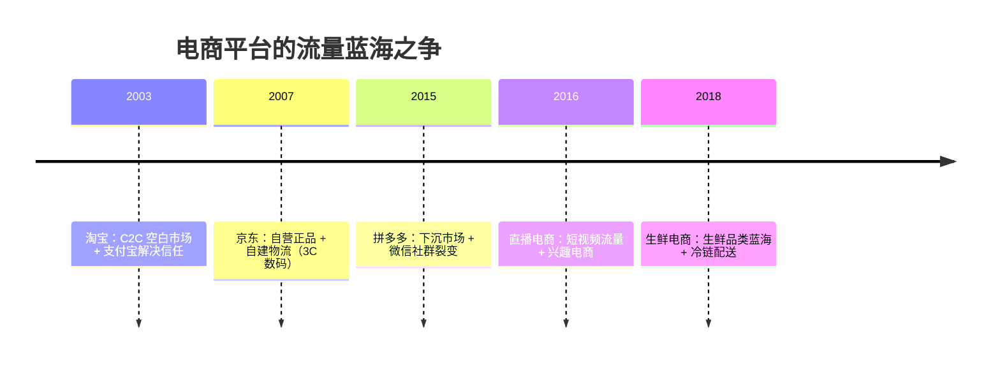
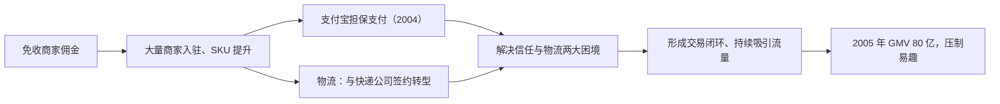
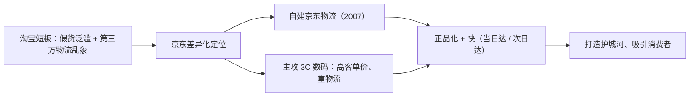
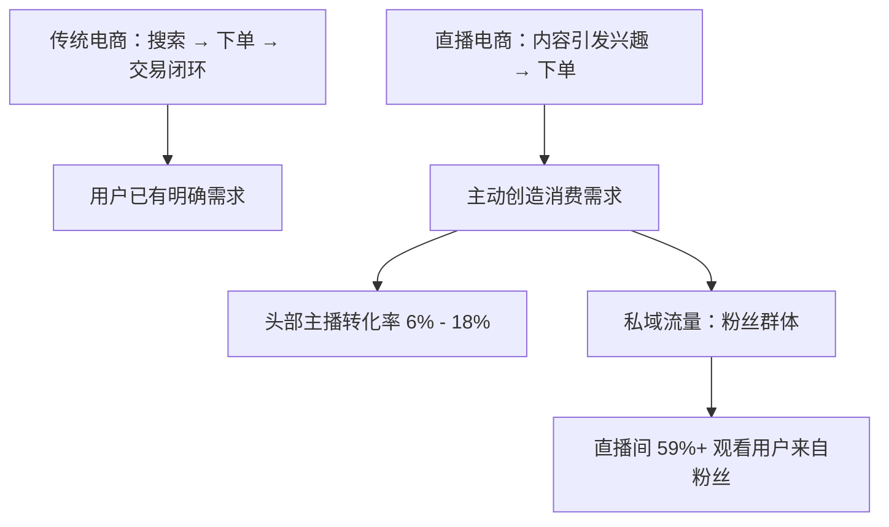
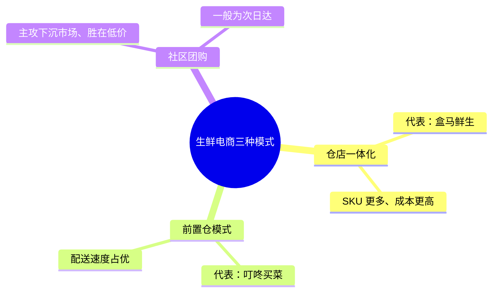
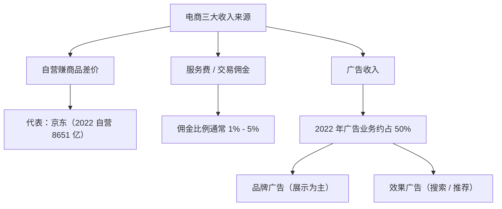
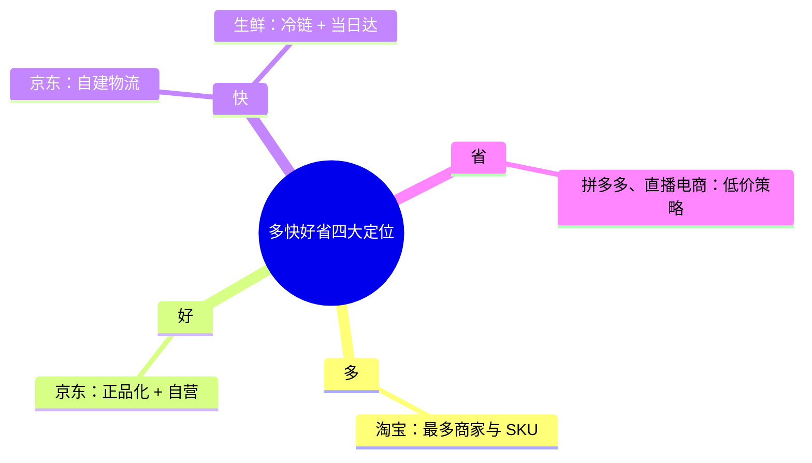
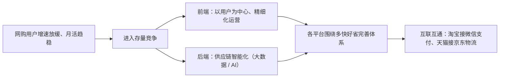

## 一、移动支付与电商的流量战争

2024 年 7 月，你一定被这样的信息刷屏了：支付宝推出"碰一下"支付；2024 年 9 月，淘宝又在陆续开放微信支付功能。这意味着人们买东西时花钱更方便了——将喜欢的商品加入购物车、点击下单，用两个移动支付手段完成支付，可以是扫脸支付、密码支付或者指纹支付，接下来消费者要做的仅仅是等待几天后快递敲门。

而在二十几年前，这还是不敢想的事情：当时人们网购的支付方式只有货到付款，网上支付的比例仅为百分之十几，因为只有 EMS 支持货到付款。如今中国是电商渗透率最高的国家，这背后很大程度上是由我国两大移动支付工具推动的，而这两个支付手段的相继出现，也恰好推动了我国电商发展的不同阶段。

回顾不同电商平台的发展历程，可以明显发现电商发展的本质就是一场流量大战——如今拼杀出的电商巨头，基本都是要抢先一步争夺未被对手开发的流量蓝海。

## 二、淘宝：免佣金价格战与支付物流破局

比起电商巨头，很多人第一时间会想到的无疑是淘宝。淘宝于 2003 年成立，开始与当时如日中天的易趣网分庭抗礼。背靠 eBay 的易趣网在 2003 年的市场份额可以占到百分之七十以上，是当时绝对的行业老大。但仅在两年之后，局面就彻底扭转了——淘宝异军突起，直接将易趣网的市场份额压制到百分之三十以下。

这两年里究竟发生了什么？易趣、淘宝这类 C2C 的电商平台需要靠抽取商家佣金盈利维持运转，淘宝为了抢夺市场打起了价格战，提出三年内免收商家佣金。大量商家入驻提升了平台的 SKU，终极目的都是为了更好地吸引消费者。

淘宝能在短时间内击败易趣网，是因为它解决了当时电商面临的两大困境：支付与物流。当时的互联网尚在发展阶段、技术并不成熟，就国内市场而言，电商更是一个新鲜东西；对于当时的人们来说，安全是网购的首要问题——如何保证我付了款能拿到货、我的售后权益又该如何保障。

2004 年，淘宝推出支付宝。当时银行体系的支付结算系统远没有现在发达，淘宝创立支付宝的初衷并不是要创新支付系统，它更像一种担保机制，这也是目前淘宝交易的基本逻辑：到货之后商家才能收到钱，在此之前钱由支付宝保管，这样淘宝作为中间平台协调了商家与消费者。仅在支付宝推出的三年之后，它的市场份额就占了近百分之五十，交易额规模高达四百七十六亿元，位居第一。

支付问题解决以后，淘宝开始布局物流体系。自 2005 年起，淘宝先后与各大快递公司签订合约，这些快递公司由商务快递商向电子商务快递商转型，成为电商生态系统重要的一环。凭借支付手段和物流手段的革新，淘宝迅速吸引流量、一路高歌猛进：2005 年淘宝的商品交易总额达到了八十亿元，而易趣为五十亿元；到了 2007 年，这个差额扩大到了一百亿元。

但淘宝也不是毫无短板。经历过早期淘宝阶段的人们一定还记得当时假货的泛滥。早些年淘宝通过免佣金吸引来大量商户，这些商户入驻的审核门槛相对较低，无论是个人卖家还是企业都可以注册成为商家，导致了平台上商家质量的良莠不齐，假货问题一直是淘宝难以根除的病根。2015 年淘宝大战工商总局事件，是对这一问题的集中爆发。

## 三、京东：自建物流与 3C 差异化

2015 年 1 月 23 日，国家工商总局发布《2014 年下半年网络交易商品定向监测结果》，淘宝样本数量分布最多，但正品率最低——采样五十一个，正品率仅为百分之三十七点二五。然后淘宝质疑监测过程和结果，向工商总局叫板；随后工商总局发布白皮书，直指淘宝运营存在的五大问题，事件进一步发酵，震动资本市场，导致两天内该公司市值蒸发了三百三十亿美元。

除了假货问题外，与第三方快递合作也有诸多问题，暴力运输、时间长、物品损坏难追责等物流问题长时间困扰着人们。淘宝的假货问题得不到解决、物流运输又有诸多难题，盯住淘宝这两个劣势，一家电商平台开始打造自己的优势、建立护城河——这就是刚转型到线上不到三年的京东。

京东脱胎于一家位于中关村、主营数码产品的实体店。2003 年非典爆发，中关村客流量骤减，为了生存京东被迫向线上平台转型；2005 年京东彻底放弃线下市场，全力向电商平台过渡。2007 年，针对当时的物流乱象，刘强东力排众议，着手打造京东专属的物流体系——京东物流，从北京开始逐渐覆盖全国，并开启了当日达和次日达的快递服务。根据官网数据，截至 2023 年 9 月 30 日，京东物流运营超一千六百个仓库。

借助原先在数码领域的资源积累，京东也瞄准了自己的强势所在——3C 产品领域。这类产品单价高、对物流的要求更为严格，而利用自建物流体系，京东可以极大地保证运输物品的安全，吸引消费者、提升消费者体验。与此同时，京东为了掌握渠道话语权，利用规模实施低价策略，压低了 3C 产品的价格，进一步吸引消费者。2005 年京东的商品交易总额增速高达百分之两百，并逐渐超过其他电商平台的零售增速；在转型到线上的第三年，增速高达百分之三百五十。如今的京东早已从 3C 数码领域拓展到全品类，但其优势品类依然在用户群体中占有较强的心智。

## 四、流量变贵：下沉市场成为最后一片蓝海

对于淘宝、京东以及其他电商平台而言，流量就是王道，新增的流量意味着潜在的消费群体。而互联网在中国经历了几十年的发展，网民的增速正在逐年趋缓：从 2018 年底到 2019 年 6 月，网民规模从 8.29 亿上升到 8.54 亿，半年增长率约为百分之三；而到了 2023 年 12 月，我国网民规模为 10.92 亿，较前一年新增了两千四百八十万人，年增长率仅为百分之二。这意味着流量变得越来越贵，获客成本变得越来越高。

尽管增速在下降，但互联网用户的增长并没有停止，这透露着一个积极讯号：以互联网为代表的商业基础设施正在不断完善。截至 2018 年 12 月，我国手机网民规模达 8.17 亿，手机上网流量达到七百零二亿 GB，而超过百分之五十的新增流量来源于以地级市、县城、乡镇、村庄为主的下沉市场。

与此同时，快递物流系统也在逐渐向乡镇铺开：2014 年我国开始实行快递下乡政策，县级村级快递服务站开始猛增；2024 年我国已累计建成一千二百多个县级公共快递服务中心、超三十万个村级快递物流综合服务站。下沉市场在流量增速缓慢的大背景下还能表现得如此突出，自然也就成了电商平台争夺的最后一片流量蓝海。

## 五、拼多多：微信裂变与极致低价

自从拼多多进入战场，它的打法就是主打下层市场。2015 年，我国手机用户规模约为 6.2 亿，淘宝月活跃用户有 3.86 亿，京东月活跃用户有 1.29 亿，这其中的差值就是拼多多的切入口，而切入的工具是当时深陷电商泥潭的微信。

2013 年淘宝封杀微信，失去了淘宝入口的微信开始布局其他电商平台；2014 年微信与京东达成合作；2016 年上线仅一年的拼多多获得了大厂投资，随后拼多多获得微信钱包的接入口——当时微信支付已经在下沉市场拥有广泛的用户基础，市场份额为百分之三十八点八七，仅次于支付宝。之后恰逢那个时候微信对社群的外部流量管控并不严格，拼多多在合适的时间入场，利用微信的社群流量，通过"砍一刀"、社群拼团等裂变向自己引流，极大地降低了自己的获客成本。

2017 年，拼多多获客成本不超过十二元每人，而同期的淘宝获客成本高达二百七十九元每人，京东为二百二十六元每人。拼多多利用微信社群触及到了淘宝和京东无法触及的用户，但仅仅通过社群裂变吸引来的流量并不足以成为它的活跃用户。要提升复购率、持续提升商品交易总额，拼多多依靠的是专门针对下沉市场的产品设计和价格策略。

前面提到过的 2015 年淘宝大战工商总局事件的后续，便是淘宝为了产业升级开始打假，有一部分被迫退出的中小商家被拼多多吸收。这些中小店家的商品单价低、覆盖了日常消费需求，契合对价格敏感的下沉用户，这些产品特性也与拼多多秒杀、清仓、百亿补贴等产品设计界面相合。这些中小商家的入驻让拼多多不用担心供应链的问题，针对化的消费场景也提高了平台用户的复购率以及商品交易总额，这些元素让拼多多快速崛起：2017 年它的商品交易总额为一千四百一十二亿元，两年以后这个数字上升到了一万亿元。

## 六、直播电商：兴趣驱动与私域流量

拼多多并不是电商基础设施在下沉市场逐渐完善的唯一受益者。随着移动网络、手机等硬件的普及，短视频平台迅速崛起。无论是淘宝、京东还是拼多多，都是传统的电商模式——用户产生购买需求，在电商平台完成搜索下单，形成交易闭环；而直播电商与之最大的区别是，直播电商主动提出消费需求，通过短视频引发兴趣、吸引用户下单购买。短视频平台发展直播电商有天然的优势，这些平台本身就是流量平台，有天然的转化力。

2023 年，两大短视频平台月活跃用户均超六亿，这些用户的单日使用时长均超过了一百分钟，而在这些活跃用户中观看直播是用户的常态选择——截至 2023 年 5 月，两大短视频平台会看直播的用户均超过了百分之八十五。截至 2024 年第二季度，两大短视频平台在直播电商市场共占据了一半以上的市场份额。直播电商兼具社交电商与内容电商属性，一方面通过直播优质内容吸引用户，另一方面通过拉近商家与消费者之间的距离实现较高的转化率。这些直播平台基本都有各自头部的主播，这些头部主播的转化率可高达百分之六到百分之十八。

事实上，直播电商的发展是伴随着传统电商获客成本的不断提高而出现的。在传统电商模式下，利用公域流量拉新的成本已经越来越高，即便是 2017 年获客成本不超过十二元每人的拼多多，也在短短四年后获客成本上涨到了近二百五十元；而直播电商是一个很好的发展私域流量的机会，商家与消费者直接沟通、在直播间引导用户成为粉丝，获取自己的私域流量池。

简单来说，私域流量指的是关注企业、店铺、直播间等有一定忠诚度的用户群体，也就是粉丝群体。在直播间里，百分之五十九以上的观看用户就来自这些群体。尽管头部电商公司的位置难以撼动，但这两家短视频平台仍然以较高的增速在快速发展。2023 年淘宝的商品交易总额增长率为百分之十，而另外两家头部短视频平台增速分别为百分之五十、百分之二十八点二。

## 七、生鲜电商：三种模式与冷链物流

在电商发展得如火如荼的时候，仍然有一块品类需要开发，那就是生鲜食品类。2018 年，食品饮料零售总额的比重在社会消费品零售总额中位居第一，但电商渗透率却仅为百分之五到百分之十，在五大品类中排最后。这其中很大的因素在于食品类保质期的短暂，对运输时效提出了相当严苛的要求，运输成本高而毛利却很低，不适用于传统电商；而外卖物流的发展增加了即时配送的能力，消费者需求也显著提高。

如今八零九零后成为消费的中坚力量，对这部分群体来说，购买生鲜注重便利性与品质，与此同时对生鲜价格敏感度较低；疫情之后更是加强了线上购买生鲜食品等习惯的养成。2020 年中国生鲜电商行业规模达四千五百八十四点九亿元，比前一年增长了百分之六十四。

生鲜电商的模式主要分为三种：以盒马鲜生为代表的仓店一体化模式、以叮咚买菜为代表的前置仓模式，以及社区团购模式。仓店一体和前置仓模式都是为了满足用户的即时需求、能快速配送，但这两者之间有细小差别：仓店一体的 SKU 更多、客单价较高，因此成本较前置仓模式更高；而前置仓模式在配送速度上占优。相比之下，社区团购主攻下沉市场、胜在低价，一般为次日达，在质量和配送速度上不占优势。在目前，生鲜电商正面临着激烈的市场竞争和线下零售的挑战，导致其未来的前景不如其他电商模式那么明确。

## 八、三大电商模式与经营逻辑

无论是淘宝、京东、拼多多等传统电商，还是从短视频平台发展出来的直播电商，还是瞄准了特定需求的生鲜电商，它们的发展是天时地利人和的结果：2003 年易趣网的战略失误给了淘宝一鸣惊人的机会；京东针对淘宝的劣势打造自己的特长、填补了市场空白；拼多多在微信严管外部流量时，已经完成了对其社群流量的收割；而两个短视频的直播电商依托的是网络和物流等基建的全面铺设。可以说，每个电商平台都在不同时间段敏锐地捕捉到了机遇、趁势而起。

但手握流量并不能帮助这些电商平台站稳脚跟，电商是一个需求端和供给端相辅相成的行业，如何利用供给端吸收、留存住这些流量，是电商平台们要思考的重中之重。经过十多年的发展，我国不同的电商平台全面开花，主要形成了传统电商、直播电商和生鲜电商三大类型，这三种电商模式各自拥有独特的经营模式和盈利模式。

淘宝作为典型的 C2C 电商平台，并不拥有货物产权，它只是为买卖双方提供交易平台，发展早期通过不断吸引中小商家入驻，借助多样化的商品、支付宝的安全支付和物流运输形成交易闭环，依靠这个闭环持续吸引流量、完成资本积累、进行产业升级，这就是所谓的飞轮效应。2008 年，淘宝进行产业升级，打造 B2C 品牌天猫，吸引众多知名品牌开设直营店；2023 年，该公司在电商行业中占据百分之三十九点五的市场份额，其盈利的方式依然是后期抽取佣金、服务费以及广告收入。

京东主要是自营业务，也就是 B2C 电商，和线下零售业有些相似，它本质是一种经销商，需要吸引优质的大型供货商与品牌商，以此打造客户口碑、形成良性循环。兼具电商与经销两种身份的京东，实际上也是向这两个行业同时宣战：经销商的身份意味着京东在商品供应链侧有着比淘宝更多的话语权，可以全面把控售卖商品的正版与质量；而凭借品牌优势，京东又可以提供比实体门店更优惠的价格。这便使得京东在淘宝和线下零售门店这两个业态之间找到了差异化。

跟淘宝一样，拼多多为平台模式，但它的 SKU 比淘宝少、非品牌商家更多。相较淘宝和京东，它定位低价策略，这便导致了拼多多曝光策略的不同：在搜索结果中，拼多多会将非品牌低成本的产品排前，加大对小商家小商品的曝光度，以此来吸引对价格敏感的消费者；在拼多多上做生意的商家盈利主要靠薄利多销，由于运营策略的极度简化，商家的运营效率也比其他平台更高。

两大头部短视频平台最开始的电商功能基本为导流，商家在 App 里通过直播、短视频等方式将用户导入到第三方交易平台完成交易，2019 年通过第三方平台达成的交易总额在这两个平台上占据百分之八十二以上的份额。2020 年以后，这两家分别建设自己的电商平台、切断第三方平台链接，降低第三方平台的商品交易总额比重——2019 年两家短视频平台自建电商的比例只有百分之十八，到了 2021 年，其中一家的自建平台比例就已经达到了百分之八十五。两家公司分别在 2020 年和 2022 年切断了所有第三方平台链接，切断外部链接后，它们开始搭建自营电商并逐渐吸引商家入驻，完成从直播引流到货架销售的转变，实现短视频内容、直播和交易的电商闭环。目前这两家短视频平台的电商业务仅次于其他三家电商巨头。

## 九、收入来源：自营差价、佣金与广告

这些电商经营模式的不同，也决定了收入来源的不同。电商的收入来源主要有三种。第一种是自营赚商品差价，这是传统零售的主要商业模式，核心逻辑是通过巨大的规模增加供应链侧的议价权，从而拿到更低成本的商品、拉长应付款账期。平台在享受更低的采购价的情况下，需要承担商品滞销风险、运营好仓储配送的各个环节等，还需要有能力管理好较庞大的组织，总体上链条长、人员庞杂、运营非常复杂，赚的是采购侧的规模效应和经营效率的钱，和传统零售的商业模式非常相似。

目前这种模式主要玩家是京东，其 2022 年自营业务达到八千六百五十一亿元，是全国规模最大的自营业务。在生鲜电商领域，叮咚买菜和盒马鲜生采用的也是自营模式，而其他平台更多作为一种补充策略——例如当洞察到用户有需求、而供给侧还没能很好地组织起来的时候，会通过自营的模式先把业务跑起来，后续再逐步优化。

第二种是收取服务费。这类电商平台不直接售卖商品，仅仅是为各种商家和消费者提供交易平台，需要承担商品的采购、仓储、物流等成本和风险。服务费可分为软件服务年费、交易佣金等：软件服务年费为商家入驻时每年所需要缴纳的费用，这个费用是每年固定的；而交易佣金则是电商平台从卖家的成交额中抽取一定的比例作为自己的收入，佣金比例通常由电商平台根据商品或服务的品类、卖家的信用等因素来决定，一般来说佣金比例会在百分之一到百分之五之间。

佣金模式的优点是对电商平台的运营成本要求较低，同时商家可以通过在电商平台上自主提供商品或者服务，有较大的灵活度，根据自身情况来获得更多的曝光和销售机会，从而提高自己的利润。淘宝、拼多多、两大短视频平台以及社区团购、生鲜电商，它们的收入来源之一就是佣金。

第三种是广告收入。无论是自营电商平台还是平台电商，这都是它们最重要的商业化方式：商家通过电商平台提供的广告系统投放广告，吸引更多的流量和用户，平台从商家处获取广告费用。电商的广告业务在 2022 年约占比百分之五十。广告模式按照广告目的大致分为两种：一种为品牌广告，最主要的是展示广告，广告主通过在电商平台的首页、分类页面、商品详情页面等位置投放广告，向用户展示自己的品牌信息，这个类型的广告以曝光度为主要衡量指标。

第二种为效果广告，这种对广告主具有很强的吸引力，可以帮助广告主更高效地获取更多客户，其中最典型的是搜索广告和推荐广告——搜索广告是电商平台最常见的广告形式，广告主可以通过在电商平台的搜索结果页面投放广告，当用户搜索相关关键词时广告就会出现在搜索结果页面上；推荐广告是依托大数据和计算机算法、近年来各电商平台广告中增长最快的形式，通过准确的推荐系统，广告主通过广告点击率、广告转化率等指标来衡量广告的效果。因此，电商平台的盈利模式和收入来源，均体现了其在供应链管理和满足用户需求方面的深刻理解，以及在激烈的市场竞争中持续创新的能力。

## 十、多快好省：各平台的差异化定位

无论是淘宝、京东，还是短视频电商平台，每家电商平台都会侧重在"多快好省"这四个字的一个或几个方面，有各自的差异性。淘宝主打"多"，拥有最多的商家和最多的 SKU，目前虽然强敌环绕，但仍然保持了一定的竞争力。在琳琅满目的商品中，服饰鞋包是该公司的优势品类，商品交易总额可达一万一千四百七十八亿元，占比在所有品类中最高，达到百分之二十八点六。

京东则是凭借正品化和京东物流在"好"与"快"质量电商发力，在电商早期阶段和淘宝形成了差异化竞争。它的优势类目则是 3C 产品，这类产品的使用周期长，这决定了它们并不是消耗品，消费频次也不高。2012 年，网购数码产品以及家电的消费者比例，相较于购买服装鞋帽、日用百货的比例较低，要想长远发展、吸引新的流量，拓展品类是一条必经之路。从 2011 年起，京东的 3C 产品销售比重剧烈下降，而与之相对的是毛利率的逐年提升；但直到现在，比较典型的家电、3C 等高价值的品类，仍然让京东具有较强的竞争力。

拼多多和直播电商等主打下沉市场的电商平台，则将重点放到了"省"。2023 年的一项调研数据也能看到这些电商为什么会发展得如此之快：2020 年商品的质量还是网购用户最关心的因素，到了 2023 年，最看重的因素变成了价格优惠度。为了摆脱商品质量差、盗版多的标签，2019 年拼多多上线百亿补贴，通过官方补贴降低诸如电子设备、家用电器等正品价格，同时它又简化了复杂繁琐的营销套路玩法、直接最低价，售后服务推出仅退款等，满足对价格敏感的用户需求。

2022 年直播用户中平均月收入五千元以下的用户占比为百分之七十四，这些用户对价格更为敏感；以抖音为例，商品单价普遍在百元以下，短视频平台利用直播优势、利用抢优惠券等方式降低商品单价，进一步增加用户粘度。生鲜电商也将"快"与"好"作为发展重点，其中冷链物流是实现这两点的重要方式。盒马鲜生自 2019 年开始建立全国化冷链物流体系，依靠线下线上齐发力，将传统线下门店转化为前置仓、就近配送，打造社区型消费和当日达的物流链，减少物流成本。另一家公司也从 2021 年起加强冷链物流建设，保证生鲜食品的安全配送，这些涉及外卖业务的公司，在同城短距离配送上具有更丰富的经验，匹配外卖接单、路线规划等有海量的数据，可以帮助其率先占领市场。

## 十一、管理层战略与存量竞争的新出路

面对电商行业的风云变幻，不同电商平台要审时度势、及时调整战略目标，而公司接下来发展的重点从高层背景可见一斑。淘天集团作为传统电商巨头，目前依然受到来自各方的围剿，巅峰时期在电商行业中的市场份额曾一度高达百分之八十，而如今不到百分之五十二。

2023 年 12 月，吴泳铭担任淘天集团 CEO，毕业于计算机系的他将重点放在了 AI 和用户体验上，其推出的 AI 助手"淘宝问问"也是其实现 AI 电商的体现。同时京东网的高层也在经历变动，同年许冉兼任京东零售 CEO，和技术出身的吴泳铭不同，她在财务管理方面有着丰富的经验，而与此对应的是京东实行低价策略与成本体验之间的平衡——优质商品一直是京东网的强项，这个绝不能与低价相冲突。

拼多多的掌舵人黄峥也是技术专家出身，在创立拼多多之前，黄峥曾有三次创业经历，分别是手机电商、电商代运营公司、游戏公司，这三次创业经历让黄峥对流量、运营以及产品交互设计极其了解。而回顾拼多多的崛起，便离不开微信引流、砍一刀等营销策略的运用，这些营销策略提升了用户的使用时长、增加了用户粘性。

和本就是电商出身的前面三家不同，两家头部短视频平台均是内容平台，在电商业务上走得较为曲折。2019 年到 2021 年，直播电商连年亏损，为了尽快扭转这一局面，其中一家公司将电商业务整合为事业部，CEO 程一笑亲自接管，开始大刀阔斧改革，降低品牌商和商家的准入门槛、提供更多流量支持，并逐渐切断第三方导流链接、全力发展电商，半年之后便实现盈利。

2023 年 12 月，王剑伟接任，同时负责广告和电商两大业务，并提出了增强内循环广告的策略，鼓励平台内部商家进行广告投放、增加广告收入，进而提升电商业务的变现能力。而抖音电商总裁康泽宇和中国区总裁魏雯雯分别为产品和广告出身，在康泽宇接手电商业务之前，该业务已经有了几年的蛰伏期，对于当时刚刚接手的康泽宇来说，平台治理是当时发展电商的优先任务，即优化平台对商家用户的服务；与此同时康泽宇提出了兴趣电商的概念，依托一直以来强大的推荐算法将商品推荐到用户面前，实现"提出需求、产生兴趣、下单购买"的闭环。康泽宇接手一年后，中国区电商业务交到了魏雯雯手上，将兴趣电商升级到全域兴趣电商，进而实现货架电商的目标。

电商产业规模巨大，当前已经进入成熟发展阶段。2023 年中国社会消费品零售总额达四十七万亿元，其中网上零售额达十三万亿元，占社会消费品零售总额的百分之二十七点六，这一规模位居世界第一。但与此同时，我国网络购物用户规模增速在变慢：2022 年中国网络购物用户规模为 8.5 亿，而截至 2023 年 12 月，网络购物用户规模达 9.15 亿人，仅较前一年增加六千九百六十七万人；而淘宝、京东和拼多多从 2021 年 12 月、2022 年 3 月到 2023 年 9 月的月活跃用户变化不大、基本稳定，这意味着电商平台均已进入存量竞争。

同时各大电商平台的商品交易总额增速持续放缓，这个迹象从双十一购物节的销售额可以一窥究竟。2019 年双十一购物节全网商品交易总额为四千一百零一亿元，比 2018 年增长了百分之三十，其中花费超一千元的网购用户占比为百分之五十三点一；但在 2023 年全网销售额达一万一千三百八十六亿元，仅比去年增长了百分之二点一，而花费超一千元的用户下降到了百分之二十八点五。这些数字都表明，平台扩张期的粗放增长策略已经不再适用，电商平台和商家要想的是如何依靠更加精细化的营销策略和数据模型来留住这些用户，这些措施可以从前端消费侧和后端供应链侧两个方面来着手。

就前端消费者侧而言，电商平台无一不在以用户为中心，在这供给过剩的时代，讨好消费者是大势所趋，各平台围绕"多快好省"不断完善自己的体系——淘天集团提高淘宝权重、用户为先，而京东重拾低价、投入百亿补贴。而后端供应链侧的发展，则是计算机算法高速发展的应用场景之一，依靠大数据、云计算等技术，电商企业可以推动产业升级，实现供应链侧的智能化和个性化，帮助商家智能选品、预测补货——京东于 2016 年成立事业部，利用人工智能技术预测销量，而淘宝则提出了 AI 驱动、AI 电商的概念。

回顾电商行业的发展，一切都可以说是一场争夺流量的竞争。在这片流量之海里，不同的电商平台互相合作又彼此隔绝；当流量的海域已经拓展到极限，寻找新的出路又成了电商平台们下一个发展的目标。今年 9 月 4 日，淘宝正式官宣接入微信支付，而随后又传出了淘宝天猫接入京东物流的消息，头部电商平台之间的合作无疑透露着一个积极讯息——互联网互通互联的大趋势，减少了相互隔绝的流量竞争。这种互相连通给了用户更多的选择，毕竟在此之前，仍有一部分群体因为没有支付宝而无法在淘宝消费，而现在他们或许终于不用担心这个问题了。
