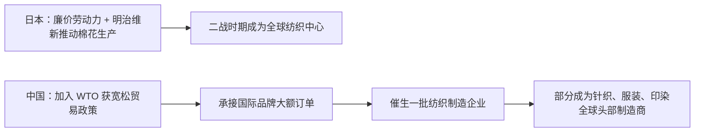
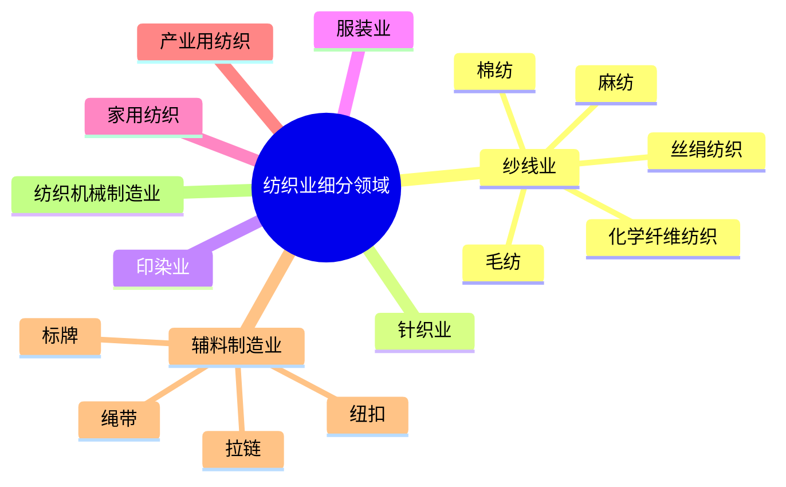
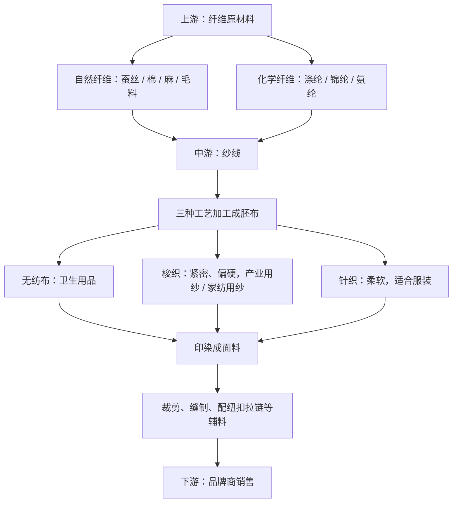
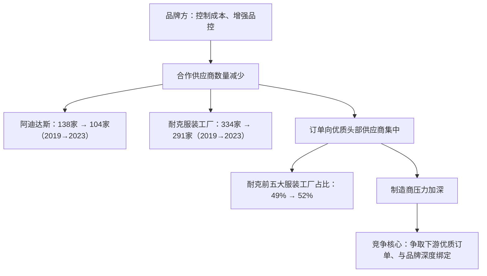
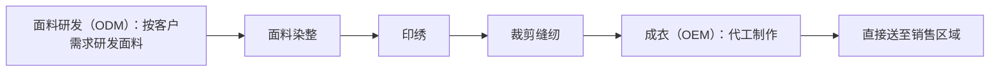
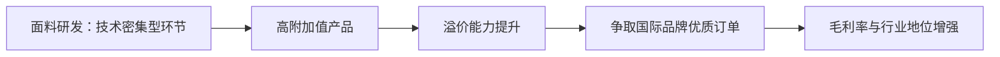
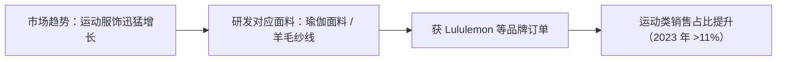
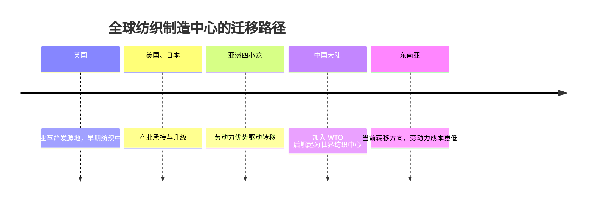
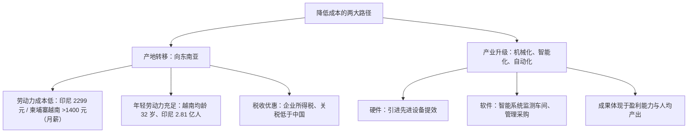
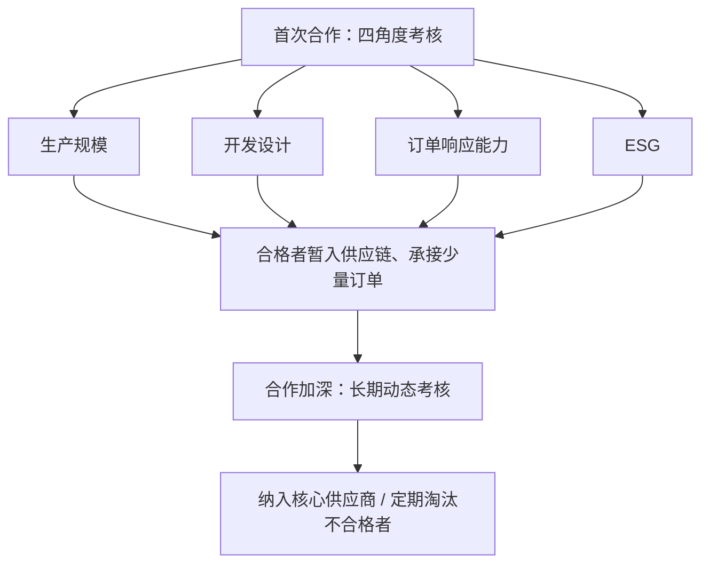

## 一、行业缘起：从《大染坊》到世界纺织中心

很多人看过商战剧《大染坊》，这部剧背景设于清末，主角陈寿亭所在的印染业是纺织业中关键的一环，他的创业历程也是一段逐步与日本人展开商战的过程。而在现实中，日本确实曾是二战时期的全球纺织中心——明治维新时期日本开始积极推动棉花生产，凭借低廉的劳动力大力发展纺织业，在亚洲遥遥领先。

但陈寿亭不会想到，后来的中国也一度成为了世界纺织中心。加入 WTO 后的中国获得了宽松的贸易政策，催生了一批批纺织制造企业。有些企业承接了来自国际品牌的大额订单，紧抓时代机遇，成为了全球头部制造商。这些企业里，既有《大染坊》里重点描绘的印染企业，也有人们日常更为熟悉的针织企业、服装企业等。

##  二、产业链全景：细分领域与上中下游结构

纺织业可以被细分为纱线业、针织业、印染业、服装业、家用纺织、产业用纺织。而根据纤维的不同，纱线又有棉纺、毛纺、麻纺、丝绢纺织、化学纤维纺织等诸多不同的材料。此外还有纺织品必不可少的拉链、纽扣、标牌、绳带等辅料制造业，以及可提供机械的纺织机械制造业。这些不同的细分领域都有着各自的龙头企业。

在这些龙头企业里，有些企业专攻某一种特定的纺纱线，有些企业则从原材料开始构建纺纱生意，还有些企业纵向开拓产品线，涵盖纱线、针织、印染，甚至是成衣环节。纺织业里辅料的地位同样重要，有些辅料制造商会横向布局产品矩阵，范围之广包括拉链、纽扣、衣架、标牌、绳带等纺织物必不可少的配件。

这些企业构成了产业链的上中下游。其中上游主要负责提供纤维原材料，包括蚕丝、棉、麻、毛料等自然纤维，以及涤纶、锦纶、氨纶等化学纤维。这些纤维材料会被运送到中游的制造商企业，由这些企业将其加工成各种纱线。制作完成的纱线会通过无纺布、梭织、针织三种工艺被加工成不同质地的胚布。这些胚布印染之后就被加工成面料，走向三个不同的细分产业：无纺布的使用场景多集中在卫生用品上；梭织纱线制成的面料较为紧密，质地比针织面料硬，常用于产业用纱、家纺用纱；针织面料的质地更为柔软，适合做成服装。

无论是产业用纱、家纺用纱亦或是服装纺织，都会经过裁剪、缝制、配纽扣拉链等辅料，最终成品都会由中游的制造商交付给下游的品牌商，再由品牌商对外销售。在投资领域里，位于中游的制造商和下游的品牌商是重点研究对象——前者几乎涵盖了纺织制造的方方面面，或者直面市场。

## 三、中游制造商的竞争压力：品牌方核心供应商策略

众所周知，纺织业门槛低，竞争愈演愈烈。对于制造商而言，竞争的压力主要来自品牌方近些年合作策略的转变。为了控制成本、增强品控，品牌方的合作供应商不仅没有增长，反而有逐渐减少的趋势。以头部品牌阿迪达斯、耐克为例：阿迪达斯在 2019 年合作的制造商有一百三十八家，到了 2023 年减少到了一百零四家；与耐克合作的服装工厂，则从 2019 年的三百三十四家减少到了 2023 年的二百九十一家。

这意味着订单会逐渐向优质的头部供应商集中。根据耐克财报，其前五大服装工厂在 2019 年的占比为百分之四十九，到了 2023 年则上升到了百分之五十二。在品牌方逐步采用核心供应商策略的情况下，制造商们的压力更深。要想突出重围，就要服务好品牌方——也就是说，他们的竞争核心是要争取到下游的优质订单，服务好这些品牌客户，与这些品牌实现深度绑定。

有了稳定的客户源，不仅能提升利润率，还能进一步加深自己的行业地位，吸引到更多优质的品牌客户。拓展新客户不仅是为了巩固市场地位，更是为了减少经营风险——制造商们并不能采取和品牌方同样的合作策略，而要减少对单一大客户（也就是对单一品牌方）的依赖度。YY 公司作为少数同时拥有耐克和阿迪的制造商，与这两个品牌有着超过三十五年的合作关系，但公司对单一大客户的依赖度较低：2023 年第一大、第二大、前五大客户收入占比分别为百分之四十、百分之二十、百分之八十一，有着良好的客户结构。XC 公司全球市占率达到百分之三点九九，其客户包含爱马仕、Off-White、Burberry 等多个奢侈品牌；2017 年 XC 公司的全球客户数量为三千余家，2023 年提升至五千家以上，合作品牌数量达到五百个以上。

## 四、突围路径一：供应链优化与垂直一体化

为了实现"服务好品牌方、拓展新客户"这两个目标，制造商主要在供应链优化、技术研发、降低成本这三个地方发力。一般来说，制造商上游需要对接纺纱以及面料供应商，下游对接品牌商，无论是沟通周期还是交付周期都比较长。由于沟通环节的增加，在这种传统代加工模式下面料采购和成衣制作存在时间、空间上的匹配风险。

随着全球经济放缓，尤其是疫情之后，各大品牌方对库存的敏感度加重。与此同时，随着消费者追求个性化的心智越来越强烈，服装行业不再像以往一样通过大批生产来满足市场需求，而是出现了小批量、多批次、快速交货的"快返"订单模式。市场需求影响品牌方，进而对中游的这些制造商提出了更加灵活多变的生产需求。

面对这种情况，不同的头部制造商有不同的供应链模式，最具代表性的便是集生产之大成的垂直一体化——也就是说，头部制造商将同一工业领域内的几个生产工序合二为一，从面料染整、印绣，到剪裁缝纫，最后甚至可以将成衣直接送至销售区域，基本包括了服装生产制造的上下游产业链。这几个生产流程涵盖了不同的生产模式：在面料研发环节，制造商采用 ODM 模式，也就是根据客户的要求研发对应的面料；在成衣制作环节则采用 OEM 模式，即代工模式制作成衣。这样便实现了面料生产到成衣制造的无缝衔接，极大地减少了各个环节的衔接时间，一旦确定订单便可立刻开展生产工作，进而缩短生产周期。

在传统成衣制造商的模式下，面料生产和产品制造为独立的两个生产环节，而垂直一体化将其合二为一。从样品确认到最后的包装外发，其生产周期与传统成衣制造相比缩短了近百分之五十。生产环节的精简也减少了物流运输成本，会进一步提高公司的盈利能力。SZ 公司是全球最大的垂直一体化针织服饰制造商，主营业务为运动服饰，营业收入可占到总收入的百分之七十以上；公司主要为客户优衣库、耐克、阿迪达斯专门建立成衣车间，一站式完成从面料到成衣的制作。2019 年和 2020 年，公司的毛利率可高达百分之三十，尽管近年有下降趋势，但也在 2023 年维持了百分之二十四的毛利水平。

## 五、突围路径二：技术研发与面料创新壁垒

纺织行业是一个劳动密集型产业，产业内参与者众多，市场竞争激烈，加上进入门槛低，多数纺织企业的产品技术含量并不高，下游品牌商的选择余地大，也就造就了制造商溢价能力偏弱、利润率低的局面。根据国家统计局的数据，2023 年我国规模以上纺织业、服装服饰业、化学纤维制造业企业营业收入利润率分别为百分之三点七、百分之五点一、百分之二点五。

但在纺织业庞杂的生产流程里，只有一块环节为技术密集型，存在着技术壁垒，那就是面料研发。这是制造商生产高附加值产品的关键环节。面料的好坏直接关系着鞋服的舒适度、安全性与功能性，这些性能又直接影响着产品在市场上的销售情况，因此面料研发能力是国际品牌方选择制造商的重要考量之一；而那些能自主研发面料、有着技术优势的制造商，其溢价能力也要高于一般的制造商。

2012 年，FT 公司放弃的耐克 Flyknit 面料订单由 SA 公司承接，该公司投入七亿元及数千台设备用于研发生产 Flyknit 面料。Flyknit 的大获成功，让其不仅获得了耐克的优先供货权，凭借其技术优势也获得了更强的溢价能力。而对于 YY 公司、FT 公司、埃雪尔公司等这些制造商来说，近年来的平均销售单价也呈现不断上升的趋势，这侧面说明了其产品有较高的附加值，下游品牌方愿意为其买单。

## 六、行业敏锐度：卡位运动服饰高增长赛道

除了技术研发能力之外，行业敏锐度也是头部制造商必备的素质之一。疫情之后，随着户外运动、女子运动风潮兴起，运动服饰行业成为各类服装业中为数不多迅猛增长的产业。以 Lululemon 为代表的瑜伽服饰品牌在中国开始迅猛发展。为了能紧跟时代，SA 公司开始着手进行瑜伽面料的研发生产，并在 2022 年获得 Lululemon 的第一笔订单，成为其成衣供应商之一。此外，诸多本土运动品牌与该公司合作份额提升，2023 年这些品牌为其贡献了超过百分之十一的销售额，较 2022 年有所提升。

同样看准了运动服饰潜能的还有 XA 公司。该公司于 2016 年开始探索羊毛纱线在运动领域的应用，开发涵盖瑜伽、滑雪、徒步、登山、攀岩等各类运动场景的纱线；2022 年输送给运动品牌客户的纱线销量比重为百分之二十五，较 2021 年上升了百分之五。为了在动态的市场中维持核心供应商的地位，这些制造商普遍都在研发人员、技术上大笔投入，并且通过申请专利来进一步保持自己的技术优势地位。WX 公司从 2016 年增大研发投入，先后成立拉链技术研究中心、中国辅料行业首家国家级实验室、博士后研究工作站等研究机构，始终保持在百分之四以上的高研发费用率；2023 年研发人员占比为百分之八点零二，其授权专利高达一千二百七十项。BL 公司、XA 公司在纺纱上的研发投入均超过一亿元：前者不断通过工艺改进来增强色纺纱的染色稳定性，减少甚至不用盐、碱来实现绿色环保，以此满足我国棉纺织业绿色转型和欧盟对进口纺织品的绿色环保要求，并有对应的代表纱线；后者则通过采用紧密纺、涡流纺、包芯纺等行业先进工艺，让纱线在弹力、柔软性、抗起球等衡量指标上均有不错的表现。

## 七、突围路径三：降低成本——产业转移与产业升级

服装行业作为和人们日常生活息息相关的行业，极易受市场波动影响。无论是上游诸如棉花原材料的价格上涨，还是下游受经济形势影响、居民消费水平的波动，都可以极大地影响制造商的盈利能力。为了提升抵抗风险的能力，制造商会想方设法减少生产成本。制造商普遍采用的定价模式为成本加成模式，即定价由产品材料成本、人工成本、制造费用以及一定范围内的利润确定，成本的降低无疑可以提升利润率。

制造商们减少成本的方式主要有两个：一个是产地转移，一个是产业升级、提升智能化。产业转移是经济发展到一定程度必然需要经历的阶段，纺织服装作为典型的劳动密集型产业，跟随劳动力优势迁移的趋势非常明显。在历史上，它先后经历过从英国、美国、日本、亚洲四小龙到中国大陆的迁移；而现在，纺织工业在向东南亚转移。中国纺织工业承接来自国际品牌商的订单已近几十年，逐渐完成了经验积累与资本积累，减少对人力的依赖，向着高附加值产业升级。

2023 年，我国纺织工业形成了三十项国家标准、四十二项行业标准和七十五项中国纺织标准，这意味着纺织工业正在远离粗放型发展方式。而在这个阶段里，国际品牌商也在逐年减少中国进口率，加速向东南亚转移产业链。以鞋靴为例，美国和欧盟从中国进口比率在逐年减少，与之相对的是从越南进口率的提高：耐克于上世纪九十年代末便开始了在越南的产业布局，鞋类产量从仅为百分之二上升到了 2023 年的百分之五十以上；中国产量则从 2000 年的百分之四十三下降到了 2023 年的百分之二十以下。

随着品牌方产业链转移的趋势，最大纺织制造商同样在向东南亚转移，在越南、柬埔寨、印尼等地设立分公司、开设工厂。东南亚的主要优势在于劳动力成本低廉，同时为了鼓励纺织业发展还推动了一系列税收优惠政策，可以极大降低生产成本。作为劳动密集型产业，生产地的人力成本和劳动力结构对纺织制造商的利润有着重要影响。从人力成本来说，越南、柬埔寨、印尼、缅甸等地的最低工资水平都比中国低：2024 年印尼平均最低工资约为两千两百九十九元人民币，而柬埔寨、越南的最低工资水平折合成人民币约高于一千四百元。

在劳动力结构方面，东南亚地区的另一个优势便是年轻劳动力充足：截止 2023 年，越南人口约为 1.003 亿，平均年龄为三十二岁；柬埔寨人口约为一千六百万，10 岁到 35 岁人口超过总人口的一半；印尼是世界第四人口大国，人口规模为 2.81 亿，平均年龄为 29.7 岁，15 岁到 55 岁人口占总人口的百分之五十九。年轻劳动力丰富，为了大力发展纺织服装业，越南、柬埔寨、印尼等国家推出一系列优惠政策来吸引外资建厂，奖励措施之一便是税收优惠——这些国家的企业所得税率、关税要低于中国，如 XA 公司在越南的工厂在三年启动期和两年免税期内可享受企业所得税免税优惠，四年减半期内享受企业所得税减半优惠。

随着美国、欧盟等地逐渐提升东南亚进口的占比，东南亚国家的纺织业在快速发展，已经是全球服装的主要生产地和出口地。越南的纺织服装较为发达，而印尼则是全球第八大服装出口国，柬埔寨的服装制衣出口额约占全国出口额的百分之六十。运动鞋服类制造商很早就开始了向东南亚的转移：YY 公司于 1992 年在印尼建厂，三年后 FT 公司也来到印尼建厂，另两家公司的产业也在 2005 年开始向东南亚迁移；纺纱类、辅料类企业相对而言布局较晚，该转移已是趋势，至今并未结束。贝尔公司于 2012 年在越南建成，WX 公司于 2018 年在孟加拉建厂，而 XA 公司则是在 2022 年开始在越南建厂，该工厂于 2024 年 3 月正式投入生产。

投资建厂只是转移的第一步，第二步是逐步释放在东南亚的产能。2023 年，XA 公司在越南和柬埔寨本地的员工比例分别占集团员工总人数的百分之三十五点三和百分之二十三点四，超过了总人数的百分之五十，其一办以上的产能产出就来自这些海外工厂；YY 公司在印尼和越南的产能也在稳步提升，占到了总产能的百分之八十以上；户外鞋履制造商 YQ 公司在中国的产能从 2014 年的百分之六十七降到了 2023 年的百分之二十五以下，而越南工厂则承接了一半以上的产能。

除了向东南亚迁移转移成本外，近年来各大制造企业也在产业升级，通过提升机械化、智能化、自动化来降低生产人力成本、提高效率，其成果将最终体现在盈利能力和人均产出上。其大背景是我国针对纺织服装的战略布局与政策支持：2015 年 5 月，国务院印发《中国制造 2025》，开始推动制造业的结构调整，支持制造业高端化、智能化、绿色化。纺织服装的制造商们，一般会从硬件和软件两方面来进行产业升级。硬件上来说，制造商们会通过引进先进技术设备来提高生产效率；而与之搭配的，都是各种各样的软件系统，这些软件系统专门负责监测车间生产状况、管理情况和采购情况，通过智能化监测来提升生产车间对订单的响应能力、计划完成率、库存管理准确率等指标。

SZ 公司位于越南西宁省的得力工厂则为公司贡献了一半的面料产能，产能可达每日四百吨；越南工厂的刺绣车间仅有二百八十名工人，可实现每日十五万件的产能。WX 公司从 2016 年起从软硬件着手打造智慧工厂，依靠进口设备提升制造水平，并且配备了智能管理软件，实现对工厂生产的智能化监控，在销售管理和采购上均有明显的进步：如订单交期缩短了约二十四小时，采购周期平均缩短了约三十六小时，而库存统计准确率则达到百分之九十五到百分之九十八。

## 八、品牌方的供应商选拔与动态考核

制造商所做的这一系列市场策略，都是为了迎合品牌方的生产需要，取得他们的青睐。无论是 Prada、Burberry、MaxMara 等奢侈品牌，还是优衣库等大众服饰品牌，对于他们而言，选择一个良好的中游制造商至关重要——这不仅关系着服装本身的质量，还涉及到产能、供应链成本等一系列运营问题，这些所有的元素都关系着一个国际品牌的市场地位。因此，品牌方们有一套长期严密的选拔过程。

对于首次合作的制造商，品牌方会从生产规模、开发设计、对订单的响应能力，以及 ESG 四个角度考核。合格的制造商会暂时进入品牌方供应链，承接少量订单；随着合作的进一步加深，品牌商会长期动态考核，决定是否将制造商纳入核心供应商，并定期淘汰考评不合格的制造商。

对于优衣库来说，多种生产合规问题和人权问题为零容忍问题；而阿迪达斯会不定期考察工厂，主要指标为环境方面的 E-KPI 和合规方面的 C-KPI；耐克则根据产品质量、产品交付及时性、采购成本和可持续发展能力四个评价维度，将供应商分为红、黄、绿、蓝等五个等级，其中最低等级为最低合作要求。这些品牌方通过动态考察制造商，持续淘汰掉不合要求的制造商。市场变动左右着品牌方的策略，而这些策略又会深深影响与之合作的制造商们。

## 九、结语：轰鸣车间里的持续产出

但无论纺织服装经历着怎样的生产周期与产业转移，车间的工人们依然要操作不同的纺织器械，在机器的轰鸣声里持续产出纱线、布料，用剪刀、缝纫机裁出衣物。这件衣服或许出现在公园的跑道上，或许被展示在巴黎的 T 台上，为"衣食住行"这个词源源不断地提供着新的注脚。
