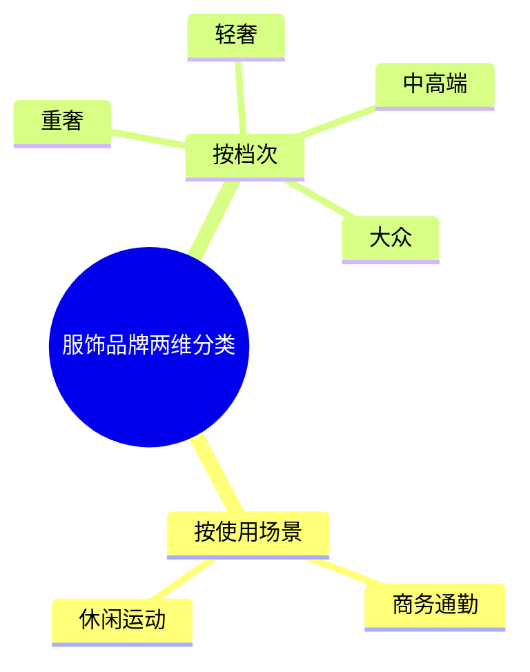
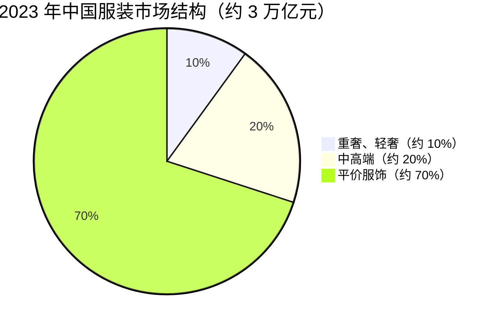
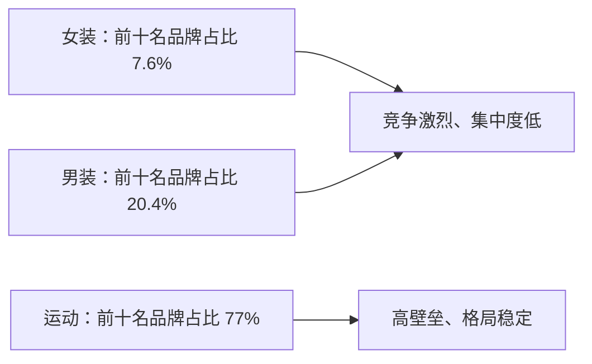
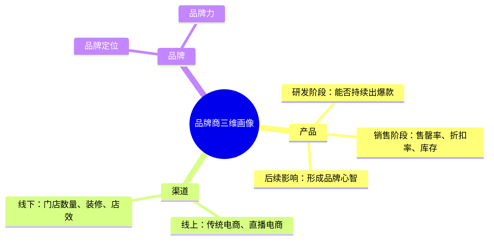
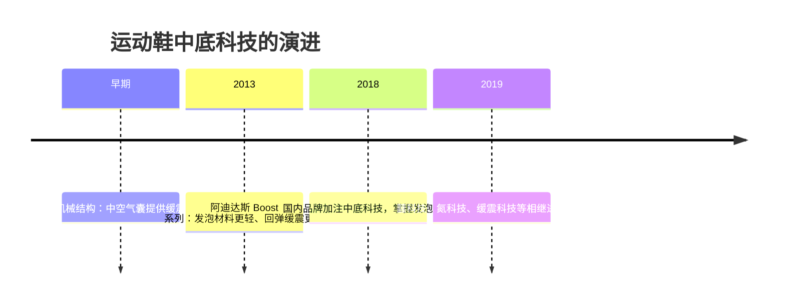
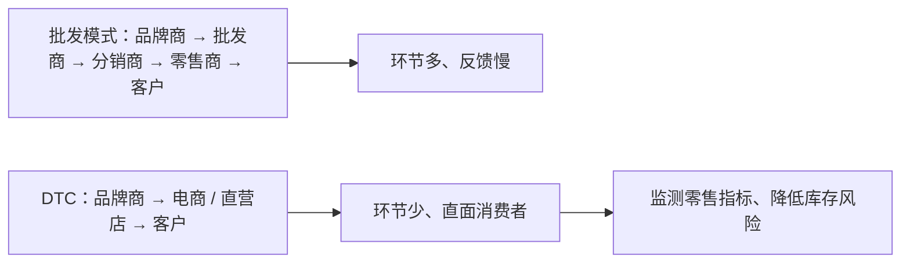
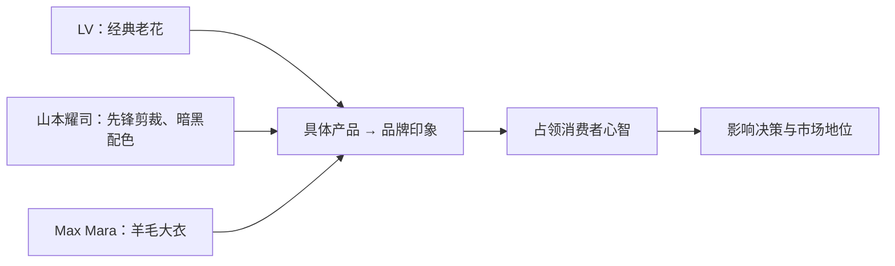

## 一、场景需求与服饰的多元含义

聚会、典礼、跑步、家居、通勤、面试、游乐——人们多半会为这些不同的场景选择不同风格的服饰。当服饰逐渐脱离最基本的功能需求，它们被赋予了更为具体而多样的含义：它们是个性的具象化，是态度的表达，是心情的外露。丰富多样的需求催生了服装市场的繁荣。

如果说纺织服装制造商的需求基本由品牌商决定，那品牌商生产不同类别服饰的动力，则来源于人们日常生活中对不同场合着装的需求。

## 二、两维分类与 3 万亿市场结构

家居、运动、通勤、正装和休闲，这些服装的不同不仅体现在使用场景上，也体现在价格上，市面上的服饰品牌也可以按照这两个维度分类。按照使用场景，服饰品牌可以分为商务通勤、休闲运动；按照档次，又可以分为重奢、轻奢、中高端以及大众品牌。而这两个分类的不同交集，则诞生了更为垂直的服饰类别。

当商务通勤和休闲这些场景遇到重奢，就是人们所熟悉的 PRADA、爱马仕、迪奥等经典重奢品牌；轻奢之下则是 Theory、Michael Kors、COS、Coach 等品牌；而更多的服饰品牌，则集中在中高端和大众这两个档次里，主要由通勤服饰、休闲服饰、时装、平价服饰和渠道品牌构成。中高端领域的服饰品牌以之禾、玛丝菲尔为代表，大众服饰品牌则主要由以纯、热风等品牌构成。在运动服饰品牌里，主要有顶尖运动、中高端运动和大众运动三类。

2023 年，这些多样的品牌共同构成了中国服装市场约 3 万亿元人民币的市场规模：重奢和轻奢约占市场规模的 10%，中高端约占 20%，而平价服饰品牌则占据了 70% 的市场份额。

## 三、市场表现与行业集中度

这些服饰品牌的市场表现力也不尽相同。近些年，顶尖运动和中高端运动类别涨势最为迅猛。其实在疫情之前，运动类别的市场规模增速就是最高的；疫情之后，消费者的健康意识提升，诸如滑雪、攀岩等运动开始流行，这些因素进一步推动了运动类服装品牌的繁荣。2021 年，也就是疫情后的第二年，运动服饰市场规模增速高达 21.6%；2023 年则依然保持着 10.8% 的两位数增速，远比男女服饰要高。

重奢服鞋的品牌效益非常明显，行业壁垒高、格局较为稳定；而传统轻奢品类的增长较为乏力，小众设计师品牌则快速增长。市场占比最多的中高端品类和大众品类，市场集中度低，各个品牌的竞争远比其他品类要激烈。运动品类和高奢品类一样，行业壁垒较高，这种高壁垒主要是由运动专业性决定的。

整体而言，中高端和大众领域的女装行业竞争激烈，女装的行业集中度低。2023 年，女装前十名头部品牌的市场占比仅为 7.6%，男装前十名品牌占比则为 20.4%，而运动品类下该数值高达 77%。

## 四、多品牌策略：主品牌主导

与运动服饰的高集中度不同，女装、男装品牌服饰为了降低经营风险、尽可能涵盖更多客户群，头部企业基本都会实行多品牌策略。这些品牌的风格调性均有不同，但新品牌的发展往往考验着公司整体的运作能力和产品能力，很难突出重围——对销售额贡献最大的，依然以一到两个主品牌为主。

GH 公司 2023 年的营业收入约为 45 亿元，其中主品牌为其贡献了 77% 的营业收入；地素时尚 2023 年的营业收入约为 26.44 亿元，旗下两个主品牌的营业占比分别为 53% 和 38%；另一家朗姿股份，其主品牌营业收入占比也高达 70%。

## 五、三维画像：产品、渠道与品牌

不同的市场格局，也深深影响着不同品牌的竞争策略，这些策略也是我们在投资研究中的重点，主要分三个角度，分别是产品、渠道和品牌形象，这三个角度共同构成了品牌商的三维画像。

从产品这个维度来说，主要分为三个阶段：第一个阶段是产品研发阶段，看品牌商是否有能力持续推出爆款产品；第二个阶段是产品销售阶段，主要看产品的售罄率、产品折扣率、库存压力，以及能否通过更少的折扣获取更多的销量；第三个阶段主要看产品的后续影响，即能否通过产品持续形成品牌心智。

渠道主要研究线上渠道和线下渠道。线上渠道即电商，针对传统电商和直播电商，品牌商有不同的产品策略、推广策略；线下渠道即门店，门店数量、装修风格、店效、终端渠道运营效率，都可以反映出品牌商的总部策略和门店执行情况及落地效果。

从品牌这个角度来说，首先研究的是品牌定位——一个品牌所处的是大众市场、中高端市场还是奢侈品市场，是非常直观的；第二个要研究的是品牌力，这个指标虽然很难量化，但可以通过线下渠道和营销资源来一窥究竟。就线下渠道而言，主要看品牌能否入驻甲方物业、是否有能力获得更好的区位和所需的面积，以及能否获得更低的租金或者扣点；从营销资源来说，则主要看品牌能否获得较为优质、稀缺的代言资源或者活动赞助。除了这三点之外，对供应链和经销商的把控，以及企业内部的管理团队、组织架构、企业文化，都会影响一个企业的发展。

## 六、产品：从爆款研发到品牌心智

近些年，国内品牌呈现出了更加多样、新潮时尚的设计，这其实也在透露着另一层信息：消费者对国内品牌的认可并不仅仅来自于情感因素，更重要的是，这些品牌在服饰、鞋履的设计和研发方面有了长足的进步，可以日益满足不同人群个性化、时尚化的精神需求。审美的多元化推动着服鞋设计的繁荣，这一时尚趋势在女装领域表现得非常明显。

这是因为女性服鞋一直占据着中国服装业的半壁江山。2023 年，中国女装的市场规模约为 10886 亿元人民币，占服装总规模的 48%，女鞋约占鞋类市场的 47%。庞大的体量意味着广阔而多样的消费群体，服鞋企业往往会开创多个品牌线，或收购其他品牌，来满足更多层级消费群体的需求。这些品牌线在延续了企业统一调性的同时，还会通过设计、剪裁、面料来凸显定位的不同，以便触达更多的消费群体，这样既不会因为盲目追赶时代潮流丧失品牌内核，也避免了与市场脱节。

以朗姿股份为例，其旗下既有面向都市成熟女性、剪裁风格以优雅为主的 LANCY FROM 25（现多简称为 LANCY 朗姿），也有面向都市白领、突出活泼个性时尚的莱茵（LIME），还有高端职业知性风的 LIMEFLARE，以及以国风为主、以云锦为主要面料的 MOJO.S.PHINE 等品牌。如今职场环境对穿着的要求日益放松，很大程度上推动了新式通勤的流行——在保持体面的同时融入休闲元素，更多地体现个性化。这样的趋势也一定程度上影响着人们对运动、休闲类服饰的喜好。

以男装为例，T 恤、休闲裤、卫衣等休闲类服饰更受欢迎，而西服这类传统的商务装排名则相对靠后。这样的喜好影响着男装品牌的产品设计策略。为了拓宽用户群，男装品牌也在持续推出休闲化、年轻化的服饰。报喜鸟的优势产品一直是传统的中高端西装服饰，除了私人定制西装外，该公司从 2019 年开始陆续推出轻商务和运动西服系列，以此来贯彻年轻时尚的市场策略。轻商务和运动西服的价格带普遍在 853～3870 元、1284～3970 元之间，而传统的正装一般在 2380 到 4230 元之间。截至 2023 年上半年，这两条产品线占据西装销售额的 15% 到 20%，是增速第二的销售品类。

年轻化的另一个重要方式就是国潮。近些年国潮服饰的兴起，也成为了头部品牌商们不可忽视的潮流。2017 年到 2023 年，国潮鞋服市场的总规模从 4071 亿元增长到了 9928 亿元。而设计人才的涌现与成长，也为品牌提供了源源不断的生命力。李宁通过培养设计师，以接近设计师品牌运作的模式，将运动元素与国风元素结合，发布了大量具有市场影响力的产品；2022 年，该公司又与 ACU 公司合作，将中医药设计元素与西方街头运动风格结合，推出联名鞋款。

近年来，各个服饰品牌加大了研发投入，其投入重点主要集中在面料研发上。对于头部品牌而言，面料的质量至关重要。和制造商一样，品牌商每年也会在天然面料和科技面料的研发上投入大量资源。锦泓集团旗下高端女装品牌 V-GRASS 采用棒槌蕾丝、南京云锦、苏绣丝绸等面料，开发出了具有代表性的夏日艺术蕾丝系列、云之锦系列和新丝绸系列。报喜鸟的研发人员占比从 2022 年的 5.42% 上升到了 2023 年的 6.33%，而研发费用则从 2022 年的约 8000 万元上涨到了 2023 年的 1 亿元，增长了 30.34%，占营业收入的 2.07%。传统商务西装的档次主要由面料和剪裁决定，除了与意大利、法国等知名面料供应商合作外，该公司也与东华大学合作推进面料研发；而在运动西服和轻商务系列上，其研发的面料比传统西装面料更轻、也更抗皱，减少了传统西装的束缚感。

与传统男装、女装不同，为了凸显专业性，运动品牌对产品的科技性要求更高。为了满足这部分研发需求，各运动品牌公司均设立研发中心，配备科研级别实验设备，设置运动生物力学、鞋类机械测试、矫形等实验室，为鞋服两大部分产品的研发提供技术保障和科技支持。在运动鞋方面，各个品牌主要集中攻克中底科技。

运动鞋主要由鞋面、中底和外底三个部分组成：鞋面负责包裹性、透气性、美观性；中底则体现着运动鞋的舒适感、弹性和缓震性能；外底需要耐磨防滑。一双运动鞋在体育竞技场上的表现，很大程度上是由中底决定的。早期运动鞋的中底主要是机械结构，由中空的气囊提供缓震需求，但人类在竞技场上不断刷新的体育纪录，却对运动鞋的轻质提出了更高的要求。

2013 年，阿迪达斯 Boost 系列横空出世，所采用的发泡材料更轻，回弹性和缓震性能都比机械结构优越，这个系列的出现也掀起了用发泡材料而非机械结构制作中底的浪潮。2018 年，国内运动品牌纷纷加注中底科技，逐渐掌握不同的发泡技术，并可以保证较高的良率；2019 年开始，䨻科技、氮科技、缓震科技等产品开始进入市场。国内运动品牌主打性价比的同时，由于科技含量的提升，也逐步具备了一定的议价能力。李宁旗下的超轻系列跑鞋，在搭载䨻科技之后，产品售价有明显提升。

而无论是产品设计还是产品研发，都是为了丰富产品线、扩展产品矩阵。在设计阶段，产品丰富度可以通过市场调研、潮流趋势和消费者洞察这三个维度调整；而在运营阶段，则可以通过产品陈列和上新频次来补充完善。

## 七、渠道：从批发为王到 DTC 与全渠道

市场变动带来的不仅仅是产品方面的革新，还有企业被迫转变的经营模式。2001 年到 2010 年之间，中国服装行业需求属于大规模爆发阶段，那个时候"批发为王"，通过大规模的批发订单响应市场需求；而中国本土服装品牌依靠"代理 + 加盟"模式，通过大批量供应实现了低成本的快速扩张。然而这样的批发模式并没有让品牌商直面消费者群体，经销商对市场的反馈往往需要很长时间才能回馈给品牌商，自然也难以顾及消费者对"撞衫"的敏感度和对个性化的多样需求。

2012 年服装行业爆发库存危机，滞销在仓库中的数万件衣物，每多停留一天就多贬值一天，不少品牌纷纷出现了闭店潮。安踏体育在 2012 年的净利润为 13.59 亿元，比上一年下滑了 21.5%，这是该公司自 2007 年上市以来首次面临业绩下滑的情况。库存危机迫使头部品牌开始尝试转变渠道模式，由此引起了产业链的 DTC 改革。

与传统的批发零售模式相比，DTC 减少了中间环节，直接由品牌商经由电商或直营店卖给客户；而批发模式则是要经历品牌商、批发商、分销商、零售商等多个环节才能抵达客户。DTC 模式削减了经销商层级，甚至有品牌商将商品直接卖给客户，更好地触达市场，通过监测零售指标，降低库存危机再度爆发的可能性。在这方面最典型的是 TB 国际。该公司于 2015 年开始 3 年变革及品牌转型，2016 年对外部进行分销渠道扁平化改革，改革后的渠道由原来的 4～5 层分销商精简为两层分销商，其中超过 60% 的门店由约 40 家独家分销商运营。直营大型品牌在渠道端的转型主要从两个方面着手：一个是铺设线上电商平台，另一个是增加线下直营店的比例。

女装的电商渗透率一直较高，再加上 DTC 的改革，各大女装品牌加大了线上渠道的投入。2023 年，朗姿股份在天猫渠道的支付金额比 2022 年增长了 57%，618 期间其天猫店单店支付额突破了 9000 万。与女装相比，男装的电商渗透率较低，2022 年一些知名品牌的电商渗透率也仅为 18% 到 20%，但男装品牌的电商增速要高于女装品牌，线上销售占比在逐步提升。HL 公司线上直营收入占比从 2019 年的 6.9% 增长至 2022 年的 18.2%；同期另两家公司的收入占比也有所上升，其中一家从 15.2% 增长至 20.3%，另一家从 11.1% 增长至 13.1%。在销售额方面，报喜鸟的线上销售额从 2019 年的 4.2 亿元上涨到了 2022 年的 7.9 亿元，而另一家公司在 2020 年的线上销售额为 9800 万元，2022 年上涨到了 1.95 亿元。

运动品牌对不同电商平台的使用则较为彻底，在不同的平台上有着明显不同的销售策略。除传统天猫、京东、唯品会等平台外，各品牌纷纷增加短视频平台、小红书、得物、拼多多等平台的销售比例：短视频平台以直播为主，主要负责推广新品和重点款式；小红书平台则多与 KOL 合作；得物上主要涵盖产品评测等专业性内容；而拼多多则主要为这些品牌承担去库存的功能。

在线下渠道方面，各个服饰品牌也在提升直营店比重，通过精简渠道架构、直面消费者，可以实现更精细化的门店标准和终端运营管理。在配送效率方面，则可以实现物流总仓向直营门店直配铺货、补货及调拨，有利于提高库存协同效益，实现直营门店全国范围灵活配货。再加上近些年来大企业都在品牌升级，这样做可以快速将"人货场"运营标准统一至门店，进一步塑造品牌形象。

近些年很多品牌都加大了入驻购物中心、建立直营店的力度。以安踏体育为例，该公司于 2020 年推出 DTC 改革，其中 60% 的分销商直营部分转为公司直营，余下 40% 仍为加盟商管理，首批 DTC 转型涉及的门店约有 3500 家。2023 年，DTC 直营店为该公司带来了 170 亿元的收入，占总收入的 56.1%。其他品牌直营店的收入比重也在逐年增加：2023 年 BY 公司的直营店收入可占其总收入的 67.73%，较上一年提升了 6%；另一家报喜鸟 2022 年的直营店数量有 746 个，2023 年增加到了 793 个，营业收入占比从 2022 年的 33.63% 上升到了 2023 年的 39.76%。

直营店对品牌商们的意义并不仅仅只是直接触及消费者，更重要的是，通过数字化系统和库存互联互通，可以更好地掌握销售数据和库存情况，赋能线下门店，进一步提升运营效率。李宁通过与阿里云合作，在线下门店推进全场景数字门店解决方案，利用云价签、云货架等功能，帮助消费者实时了解商品信息和个性化搭配方案，实现从进店试穿到成交的完整交易闭环；此外还通过人流热力监控系统等分析平台，了解商品销售情况、消费者个性化需求分析，及时跟进销售策略。

但线上线下渠道并不是彼此孤立的。无论是男装、女装还是运动品牌，头部企业都在努力打通线上和线下渠道，实现品牌全渠道建设：先进行线上引流，再利用线下门店提升 VIP 客户体验、实现会员权益线上线下共享，通过更便利的会员服务，让经营更加精细化。渠道优化除了可以更灵活地掌握市场情况外，还可以带来存货周转的缩短。存货周转越快，说明存货转换收入的速度就越快，对运营资金的使用就越有效率；而存货周转慢则意味着变现时间长，最终势必会降低企业在市场中的竞争优势。

## 八、品牌：形象塑造与代言营销

无论是产品策略还是渠道升级，终归会影响到这些企业的品牌形象。提起 LV，人们首先想到的是经典的老花；提起山本耀司，人们想到的是先锋的剪裁和暗黑的配色；提起 Max Mara，人们想到的是剪裁得体、面料优越的羊毛大衣。这些具体的产品之下，暗含着人们对这些品牌的印象。具体的形象与抽象的印象并非一蹴而就，而是各个品牌历经多年植入人们心中的概念，是品牌名称的外延。可以说，正是因为这些形象，品牌的名字才有了意义。

品牌形象影响着消费者的决策，进而影响品牌的市场地位。正因为如此，各个品牌企业会通过建立独特的品牌形象来占领消费者心智。品牌商们会通过选择知名度高、名誉较好的明星来作为代言人，而同一企业下的不同品牌，还会通过代言人的选择来突出品牌之间的差异性。隶属于地素时尚集团的 DAZZLE、DIAMOND DAZZLE 和 d'zzit，就分别邀请了刘雯、舒淇和周冬雨作为其品牌代言人，以体现不同品牌的差异化定位。

从 1998 年开始，报喜鸟先后与任达华、任贤齐、古天乐合作；从 2020 年起，该公司宣布邀请张若昀作为新的品牌代言人，此后又陆续与脱口秀演员庞博、演员张云龙和方逸伦等艺人合作，这些艺人的粉丝多集中在年轻一代。2020 年，报喜鸟又与中国设计师先锋品牌合作推出限量系列，持续在消费者心中夯实年轻潮流的形象。

作为迅猛增长的运动鞋服类各个龙头品牌，为扩大在运动人群的影响力，从运动赛事、体育明星代言、联名活动等策略增强品牌建设。头部几个国内运动品牌，广告营销费率普遍在 8% 到 13% 之间，这些头部品牌更容易掌握稀缺的营销资源，例如赞助体育赛事、与国际体育明星合作等。在具体的赛事和明星选择上，这些头部品牌也有明显不同的偏好：从 2009 年到 2024 年，安踏体育连续四届成为中国奥组委的官方合作伙伴；另外两家公司则在很早就开始支持马拉松，相继赞助了杭州马拉松、无锡马拉松、青岛马拉松等赛事。

选择体育明星代言一直是运动品牌重要的市场策略之一。由于国际品牌起步较早、市场影响力较大，在签约体坛明星方面一直有着明显的优势——耐克在篮球方面、阿迪达斯在足球方面均有着较深的资源壁垒。但近年来国内品牌也在积极开拓体坛明星资源，有些甚至有着不短的合作时间。以 NBA 明星为例，就有德怀恩·韦德、吉米·巴特勒、凯里·欧文、克莱·汤普森、尼古拉·约基奇等巨星相继签约国内品牌，品牌会与这些运动员合作推出个人系列产品，通过他们的粉丝号召力持续吸引运动爱好者，进而提升品牌的影响力。

除了体育赛事赞助和体坛明星代言外，为了吸引年轻人，这些运动品牌也会与娱乐圈或者其他品牌推出联名设计、跨界联动，成龙、空山基、迪士尼，甚至故宫、原神都成为了跨界联名的对象。

## 九、结语：时尚周期的周而复始

尽管纺织业历史悠久，其承载的时尚风格却在不断经历着风云变幻。这种变幻的痕迹并非是落于纸面的二维描述，而是我们每个人都能在日常生活中亲身感受到的经历。品牌商们以面料为精、剪裁为魂，将时尚风格具体化，把它们摆在明亮的橱窗里，吸引着来来往往的人群，如此周而复始，重复着一个又一个日渐变短的时尚周期。
