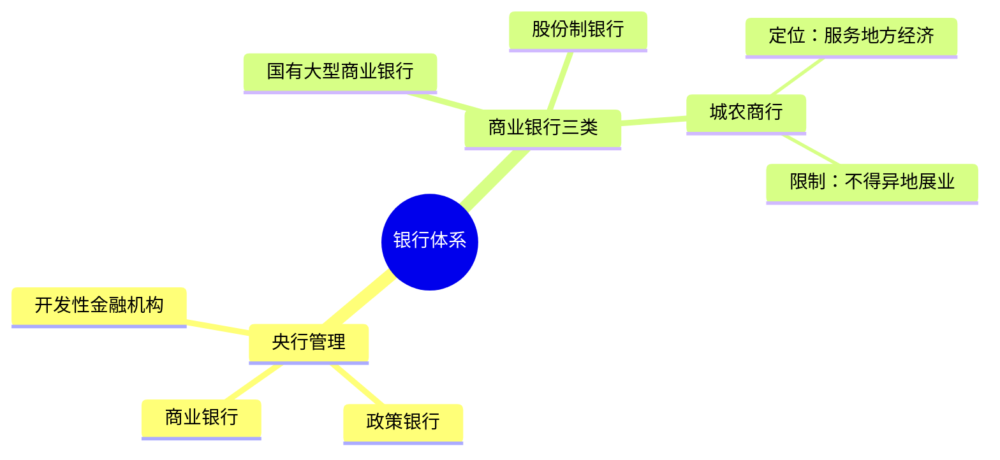
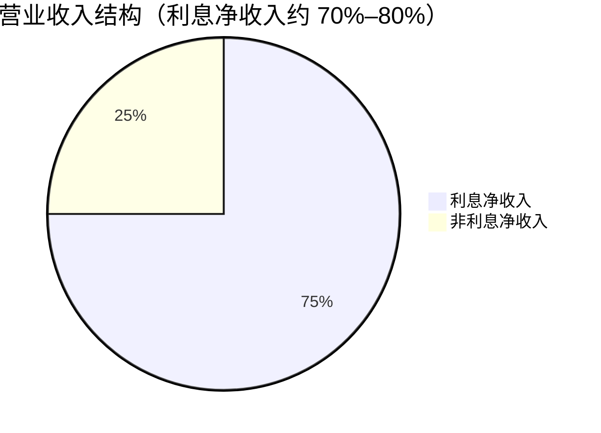
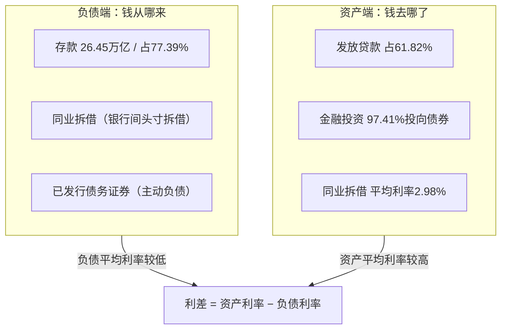
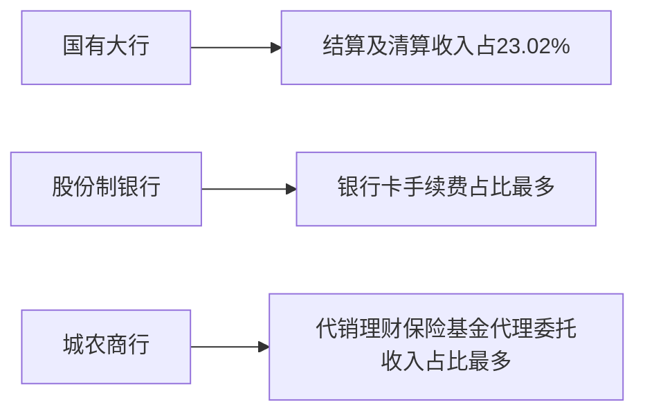
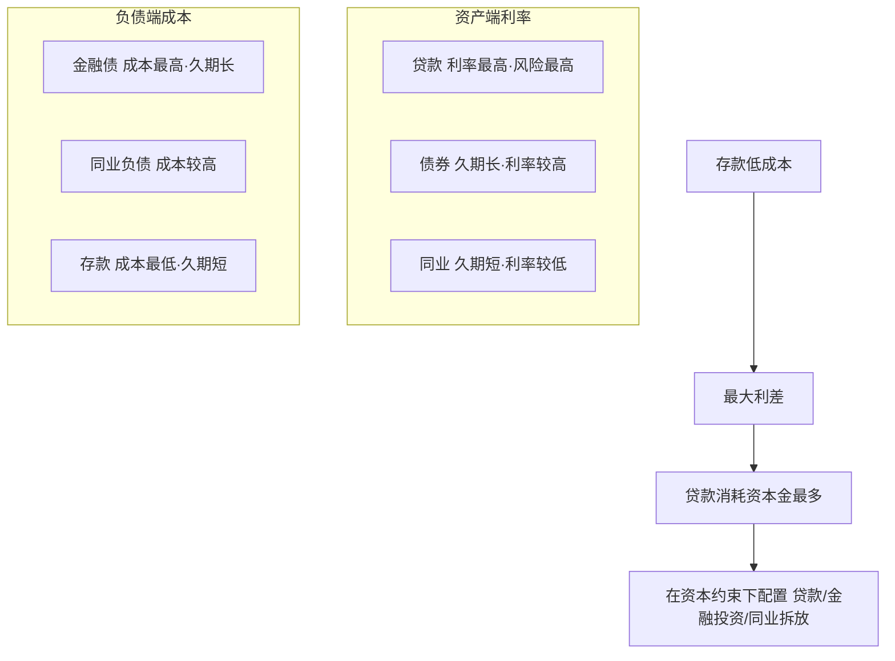
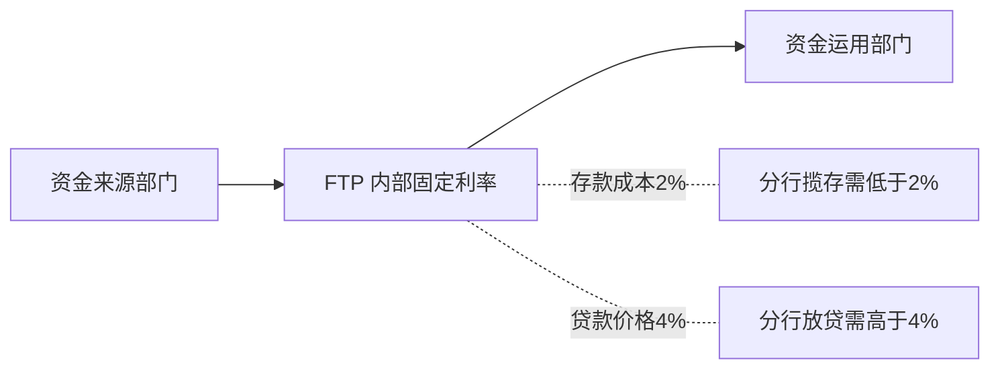
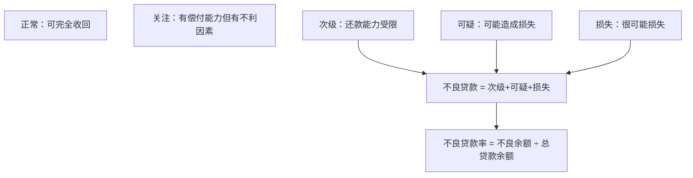
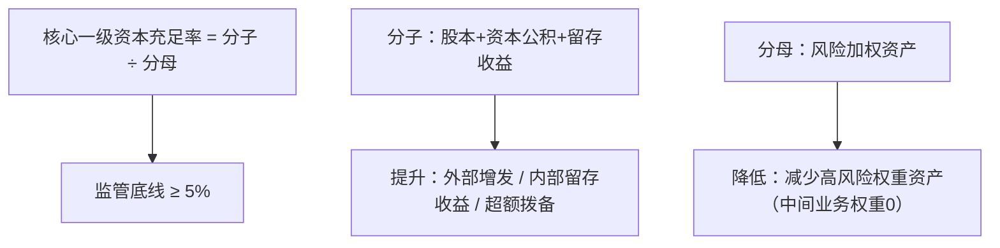
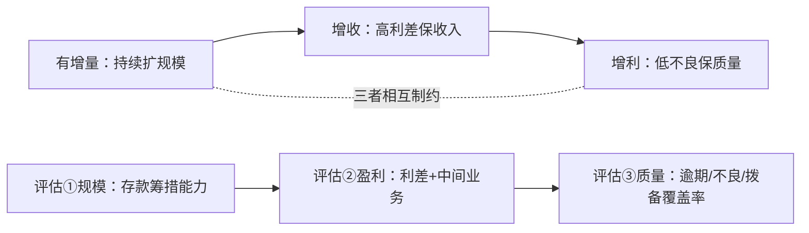

## 一、商业银行的定位与分类

中国人民银行负责人民币的设计、印制与发行，并管理着开发性金融机构、政策银行、商业银行等。与人们日常生活最密切相关的，是各类商业银行。

根据股东背景和经营范围，商业银行大致分为三类：第一类是国有大型商业银行，第二类是股份制银行，这两类经营范围较广，可在全国各地设立分行开展存贷款业务；第三类是地方城市商业银行与农村商业银行（合称城农商行），其定位是服务地方经济，绝大多数不得异地展业，异地存款也受到严格限制。

## 二、银行的盈利从哪里来：利息净收入与非利息净收入

对银行的简单理解是"以高于存款利率的成本把存款贷出去，赚取差价"。具体看各家银行的利润表，营业收入分为利息净收入与非利息净收入两部分，其中利息净收入占绝大部分，比例在 70% 到 80% 之间；非利息净收入中主要是手续费及佣金净收入，占该部分收入的 50% 到 80%。

从根本上看，银行赚钱有两大方式：一为利差，二为中间业务。

以某银行 2023 年的经营状况为例，可以更清楚地看到银行是怎么赚钱的。下面是该银行的部分资产负债表：负债端可以理解为银行的钱从哪里来，资产端为银行的钱都去向了哪里。

在负债端，存款约有 26.45 万亿元，占总负债的 77.39%，以公司存款和个人存款为主，既包括定期也包括活期；排名第二的是同业拆借，这是银行之间的市场业务，主要用于日常头寸的拆借和资金流转；第三是已发行债务证券，即银行作为金融机构为募集资金而发行的债券，属于银行的主动负债。以上三个项目是银行负债的主要来源。

在资产端，绝大部分资金用于发放贷款，占比 61.82%，主要流向公司和个人——公司贷款主要用于企业经营，个人贷款主要有房贷和信用卡贷款；第二大项目是金融投资，主要投向国债和地方政府债券，在该银行案例中 97.41% 的金融投资投向了债券，其持有的前十大金融债券中年利率普遍在 3% 以上；第三块资产是同业拆借，与负债端的同业拆借相对应——对借入方是负债，对借出方就是资产，该银行此项业务的平均利率为 2.98%。

综合来看，负债端的平均利率低于资产端的平均利率，这其中的差值便是利差。

## 三、非利息净收入：中间业务与三类银行的收入结构差异

非利息净收入中占比最大的为手续费及佣金净收入，与利差收入不同，这部分收入来源于不需要承担信用风险的中间业务，主要包括与经济活动相关的各类手续费（如交易手续费、银行卡费）、与资本市场相关的咨询费、托管佣金、资产管理业务收入等。中间业务和银行的客群基础密切相关，可以理解为银行向客户提供的金融服务，其目的也是夯实客户基础、提升综合服务能力；手续费和佣金净收入即这一过程中产生的服务费。

由于业务范围和规模不同，我国三类商业银行在手续费及佣金收入的构成方面存在明显差异：2024 年上半年，国有大行中结算及清算收入占全部手续费收入的 23.02%，是占比最大的来源；股份制银行占比最多的则是银行卡手续费；城农商行受限于经营范围，只能主打差异化竞争和多元化服务，占比最多的是代销理财、保险和基金产品的代理委托收入。

## 四、资产负债的利率结构与资本约束

银行是经营资本和杠杆的生意，需要基于现有资本进行资产分配以获得更厚的利差与更高的收益。从各大银行的资产负债表来看，资产端的利率呈"贷款利率大于债券利率大于同业利率"的阶梯：三种资产中贷款风险最高、贷款利率自然也高；债券投资和同业拆借久期不同，相比之下债券久期长、利率高，而同业拆借久期短（一般为隔夜或七天）、利率相对较低。

在负债端，成本呈"金融债利率大于同业负债利率大于存款利率"，即从成本角度，获取存款的成本最低，金融债的成本最高。这是因为各大银行的存款中有很多利率不到 0.5% 的活期存款和一年期以内的短期存款，久期短、利率低；金融债和同业负债属于高息负债，久期长、利率相对较高。

理论上，银行用最低成本的存款去放贷得到的利差最大。但银行并不能把所有的钱都拿去发放贷款，关键原因在于资本金。银行的运营可以类比一套电路，而资本金则是这套电路中的电池，为整个系统提供电量：在资产端，不同的业务对资本金的占用情况各不相同，大致来说就是资产风险越高、占用资本金越多、消耗的电量越大。贷款是银行最主要的资产之一，同时也是对资本金消耗最大的部分——由于贷款久期较长、风险较高，每发放一笔贷款都需要占用一定比例的资本金；相比之下，金融投资和同业拆放的久期较短、收益虽低于贷款但风险也较低、占用资本金较少，消耗的电量也更少。这两类资产虽不能提供像贷款那样高的回报率，却能有效降低资本金的使用压力。因此银行需要在资本金的约束下合理配置贷款、金融投资和同业拆放的比例，既让整个电路更高效运转，也在风险与收益之间找到更好的平衡。总的来说，资本金、负债端和资产端是一个相互影响、相互制约的关系。

## 五、总分行管理与 FTP 资金转移定价

前面说的是一家银行作为整体如何开展业务，而具体操作和执行则落在分行、支行以及网点。总行以管理职能为主，通过制定授信指引手册指导下面的分行开展业务，对未来一年重点布局的行业和审慎介入的行业都做了明确规定，从而对贷款投放的行业也做了管控。

大致来说，总行会从贷款量和贷款价格两方面做出规定。在贷款量方面，总行首先划定一个风险加权资产总量，将其分配到各个资产中，然后对不同类别的资产赋予风险权重，不同的资产类别除以对应的风险权重系数后加总，便是分行可使用的投放额度——风险权重越高，可获得的投放额度就越低；相反风险权重越低，能获得的投放额度就越高。假设一家银行给个人房贷业务切分的风险加权资产为 1000 万元，按照《商业银行资本管理办法》，个人住房按揭的风险权重为 50%，用 1000 万元除以 50% 的风险权重，得到 2000 万元可投放的贷款总额。如果分行想在这一业务上贷出更多的钱，就需要将房贷业务的风险权重降低；但分行不能无限制降低一项业务的风险权重，因为总贷款额是固定的，这时分行就需要调整其他业务的风险权重以满足总行的监管要求。

对于分行来说，拿到的这部分贷款额度要以什么样的利率贷出去，便涉及到了贷款价格。在银行内部的经营中，吸收存款、发放贷款涉及到三个部门：资金来源部门、资金中心（司库）以及资金运用部门，这三个部门的业务往来需要按照银行内部的定价机制，即 FTP（资金转移定价）来进行。其中司库相当于批发中心，所有部门的存贷款业务都需要经过司库，并且它有一个固定的利率来吸收存款和发放贷款。比如说司库的存款成本是 2%，那么分行就要以低于 2% 的利率去吸收存款，这样分行才不会亏钱；如果司库的贷款价格是 4%，分行为赚取利差就要用高于 4% 的利率去发放贷款。总行就这样对分行业务实施了较为灵活的量价双重管理，在满足监管统一要求下确保营收。

## 六、资产质量指标：不良贷款率与拨备覆盖率

无论是公司贷款还是个人贷款，风险等级都是不一样的。根据《贷款风险分类指导原则》，我国将贷款风险等级分为五类：正常、关注、次级、可疑和损失。正常类贷款可以完全收回；关注类贷款指的是借款人虽然有能力偿还本息，但有一些不利于偿还的因素；次级、可疑、损失三类的还款能力受限，可能会给银行造成不同程度的资产损失，这三类被合称为不良贷款。这些不良贷款与总贷款余额的比重被称为不良贷款率，这个指标是用来衡量银行资产质量的一个重要数字。

假设一家银行共贷出了 100 亿元贷款，正常类 95 亿、关注类 1 亿、次级类 2 亿、可疑类 1 亿、损失类 1 亿，那么不良贷款（次级+可疑+损失）为 4 亿元，不良贷款率为 4%。总体而言，国有大行和股份制商业银行的不良贷款率要低于城农商行；2024 年上半年，国有大行的平均不良贷款率为 1.28%，股份制银行为 1.24%，城农商行为 1.30%，但三类银行的不良贷款率都在逐年下降，信贷质量较为稳定。

为了应对不良贷款可能造成的损失，银行就要预先计提贷款减值准备来应对这部分贷款损失。贷款减值准备占不良贷款总额的比例就是拨备覆盖率，这是衡量银行贷款质量的第二项指标，它考察了银行是否有能力应对贷款风险。面对不一样的风险等级，银行需要准备的金额比例也不一样：根据《贷款损失准备计提指引》规定，关注类贷款需要的计提比例为 2%，次级类为 25%，可疑类为 50%，损失类为 100%；另外对于次级和可疑类贷款，银行可以根据情况上下浮动 20% 的比例。沿用上例，除去正常类贷款外，关注类 1 亿、次级类 2 亿、可疑类 1 亿、损失类 1 亿，那么银行至少需要计提准备：1 亿×2% + 2 亿×25% + 1 亿×50% + 1 亿×100% = 2.02 亿元；用 2.02 亿除以 4 亿，得到的拨备覆盖率为 50.5%。

但风险之所以被称为风险，就在于它的不可预测。如果银行真的只计提了 2.02 亿的减值准备，显然无法应对额外可能产生的财产损失，所以理论上来讲，拨备覆盖率越高越好，它代表银行应对风险的能力足够高。央行规定银行的拨备覆盖率需要保持在 120% 到 150%，但一般情况下，各大银行的拨备覆盖率基本会超过 150%。2024 年上半年，国有大行的平均拨备覆盖率为 242.73%，股份制商业银行为 221.97%，城农商行的拨备覆盖率最高，为 261.4%。

## 七、核心一级资本充足率

银行在运营过程当中可能需要面临各种各样的风险，当风险导致的损失超出银行的准备时，银行就需要用自身的资本去弥补风险，这便对银行的资本提出了要求。所以除了拨备覆盖率，还有一个重要的衡量指标，那就是核心一级资本充足率，它最能体现银行的抗风险水平。就计算方式而言，核心一级资本充足率等于（股本 + 资本公积 + 留存收益）除以风险加权资产。按照规定，我国商业银行的核心一级资本充足率不得低于 5%。

2023 年上半年到 2024 年上半年，三类商业银行的核心一级资本充足率平均上升了 0.43 个百分点；2024 年上半年，国有银行的平均核心一级资本充足率为 12.31%，股份制银行为 9.89%，城农商行为 9.79%。

提高核心一级资本充足率的方式有两种：一是提高分子值，也就是提升核心资本净额，提升分子值意味着银行要补充资本，补充资本有外部和内部两种方式，外部补充资本的方式主要是增发股票，内部补充资本的方式包括留存收益（每年的净利润扣除股东分红的部分）和部分超额拨备；二是降低分母，即降低风险加权资产的比重。一项资产的风险等级与它的利率息息相关，利率高、风险等级就越高——参考前面的资产利率，贷款业务的利率最高、风险等级也最高，而中间业务完全不需要承担信用风险、风险权重就是 0。银行需要平衡好利差业务和中间业务，在满足核心一级资本充足率的情况下做出更大的产业规模、实现更高的利润回报。

## 八、银行的竞争优势与经营模式

银行虽然受到央行的管控，但资本端和负债端的表现依然可以体现出银行的竞争水平。负债端的竞争优势在于比较低的利率成本，这主要来自于客户的积累和留存，因为客户是不会频繁切换自己主要银行卡账户的，粘性非常高，这不光会带来相当可观的活期存款，还有不需要占用资本就能获得收益的中间业务收入。持续性的获得客户是一个长期经营的过程，这个过程中积累的口碑也能为银行带来更多客群——近年来城商行在积极开拓客群效果显著，2023 年的个人存款比例较 2018 年上升了 16 个百分点。

资产端则要求银行有出色的管理能力，能够在信用下沉群体中发现优质客户、提供高成本借款，在扣除信息成本和坏账成本后仍然具备超额收益，与此同时还要有应对风险的能力，具体表现为贷款增速、资产收益率和不良贷款率。从 2018 年到 2023 年，国有商业银行的不良贷款率最低，而农村商业银行的不良贷款率则远远高出其他几类银行。在经济相对发达地区，投融资活跃、优质企业较多，银行会面临一个相对旺盛的贷款需求，但风险也会随着机遇一起来临，银行需要高效的管理、严格的风险把控力度和有吸引力的激励机制才能在其中脱颖而出。

总而言之，银行最好的经营状态就是"有增量 + 高利差 + 低不良"：有增量意味着银行可以持续扩充规模，高利差保证了银行的收入水平，而低不良则关乎着银行的资产质量。但这三者往往相互制约、不可兼得——高增量可能伴随着良莠不齐的客群，过高的利率也会筛走信用等级高的优质客户，这两者都可能会提高银行的不良贷款率；但如果银行过于谨慎、执着于低不良，又可能会造成扩表乏力以及收益率过低。因此银行需要权衡，实现从增量到增收再到增利的良性成长。

首先从规模上讲，要看银行的资产负债表。微观层面来看，个体银行仍然是存款立行，作为最低成本的负债，存款筹措能力会制约资产端放款能力；如果银行没有很强的吸收存款的能力，就要依赖同业拆借或金融债等高息负债的方式，为了获取一定的利差提高收入，银行又只能被迫提高放款利率、降低客户准入门槛，就意味着不良贷款风险的增加。其次从盈利能力上来讲，要综合看待银行的各个指标：首先要看负债成本和生息资产收益，存贷业务的利差是最高的、但同时也是最消耗资本的；第二看中间业务收入，这部分占比虽然不高但不存在信用风险，带来的收入非常具有粘性；比较高的利差水平和中间业务收入，可以贡献高于行业平均的净资产收益率，对于股东的长期回报也会更有保障。最后要看一家银行的资产质量，贷款无法回收本息会给利润造成巨大冲击，从增收到增利最重要的一步是控制资产质量；当银行放贷时，贷款的逾期率、不良率、不良生成率会反映出银行的风险控制能力，而拨备覆盖率又能看出银行应对风险的能力。步入 2025 年，经济局势风云莫测、市场变化万千，而这又对国内商业银行的发展提出了新的挑战。

