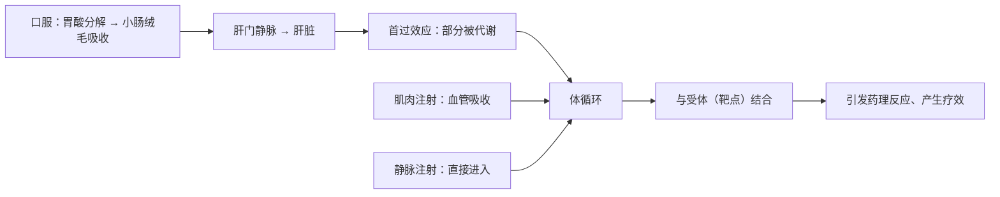
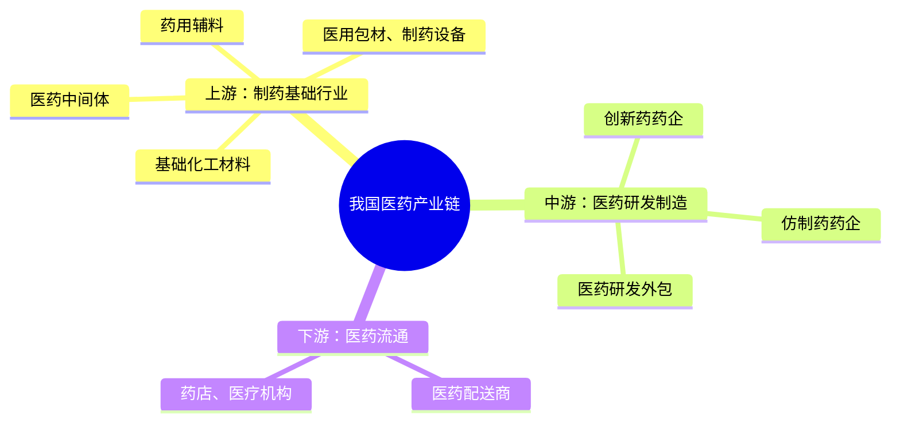
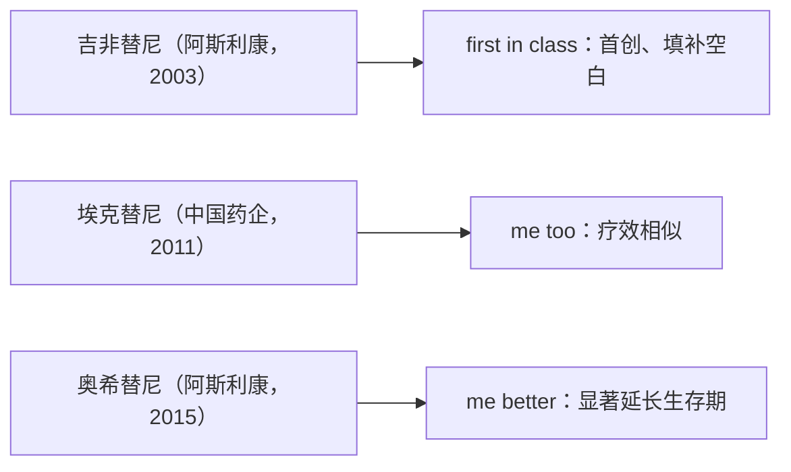
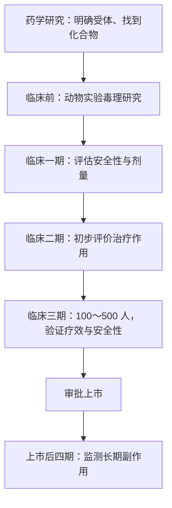
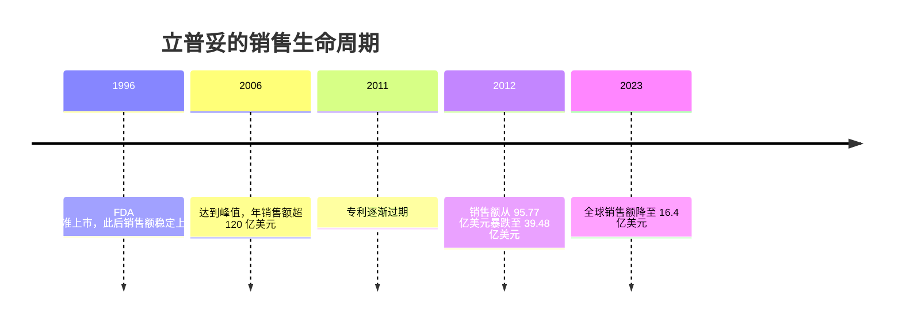
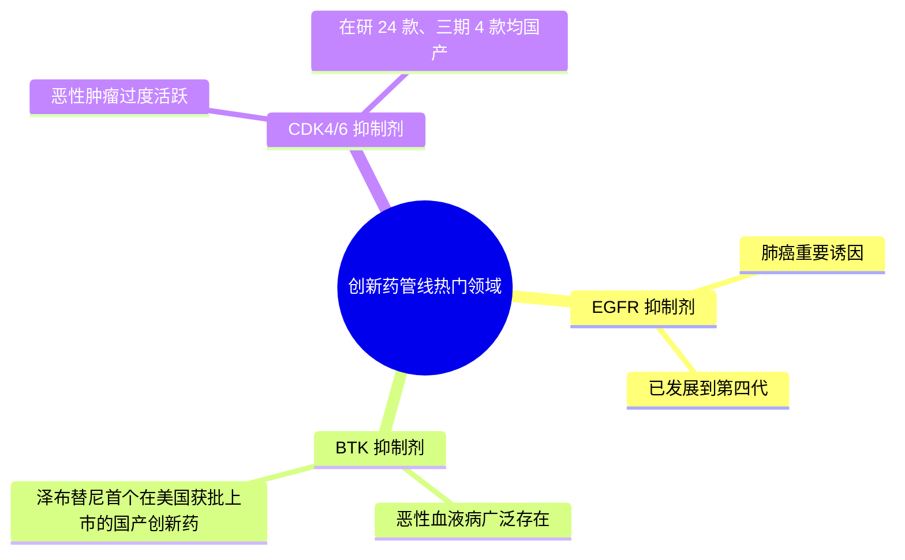
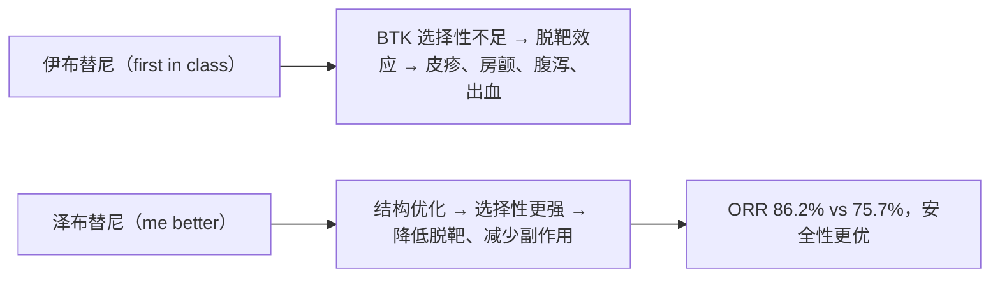
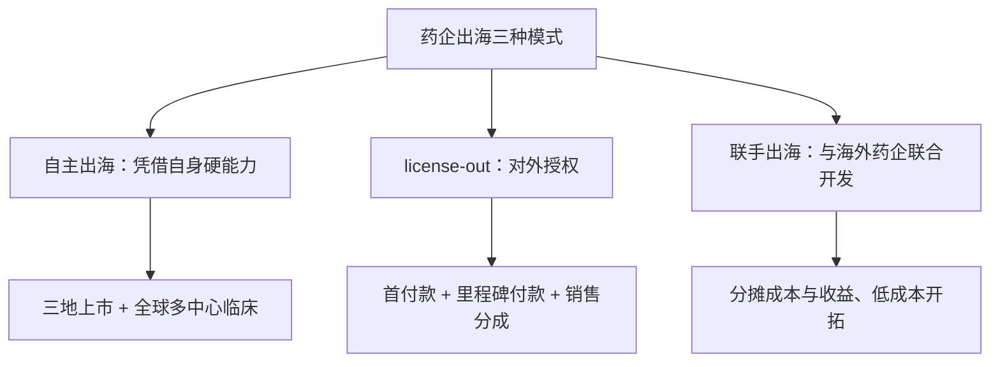

## 一、引言：从优赫得说起

优赫得，又称德曲妥珠单抗，是一种用来治疗 HER2 阳性肿瘤的靶向药，由日本制药公司第一三共研发，于 2019 年首次问世，2023 年获批进入中国市场。它的问世时间并不长，却可以说在一定程度上代表了医药界在 HER2 阳性肿瘤治疗上的最新科研成果。

那么，一种药物在进入人体后是如何治疗疾病的？要回答这个问题，得先从给药方式说起。

## 二、药物作用的机制：给药方式与靶点

优赫得的给药方式仅限于静脉注射，而其他常见给药方式还包括口服、肌肉注射以及静脉注射。无论是哪种方式，药物最终都要进入血液里、参与体循环。其中，静脉注射参与循环的速度是最快的，其次是肌肉注射，最后是口服。

这是因为口服药物首先要进入消化系统，在胃部被胃酸分解成小颗粒后进入小肠，通过小肠内壁上丰富的小肠绒毛进入血液运输。这些血液和药物成分的毛细血管会汇成肝门静脉，由此进入肝脏。在肝脏里，这些药物成分会面临它们的第一个考验——首过效应：部分药物成分会在肝脏内部被代谢掉，随着尿液排出。也就是说，通过口服的药物无法百分百发挥它的药效。幸存的药物成分会随着血液从肝脏上部的肝门静脉流出，进入到第二阶段体循环。相比之下，通过肌肉注射的药物会被肌肉组织中的血管吸收、进入体循环，而静脉注射的药物则会直接进入体循环。

那么药物具体是如何发挥药效的呢？首先要知道的是，大多数药物是与人体的一种特殊蛋白质发生反应、从而产生药效的，这种蛋白质被称为受体，是药物的靶点，主要分布在细胞膜上、细胞器上，甚至是细胞核内。这种受体参与诱导细胞的生长、分裂和死亡，药物与受体结合后会引发药理反应，从而产生治疗效果。

开头提到的 HER2 就是一种受体，又称人类表皮生长因子受体 2。它本是参与细胞正常生长和修复的蛋白质，但在某些情况下可能为癌细胞提供了温床，从而加剧癌细胞的扩散。有一类乳腺癌的肿瘤细胞表面 HER2 数量超出正常范围，会让癌细胞生长扩散得更快，这种癌症被称为 HER2 阳性乳腺癌。针对这种癌症的靶向药物，其基本原理就是通过影响 HER2 受体的增殖分裂，进而抑制或者杀死癌细胞。如开头提到的优赫得就像装了导航系统一样，可以精准找到 HER2 受体，并进入癌细胞内部杀死癌细胞，对人体其他的正常细胞影响较小。

## 三、我国医药产业链：上游、中游与下游

当科学的进步揭示了越来越多疾病的发病原理，如何研制出更为有效的药物，变成了很多创新药药企的研发目标，而这个研发流程涉及到了多个产业链环节。我国的医药产业链条大致可以分为上游、中游和下游三个部分：上游是制药基础行业，中游是医药研发制造环节，下游是医药流通环节。

上游制药基础行业负责原材料和制药设备的供应，包括基础化工材料、医药中间体、药用辅料、医用包材和制药设备。其中基础化工材料、医药中间体、药用辅料都是药品原材料：医药中间体指的是需要进一步精制才能制药的一种化工产品，比如喹诺酮类抗菌药中间体；药用辅料则可以用来改善药物的味道、稳定性或吸收性，但不会改变药效。上游企业面对的客户主要是药企，是一门 To B 的生意。

中游产业主要负责医药的研发和制造，这里面有药企，也有医药研发外包（CRO/CDMO）。药企分为创新药药企和仿制药药企，而医药研发外包主要是给创新药研发提供科研支撑。这里涉及到了仿制药和创新药的区别：创新药物具有自主知识产权、专利，相对于仿制药，创新药物强调化学结构新颖或新的治疗用途；仿制药顾名思义模仿的是创新药，在分子结构上与创新药保持一致，在制造工艺、配方、颜色、味道和包装上有差别。仿制药和它们所模仿的创新药有着一样的通用名——有一种药多达 607 种药片、颗粒、胶囊、悬浮液等不同的剂型，但它们都叫布洛芬。位于中游的药企面临的主要客户是医院、医生以及消费者，整体而言药企的毛利率比较高，一般在 50% 到 95% 之间。

下游主要是医药的批发和零售，涉及到了医药配送商、药店以及各种医疗机构。医药配送商主要负责医药的批发，药店和医疗机构则是药品器械终端销售的场所。总的来说，药物从研发到触及患者，需要多个精细而缜密的环节，这其中既包含时间成本，也包括金钱成本。

## 四、创新药的三种类型：first in class、me too、me better

所谓创新药，指的是境内外均未上市、具有新的结构明确的、具有药理作用且具有临床价值的药品。这类药品基本都会拥有自己的药品通用名，且受到专利的保护。针对同一适应症可能会有很多不同的创新药，它们的名字不同、化学结构式不同，相互之间不构成仿制的关系，但存在竞争关系。

一般情况下，满足以下三种状态的药品可以被称之为创新药，分别是 first in class、me too 和 me better。以针对肺癌的靶向药物吉非替尼、埃克替尼、奥希替尼为例：这三款药物都是靶向治疗 EGFR 突变非小细胞肺癌的药物，它们的化学结构明显不同、都具备独立的专利权，都属于创新药。

吉非替尼由美国药企阿斯利康研发，于 2003 年获批上市，在此之前市面上并没有和它类似的药物，因此像吉非替尼这类的新药被称为 first in class。埃克替尼由中国药企研发，是国产首款 EGFR-TKI，于 2011 年获批上市，它的疗效与吉非替尼相似，属于 me too 类药物。奥希替尼（第三代 EGFR-TKI）仍然由阿斯利康研发，于 2015 年获批，首先在美国上市，这款药物的临床数据表明，与吉非替尼相比，奥希替尼有着显著延长患者生命周期的能力，因此被称为 me better。

研发 first in class 的药物是一项高风险、高回报的生意，很容易研发失败，而一旦研发成功，就能通过弥补市场上的空白来获得巨额的收益。me better 药物更像是在现有基础上做优化，通过临床试验证明自己更优，在市场竞争中取得优势地位。

## 五、创新药研发流程：从药学研究到上市后四期临床试验

无论是 first in class、me too 还是 me better 药物，其研发流程都十分漫长，大致需要经历药学研究、临床试验、审批上市、四期临床试验这四个阶段。

以针对肿瘤的靶向药物为例，在第一阶段，药企需要明确受体，并找到可以作用于该受体的药品化合物，既要从理论层面确定化合物的可行性，又要通过动物实验完成毒理学研究，获得安全药理、遗传毒性、生殖毒性、致癌性等数据。在第二阶段，也就是临床试验阶段，药物就要在人体上做试验了，这个阶段的临床试验一般分为一期、二期和三期。其中一期临床重点评估药物的安全性和给药剂量，二期临床初步评价治疗作用，最为关键的是三期临床阶段，这个阶段需要招募更多的病人志愿者，通常为 100～500 人，以便进一步验证药物对患者的治疗作用和安全性，同时评价利益与风险关系。从第一阶段到第二阶段，任何一步数据反馈不好，都可能会让项目胎死腹中。

当药企成功完成三期临床试验后，就需要整合数据来综合评估一款药物的效果、安全和可控，这个数据又称临床终点，它直接决定了药企前期的投入能否得到回报，即能否获得药监局的批准，成功上市。

以肿瘤临床终点为例，一般可以分为四类数据：第一类为总生存期，指患者从用药到去世能存活多久；第二类为肿瘤评估，这个数据基于患者肿瘤直径的变化大小来获得一系列关键数据；第三类为症状评估，比如患者的生活质量；第四类为生物标记物，指某些测试下显示的基因、蛋白质或其他物质，比如 PSA 是前列腺产生的一种蛋白质，血液中高水平的 PSA 可能是前列腺癌的一个征兆，通过服用药物患者体内 PSA 水平的变化，就是评价药效的维度之一。

无论前期药企得到了怎样良好的数据，都只是临床试验阶段。新药获批上市后会面临更广泛的患者群体，这些个体对药物的反应可能是不同的，有些甚至会产生临床试验阶段所没有的症状，不得不撤市。1999 年 5 月，抗关节炎药物罗非昔布上市，但因这款药物会增加心血管疾病的发作风险，仅在 5 年后，罗非昔布不得不退出市场。因此为了测试一款药物的实际运用效果到底如何，在上市后还需要经过四期临床试验阶段，这个阶段主要是监测药物的长期副作用等情况。药物的研发经历着一个严密的过程，每一步都需要有详实的数据做支撑。

## 六、创新药收入曲线：专利悬崖与生命周期

对于创新药企来说，这些关键节点的数据至关重要，它是药效的体现，更凝结着药企自身的科研能力和竞争力。药物研发需要巨额的金钱和时间投入，在一款新药正式获批之前，药企需要耗费数年时间、数亿甚至数十亿的资金。但个体新药的研发成本相差较大，就抗癌药物来说，普拉曲沙的研发成本为 12 亿元人民币，而卡博替尼胶囊的研发成本则高达 142 亿元人民币。

从 2016 年到 2023 年，中国化学创新药品从最开始的临床申请到获批上市的整体成功率为 17.71%，而从临床一期、临床二期、临床三期，甚至是最后的申请上市环节，都有可能面临着失败。那些试验失败无法获批的产品，最终都不会上市、为药企带来收入，前期的研发投入都会打水漂。这样的高风险需要成功后足够的利润去弥补，才能维系药企正常的运转，继续持久地研发新药物。

获得丰厚利润的重要方式就是申请专利保护，以此获得独占销售期。一般而言专利保护期限是 20 年，但实际上留给药企的独占期并没有这么长。前面提到过，判断一款药物是不是创新药的标准之一，就是看这款药物的化学结构是否是新的，那么药企一开始就要对药物的化学结构申请专利保护，同时药企还要进一步通过增添晶型、制备方法等专利来延长一款药物的专利保护期。但药物研发需要大量时间，从申报专利到药物获批上市，至少需要消耗 4 到 10 年甚至更多时间。一旦专利到期，药物就可以被仿制，市面上会出现大量的仿制药，药品越赚钱，后续加入竞争的仿制药就越多。此时创新药所具备的差异化产品力走弱，能够带来的销售额和利润就会一落千丈，这就是专利悬崖。

以立普妥为例来看一下创新药的销售生命曲线是怎样的、在专利过期之后又会受到怎样的影响。立普妥又名阿托伐他汀，是辉瑞公司有史以来最成功的药物，于 1996 年由美国食品药品管理局审批上市，2011 年专利逐渐过期。可以看出，在上市后的前几年它的销售额一直是稳定上涨的，于 2006 年达到巅峰、年销售额超 120 亿美元，之后开始稳步下降。但在 2012 年，也就是专利期到后的第一年，其销售额骤从 95.77 亿美元暴跌至 39.48 亿美元，2013 年降至 23 亿美元，2023 年立普妥全球销售额降至 16.4 亿美元。

和立普妥一样，大多数创新药物在上市的前 5 年内年销售额会处在一个比较低的水平，往往需要 5 到 10 年才能达到销售额的峰值，在专利到期的第一年销售额会暴跌，而后生命周期进入稳态阶段。

## 七、潜在竞争力：研发管线

整体而言，我国创新药发展起步较晚。从建国到上世纪末，我国医药研发处于模仿阶段，这个阶段的药物以仿制药、普药为主；步入 21 世纪后，研发能力和工业化水平有了明显的提高，这个阶段的药企以 me too、me better 的药物研发为主；2015 年后，随着产业升级等一系列政策的出台，更多的药企逐步向 me better、first in class 药物靠近，进一步走向创新。2018 年，我国批准上市的一类创新药为 9 种；到 2023 年，获批上市创新药数量增加到 23 种。在这些药品里，有 47% 是抗肿瘤药和免疫机能调节的药物，而这也是目前创新药研究的热门领域。

除了成功上市的药品外，申请临床审批的创新药的数量也有了明显的提高。宏观情况下，这些数字反映了药企整体的科研能力；微观层面下，不同的药企产品差异较大，很难找到完全对标的企业，无法通过行业竞争格局做宏观分析，只能纵向研究一家药企的竞争力。管线就是一个重要的维度。所谓管线，指的是药企正处于研发过程中的产品线，这些产品线可能处于不同的研发阶段，有的还处在临床一期，有的已经处于申报阶段。

管线分布与医学界研究的热门领域息息相关，目前药企的管线分布多集中在肿瘤、心血管疾病和免疫疾病上。从细分领域来看，EGFR 抑制剂、BTK 抑制剂、CDK4/6 抑制剂等都是管线分布的热门领域。EGFR 是表皮生长因子受体，是肺癌的重要诱因之一，目前 EGFR 抑制剂已经发展到了第四代，国内多家药企正在积极推进相关管线的研发，部分药物已进入临床一期或二期试验。BTK 又名布鲁顿氏酪氨酸激酶，在多种恶性血液病中广泛存在，目前国产 BTK 抑制剂大多处于临床早期阶段，然而国内领先的创新药企研发的泽布替尼，已成为首个在美国获批上市的国产创新药，2023 年该药在全球的年销售额超过 13 亿美元，是第一个达到该成绩的国产创新药。CDK4/6 即细胞周期蛋白依赖性激酶 4 和 6，这种酶在很多恶性肿瘤中过度活跃，促成了癌细胞的增殖扩散，截至 2023 年 8 月，全球在研的 CDK4/6 抑制剂共有 24 款，其中处于三期临床阶段的共有四款，均为国产创新药。

从国内创新药企的整体情况来看，不少领先企业都拥有各自具有竞争力的研发管线，涵盖多个治疗领域。2023 年，某创新药企在多个领域取得了显著进展，共有 14 个产品处于申请受理阶段、12 条管线进入临床三期、35 条进入二期、30 条进入一期，同时 72 个创新药也获得了临床批准。而某专注于自身免疫疾病药物研发的企业，2025 年 1 月共有七条管线在此领域进行研发，另有四条与感染性疾病和肿瘤相关，进入临床三期的有三条，一条正处于审批阶段。在肿瘤靶向药物研发方面，另一家药企也有所突破，截至 2023 年 8 月共拥有 48 条管线，其中 38 条与肿瘤相关、四条进入三期，值得注意的是，全球首个针对 BTLA 靶点的抗肿瘤单抗也在其管线中。此外一家全球领先的药企凭借 41 条在研管线继续在创新药领域保持强劲势头，七条进入三期，另有 60 多项临床前项目，涵盖了多个创新药方向，主打 me better 和 first in class。雄厚的科研能力让该公司有着丰富多元化的研发管线，覆盖了血液肿瘤、乳腺、妇科肿瘤、肺部肿瘤、消化道肿瘤等多个肿瘤类型。

对于一家药企而言，优质而数量多的管线能够熨平单一产品的生命周期，让企业有持续盈利的能力，这也是外部评价一家药企创新力的重要衡量标准之一。

## 八、现有竞争力：已获批上市药品

管线研究是一家药企潜在的竞争力，要想更加直观地了解一家药企的实力究竟如何，则要从已经获批上市的药品来研究，研究维度主要是该药的药物结构、作用机理和临床数据。

还是以泽布替尼为例。这是一种 BTK 抑制剂，主要用于治疗血液肿瘤和自身免疫性疾病。BTK 是人体的一种酶，调节人体免疫细胞 B 细胞的增殖、分化和死亡，如果 BTK 被不当激活、抑制 B 细胞的凋亡，就会出现恶性 B 细胞过度繁殖的情况，进而导致慢性淋巴细胞白血病等问题，BTK 抑制剂就是要抑制 B 细胞的生长，从而达到治疗的目的。

泽布替尼是第二代 BTK 抑制剂，主要对手是伊布替尼。伊布替尼由强生和艾伯维研发，于 2013 年首次在美国获批，是全球第一个上市的 BTK 抑制剂，属于 first in class，而泽布替尼属于 me better。从药物结构上来讲，伊布替尼对 BTK 的选择不太专一，可能会和 BTK 结构相似的 EGFR、ITK 和 TEC 等靶点相连，从而产生脱靶效应，这样的脱靶效应会带来皮疹、心房颤动、腹泻和出血等副作用，因此后续 BTK 抑制剂的研发多集中于减少这个效应、提升药物的安全性。泽布替尼主要通过化学结构的改善，使其具备更强的 BTK 选择性，从而降低脱靶效应、减少副作用。伊布替尼和泽布替尼的作用机理是一样的，都需要与恶性 B 细胞上的 BTK 靶点结合、进而破坏癌细胞，但由于分子结构的优化，泽布替尼的选择性更强，减少了与肺癌细胞结合的风险，在安全性上会更有优势。

在临床试验里，一款药物的疗效和安全性是并重的。验证效果最重要的方式是头对头临床试验，通常会和已经上市的药物做对比，通过各种数值的差异来对比两款药物的临床价值。从疗效的角度，有多个关键数据做对比，如 ORR 客观缓解率，指的是肿瘤缩小达到一定量并且保持一定时间的病人的比例，这个数值用来直接衡量药物抗肿瘤活性；此外还有 PFS 无进展生存期，指从随机化开始到肿瘤发生进展或死亡之间的时间，这里的死亡可以是任何原因，PFS 可以很好地反映药物的疗效。

在对慢性淋巴细胞白血病的临床对比中，伊布替尼的 ORR 为 75.7%，泽布替尼为 86.2%，并且在 PFS 的比较上也可以看到泽布替尼要优于伊布替尼。相较于伊布替尼，泽布替尼在 ORR 和 PFS 的数据都呈现出优势。从安全性上看，泽布替尼的三级以上不良发生率整体低于伊布替尼，特别是在房颤、心脏停搏、心力衰竭、心肌梗死等心脏事件的发生率上明显占据优势。综合来看，一款药物的药物结构和作用机理决定了它的临床价值，如果临床试验也可以获得令人满意的数据，那么这款药物就算研发成功了。

## 九、国际化战略：三种出海模式

前面已经说过，创新药的研发需要耗费巨额的金钱和时间成本。对于药企来说，仅立足于国内市场很难弥补前期研发的投入，也不足以支撑一家药企达到千亿规模的持续成长，因此出海是很多药企的愿景——将药品投入更广阔的全球市场，来获得更高的销售额。如泽布替尼在全球 65 个市场获批上市，2023 年全年销售额为 13 亿美元，单是美国市场就贡献了 9.45 亿美元。

有了出海的动力，还需要有出海的能力。药企出海看的并不仅仅是研发能力，还需要有临床试验和布局能力，此外药品还需要由各个国家政府部门的审批才能上市，这对药企的跨国协作与谈判，国际监管部门沟通等能力又是一次全方位的考验。根据出海难度的不同，药企出海主要有三种模式。

第一种是凭借自身的硬能力实现自主出海。在国内领先的创新药企中，有一家企业不仅成功实现了 A 股、H 股和美股三地上市，还具备了全球多中心临床试验的能力，其自建的临床研究团队规模达近千人。第二种是 license-out，这是药企出海最普遍的方式，即药企将自己的产品在海外或全球的权益授权给海外企业，通过这种方式，药企可以获得三部分收益——首付款、里程碑付款和销售分成，而后续的临床开发、申报上市、生产和销售等工作则由海外企业负责。这种模式可以很好地解决手上有好药、但没有资金和经验去国际化运营的尴尬，可以快速收回现金去进行下个潜在项目的开发。

从 2019 年到 2023 年，中国药企 license-out 交易量逐步提升，2023 年有 78 起 license-out；2024 年前三个季度，国内药企对外授权的总金额达到了 336 亿美元，首付款总额为 25.9 亿美元。

第三种是联手出海，这种模式是和海外药企联合开发，分摊成本和收益，优点是可以低成本地开拓海外市场，缺点是可能会有跨文化的沟通和挑战。

传奇生物的西达基奥仑赛就是一个典型的案例。西达基奥仑赛用来治疗复发或难治性多发性骨髓瘤患者，是一款细胞治疗产品。为了能更好在美国开展临床申报和试验工作，传奇生物与强生签署了独家全球许可和合作协议，共同进行西达基奥仑赛的开发和商业化。2022 年，西达基奥仑赛获得美国食品药品管理局的批准，成为国内首款成功出海的细胞治疗产品。

## 十、结语：从 me too 到 first in class

综合来看，我国的医药研发制造企业已经进入了以创新为主导的新阶段。从 me too 到 me better，再到 first in class，头部药企都在奋力转型创新，管线的整体储备较为丰富，也有自己的明星产品。希望在不久的将来，会有更多有竞争力的产品出现，在国际上、站稳脚跟。
