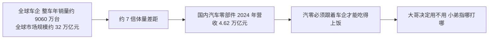
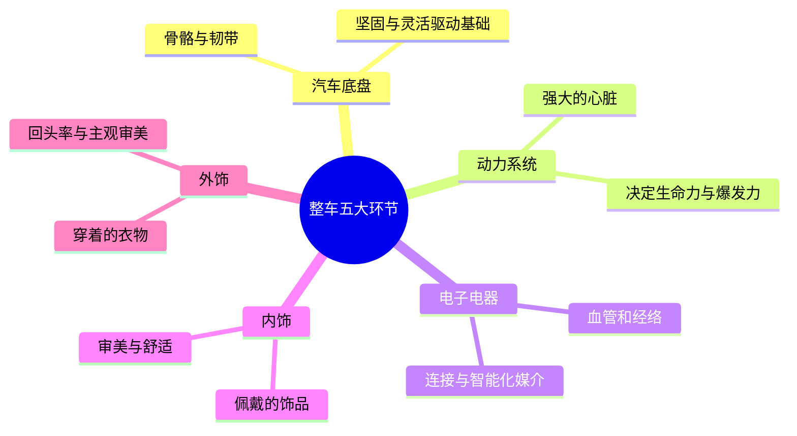
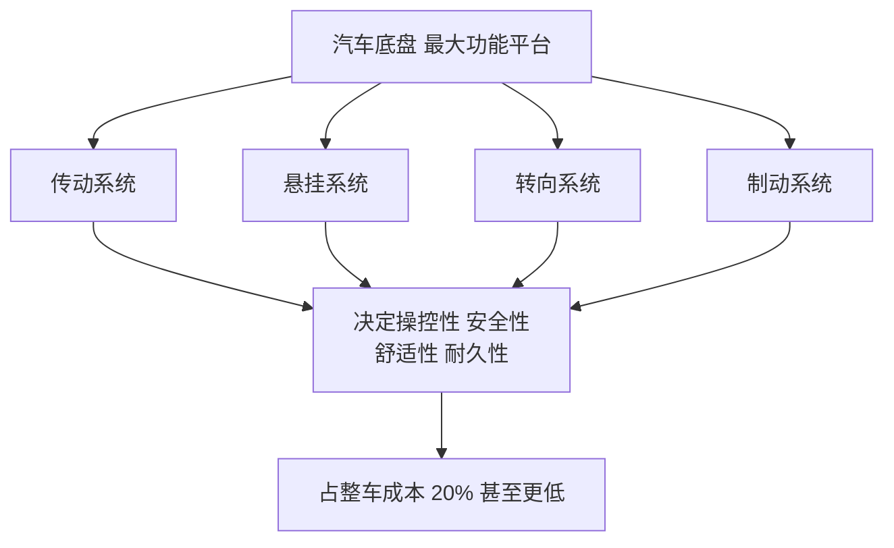
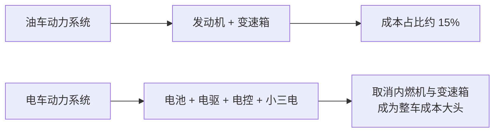
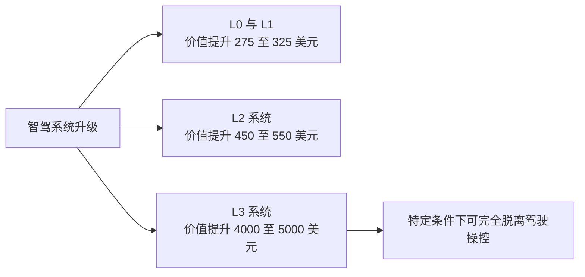

## 一、引言：从改装预算看汽零行业

假如给你一笔 2 万块的改装预算，却只能做一个选择，你最想改装爱车的哪个部位？这个问题就像给游戏角色加技能点一样让人纠结。其实我们能想到的每一个改装部位，背后都对应着产业链极其庞大的汽车零部件行业。

这个行业规模之大、功能细分之繁琐，比蜘蛛网还难以想象。在已经公布的数据中，2024 年仅我国汽车零部件制造业就达到了惊人的 4.62 万亿元人民币。这个数字意味着什么？当年号称杯子连起来可绕地球一圈的奶茶，一年能卖出 3 亿杯、做出 48 亿人民币的 GMV，而把汽零行业的规模换算成奶茶杯，可以直接绕地球 962.5 圈。

## 二、汽零行业的地位：车企背后的隐形冠军

那么汽零行业到底算不算一个赚钱的行业，又算不算一个值得投资的行业呢？从账面的 GMV 来看，它无疑是一块巨大的蛋糕。但如果把视角放到产业链上，它的战术地位却只是一名处于从属地位的小弟。

压在汽零行业头上的，是一位绝对可以碾压它、且永远无法实现地位互换的大哥，那就是全球各大车企。这尊整车年销量可以做到约 9060 万台的庞然大物，营业报表拉出来，每年能干出约 32 万亿元人民币的全球市场规模。两边的体量一对比，全球车企大哥是国内汽车零部件小弟的近七倍。

再加上汽零行业必须跟着车企才能吃得上饭，两者就形成了只有大哥决定用不用、大哥指哪儿小弟就必须打哪儿的关系。不过万物的定义都是相对的，向上对比汽零行业是小弟，但向下对比其他行业，它必是一块大蛋糕。

## 三、造车如捏人：五大环节的分类

汽车毕竟是复杂的现代工业品，任何一台整车都是由数以万计的零部件经过组装、压铸等一系列精巧工艺制造流程成车下线。每一颗零部件就相当于人体的细胞、血管、皮肤、器官，看似细小，但缺一不可。所以从这一层面也凸显出汽零行业作为小弟的不可或缺与不可替代性——大哥离不开你，也就为你创造了蓬勃生长、做大做强的土壤。

那么如此繁杂的零件要如何梳理分类呢？造车也像捏人一样，可以把它分为五大环节。

## 四、底盘：骨骼与韧带

和人的骨骼韧带一样，底盘是全车的大核心。你可能会问，汽车的核心不是发动机吗？发动机确实提供了全车的动力，但汽车底盘集成了传动系统、动力转向系统、制动系统、悬架减震，甚至轮毂和轮胎都归类在底盘大类里面。

它在你看不到的地方，同时决定了整车的操控性、安全性、舒适性还有耐久性。我们可以简单理解为，车到你手上操作起来丝不丝滑、紧急刹车能否平稳踩停、高速过障时颠不颠簸、复杂路面时耐不耐造，这些都是被底盘包圆的。

作为汽车最大的功能平台，底盘上排布了最重要的传动、悬挂、转向和制动四大系统，各大车企能往里面烧的研发成本和技术调教也会不遗余力，四大系统占了整车成本的 20% 甚至更低。

正所谓百因必有果，随着保时捷卡宴调教出动态底盘控制、奔驰 S 级研发出魔毯悬挂、奥迪行政车型投入巨量财力人力物力，这些技术在悠久的汽车历史文化长河中沉淀了下来，也为各家底盘技术筑起了高耸的万丈壁垒。

## 五、动力系统：油车与电车的路线分化

当你在十字路口吃了一个 0.1 秒的尾灯，不管你什么反应，这个尾灯都是由汽车的动力系统决定的。但油车和电车因技术路线不同，它们的动力系统在构造和成本占比上都不相同。

油车只有发动机和变速箱，所以成本占比只在 15% 左右。而电车取消了内燃机和变速箱，由电池、电驱、电控和小三电系统取代，直接倒反天罡，成为整车成本的大头。不过这个数据对比的结论只能说明，在崭新的电车时代，因为要实现高度电气化，电车的核心动力系统成为了最大的吞金兽而已。

要把两种技术横向比较，油车车企在动力系统的自主研发能力上确实更强，毕竟是自己的亲儿子，关键心脏部位肯定外部移植不了一点，必须自己手搓，即便是要升高配置，也是复制基因——这也是为什么奥迪和大众的发动机有异曲同工之妙的原因。

## 六、电子电器、内饰与外饰

当汽车有了骨架和心脏，像人的血液一样流淌在车身上的载体就是电子电器。其中除了连接元件的线束、线缆、连接器以外，智能化系统也都算在其中，比如空调系统、安全气囊、电动脚踏板，当然也有雷总送的大冰箱、大彩电，平时使用的无钥匙进入、折叠座椅靠背，还有各大车企大力研发的智驾系统，都是由电子电器作为媒介来完成的。

内饰由传统内饰件、座椅及附件、安全系统组成的仪表台控制按钮等构成。形容质量劣质的"塑料感"，大概率是从汽车行业里普及出来的，因为最差的汽车内饰真就是梆硬的全塑料，而好的汽车内饰上不封顶，可以从木料皮料混合升级到全皮料，然后一路拉满，进化成全碳纤维。

外饰则是更容易带来回头率的车漆、车衣、车灯、电动尾翼这些，它很像人的穿着衣品。但这东西丰俭由人，不管是车企原装出厂的配置，还是用户后期改装的部分，都是更加主观的审美表达。

## 汽零巨头为何鲜为人知

如果三秒钟让你说出三家车企的名字，你肯定张口就来；那再来三秒，说出三家零部件厂商的名字，游戏可能就结束了。为啥数量规模如此庞大的市场，居然没有几家叫得上名字的公司呢？因为他们在疯狂又被动地卷。

一方面是身份问题——车企在台前，汽零行业在幕后，大家记住了成功的车企，而汽零行业却只能做默默无闻的小弟。另一方面是业务性质问题——零部件供应商只能服从命令、指哪儿打哪儿，只要整车厂需要，他们就必须快速高效稳定地落地量产。大哥起飞了，小弟就跟着大鱼大肉；大哥干崩了，小弟就跟着喝西北风。

## 七、两个局面：加速迭代与降本增配

所以现在的汽零行业就形成了两个局面。首先是电车的崛起，让全球车型都开启了加速模式。过去油车基本上 3 到 5 年一小改、10 年一大改；电车进场后，直接把新车的开发时间加快到两三年，改款更是一两年就搞定了。油车还在市场上一刀一刀地给用户平 A，电车就开始不断上新、放大降价大招，没有冷却时间的油车是真打不了一点。

然后就是所有汽零行业都要面临的降本增配。平常不管租房子还是买东西，潜意识里的物价规则都是递增制，而汽零行业的采购规则则是年降——车企要你的产品在保持甚至提升质量的同时，价格上每年还要砍你一刀，而且刀刀都是屠龙刀。从 2025 年某汽车栏目做的调查来看，约四成参与者透露所在公司被要求年降幅为 6% 到 10%，13% 面临的幅度为 11% 到 15%，7% 面临的幅度为 16% 到 20%，更有甚者，车企给出的年降要求已经超过了 25%。如果不降本增配，只有死路一条。

## 零部件集成化与产业链重构

所以零部件集成化就成了必经趋势。那什么是零部件集成化呢？简单说就是对多余的散件做减法，比如用连接车机的触摸大屏取代繁杂的中控物理按键，不仅提升了空间利用率，车内操作也更加智能便捷；或者对操作集中的区域做加法，比如方向盘不再只控制转向系统，甚至增加了音乐播放、定速巡航等功能，怀挡的加入还能承担起换挡的角色。

所以零部件集成化不仅对供应商的综合能力和响应速度提出了更苛刻的要求，也彻底改变了零部件的产业链格局。很早以前，零部件产业链有三个层级——最上游是原材料供应商，中间是次级供应商，下游是最靠近主机厂的一级供应商，一家主机厂可以有几百家一级供应商。

但随着市场竞争越来越激烈，更多的一级供应商甚至主机厂都开始意识到零部件集成化和整合产业链的重要性。于是像博世这样的一级供应商开始了改革体系、进行业务重组转型，成为更加全面的软硬件服务供应商；国内主机厂也在特斯拉上海超级工厂的影响下，开始了全产业化布局。就是这样的双向奔赴，让很多核心技术停滞不前、甚至没有核心技术的一级供应商，在滚滚洪流中被淘汰掉了。当你看到某家车企的一级供应商从 300 多家直接干到 100 多家的时候，没什么好奇怪的。

## 八、汽零赚的是辛苦钱

那汽零行业到底算不算一门赚钱的生意？从利润表中可以看出，虽然过去 5 年汽零行业净利润呈上升趋势，但最高也只有 6.2%；2023 年 A 股收入前 20 的零部件公司，ROE 集中在 10% 到 20% 之间。如果拿 2023 年白酒一哥的 33% 来对比，汽零行业也就是赚个辛苦钱。

不过即便赚的是辛苦钱，也还是有钱可赚的，毕竟中国是全球最大的汽车市场，2024 年做到了 3143.6 万辆的销售规模，举一国之力占据了全球约 1/3 的市场。要想吃下这块蛋糕，汽零企业需要找到增加利润率和增加订单量的最优解，才能成为小弟集团中的大哥大。

## 九、两条突围之路：提利润率与增订单量

增加利润率的最优操作是提升核心技术，比如智能驾驶的系统升级可以提升单车价值量。最早的智驾系统是 L0 及 L1 级别，可以给单车带来 275 到 325 美元的价值提升；进化到 L2 的系统，加入了多个传感器、控制器及功能组合，给单车带来 450 到 550 美元的价值提升；升级到 L3 系统时，驾驶员可以在特定条件下完全脱离驾驶操控，这项技术为单车带来了 4000 到 5000 美元的价值提升。

不仅利润率提高了，核心技术的升级及其迭代也为企业打开了市场、提高了产品的普及度和渗透力。车企为提升用户驾驶和乘坐体验，传统智能座舱已逐渐成为各大品牌新车的标配，而新型智能座舱的引入进一步提高了国内市场渗透率——2019 年国内新车渗透率才 49%，2025 年预计都要干到 75%。新型智能座舱的概念引入和应用，也为单车带来了 4 到 10 倍的价值提升。单一的产品供应已经不是生存之道，如果把液晶仪表、中控屏、抬头显示、流媒体后视镜、行车记录仪、后排液晶屏、车内氛围灯这些智能座舱产品整合到一起干，是不是就能在这个风口上站着把钱给挣了。

最后，友商们还需要学会一项必杀技能，就是提高企业情商，因为和车企搞好关系是一门很重要的学问。这里说的搞好关系，不是让你去请客送礼，而是要坚持把控好产品质量，同时在产品的设计、生产上和车企进行频繁的沟通互动。当你真正成为懂大哥需求的小弟时，不仅可以缩短产品的迭代周期，还可以给大哥留个好印象，这样你在大哥的小弟们的订单里就可以不断升级，变成那个核心的一级供应商，拿到更多又更稳定的订单。
