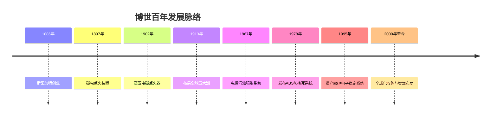
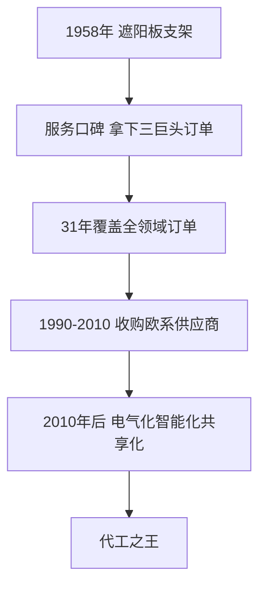
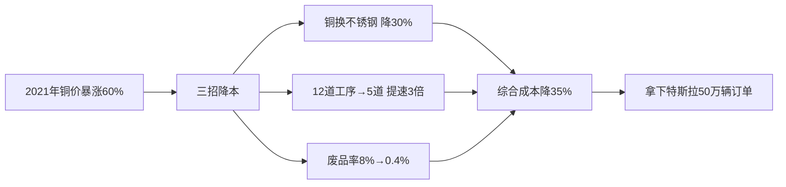
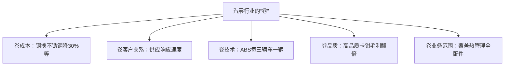

## 一、万亿市场背后的“逆袭”江湖

麦格纳公司吃了65年“饼”，从遮阳板支架生产商一路做到了汽车代工厂之王；博世公司同样吃着这张“饼”，研发出了ABS系统等多项前沿技术，坐稳了小弟集团的头把交椅。其实在汽零行业这万亿市场背后，还有很多这样“爽文逆袭”的故事。

现在咱们就把大幕拉开，好好讲讲这个江湖。

## 二、1980年，风口来了

时间拉回到1980年的底特律。两次石油危机让“喝油不嫌贵”的美国人意识到，省油才是硬道理。以前底特律三巨头靠“肌肉”，美系车躺着就能赚钱；现在日系车省油又耐造，欧系车精致又时髦，直接啃掉了超20%的市场份额，让美系车份额首次跌破80%。

地主家的粮仓明着被抢，底特律巨头们肯定不干，于是一拍大腿改革。通用二话不说玩起了自动化狂潮，开始砸钱搞平台化；福特偷学日系的精简流水线，省钱搞外包——能复制粘贴的绝不自己手搓，能外包的绝不自己单干。这个时候，齿轮开始悄然转动。

因为80年代那会儿，汽零行业除了博世混得有点人样，麦格纳还在苦干遮阳板支架，李尔公司也只会做座椅、金属件，产品线都非常单一。但车企巨头要转型了，他们要搞平台化，模块化时代的风口来了，零部件厂商相当于被硬塞了一张免费机票，直接就原地起飞了。

## 三、技术逆袭之王：博世

但在这个风口上起得最猛的，还得是技术大佬博世。1980年之前，他们就已经完成了从动力系统到制动系统等多项前沿核心技术的研发，也完成了从本土到全球化的战略布局，不管是技术上还是客户资源上都遥遥领先。相当于别人还在排队登机，他就已经包了一架火箭直接起飞了。

你肯定要问，博世是怎么开的“上帝视角”？故事来到1886年前，奔驰、保时捷相继在斯图加特成立，这让未满20岁的电气工厂学徒罗伯特·博世嗅到了商机，决定做他们的“天使轮小弟”。1886年，他就带着三名员工，搞了一间精密机械和电气工程的小作坊，传奇之路由此开启。

1886~1925年是博世的起步40年，他们开局就大搞技术研发：1897年研制出磁电点火装置；1902年又推出配备火花塞的高压电磁点火器，彻底改变了汽车动力系统，一下就干成了“网红供应商”。

凭借核心技术优势，博世在1900年开启国际化布局，1913年就把业务拓展到全球五大洲，海外销售额占比高达88%，一上来就打出了大优势。

但随着一战后全球经济陷入困境，订单缩减，也让博世打上了逆风局。1926~1945年，博世开始求稳，向南美市场发力；汽车行业累积下来的研发经验，反而为他们在家电领域崭露头角提供了技术支持。业务多元化发展，让企业收益不降反升，在逆境中稳住了颓势。

但业务多元化始终没能动摇博世对汽车的狂热，对汽车电子组件的研发也从未暂停。正是因为这份坚持不懈，1946~1999年，博世一头扎进了自研技术井喷的爆发50年。他们开始豪掷千金，对一系列电子组件进行研发：1967年就量产出了全球首个电控汽油喷射系统；基于这项技术，1978年博世和奔驰联手发布了改变汽车制动方式的历史级产品——ABS防抱死系统。

ABS可以智能调节刹车力度，防止车轮在急刹时完全锁死，从而维持车辆转向能力，并减少侧滑风险。这项技术从1936年申请专利到实际应用，经历了多年技术迭代，如今已经成为所有汽车的标配。

所以到1980年，美国车企一拍脑袋准备开始改革的时候，博世早就拿了一手又起飞的好牌。借着这股东风，博世的自研技术开始井喷式发布：1995年又量产上市了ESP电子稳定系统，它可以防止车辆在急转弯、路面湿滑等场景下发生侧滑或失控，将单车事故率直接砍半（降低了49%）。凭借着ABS和ESP这两项“王炸”技术，博世成为了汽车电子领域的霸主。

2000年至今，博世开启了全球化烧钱模式，主打就是一个搞技术：各国只要和他们战略相关的技术型创新型企业，直接掏钱收购，10年内就实现了产业链全球化。随着智能驾驶概念的推出，博世开始加速智能驾驶系统的升级研发和应用落地，中国新能源市场也成为了博世智驾技术最完美的嫁接土壤。

截至2024财年，博世在中国的年销售额来到了1427亿人民币，其中汽车业务就干了1166亿人民币，占比82%。此时中国已经是博世全球最大的单一市场，不仅贡献了集团超20%的年销售额，还成为了博世抵御欧美市场疲软的关键引擎。

1980年的风吹到今天，博世交出了高毛利、高研发投入、高市占率的成绩单：依靠前瞻技术多次驱动行业变革、独占市场，再通过成熟产品的规模效应对竞争对手形成降维打击，打“有技术准备之仗”，才坐稳了行业的头把交椅。

## 四、代工之王：麦格纳

在汽零行业的江湖“爽文”中，如果博世属于技术逆袭，那代工之王麦格纳纯纯是“大哥带飞”。1958年的麦格纳只会做遮阳板支架，如果没有通用的订单，估计开局就得点投降。但麦格纳愣是凭着服务好、质量顶的口碑，打开了天时地利人和的高速通道。

因为当时美国本土的零部件厂商都很拉胯，美国三巨头想找一个离得近、又带得动的小弟，这就让身在加拿大的麦格纳具备了得天独厚的优势。所以还不到一年，麦格纳就拿到了福特和克莱斯勒的订单，成为美系三巨头的“御用小弟”。

关键是，这麦格纳也争气，不仅服务态度给力，研发生产力也在线，纯粹就是“大哥指哪儿，我打哪儿”：要发动机驱动，我给您搞；要儿童安全座椅，我给您造；和大哥旗下车型相关的发动机盖、后备箱盖、翼子板，我都给您配套。仅用了31年时间，麦格纳就拿到了几乎覆盖汽车零部件全领域的海量订单，成为了最懂三巨头的小弟，直接一飞冲天。

接下来的麦格纳就开启了简单粗暴的收购模式，主打一个加速全球化布局、配套更多车企的需求。在1990~2010年间，麦格纳疯狂买下了多家有创新技术的欧系车供应厂商，相继拿下欧洲各大车企的订单；2010年后，继续保持烧钱收购的模式，进一步加强了企业的全球化、电气化、智能化、共享化布局，一举成为了自己都能手搓整车的代工之王。

博世一路走来用了140年，而麦格纳追上前辈的脚步，仅用了69年。零部件巨头们可能有很多种逆袭的方式，但最重要的是：在汽车行业迅猛发展的时代红利面前，做好了准备、抓住了机会，所以在大浪淘沙之后，成为了那群吃螃蟹的“小弟”。

## 五、这个行业到底在卷什么

说完两个巨头的成长史，你有没有一种感觉——汽车零部件这个行业，真的在疯狂又被动的卷。俩巨头努力了这么多年，市场份额都没超过5%；最可气的是，他们都这么努力了，汽车产业利润的大头还是让整车厂赚走了。所以这个行业到底在卷什么？

还记得我们之前提到过的“年降”制度吗？毫不夸张地说，“年降”这个词几乎是每个零部件供应商的噩梦。在这种残酷的环境里面想挣钱，最最重要的就是控成本。

比如2021年那会儿，铜价一度暴涨60%。汽车空调里有个热交换器，主要材料就是铜。为了降低成本，厂商想出了三个大招：一是把铜换成不锈钢，在满足车企要求的前提下，成本直接砍下来30%；二是把12道工序简化到5道，自研的激光焊机提速3倍，效率一下就上去了；三是把废品率从8%压降至0.4%，每月怒省500万。靠着这三招，综合成本直降35%，直接拿下特斯拉50万辆的订单。

卷完成本，接下来就是卷客户关系，最好呢是跟客户处成“夫妻”一样的关系。一般情况下，车企采购人员最在乎的就是供应的响应速度。2022年2月，XY公司与HW公司强强联手，在DLP车灯领域开发合作，从设计研发到装车量产仅用了一年多时间；2023年12月，XY公司自主研发的智慧灯光系统就在问界M9新车上亮相，而友商花了近5年时间才完成这个飞跃。对比之下，效率提升了60%以上。

除了成本和客户关系，卷技术也很重要。比如刚说过的博世，在ABS领域就凭借核心技术获得了行业统治地位——全球每三辆新车中，就有一辆搭载博世的ABS系统。技术能力如此硬核，那怎么会愁没钱赚呢？

还有一些厂商通过卷产品品质，争取到了产品的高溢价，尤其是跟汽车安全相关的零部件。比如刹车卡钳，高品质卡钳的毛利率相比普通卡钳，基本上都是直接翻倍的。

最后就是卷业务范围：在钻研自家核心技能的前提下，探索更多业务。可能前面提过的SH公司，它本身是做阀类产品起家的，后来产品线不断拓展，覆盖了热管理系统的所有配件，让自己在车企的热管理产品上也具备了竞争力。

## 六、卷到深处，也是一种智慧

当我们把焦点拉回到“汽零到底算不算一门赚钱的行业”时，其实很难给出答案。因为“卷”是这个行业生存环境的永恒命题，但卷到深处也是一种智慧。正是这些被低估、被忽视的“小弟”，才铸造了汽车行业最夯实的根基。

兄弟们在传统汽车时代确实是苦过来的，但现在风起云涌的电动化、智能化已经拉开，也就注定会把新的机遇撒在这片看似“枯萎”的零部件战场上。
