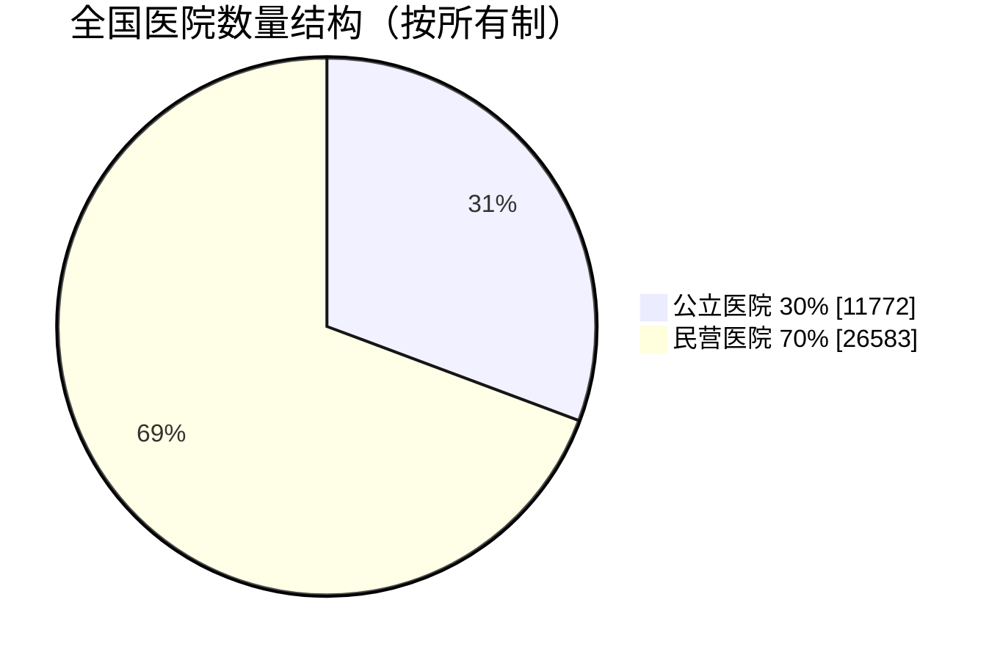
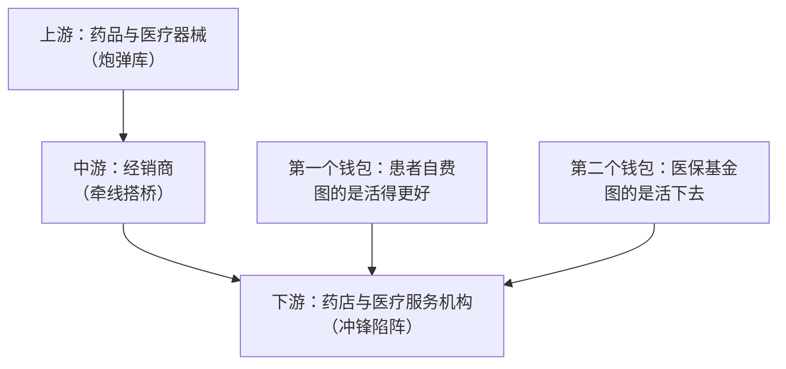
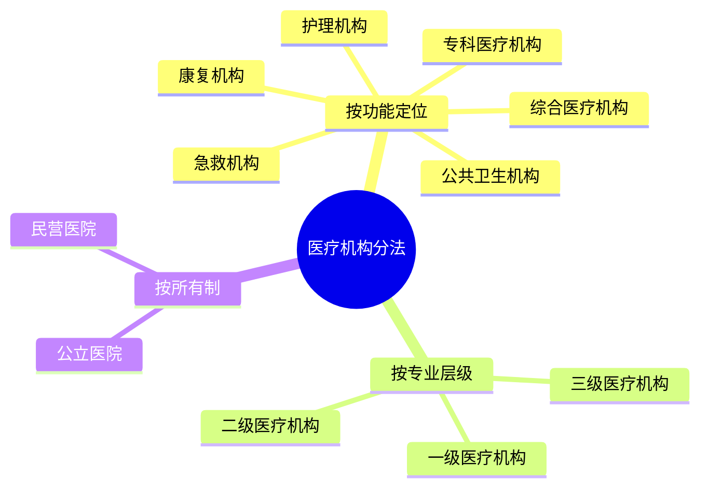
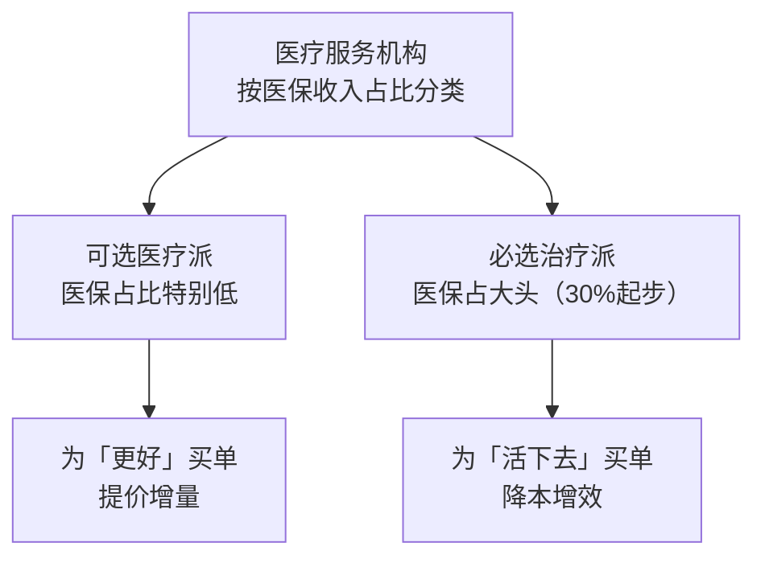
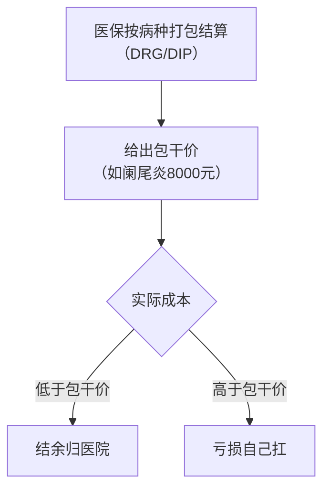
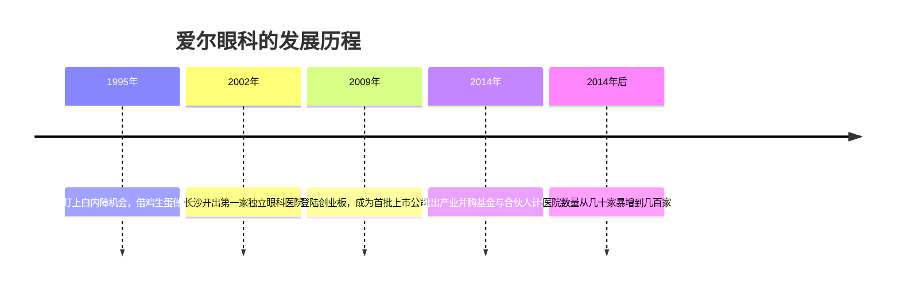
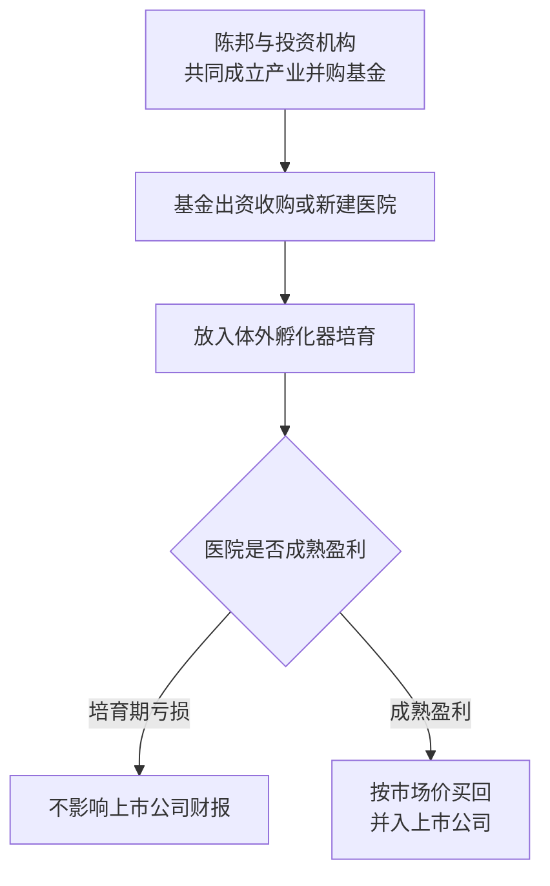
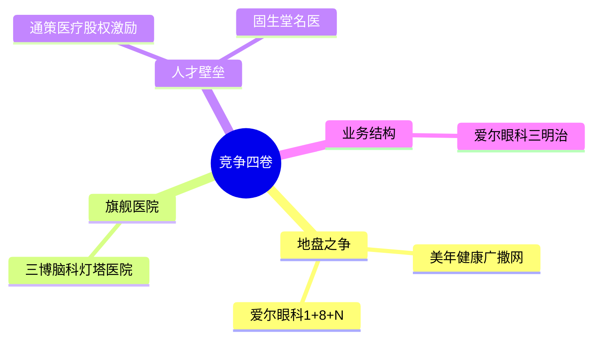

## 一、一张药方，通往万亿产业

如果给你看一张字迹潦草、像画符一样的药方，上面写着几支糖浆、头孢、红霉素，你未必认得出来。但别小看这张药方，它可是每个老百姓看病吃药的起点，更是一张通往万亿级产业的门票——说的就是医疗服务。

2023 年，中国医疗市场规模已经冲到 9.1 万亿。什么概念？相当于每个中国人一年就得花 8000 多块钱在医疗上。

但有意思的是，你以为这 9 万多亿都进了公立医院的口袋，那就想简单了。咱们把数据往细里拆，会发现一个特别有意思的现象。

## 二、数量倒挂的"离奇"现象

全国一共有 38355 家医院，其中公立医院只有 11772 家，差不多占 30%，剩下的近 70% 全是民营医院。这就离谱了，按道理公立医院才是我们心中的白衣战神。

可再按看病人次算，每年有 83% 的人都去了公立医院，而且那些顶尖的医生、设备，也基本全在公立里面。可以说，公立医院就是医疗卫生领域的主力。

那为什么在这种王炸级的存在面前，民营医院不仅没倒，还越开越多，有的甚至开去了国外，直接干成了国际连锁品牌呢？今天咱们就来聊聊这个神秘的医疗服务产业。

## 三、一场"高地保卫战"：拆解产业链

要弄清楚民营医院怎么赚钱，咱们先得把整条医疗服务产业链捋清楚。打个比方，如果把健康看成是一块必须守住的高地，那医疗服务产业链就是一场高地保卫战。

上游是生产药品和医疗器械的"炮弹库"，中游是把炮弹运送到前线的经销商，下游则是负责冲锋陷阵的药店和医疗服务机构。

先说上游，这相当于医疗服务的原材料，包括药品和医疗器械。药品分中药和西药，医疗器械则分为诊断设备等。要打治病救人的仗，没有这些家伙事可不行。不过在这个环节，一些高端设备还是被外国人牢牢占据：像严苛的飞秒激光设备，主要来自德国和美国；口腔种植体来自瑞士和韩国；内窥镜设备来自日本。这些设备技术门槛高、利润丰厚，生产商们自己也知道，自己卖的不是普通商品，而是别的地方买不到的超高音速远程导弹。

中游就是经销商，负责把上游的这些"武器"卖到下游。而重点来了，今天要聊的主角，就是下游的药店和医疗服务机构，这也是战况最紧张的战场。

但还有个关键问题：医疗这事儿说到底还是钱的事儿，那这个钱到底谁来出？在咱中国，有两个钱包负责出这个钱。

第一个钱包就是咱自己的私房钱，谁看病谁花钱，丰俭由人，只要能解决咱的身体健康需求，咱就刷卡买单，图的是活得更好。第二个就是医疗保障基金，也就是医保，这是一种集中力量办大事的基金，包括职工基本医疗保险、城乡居民基本医疗保险、城乡居民大病保险以及医疗救助等专项基金。

发现没，医保最讲究的就是"基本"，也就是保障 14 亿中国人的基本医疗需求，图的是让咱活下去。

这样一来，整条医疗服务的产业链就通了：上游卖药和设备形成成本，中游经销商牵线搭桥负责运输，下游各种医疗服务机构激烈竞争又互相合作，由两只钱包提供动力，就像一个精妙的生态系统，每个环节各安其位，保持着医疗系统的稳定运行。

## 四、医疗机构的三种分法

请给医疗服务机构分分类。按照功能定位，可以分为综合医疗机构、专科医疗机构、康复机构、急救机构、护理机构和公共卫生机构。

按专业层级分，就是咱们经常听的一级、二级和三级。镇卫生院就属于一级医疗机构，看点小病没毛病；二级医疗机构一般是区县级的医院和专科医院，属于地方精英，除了能解决小毛病，一些常见病也能搞定；而三级医疗机构就相当于当地甚至全国知名的大医院，像协和、瑞金、华西都是这个级别，不光能看常见病，疑难杂症甚至罕见病也能 hold 住。

而咱本篇开头说的公立和民营，则是按所有制来区分的。公立医院属于国家队，他们的任务很明确，保基本、保公平，服务更广大的人民群众，但这也形成了"排队两小时、看病五分钟"的尴尬局面。民营医院更像是民间游击队，硬拼肯定是拼不过公立医院的，那就走另一条路——灵活补位，专门接公立医院接不住的那部分流量。你公立医院不是排队时间长吗？那我就搞不排队、原地就诊；甚至有的卷王还能创新诊疗手段、帮公立医院优化诊疗流程，成了整个医疗系统的实验田。

## 五、两大阵营：可选医疗派 vs 必选治疗派

接下来咱们聊一聊医疗服务机构的商业模式。这块其实有点复杂，不同类型的机构都有自己的一套运转模式，很难总结，但咱可以把重点放在终端消费者——就是看这家机构的收入到底从哪里来，也就是它的医保收入占比。

根据医保收入的占比高低，可以把医疗服务机构分成两大阵营：可选医疗派和必选治疗派。两种模式、两套玩法，商业模式完全不同。

## 六、可选医疗派：为"更好"买单

先说可选医疗派。这些机构医保收入占比特别低，比如爱尔眼科，2021 年医保收入占比只有 15.8% 左右。也就是说，100 块的收入里只有不到 16 块是医保出的，剩下的 80 几块都是患者自掏腰包。

那为啥大家愿意自己掏这么多钱？除了医保没有覆盖之外，更重要的是，这些机构的目的不是活下去，而是活得更好。

举个例子，假如说你近视 500 度，其实戴眼镜就能看清，完全不影响日常生活。但你发现戴眼镜拍照显得脸很大不好看，想摘掉眼镜、做朋友圈最靓的仔，这时候你可能就愿意花个两三万去做个全飞秒手术了。再比如白内障，最基础的白内障手术医保是能报销的，装个普通晶体让你看得见就行；但如果你想装个散光矫正型的晶体，顺便把散光问题一起解决了，那对不起，差价部分就得你自己掏。这就是可选医疗的本质——为更好买单。

那这类机构的赚钱法门是什么？四个字，提价增量。

第一招，提高客单价，怎么提？靠产品升级。这几年的屈光手术就是这么干的，更新换代速度跟手机差不多：LASIK 就是功能机，半飞秒就是智能机，全飞秒 SMILE 就是折叠屏。每换一代，创口更小、恢复更快、服务更好，价格也就从几千涨到了两三万。患者买的不是"把近视矫正"这件事，而是"快、好、体面"三合一的体验，所以屈光类手术的毛利率能轻松突破 50%。

第二招，增加业务量，怎么做？靠品牌和连锁。想吸引更多患者进院消费，医院就得像小超市一样遍地开花。最常见的方式是"中心加卫星"：在大城市建区域诊疗中心，在县城插满门诊揽客，甚至社区里也得整个基础检查工作站。这个模式爱尔眼科玩得最溜——国内 200 多家医院、上百家门诊，卷完国内再去卷国外，到处开，硬生生搞成了"眼科星巴克"。要是再加一手三甲医院专家挂牌兼职，品牌格调瞬间拉满，患者想不来都难。

这两招落地，效果就出来了：产品升级抬价、毛利率回款，狂做广告打出品牌，到处开店引流，继续强化品牌心智，反过来再继续升级产品——这产业飞轮不就转起来了。

## 七、必选治疗派：在医保面前精打细算

咱们再说说必选治疗派。这类机构以治疗疾病和康复为主，一般都需要住院，收入来源跟可选医疗派正好相反，医保占了大头，一般都是 30% 起步。

但是在医保面前，所有机构都是弟弟。检查怎么做、治疗方案怎么出、手术和药方怎么开，都不是医院自己能说了算的。而且最近几年医保还在推广 DRG 和 DIP，不再按照"做了什么"来付钱，而是按"得了什么病"来打包结算。医保局说，治好一个阑尾病人我给你 8000 块，这是包干价；你要是 7000 块就搞定了，赚的 1000 块归你；你要是花了 9000 块，亏的 1000 块自己扛着。这相当于给医院下了一个生死状：要么精打细算赚钱，要么管理粗放亏本。

这直接改写了必选医疗的赚钱模式。过去靠多开药、多检查创收，现在反而多用一分钱都是在吃自己的利润。所以必选派的赚钱逻辑变成了四个字：降本增效。怎么降本？采购要便宜、用药要精准、检查只做刚需；怎么增效？流程要优化、住院时间要缩短、病床周转要加快。

比如海吉亚医疗，2024 年他们的毛利率只有 29.9%，远低于爱尔眼科的 50%。再看国际医学，2023 年营收涨了 70% 飙到 46 亿，结果年底一算反倒亏了 3.68 亿——为啥呢？因为前期投入砸得太狠，买设备、建医院、引进质子治疗技术，这些都是重资产投入，但收入却被医保卡得死死的，毛利率也只剩下了 8% 到 9%。

所以说，收入来源对医疗服务机构的生死至关重要。可选医疗派不靠医保，相当于服务业，靠的是品牌溢价和消费升级，选择权在患者自己；机构要做的就是提供更好的服务，让他们心甘情愿掏钱。必选治疗派则算是制造业，产品服务价格自己说了不算，靠的是成本控制和运营效率。一个想方设法提高客单价，一个绞尽脑汁降低成本；一个让你活得更精彩，一个让你活下去。路线不同，玩法完全不一样。

## 八、巨头诞生记：爱尔眼科的逆袭

但无论选择哪条路，都绕不开那座大山——公立医院。在如此强大的对手面前，有一家眼科机构不仅活了下来，还成长为行业巨头。一位退伍军人竟然建立了全球最大的眼科帝国，一家小诊所竟能从寄人篱下干到市值千亿。

故事要从一个叫陈邦的人说起。1965 年出生的陈邦有过一段军旅生涯，人们都说当过兵的人身上有三个特点：坚毅、刚强、敢为人先。在后来的创业路上，陈邦也把这三个特点体现得淋漓尽致。

1995 年，退伍后的陈邦盯上了一个巨大的机会：他发现中国有大量的白内障患者，但能做手术的医院却少得可怜，这里肯定藏着巨大的创业机会。可创业哪有那么容易？没场地、没执照、连设备都买不起，怎么办？这时候陈邦使出一招江湖绝技——借鸡生蛋：先分期付款搞了一套眼科设备，再带着机器去找长沙市第三人民医院谈合作，结果还真让他谈成了。医院出场地、出医生，陈邦出设备、出运营，一个白内障治疗中心就顺利落地了。这就是当时流行的"院中院"模式，说白了就是在公立医院里边再开一间"医院里的医院"，属于一种套娃模式。

这种模式有什么好处？一句话，找到组织了：借了公立医院的金字招牌，患者信得过；借了公立医院的医生，省得自己招人；还借了人家的场地，启动资金少、风险相对可控。但坏处也很明显，你再牛也始终只是寄人篱下，说到底不是自己的生意。果然没过几年，这种模式就干不下去了——2000 年，国家开始大力整治院中院，要么撤，要么收编。

眼看着第一桶金要打水漂了，陈邦完全慌了。但咱就是说，有的人真的是命好，想吃饭有人递筷子，想睡觉有人递枕头。同一时期，国家开始推动医改，明确允许社会资本开办营利性医院。对于别人来说，这只是一纸新政，但对于陈邦来说，那绝对是救命稻草。想都没想，陈邦直接开干。2002 年，陈邦在长沙开出了第一家真正属于他自己的独立眼科医院。

但独立门户谈何容易？首先没钱，开医院是重资产生意，买设备、租场地、装修样样都要花大钱，据说当时资金紧张到连工资都要挪用设备款来发。其次是没医生，好医生都去公立医院了，民营想挖人根本挖不过来，哪个医生愿意放弃公立的铁饭碗跑民营赌前途呢？最难办的还是没患者，一听民营医院，老百姓自动脑补电线杆上的小广告，立马捂紧钱包，信任感很难建立起来。

但人就是这样，越被逼到绝境，越逼着他去思考解决问题的办法。2009 年 10 月 30 号，爱尔眼科成功登陆创业板，成为首批上市的公司之一。这一上市，陈邦的翻身仗就算是正式打响了。上市之后最先解决的就是钱的问题，上市当年陈邦的利润直接涨了 60%。手里有了钱，腰杆子就硬。最关键的是，当年一看"上市公司"四个字，所有人的印象就是俩字——靠谱。以前招医生，人家嫌你民营医院不稳定，现在一听上市公司，而且还提供高工资高待遇，医生就愿意加入了。患者也一样，看到这家医院是股市挂牌的正规军，信任度蹭蹭往上涨。

不过，让爱尔眼科从一家普通上市公司一跃成为市值千亿巨头的，是他在 2014 年推出的两个大杀器。

第一招，产业并购基金。简单解释下啥是产业并购基金：假如你想开 100 家分院，一家分院要投资 500 万，那 100 家就是五个亿，一般人谁有这实力呢？而且医院是重资产，新院刚开肯定亏钱，至少得养个一两年才能开始盈利；如果这期间的亏损都记在账上，作为上市公司财报就会很难看，很影响股价。陈邦想了个办法：他找来专业的投资机构，共同成立了一个孵化基金。在这个基金里，陈邦自己只出资一小部分，剩下的大头由投资机构来出，然后用这个基金的钱去收购或者新建医院。这些新医院相当于被放进了一个独立于上市公司的孵化器里，在培育期间即便出现亏损，也不会直接影响上市公司的财报，这就确保了上市公司的业绩稳定。等到这些医院运营成熟、开始盈利了，陈邦再按照市场价把这些优质资产买回来，并入上市公司。这样一来，体外孵化、成熟注入，用一个亿的自有资金撬动了五个亿的投资，开出 100 家医院。地盘扩张了、风险隔离了、财报还漂亮，这盘棋下得属实高明。

第二招，合伙人计划。光有钱不行，还得有医生愿意干。陈邦把话挑明了：别光给我打工，咱们一起合伙开医院。具体怎么合伙？比如一家新开的医院投资 1000 万，陈邦出资 700 万，核心医生和院长出 300 万，咱们一块儿当老板。这下医生就从拿死工资的打工仔摇身一变成了老板，医院赚得越多，股份也就越值钱。这两招双剑合璧，直接打通了资金和人才这两个任督二脉。

从 2014 年启动这两个计划之后，爱尔眼科的扩张速度就像开了挂一样，医院数量从几十家暴增到几百家，从省会城市到下沉地市、县城，再漂洋过海，构建起一张覆盖全国乃至世界的眼科医疗网络。

## 九、竞争的四卷：地盘、旗舰、人才与业务结构

当然，在医疗服务这个战场上，可不只爱尔眼科一家在卷，各路玩家都在卷生卷死。但他们到底在卷什么？也就是医疗服务这个板块的竞争要素都有啥？

第一卷就是地盘之争。开医院就像打仗，第一步就是抢地盘，但怎么抢门道很深。做体检的美年健康走的就是典型的广撒网策略，他的客户都是遍布全国的大企业，为了给这些客户提供统一的员工福利，美年必须把体检中心铺到每一个有员工的城市。所以到 2024 年 6 月，美年健康已经在全国铺了 608 家体检中心，几乎踩遍了 30 多个省市。这是怎么做到的？秘诀很简单：控股保证指挥、参股拉上地方盟友，既抓管理权，又借外部力量快速插旗，一路铺成体检界的"高铁网络"。

搞眼科的爱尔眼科则是另一种打法，不仅要广度，更要深度。他的"1+8+N"模式就像神经系统一样：核心的"1"是世界级眼科中心，相当于大脑，负责搞科研、揽人才、统筹全局；"8"个国家级中心相当于神经中枢，专攻疑难杂症并向下输出技术；"N"就是分布在各个省市县的基层眼科点，属于神经末梢，接地气服务社区。这样一来，技术从上往下走、病例从下往上传，患者和医生都能在体系内自由流动，形成了一个自我循环、越转越快的内部生态。

但不是所有医疗服务机构都适合广撒网模式。像脑科、肿瘤这类技术定生死的领域，患者最在乎的就是权威。这种必选治疗领域，想要赢就必须打造一座"灯塔医院"。所以第二卷就是卷旗舰医院，尤其是干脑科、肿瘤这类提供住院服务的综合医院。举个例子，三博脑科把所有资源砸在北京的一家旗舰脑科医院上，集结顶级专家和高精尖设备，集中攻克最复杂的手术。这样一来，学术权威带动自然流量，患者心甘情愿奔着旗舰而来，只为那把靠谱的手术刀。说到底，在脑科、肿瘤这类必选治疗领域，核心打法不是谁开得多，而是集中火力，干出一家让同行都心服口服的"灯塔"，再让它的光环去辐射更广阔的市场。

第三卷就是卷人才。医疗机构的竞争，很多情况下都是人才的竞争。口腔诊所拼的就是手艺活儿，牙齿虽小，但由于连接了面部神经，搞不好的话就容易破相，所以患者信不信你，全看有没有靠谱的好医生。通策医疗深谙此道，他从人才源头抓起，和浙江大学合作，先把优秀毕业生扣下来，再用高达四成的股权激励把名医变股东——医生每钻一次牙，都是在给自己未来的股权升值投入。中医讲究一人一方，也高度依赖医生的经验和声望，固生堂就靠砸钱挖来了不少名医，门诊大厅里写的不是广安门、龙华医院的专家，就是国家级传承人，病人冲着大夫的名字而来，大夫的技术又帮品牌拉来更多病人，雪球式的良性循环。口腔也好、中医也罢，都离不开医生的手艺和声望。技术能复制、设备能买，但能让人信任的好医生才是真正的壁垒。

最后一卷，卷的是业务结构。就像一家餐厅在设计菜单的时候，要把毛利高的菜做成大图放在前面一样，一家医疗服务机构也要明白自己的业务中，哪些是赚钱的、哪些是引流的。爱尔眼科干得最漂亮的地方，就是把业务卷成了一份"三明治"：最外层是流量型业务，像白内障手术受医保影响大、毛利不高，但可以不断把老人往院里送，负责引流；中间夹着的是屈光手术，纯自费、高客单，毛利蹭蹭往上走；最后再铺一层视光，OK 镜高复购，锁定青少年，为未来屈光手术储备客户。白内障引流、屈光增利、视光锁客，这一组合一环扣一环，形成了一个覆盖眼科全周期、兼具流量与利润、现在与未来的商业闭环。

听到这里你就明白了吧，医疗服务这个战场怎么打，远不是多开几家医院、挖几个名医那么简单。它更像一台精密发动机：地盘分布要广、旗舰灯塔要亮、人才梯队要强、产品菜单要精，每一个齿轮都得完美咬合。

## 十、结语：更低的成本，更优质的医疗

但到了今天，这个战场正面临两面夹击：前有公立医院巨舰前出，后有医保集采来回挥刀，DRG 的紧箍咒越念越紧，对机构自己的管理能力、业务水平、人才梯队都是不小的考验。

未来的竞争，说到底只剩一句硬道理：谁能用更低的成本，提供更安全、更便捷、更优质的医疗服务，谁就能活下去，而且活得很好。

至于那些资本故事，再怎么讲、商业模式再怎么花，医疗服务这个行业都得为一个目标服务——就是让你能用花得起的钱，看得好病，过上更好的生活。这才是这场行业变革的真正意义所在。