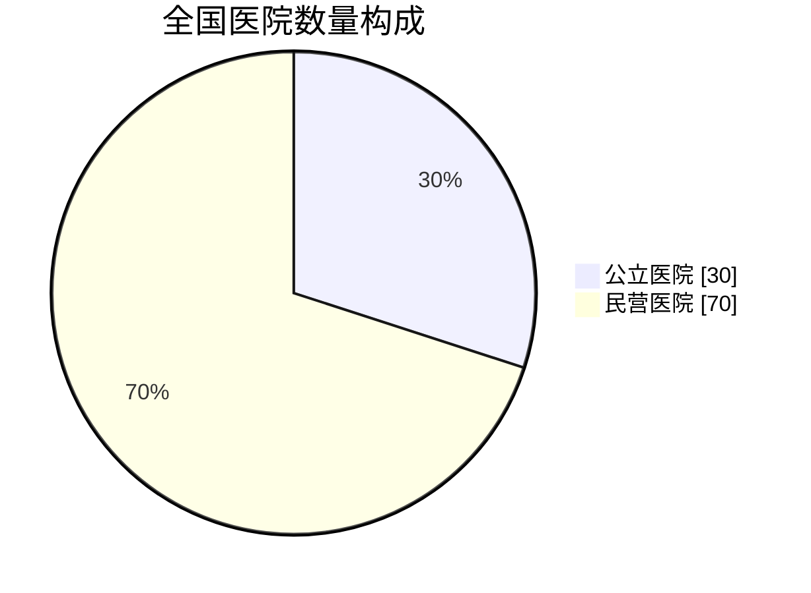
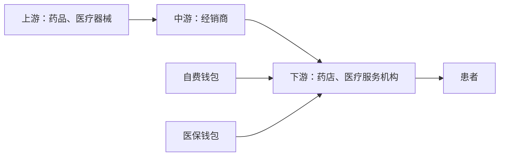
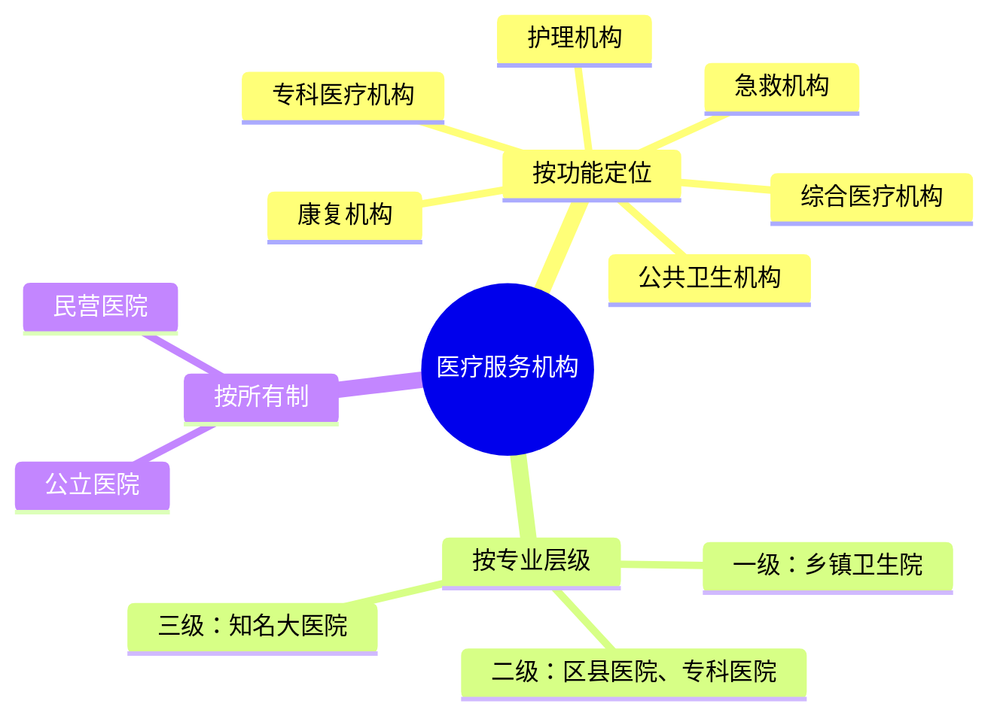
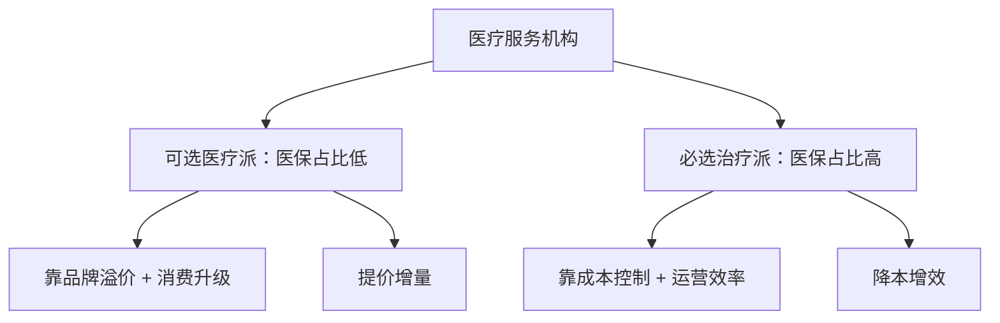
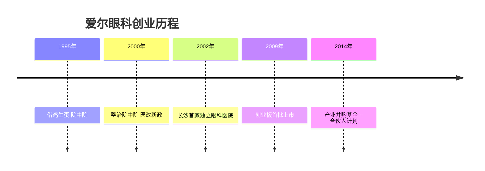

## 一、一张药方，通往万亿产业

一张字迹潦草、像画符一样的药方，却是每个老百姓看病吃药的起点，更是一张通往万亿级产业的“门票”。没错，说的就是医疗服务。2023年，中国医疗市场规模已经冲到了9.1万亿元，相当于每个中国人一年就得花8000多块钱在医疗上。

但有意思的是，你以为这9万多亿都进了公立医院的口袋，那就想简单了。

## 二、数量倒挂的“离奇”现象

把数据往细里拆，会发现一个特别有意思的现象：全国一共38355家医院，其中公立医院只有11772家，差不多占30%，剩下的近70%全是民营医院。

这就离谱了。按道理公立医院才是我们心中的“白衣战神”——按看病人次算，每年有83%的人都去了公立医院，而且那些顶尖的医生、设备也基本全在公立里面，可以说公立医院就是医疗卫生领域的“定海神针”。

那为啥在这种“王炸级”存在面前，民营医院不仅没倒，还越开越多，有的甚至开去了国外，直接干成了国际连锁品牌呢？今天就来聊聊这个神秘的医疗服务产业。

## 三、一场“高地保卫战”：拆解产业链

要弄清楚民营医院怎么赚钱，先得把整条医疗服务产业链捋清楚。打个比方，如果把健康看成一块必须守住的高地，那医疗服务产业链就是一场“高地保卫战”：上游是生产药品和医疗器械的“炮弹库”，中游是把炮弹运送到前线的经销商，下游则是负责冲锋陷阵的药店和医疗服务机构。

先说上游，这相当于医疗服务的原材料，包括药品和医疗器械。药品分中药和西药，医疗器械则分为诊断设备等。要打治病救人的仗，没有这些“家伙事”可不行。不过在这个环节，一些高端设备还是被外国人牢牢占据：眼科的飞秒激光设备主要来自德国和美国，口腔种植体来自瑞士和韩国，内窥镜设备来自日本。这些设备技术门槛高、利润丰厚，生产商们自己也知道，自己卖的不是普通商品，而是别的地方买不到的“超高音速远程导弹”。

中游就是经销商，负责把上游的这些“武器”卖到下游。而今天的主角，是下游的药店和医疗服务机构——这也是战况最紧张的战场，尤其是医疗服务这块，值得好好拆解。

聊完产业链，还有个关键问题：医疗这事儿说到底还是钱的事儿，那这个钱到底谁来出？在中国，有两个“钱包”负责出这个钱。第一个钱包就是咱自己的“私房钱”——谁看病谁花钱，丰俭由人，只要能解决身体健康需求就刷卡买单，图的是“活得更好”。第二个就是医疗保障基金，也就是医保，这是一种“集中力量办大事”的基金，包括职工基本医疗保险、城乡居民基本医疗保险、城乡居民大病保险以及医疗救助等专项基金。发现没？医保最讲究的就是“基本”，也就是保障14亿中国人的基本医疗需求，图的是让咱“活下去”。这样一来，整条产业链就通了：上游卖药和设备形成成本，中游经销商负责运输，下游各种医疗服务机构激烈竞争又互相合作，由两只钱包提供动力，就像一个精妙的生态系统。

## 四、医疗机构的三种分法

给医疗服务机构分分类：按照功能定位，可以分为综合医疗机构、专科医疗机构、康复机构、急救机构、护理机构和公共卫生机构。

按专业层级分，就是咱们常听的一级、二级和三级：乡镇卫生院就属于一级医疗机构，看点小病没毛病；二级医疗机构一般是区县级的医院和专科医院，属于“地方精英”，除小毛病外，一些常见病也能搞定；三级医疗机构就相当于当地甚至全国知名的大医院，像协和、瑞金、华西都是这个级别，不光能看常见病，疑难杂症甚至罕见病也能“hold住”。

而视频开头说的公立和民营，则是按所有制来区分的。公立医院属于“国家队”，任务很明确：保基本、保公平，服务更广大的人民群众，但这也形成了“排队两小时、看病5分钟”的尴尬局面。民营医院更像是“民间游击队”，硬拼肯定拼不过公立医院，那就走另一条路——灵活补位，专门接公立医院接不住的那部分流量：你公立医院不是排队时间长吗？那我就搞不排队、原地就诊；甚至有的“卷王”还能创新诊疗手段，倒逼公立医院去优化诊疗流程，成了整个医疗系统的“实验田”。

## 五、两大阵营：可选医疗派 vs 必选治疗派

接下来聊医疗服务机构的商业模式。不同类型机构都有自己的一套运转模式，很难总结，但咱可以把重点放在终端消费者上，看这家机构的收入到底从哪里来——也就是它的医保收入占比。根据医保收入占比高低，可以把医疗服务机构分成两大阵营：可选医疗派和必选治疗派。两种模式、两套玩法，商业模式完全不同。

## 六、可选医疗派：为“更好”买单

先说可选医疗派。这些机构医保收入占比特别低，比如爱尔眼科，2021年医保收入占比只有15.8%左右——也就是说100块的收入里只有不到16块来自医保，剩下的80几块都是患者自掏腰包。那为啥大家愿意自己掏这么多钱？除了医保没有覆盖之外，更重要的是这些机构的目的不是“活下去”，而是“活得更好”。

举个例子：假如你近视500度，其实戴眼镜就能看清，完全不影响日常生活，但你发现戴眼镜拍照显脸大不好看，想把眼镜摘掉、做朋友圈“最靓的仔”，这时候你可能就愿意花个两三万去做个全飞秒手术了。再比如白内障，最基础的白内障手术医保能报销，装个普通晶体看得见就行；但如果你想装个散光矫正型晶体、顺便把散光一起解决，那对不起，差价部分就得你自己掏。这就是可选医疗的本质——为“更好”买单。

那这类机构的赚钱法门是什么？四个字：提价增量。第一招提高客单价，靠产品升级。这几年的屈光手术就是这么干的，更新换代速度跟手机差不多：第一代好比“功能机”，半飞秒好比“智能机”，全飞秒SMILE好比“折叠屏”——每换一代创口更小、恢复更快、服务更好，价格也从几千涨到了两三万。患者买的不是“把近视矫正”这件事，而是又快又体面的综合体验，所以屈光类手术的毛利率能轻松突破50%。

第二招增加业务量，靠品牌和连锁。想吸引更多患者进院消费，医院就得像小超市一样遍地开花，最常见的方式是“中心+卫星”：在大城市建区域诊疗中心，在县城插满门诊揽客，甚至社区里也得整个基础检查工作站。这个模式爱尔眼科玩得最溜——国内200多家医院、上百家门诊，卷完国内再去卷国外，到处开，硬生生搞成了“眼科星巴克”；要是再加一手三甲医院专家挂牌兼职，品牌格调瞬间拉满，患者想不来都难。

这两招落地，效果就出来了：产品升级抬价、提高毛利，狂做广告打出品牌，到处开店引流，继续强化品牌心智，反过来再继续升级产品——这产业飞轮不就转起来了吗？

## 七、必选治疗派：在医保面前精打细算

再说说必选治疗派。这类机构以治疗疾病和康复为主，一般都需要住院，收入来源跟可选医疗派正好相反——医保占了大头，一般都是30%起步。但在医保面前，所有机构都是“弟弟”：检查怎么做、治疗方案怎么出、手术和药方怎么开，都不是医院自己能说了算的。

而且最近几年，医保还在推广DRG和DIP，不再按照“做了什么”来付钱，而是按“得了什么病”来打包结算。医保局说治好一个阑尾病人，我给你8000块，这是包干价；你要是7000块就搞定了，赚的1000块归你；你要是花了9000块，亏的1000块自己扛着。这相当于给医院下了一个“生死状”：要么精打细算赚钱，要么管理粗放亏本。

这直接改写了必选医疗的赚钱模式：过去靠多开药、多检查创收，现在反而多用一分钱，都是在吃自己的利润。所以必选派的赚钱逻辑变成了四个字——降本增效。怎么降本？采购要便宜、用药要精准、检查只做刚需；怎么增效？流程要优化、住院时间要缩短、病床周转要加快。

比如HG医疗，2024年毛利率只有29.9%，远低于爱尔眼科的50%。再看国际医学，2023年营收涨了70%、飙到46亿，结果年底一算反倒亏了3.68亿——为啥呢？因为前期投入砸得太狠，买设备、建医院、引进质子治疗技术，这些都是重资产投入，但收入却被医保卡得死死的，毛利率也只剩8%到9%。

所以说，收入来源对医疗服务机构的生死至关重要：可选医疗派不靠医保，相当于服务业，靠的是品牌溢价和消费升级，选择权在患者自己，机构要做的就是提供更好的服务让他们心甘情愿掏钱；必选治疗派算是制造业产品，服务价格自己说了不算，靠的是成本控制和运营效率。一个是想方设法提高客单价，一个是绞尽脑汁降低成本；一个“我让你活得更精彩”，一个“让你活下去”——路线不同，玩法完全不一样。

## 八、巨头诞生记：爱尔眼科的逆袭

但无论选择哪条路，都绕不开那座大山——公立医院。在如此强大的“外敌”面前，有一家眼科机构不仅活了下来，还成长为行业巨头。一位退伍军人竟然建立了全球最大的眼科帝国，一家小诊所竟能从“寄人篱下”干到市值千亿，一个看似饱和的市场竟然还能闯出新的黑马。现在就来聊聊这家巨头的故事，一起揭开医疗服务的竞争密码。

故事要从一个叫邦哥的人说起。1965年出生的邦哥有过一段军旅生涯，人们都说当过兵的人身上有三个特点：坚毅、刚强、敢为人先。在后来的创业路上，邦哥也把这三个特点体现得淋漓尽致。

1995年，退伍后的邦哥盯上了一个巨大的机会：他发现中国有大量的白内障患者，但能做手术的医院却少得可怜，这里肯定藏着巨大的创业机会。可创业哪有那么容易——没场地、没执照、连设备都买不起。这时候邦哥使出一招“江湖绝技”：借鸡生蛋。先分期付款搞了一套眼科设备，再带着机器去找长沙市第三人民医院谈合作，结果还真谈成了——医院出场地、出医生，邦哥出设备、出运营，一个白内障治疗中心就顺利落地了。这就是当时流行的“院中院”模式，说白了就是在公立医院里再开一间“医院里的医院”，属于一种“套娃模式”。

这种模式的好处，一句话：找到组织了。借了公立医院的金字招牌，患者信得过；借了公立医院的医生，省得自己招人；还借了人家的场地，启动资金少、风险相对可控。但坏处也很明显：你再牛也始终只是寄人篱下，说到底不是自己的生意。果然没过几年，这种模式就干不下去了——2000年，国家开始大力整治“院中院”，要么撤、要么收编。

眼看着第一桶金要打水漂了，邦哥完全慌了。但咱就是说，有的人真的是命好：想吃饭有人递筷，想睡觉有人递枕头。同一时期，国家开始推动医改，明确允许社会资本开办营利性医院。对于别人来说这只是一纸新政，但对于邦哥来说那绝对是救命稻草。想都没想，邦哥直接开干——2002年，邦哥在长沙开出了第一家真正属于自己的独立眼科医院。

但独立门户谈何容易。首先没钱，开医院是重资产生意，买设备、租场地、装修样样都要花大钱，邦哥当时资金紧张到什么地步？据说连工资都要挪用设备款来发。其次没医生，好医生都去公立医院了，民营想挖人根本挖不过来——哪个医生愿意放弃公立的“铁饭碗”，跑你民营医院赌前途呢？最难办的还是没患者，一听民营医院，老百姓自动脑补电线杆上的小广告，立马捂紧钱包，信任感很难建立起来。没钱、没人、没患者，一山更比一山高。

但人就是这样，越被逼到绝境，越逼着他去思考解决问题的办法。2009年10月30日，爱尔眼科成功登陆创业板，成为首批上市的公司之一。这一上市，翻身仗就正式打响了。

上市之后，最先帮邦哥解决的就是钱的问题——上市当年利润直接涨了60%，手里有了钱，腰杆子就硬。最关键的是，“上市公司”四个字，让所有人的印象就俩字：靠谱。以前招医生，人家嫌你是民营医院不稳定；现在一听是上市公司，而且还提供高工资高待遇，医生就愿意加入了。患者也一样，看到这家医院是股市挂牌的“正规军”，信任度蹭蹭往上涨。

不过，让爱尔眼科从一家普通上市公司一跃成为市值千亿巨头的，是他在2014年推出的两个“大杀器”。

第一招，产业并购基金。简单解释下：假如你想开100家分院，一家分院要投资500万，那100家就是5个亿，一般人谁有这实力？而且医院是重资产，新院刚开肯定亏钱，至少得养个一两年才能开始盈利，如果这期间的亏损都记在账上，作为上市公司财报就会很难看，很影响股价。邦哥想了个办法：他找来专业的投资机构，共同成立一个孵化基金，自己只出资一小部分，剩下的大头由投资机构来出，然后用这个基金的钱去收购或新建医院。这些新医院相当于被放进了一个独立于上市公司的“孵化器”里，培育期间即便出现亏损，也不会直接影响上市公司的财报，这就保证了上市公司的业绩稳定。等这些医院运营成熟、开始盈利了，邦哥再按照市场价把这些优质资产买回来、并入上市公司。

这样一来，“体外孵化、成熟注入”，用1个亿的自有资金撬动了5个亿的投资，开出100家医院的地盘，扩张了、风险隔离了、财报还漂亮，这盘棋下得属实高明。

第二招，合伙人计划。光有钱不行，还得有医生愿意干。邦哥把话挑明了：别光给我打工，咱们一起合伙开医院。比如一家新开的医院投资1000万，邦哥出资700万，核心医生和院长出300万，咱们一块儿当老板。这下医生就从拿死工资的“打工仔”摇身一变成了老板，医院赚得越多，股份也就越值钱。换你，你也得拼了命地干。这两招双剑合璧，成就了这家眼科巨头。
