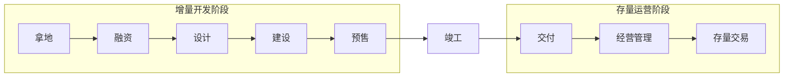
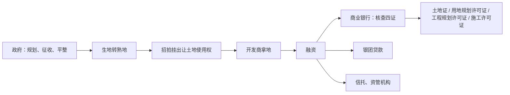
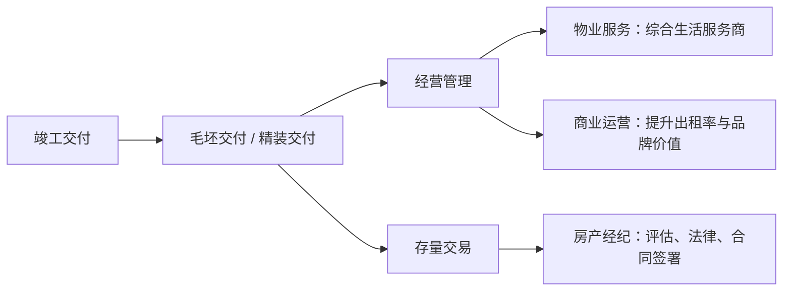
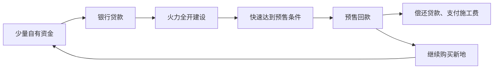
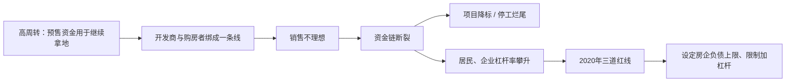
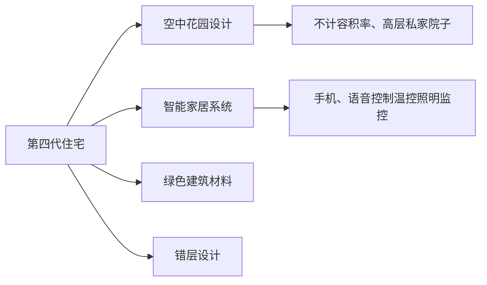
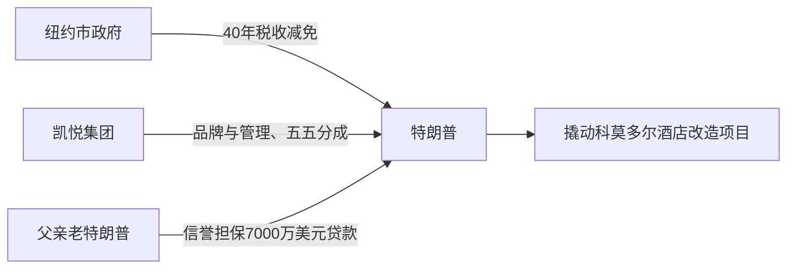
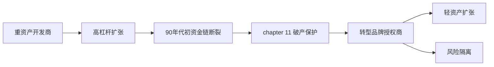
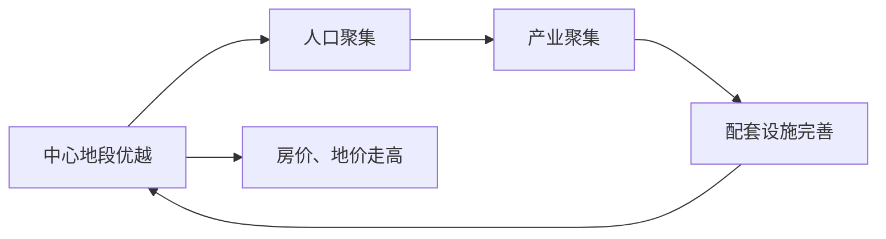

## 一、10亿，只是房地产的"入场券"

假如给你 10 亿遗产，让你进军房地产当个地产大佬，你会怎么办？你可能觉得 10 亿很多，用这笔钱开个地产公司足够了。但很抱歉，在房地产行业，这笔钱很可能连个水花都激不起来。

光看 2023 年，中国房地产的年销售额就达到了 11.7 万亿。这个数字有多夸张？它几乎接近俄罗斯当年一整年的 GDP，超过了全球 140 个小国家的 GDP 总和。在如此庞大的数字背后，是每年新造出来的 10 亿平方米的房子，是 1000 万个家庭的收货地址，更能创造出 6000 万个就业岗位。

你可能以为房地产就是买地、盖楼、卖房，但实际上，实际过程要比这个复杂得多。一个地产项目大致可以分成两个阶段：增量开发阶段和存量运营阶段，这两个阶段以房子竣工为分界线。

## 二、增量开发阶段：拿地、融资、设计、建设

首先要建房，先得有地。拿地是你进入市场的第一步。在咱们国家，土地不是商品，而是由各级政府负责供应的稀缺资源。政府通过规划、征收、平整等步骤进行土地的整备，将一片"生地"转为"熟地"，为后续开发奠定基础。之后，地方政府通过招标、拍卖或者挂牌的方式，将土地使用权出让给你，你才可以在上面盖房子。

拿地需要巨额资金，尤其是当这块地需要以招拍挂来决定最终归属的时候，需要的资金只会更多。主要是因为你的竞争对手太多了，而且实力都很雄厚。所以为了拿下这块地，你就必须出高价，甚至成为当地的"地王"。

如果你的钱不够，就需要借助融资来解决资金问题，这时候金融机构就登场了。商业银行一般是你最先接触到的"金主爸爸"，但银行可不是好糊弄的。在给你贷款之前，银行一般会要求你提供"四证"来确保项目的合法性，包括土地证、用地规划许可证、工程规划许可证和施工许可证。如果需要的钱特别多、一家银行不够，那你还可以去求助其他银行搞个银团贷款，或者找信托公司、资管机构等有贷款资质的公司借钱。但要注意，在不同的地方借钱，利率是不同的——知根知底的机构可能会给你低利率，那些不太了解你的机构，可能要通过利率上浮来提供风险保护。

有了钱、拿了地，接下来就是设计。你需要委托设计院和建筑设计公司进行设计，这一阶段决定了项目的整体结构、空间布局以及建筑风格。设计过程有很多限制，比如容积率、绿化率、消防设备等等，所以这一步你还是需要不断和政府部门打交道，反复确认设计是否合格，直到最终定稿。

随着设计方案的确定，项目进入施工阶段。你需要找一家建筑公司做总承包商，来负责施工阶段的所有问题。总承包商与多个分包商紧密合作，确保每个环节如打桩、砌墙、防水等按时完成，确保工程质量。与此同时，原材料供应商，比如采石厂、砂厂、水泥厂也要参与进来，保证项目如期完成。

你会发现，你的项目从开始到这，每一步都是花钱的。那什么时候能收钱呢？当项目开工之后，建到一定程度了，你就可以申请预售证了。拿到预售证，咱就可以开始卖房了，这也将是你第一次看见"回头钱"。但销售的过程也不简单，从售楼处的选址、样板间装修到销售话术设计、团购活动的安排，每一个细节都影响销售的效果。

## 三、存量运营阶段：交付、经营管理、存量交易

接下来经过一段不短的时间，你的项目终于竣工了，从此增量开发阶段完成。这个阶段里，你分别接触到了政府、金融机构、设计公司、建设公司，还有一部分的销售公司，每一位参与者都是这个阶段不可或缺的关键。

房子竣工之后，首先是交付。这里你将面临一个选择：如果选择毛坯房交付，那到这儿就可以交付了，房子的框架搭好了，里面怎么装那是业主自己的事；如果选择精装交付，那接下来的装修还得你继续负责。不管是哪种选择，接下来进场的就是装修、家具、家电这些公司了。

交付之后，重头戏就转向了经营管理。先说物业：过去的物业管理基本等于"保安加保洁"，但现在不一样了，物业越来越像一个综合生活服务商。好的物业不仅能让房子保值增值，还能让业主住得更舒服。所以你既可以选择成立自己的物业公司，也可以和市面上有成熟服务体系的公司去合作。如果你的项目属于商业项目，那你还将需要成熟的商业运营公司参与进来，通过提升出租率和品牌价值，把后期的经营管理从成本变成利润。

存量交易也是一个重要的环节。尤其是在一二线城市，由于土地供应有限、新房库存减少，更多买房的人选择二手房，此时房地产经纪公司就来了。他们不仅协助买卖双方完成交易，还提供包括房产评估、法律服务和合同签署等一系列增值服务。

到这存量运营咱们就说完了。发现了吗？房地产项目从土地获取到竣工交付，再到后期运营和存量交易，完全不是你花点钱就能解决的。每个环节都需要不同领域的专家参与进来，也需要这些专业人士通力合作，共同组成这个庞大且复杂的地产产业链。

## 四、房地产怎么赚钱：高周转模式

我们终于可以恭喜你，将手里的 10 亿遗产变成了丰富的行业知识和一个富有生机活力的地产项目。但仍有一个问题没有解决，就是房地产行业到底怎么赚钱。

在中国，房地产不仅关乎财富，更关乎时代。作为过去 30 年增速最快的行业之一，房地产经历了辉煌的黄金时代，如今却正面临着风云变幻的挑战。想要理解房地产的财富逻辑，就要回归它的最初起点——中国房地产的快速崛起，始于 1998 年住房制度改革。这一改革不仅把房子从单位分配的物资转变为市场化的商品，还把行业一键切换到高周转模式。

什么是高周转呢？简单来说就是"多拿地、快建、猛卖"，核心逻辑就是让各种资源转起来。开发商拿到一块地，只用很少的自有资金，就可以通过银行贷款筹集资金。一旦资金到位，他们火力全开进行建设，让项目快速达到预售条件，尽早拿到预售证，接着就开始卖房子。卖房子的钱，也就是预售资金，成为公司最重要的血液。这笔资金会被用来偿还贷款、支付施工费用，甚至继续购买新的地，继续下一个循环。只要能不断通过卖房子回款，资金链不断，规模就能不断地扩大，雪球也就滚起来了。

在这种背景下，房地产公司想挣钱必须拼速度。毕竟公司搞了个"456 军规"——翻译一下就是拿地后四个月开盘、五个月资金回笼、六个月资金回正。为了实现这个速度，BT 公司要求设计院当天出图，甚至设立"摘牌即开工"的严苛奖惩机制。这种极限施压，就是高周转的直接产物。

## 五、高周转的代价：杠杆率与三道红线

然而，高周转模式同时也会带来烂尾房、开发商跑路这种现实问题。开发商通过债务链条，把自己和购房者变成了一条线上的蚂蚱：房子还没建好，购房者的贷款就已经被用来让开发商继续拿地了。一旦销售不理想、资金链断裂，后果是灾难性的——轻则项目降低标准，当初的那些承诺化为泡影；重则项目停工，留下一个个烂尾楼，还有一个个背负着沉重房贷却无家可归的家庭。

更可怕的是，这种模式会让居民和企业部门的杠杆率达到史无前例的危险程度。中国居民部门的杠杆率从 2011 年初的 27.8% 猛增到了 2020 年的 62.2%；同一时期，中国企业部门杠杆率从约百分之百暴涨到 146%。居民和企业的债务负担一旦远远超过他们的还款能力，就可能引发大规模的违约，甚至导致金融危机。

于是 2020 年，人民银行和住建部推出了"三道红线"政策，直接设定房企负债水平的上限，从根源上限制了房企加杠杆的能力，精准打击了依赖高周转模式的房企。加上销售持续下滑、预售资金回笼变慢，高周转模式下的资金链迅速断裂。

过去 BT 公司创始人曾说"高周转是我们战无不胜的法宝"。然而随着市场的变化，他不得不承认，为了历经百年，宁可放慢一些发展速度，追溯根源、全面提升公司管理水平。这一转变标志着业界开始集体反思，单纯追求速度与规模的游戏已经走到了尽头。

## 六、从高周转到高质量：第四代住宅

所以现在的房地产公司想要挣钱，开发商必须把房子视为一项精致的作品，而非一个简单的快消品，也需要从高周转转变到高质量上来。第四代住宅就是高质量的典型代表。

这种住宅与传统住宅的区别在于，它更加注重居住的舒适性、功能性和环保性，并且融入了智能家居系统、绿色建筑材料等创新技术，从而提供更高质量的居住体验。第四代住宅最具代表性的特点，就是它的空中花园设计和智能系统的结合：一些高端项目将空中花园设计不计容积率，打造出高层住宅的 200 平私人花园，这不仅满足了业主对于私密空间的需求，还提高了城市密集环境中的空间利用率。同时智能家居系统的加入，让业主可以通过手机、语音助手等工具，轻松控制家中的温控、照明、安全监控等设施，提升居住的便捷性和安全性。

国内最早也是最知名的第四代住宅实践者之一，是坐落在成都新都区的"七一城市森林花园"项目。早在 2018 年，他们就通过创新的错层设计和结构，硬是在高层建筑中为每一户打造出了一个层高近 6 米、可以种树养花甚至遛狗的私家院子。这种颠覆性的产品，直接带来了惊人的市场回报——当年这个项目的售价达到了每平米 1.8 万到 2.2 万元，远高于周边普通高层住宅的均价 1.3 万元，溢价率高达 40% 以上。尽管价格如此之高，这个项目依然受到了市场的疯狂追捧，一经推出便迅速售罄。

七一城市森林花园的成功证明了一点：只要产品足够颠覆、设计足够有吸引力，消费者就愿意买单。尽管第四代住宅的设计也引发了关于成本、维护和蚊虫等方面的一些讨论，但正是这些颠覆性的创新，把房地产产品的竞争从户型和装修的这种小打小闹，一路卷到了建筑形态的根本性革命。

与此同时，购房者的心态也发生了根本性的变化。过去，购房者决策更多依赖于价格和投资的潜力；而如今，他们更关注开发商的财务稳健性和物业服务水平。特别是经历了烂尾楼事件后，购房者越来越倾向于选择财务健康的国企和央企。统计数据显示，自 2022 年以来，现房销售增速明显高于期房，这反映了购房者对期房交付的风险担忧，逐渐更青睐"所见即所得"的现房。

## 七、大洋彼岸的样本：特朗普的高杠杆游戏

靠一笔遗产就能成功当上地产大亨，你可能觉得这是小说里面才有的爽文情节。但在大洋彼岸的美国，确实有一个人拿到了这样的人生剧本——他就是特朗普。他曾经负债 34 亿美元、个人担保近 9 亿，却能全身而退；他六次申请破产保护，越挫越勇，身价却不降反升。有人说他是商业天才，有人说他是投机分子，无论如何评价，他的商业逻辑都值得认真思考。

虽然特朗普本人可能不愿意承认，但是他的商业起点确实离不开他的父亲——弗雷德·特朗普。我们暂且叫他老特朗普，他是一个低调却精明的地产商。他的商业模式很简单，就是在纽约外围的皇后区、布鲁克林，为中产阶级建造买得起的公寓，不求暴利、但求稳定。老特朗普有两个商业原则：第一，善用政府资源，通过政府的贷款补贴大大降低融资成本；第二，善于营销细节、诚意满满，比如房价以点九九结尾、用船只播放爱国音乐。这些招式看起来很土，但是还真能吸引来客户。到 1970 年代，老特朗普已经有了 2 万多套公寓，净资产超过 2 亿美元，在那个年代这可是笔巨款。

但是年轻的特朗普偏偏瞧不上他爸这种"小富即安"，他不想一辈子收房租，而是盯上了曼哈顿，想站上让所有人都注视的舞台，立志做一个大人物。他的第一个代表作，就是纽约地标建筑——科莫多尔酒店改造项目。

让我们把时间线拉回到 1976 年。那会儿的纽约可真的是乱成一锅粥，城市的财政几乎破产、犯罪率爆表，这直接赶走了很多中产阶级，曾经辉煌的科莫多尔酒店完全变成了流浪汉的避难所。就在所有人都对这座城市失去信心的时候，27 岁的特朗普却看到了机会：别人眼里的一栋破楼，他却当成了一块宝地——科莫多尔酒店就在曼哈顿市中心火车站的旁边，只要把它盘活，就妥妥等于拿下一块黄金地标。但问题是，当时他的口袋里根本没啥钱。

没钱不重要，特朗普的"骚操作"这就来了。首先，年轻的特朗普直接去找纽约政府谈判，他给政府画了一张超级大饼，说纽约需要投资、需要就业、需要希望，而他可以带来政府所有需要的东西，但是政府必须给他前所未有的支持。经过几轮马拉松式的谈判，他还真把政府给说动了，拿下了长达 40 年的税收减免——现在算下来，这项政策让纽约市足足少收了四个多亿美元的税。然后，他带着政府背书去找到了凯悦集团，直接摊牌说自己有政府的全力支持和 40 年的税收优惠，凯悦只需要出品牌和管理，就可以五五分成。凯悦这一听，一下子就心动了。最后，特朗普拿着前两个筹码去找到了银行的领导——你看政府支持我，凯悦也跟我站到一边了，这个项目稳赚不赔。但银行还是犹豫了：一个 27 岁的小毛孩，凭什么管得了这么大的项目？这个时候特朗普就开始"拼爹"了——老特朗普虽然没有直接出钱，但是他用自己在纽约地产界几十年的信誉，为儿子的 7000 万美元贷款提供了担保。

看出来没？这笔交易里，政策是纽约市政府给的，开发和管理是凯悦集团搞的，7000 万担保是特朗普他爹出的。特朗普这把属于是绝对意义上的空手套白狼，付出只有嘴皮，却撬动天文数字的杠杆。

## 八、高杠杆的代价与品牌授权转型

这个项目在 20 多年后被特朗普卖给了凯悦集团，卖了 1.4 亿，利润也是 1.4 亿。更重要的是，这个项目让他一战成名，把"以小博大"变成了他的招牌风格，模式跑通了，接下来就是无脑复制。

进入 1980 年，特朗普彻底放飞了，开始疯狂扩张。这个时候的特朗普已经是玩杠杆的高手了，他靠发行高息债券，在曼哈顿盖起了标志性的特朗普大厦，还跑到大西洋城砸钱修赌场。最夸张的是泰姬陵赌场——这座号称"世界第八大奇迹"的赌场，花了特朗普 11 亿美元，而且因为借了 14% 的高息债券，每天光利息就要烧掉 100 多万美元。这种模式跟咱们的高周转差不多：在经济上行期，随便他怎么玩，一旦经济下行，这套高杠杆体系就扛不住了。

果然，90 年代初美国经济下行说来就来，泡沫破裂，特朗普的资金链瞬间断裂，雪球一路滚到了 34 亿美元，其中将近 9 亿多都是他本人亲自担保的，可以说那会儿他几乎是被债压得喘不过气来。1991 年，因为经营不善，开业才一年的泰姬陵赌场就率先撑不住了，准备申请破产。各种压力之下，特朗普又玩起了法律游戏——美国的破产法里有个 chapter 11，规定了美国企业申请破产保护，欠的债不是还不上吗？那企业可以和债权人重新协议，商量一个各方都能接受的还债方案。可以说特朗普把这个工具用到了极致。

面对一群愤怒的债权人，他的核心论点直截了当：他本人以及他所代表的特朗普品牌，对于银行来说已经是大到不能倒的存在——如果他倒了，银行就只能低价甩卖那些挂着特朗普名字的资产，收回的钱连零头都不够；但如果让他继续留在牌桌上，用他的品牌把这些资产的市场价值撑起来，银行才有可能收回放出来的贷款。是不是觉得挺无赖的？但没想到这套说辞居然奏效了。就像有句话说的：你欠银行 100 万，着急的是你自己；但如果你欠银行 10 亿，那着急的就是银行了。银行最后妥协了，不仅帮他重组了债务，还提供了新的贷款支持，甚至为了维持特朗普和奢华绑定在一起的品牌形象，银行每个月给他发放 45 万美元的生活津贴。对银行来说，这不是仁慈，而是无奈——因为"特朗普"这个名字，本身就是他们抵押品里最值钱的东西。换句话来说，别人遇上这种局面，多半是一夜之间破产清算、彻底出局；但特朗普不一样，在他眼里，破产不是终点，而是一种商业工具。他硬是靠着破产保护和大到不能倒的牌桌逻辑，把巨额债务转嫁给了债权人和投资者，而自己始终靠着 TRUMP 这个金字招牌苟了下来。

也正是在这次生死劫之后，他彻底意识到，最值钱的资产并不是那些高楼大厦，而是 TRUMP 这五个字母——这个名字已经和奢华成功划上了等号，光靠这个名字他就能赚钱。于是特朗普做出了关键转型，从一个高风险、重资产的地产开发商，摇身一变成了品牌授权商，把品牌当印钞机。

进入 90 年代后期，特朗普的核心打法就是两个字：轻和隔。先说"轻"，轻就是轻资产扩张。最典型的案例是巴拿马的特朗普海洋俱乐部，在这个项目里，特朗普的角色彻底改变了：他不是开发商，不用出一分钱买地；他不是建设方，不用管施工和质量；他只做一件事，那就是授权使用特朗普这个商标。想要挂上这个商标的开发商，必须先交一笔授权费，然后再按照销售额、酒店分红和管理费来分成。举个例子，在巴拿马项目里，开发商光是为了挂上特朗普这个名字，就要先付 100 万美元；此外，特朗普还要求 4% 的酒店总营收做管理费，甚至停车场和商铺的租金他也要抽成，模式跟现在的奶茶店加盟差不多。再说"隔"，隔就是风险隔离：在这种模式下，所有的风险都由合作方来承担，也就是说，就算项目烂尾，特朗普这边也只是授权了品牌，出了问题跟他完全没有关系，在法律和财务上几乎能做到毫发无损。正如他的律师所说，在经济下行周期，这套玩法保护了特朗普，却让投资者暴露在风险之中。

事实证明，这套"卖名字"的商业逻辑，比自己亲自下场做开发更赚钱也更安全。2000 年到 2018 年间，当特朗普的其他实体业务累计亏损了 1.7 亿美元时，他靠品牌授权和代言反而净赚了 2.3 亿美元。这就是品牌的魔力。

## 九、未来拼什么：地段、产品、运营

讲到这里，我们不妨对比一下中国的高周转模式和特朗普的高杠杆模式。中国的高周转模式说白了就是一场现金流游戏，靠的是人口红利和预售制度，核心就是快买地、快开工、快预售、快回款，盘子越滚越大。特朗普的高杠杆模式，其实就是靠资本市场与他的个人品牌撑起来的金融游戏，简单来说就是借来一大堆债，用银行和资本市场的钱把项目撑起来，再靠品牌挡住风险，把赚到的钱揣进自己口袋里，把麻烦和风险甩给别人。看上去这两条路径好像南辕北辙，但其实本质都一样——都把房地产这门实体生意，变成了资本和金融的游戏。但问题是，这两种游戏现在都玩不下去了：中国这边监管越来越紧，高周转自然玩不动了；美国那边，虽然特朗普靠着高杠杆一度赚得盆满钵满，但代价就是多次破产和官司不断。

那经历了这么多周期之后，房地产公司之间现在到底在拼什么？答案其实很简单，就一个字：地。地产开发商常说"得地者得天下"，为什么呢？因为地段决定了未来的溢价空间，拿地能力直接决定了一家房企的上限。说白了，钱可以融资，品牌可以积累、风险可以隔离，但如果你地段选错了，本事再大也救不了一点。特朗普也懂这个道理，所以他一开始就锁定了曼哈顿最核心的地段，这说明中美两边其实都一样——能不能拿到好的地段，才是你能不能出头的关键。

那什么才是好地段呢？通常来说，二线及以上城市的市中心就是兵家必争之地。这里有一个经济学里的概念，叫做"地租梯度理论"，意思很简单：离市中心越近，交通成本越低，区位优势越大，企业和居民愿意付出更多的钱；而随着城市边界扩张，中心区域的稀缺性被进一步放大，房价、地价自然一路走高。

大家之所以愿意抢好地段，还有一个重要的原因就是配套。你想一下咱们买房前会考虑什么呢？无非就是出行方不方便、家门口有没有菜市场超市、孩子能不能在附近上学、遇到事儿有没有医院、附近有没有商圈、闲了能不能去看看电影。换句话说，就是吃饭买菜、医疗、教育、娱乐这些缺一不可。配套一到位，人口和产业就容易扎堆，一扎堆儿，地段的价值就继续变高，慢慢形成一个正向循环：中心地段一好，人口就会越多，产业也就会越聚集，这样的配套设施就会越来越完善，中心地段变得越来越好，所以这里的房价也就会越来越高了。这样一个循环一旦启动，就越发难以被打破，这也解释了为什么城市中心地段总是那么抢手。

当然，在好地段的基础上，还要有好产品。地段给你底牌，产品决定你能不能赢得人心。房子不仅要耐看、耐住，还要满足未来生活的需求，这样买房的人才会心甘情愿掏钱，安心把家安在这儿。

总的来说，买房不光是要买房子本身，更是买一个地段发展的红利和一种生活方式。那些依赖外部红利、把风险甩给别人的玩法都走不远，不管是靠人口增长玩预售，还是靠信贷玩杠杆，都经不起周期的考验。必须回归本源——企业只有选好地段、做好产品，为百姓提供值得长期持有的房子，才能在市场中打造一个值得信赖的品牌，也只有这样才能穿越周期。
