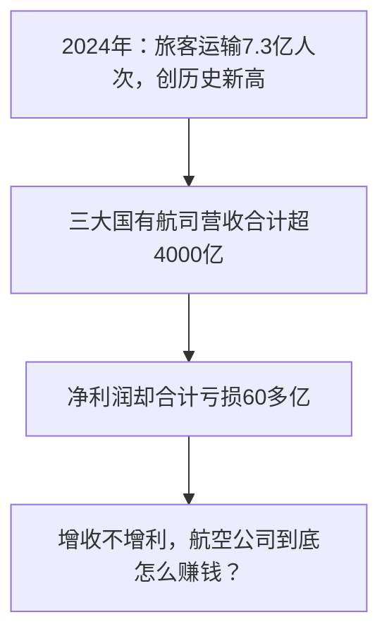
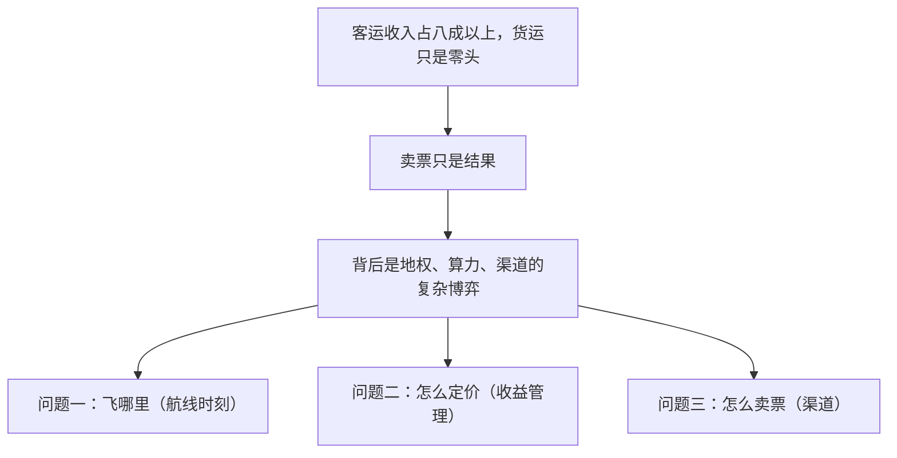
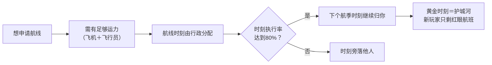
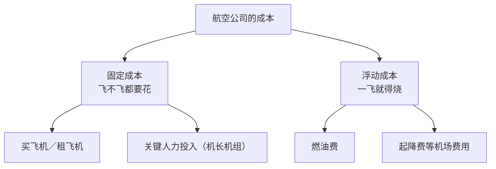
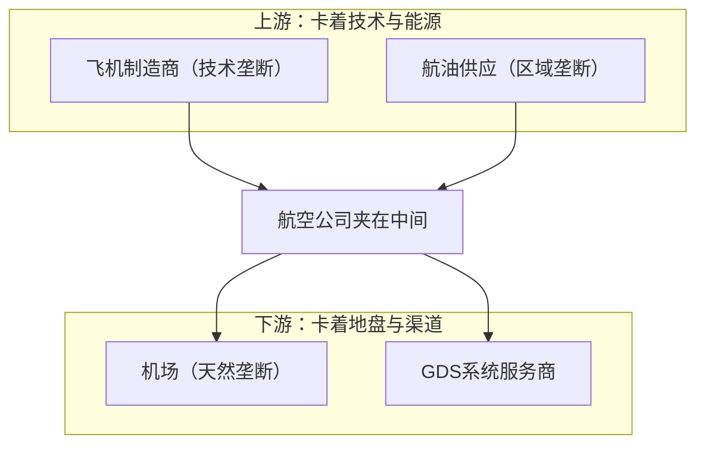
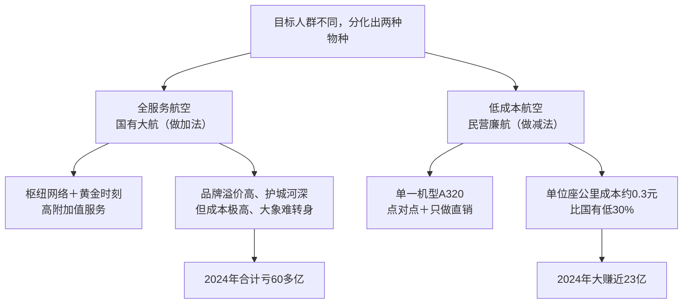
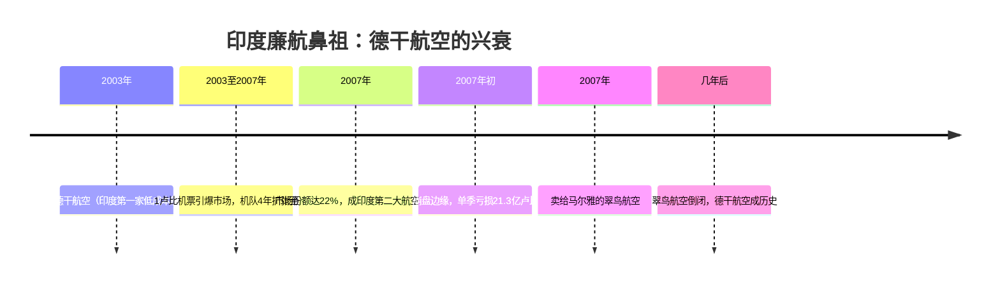
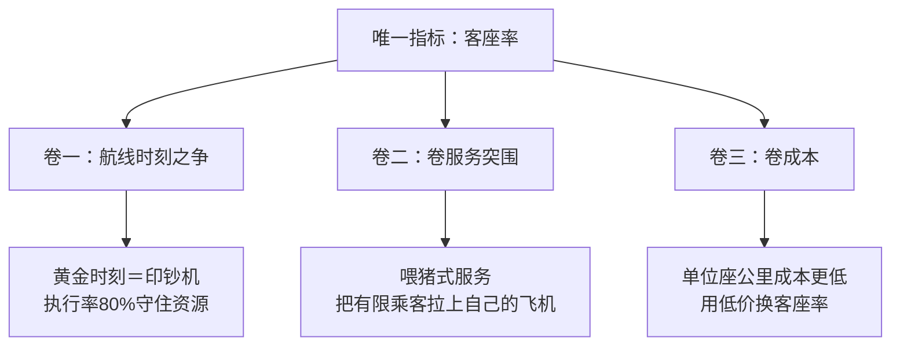

## 一、旅客量创新高，为什么赚钱这么难？

2024年，中国民航业全年一共运输了7.3亿人次，相当于半个中国的人都在天上飞了一圈，直接超过了疫情前的水平。然而魔幻的是，同样在2024年，国内三家最大的国有航空巨头营收加起来干到了4000多亿，结果一算账，三家不但没赚钱，反倒合起来亏了60多亿。

那航空公司到底是怎么赚钱的呢？难道这是一个赔本赚吆喝的行业吗？我们先把航空业从收入和成本两个方面扒拉一遍。

## 二、收入端：三个灵魂拷问

先看收入端。很多朋友会认为，航空公司的收入就是把票卖给乘客，就这么简单。确实，从数据上看，客运收入能占到八成以上，货运只能算零头。但卖票只是结果，背后其实是一场关于地权、算力和渠道的复杂博弈。要把客运这块大头讲清楚，可以拆成三个灵魂拷问：飞哪里、怎么定价、怎么把票卖出去。

### 飞哪里：航线时刻才是核心资产

航空公司光有飞机可不够，还得有航线。航线和时刻，是航空公司最核心的资产，就像房地产里的黄金地段一样。在中国，航线和时刻属于国家所有的战略资源，需要行政分配，不是你想飞就能飞的。想申请一条航线，有一个很现实的前提，那就是你得有足够的运力——飞机要有，飞行员也要有。至于运力是买是租，本质上就是算账，哪个便宜、哪个能最快把运力补上就选哪个。

但即便有了运力，资源还是不一定能给你，因为这里面有一个关键规则叫做"历史优先权"：在一个航季内，一家航司只要对某个时刻的执行率达到了80%，那下一个航季这个时刻就还归他。就像你在市中心占了个停车位，只要你天天来停，那这个车位永远是你的。这就导致了一个结果——时刻永远掌握在老玩家手里。

拿最经典的京沪航线举个例子。这条连接北京和上海的航线，是业内公认的黄金航线，因为这条线上的乘客大多数是商务人士，不在乎票价贵不贵，只在乎时间。早在2019年，这条航线一年就能运送超800万人次。所以对于占据京沪两地主场优势的老牌航司来说，最深的护城河，就是手中这些核心枢纽的黄金时刻。新来的小弟想进去，能问到的只有半夜两点的红眼航班和远离繁忙的冷门机场。

所以看一家航空公司能不能赚钱，别着急看他飞机新不新，先看他手里有多少核心地段的时刻资源。

### 怎么定价：收益管理系统

有了航线时刻，接下来是第二个问题——票价是怎么定的。相信大家都有过这种困惑：同一趟航班、同一个座位，早买晚买，或者换一个平台买，价格能差好几倍。这可不是玄学，这是航空公司背后那套收益管理系统。

先说仓位。我们平时只能看到头等舱、商务舱、经济舱这种大分类，但航司内部会在每个大类下面细分出多个子仓位。不同航司的仓位字母不完全一样，但底层逻辑是一样的：系统会根据历史数据、当前的销售速度和预期客流，实时决定每个仓位放多少张票。目标只有一个——把飞机上的每一个座位，按尽可能高的价格卖出去。

### 怎么卖票：代理商与中航信

航线有了、价格定了，接下来是第三个问题——怎么把票卖给乘客。航司卖票主要靠两类中间人，一个叫机票代理商，一个叫GDS。

先看机票代理商，说白了就是我们手机里常用的那些头部在线订票App，以及线下的老牌国有旅行社，当然现在也都转战线上了。虽然现在国内是零佣金时代，航空公司不再给代理商回扣，但还是得按人头给平台交一笔服务费，因为用户都已经习惯在这些平台上比价下单，平台手里握着巨大的散客流量，航空公司短期内根本离不开这些平台。为了提升利润、强化自有品牌，航司也在提高官网、小程序等直销渠道的占比，减少对代理的依赖，把利润和客户的数据留在自己手中。

再看GDS，中国的GDS系统供应商，就是中国民航信息集团（简称中航信）。你可能没怎么听过它的名字，但很可能用过它旗下那款能看飞机飞到哪儿的App——那就是它面向C端旅客的产品。中航信掌握了国内超过95%的机票销售，运作逻辑是这样的：航空公司会把绝大部分的座位库存同步到这个系统里，我们前面讲的机票代理商，都得通过这个系统去查询和订票。

这套基础设施当然不是免费的。每卖一张票，航空公司不仅给代理商服务费，还得按人次和航段给系统交系统使用费，通常每段几块钱。别小看这几块钱，粗略乘以年度7.3亿人次的客运量，对整个航空业来说，可能就是几十亿的刚性支出。

## 三、成本端：给整个产业链打工

接下来看航空公司的成本是怎么来的。航空业是一个典型的"成本雷打不动、看天吃饭"的行业，可以说以一己之力给整个产业链打工。成本可以分为两类：第一类是固定成本，就是飞不飞都要花的钱，主要是买飞机、租飞机以及关键的人力投入；第二类是浮动成本，就是一飞就得烧的钱，最典型的是燃油费和起降费。

### 第一份工：给飞机制造商打的

航司的第一份工，是给飞机制造商打的。想开航空公司总得有飞机，而世界上能造大飞机的就那么几家，基本等于垄断，这导致他们的议价能力强得离谱。一架飞机动辄几亿甚至十几亿，买飞机带来的巨额费用是航司背在身上几十年的大山，是最典型的固定成本。买不起飞机的航司就得租，这笔钱也是铁打的刚性支出，不管今天飞不飞，只要飞机挂在账上，钱就得照付。

而且一旦选了飞机的品牌，比如买了批波音737，航司基本就被这个体系锁死了。为什么？因为飞行员只会开这个机型，维修工只会修这个机型，库存零件全都是和这个机型匹配的，想换空客，人员和设备都得重新来一遍，这个成本高得能让一家航司当场破产。更可怕的是，一旦造飞机的寡头出现产能问题、交付速度下降，就会极大影响航空公司申请新航线，直接影响收入。

### 第二份工：给自家飞行员打的

航司的第二份工，是给自家飞行员打的。除了飞机这个铁疙瘩，航空公司还有一笔巨大的隐形投入——人，尤其是机长和机组。培养一个成熟的民航机长要10年，从航校毕业的小学员到能独立驾驶大飞机的机长，中间要经历无数次的改装训练、模拟机训练、复训和跟飞。这个期间，航司要为一个机长砸进去300到500万元人民币。可以说花钱可以买来飞机，但买不来机长。

而且核心人力规模很难快速收缩，不可能因为一个淡季就把机长裁掉，旺季再把他召回来，所以人力成本也是航司的一大块固定支出。

### 第三份工：给石油巨头打的

航司的第三份工，是给石油巨头打的。"飞机一响黄金万两"，这话一点都不夸张。燃油成本通常占到航空公司总运营成本的三成，这部分是典型的浮动成本，飞得越多烧的油就越多，国际油价一上涨，账上的成本立马跟着抬头。

最可怕的是，航空公司在这块成本上几乎没有议价权。首先在中国，航油供应几乎是垄断的，航司没有货比三家的空间；其次国内航油价格跟国际原油挂钩、波动极大，但机票价格不可能像油价一样实时跟涨跟跌。所以国际上一打仗、一减产，油价一哆嗦，航司的利润就没了。为了对冲这种波动，航空公司会使用金融工具进行套期保值，来抵消油价波动对财务数据的影响。整个局势可以总结成"国内垄断供应、国际波动定价"，航空公司的日子真不好过。

### 第四份工：给地主（机场）交保护费

航司的第四份工，是给地主交保护费，机场就是那个地主。飞机买来了、油加满了，总得找个地方起飞吧，这就得跟机场打交道。飞机轮子一沾地，收费就开始了——起降费、停车费、客桥费、安检费，名目五花八门，这笔钱完全没有讨价还价的余地。机场是天然垄断，无论这趟航班是满员还是空飞，只要你用了跑道，这钱一分少不了。机场旱涝保收，风险全在航司头上。

讲到这你可能已经发现了，航空公司其实活得挺憋屈：上游有技术垄断的飞机制造、区域垄断的航油供应卡着技术和能源，下游有坐地收租的机场、抽成抽到手软的系统服务商卡着地盘和渠道。航空公司夹在中间，左手是雷打不动的固定成本，右手是看天吃饭的浮动成本，还要面对同行之间的激烈竞争，是典型的夹缝中求生存。

## 四、怎么赚钱：把客座率拉上去

那航空公司到底怎么赚钱呢？可以说，不同的航空公司本质上提供的服务没有任何区别，都是把人从A机场运到B机场，而且很难独占一条航线，竞争非常激烈。在这种情况下，航空公司在机票上就不可能有太高的话语权，但凡敢涨价，乘客就敢买别人的机票，反正坐谁的都是坐。

更惨的是，只要飞机起飞，航油、飞行员这些刚性成本就已经产生了，很难压缩；更何况飞机本身极其贵，这部分固定成本占据了航空公司的大部分资金。所以不管一趟飞机上坐了多少人，这趟飞机的成本几乎可以认定为是固定的——坐一个人和坐100个人的成本几乎完全一样。在这种情况下，航空公司想要赚钱，就必须先想办法把客座率拉上去，用更多的乘客去摊掉那一大坨压缩不掉的刚性成本，也就是先跑量。

为了跑量，航空公司必须知道自己的乘客是谁，也就是所谓的目标人群。根据目标人群不同，行业进化出了两种完全不同的物种——全服务航空和低成本航空。

全服务航空，就是咱们熟知的那几家国有大航空，妥妥的"高富帅"，目标人群是那些愿意为时间、舒适度和品牌付高价的高端客群，所以逻辑是做加法：手里有庞大的枢纽网络、黄金时刻和宽敞的休息室，靠这些高附加值服务，让坐商务舱、买全价票的老板们买单，以此保证客座率。这种模式的优点是品牌溢价高、护城河深，但缺点也很明显——成本极高、大象难转身，一旦遇到经济下行或油价暴涨，亏损起来就是天文数字。比如2024年，三家巨头合计亏了60多亿，就是因为庞大的身躯在复苏期还没完全跑起来。

低成本航空，就是以上海为大本营、以抠门著称的春秋航空，堪称"精算师"。目标人群是价格敏感、追求性价比的休闲旅客，逻辑是做减法：在他们看来，飞机就是一个带翅膀的大巴，核心服务是安全准时到达。他们只用一种机型A320，只飞点对点、不搞复杂的转机，只搞直销，甚至都可以不接入中航信的系统，结果就是运营成本大幅下降。这家廉航龙头能把单位座公里成本压到0.3元左右，比国有三大航足足低了30%，这也是为什么2024年巨头们都在亏损的时候，他能大赚近23个亿。

不管什么策略，目的都一样——拉高客座率。只要客座率上去了，航司就可以占据稳定的航线资源，进而服务好特定的乘客，然后在合适的时候适当涨价、拉高一点收入。不管怎么说，这是一个需要极其精打细算的行业，所有的精打细算都围绕着客座率进行，这就是航空公司的生存之道。

## 五、案例：印度廉航鼻祖戈皮纳特

在这个充满精算和规则的航空世界，偶尔也会冒出一个完全不按套路出牌的人。他不只是计算成本、追求利润，而是想彻底让航空业变得不一样——这个人就是被称为印度廉航鼻祖的 G.R. 戈皮纳特（G.R. Gopinath），一个来自印度底层、白手起家、凭一己之力挑战航空业巨头、彻底改写了印度航空格局的男人，硬是让普通老百姓也坐上了飞机。根据他的故事改编的电影《英勇赞曲》，在外网评分高达9.2分。

戈皮纳特没有名门出身，也没有名校光环，人生经历简直就是一部印度现代史的缩影。他出生在偏远的农村，长大后的戈皮纳特去参军，成为一名陆军上尉，真刀真枪地参加过1971年的孟加拉解放战争；后来对军旅生涯感到厌倦，于是提前退役。退役后的他也没闲着，用时髦点的话讲是个连续型创业者——回家种过地、搞过蚕丝养殖、开过摩托车行、干过农家乐，几乎啥都尝试过，甚至还拿过劳力士的雄才伟略大奖。

但就是这样一位有点土气的退伍军人，做出了一个让全印度乃至全世界航空业都惊掉下巴的决定：他要开一家航空公司，而且目标不是赚富人的钱。他指着自己办公室里的清洁阿姨和门口的三轮车司机说——我要让他们也能飞上天。

那时候的印度，坐飞机只是少数婆罗门精英的特权，一张从班加罗尔到德里的单程机票高达1万2500卢比，而普通人的月收入只有几千卢比，对他们来说坐飞机简直太奢侈了。戈皮纳特在国外旅行时被廉价航空深深震撼，发现原来飞机也可以像印度的火车、大巴一样成为大众的交通工具。于是2003年，他创办了印度第一家低成本航空公司——德干航空。

为了打破印度人心中"飞机等于昂贵"的固有认知，戈皮纳特祭出了惊世一招——机票只卖1卢比。1卢比是什么概念？甚至不够你在印度街头买一杯印度奶茶，但戈皮纳特却让你坐飞机，四舍五入相当于白给。当然，并不是所有票都卖一块钱，每趟航班只有几个座位是这个价格，剩下的座位价格会随售出数量逐步上涨，直到最后的全价票，实际上就是用高价票补贴低价票。这一招的效果堪称核弹级：一夜之间，"一卢比坐飞机"的消息传遍了印度的每一个贫民窟和村庄，全印度都疯了，无数从没见过飞机长啥样的穷人拖家带口、拎着大包小包涌向机场，那场面比春运还壮观。德干航空瞬间家喻户晓，戈皮纳特也被媒体捧为印度的平民英雄。

从数据上看，德干航空从2003年的一架飞机起步，仅仅用了4年时间，机队规模就膨胀到了45架，市场份额一度达到22%，直接干成了印度第二大航空公司。飞机上满载着第一次坐飞机的普通乘客。

但在商业世界里，情怀不能当饭吃，掌声也不能抵消债务。作为一家廉价航空公司，德干航空几乎把所有的问题雷区都碰了一遍。

问题一是机型太杂。廉价航空成功的秘诀是单一机型，因为单一机型意味着维修班底、飞行员培训、甚至仓库里的零件都只要准备一套就行了，这样能极大降低成本。但戈皮纳特为了飞偏远小城市买了一堆ATR螺旋桨小飞机，为了飞大城市之间的干线又买了一堆空客A320大飞机，这样一混搭直接导致运营成本飙升。

问题二是糟糕的基建、裸奔的油价。廉价航空想赚钱关键在于高周转，通常靠飞二线机场，因为那里收费低、不拥堵，飞机落地加个油马上就能飞走。但那个时候的印度根本没有像样的二线机场体系，德干航空虽然想服务小城市，主干航线却还是不得不挤在孟买、德里这些拥堵的大机场，这些机场不仅收费高，而且地面运作效率低，戈皮纳特的飞机经常在天上盘旋等待降落，或在地面停靠等待起飞。更要命的是燃油，印度的航空燃油税是全球最高之一，能占到成本的1/3以上；成熟航司会做燃油套期保值，也就是买个保险锁定油价，但德干航空完全没有这个能力，基本就是在裸奔。戈皮纳特曾拼命向政府请愿，要求允许套保，但这也正说明了他们当时缺乏这种关键的金融护盾——国际油价涨一块，成本就涨一块，完全是在看天吃饭。

问题三是不理性的扩张。戈皮纳特太想做泛印度的航空公司，所以疯狂开辟新航线，只要地图上有个点就想要飞过去。这种激进的扩张策略导致公司运营复杂性直接拉爆，航班延误、取消变成家常便饭，服务质量直线下降。虽然创造了惊人的客运量，但财务报表上却是一场灾难：为了维持低价的品牌形象，即使成本已经控制不住，它依然不敢大幅涨价，这样就陷入了一个死循环——卖得越多，亏得越狠。

到了2007年初，看似辉煌的德干航空已经到了崩盘的边缘，一个季度里的亏损高达21.3亿卢比，现金流断裂、债主上门，戈皮纳特的梦想碎了一地。

就在此时，维贾伊·马尔雅（Vijay Mallya）出场了。马尔雅拥有一家名为翠鸟航空的公司，与德干航空完全相反，走的是极致奢华路线：空姐都是精挑细选的模特，飞机上提供顶级餐食娱乐系统，定位极高。2007年，马尔雅看中了德干航空庞大的市场份额和机队，决定收购它，然后吃下廉价航空市场。戈皮纳特迫于无奈，将自己一手创立的公司卖给了马尔雅。

但可以想象一下：左边是一家卖1卢比机票、服务农民工的廉价航空，右边是一家服务亿万富豪、主打奢华体验的航空公司，把这两家完全不相干的物种硬生生塞到一块儿，会发生什么？结果很直白——文化和战略的彻底精神分裂。马尔雅根本看不起廉价模式，接手德干航空后就开始用全服务的标准去改造它，试图抹去德干航空"廉价"的标签，这也直接导致德干航空失去了最核心的竞争力——低成本和低票价。原来的德干航空乘客发现票价涨了，就不坐了；而翠鸟航空的高端乘客发现服务质量被稀释了，也跑了。这次合并被后来的商业分析师称为"毒药"——它不但没能救活德干航空，反而像一个巨大的黑洞，把原本还算风光的翠鸟航空也拖下了水。几年后，庞大的翠鸟航空也因巨额亏损和债务危机彻底倒闭，那位不可一世的马尔雅甚至成了逃犯，而德干航空这个曾经承载着无数印度人飞行梦的名字，也彻底成为了历史的眼泪。

## 六、总结：所有的卷，归结为客座率

讲完印度机长的悲剧，最后来总结一下：为什么戈皮纳特的梦想会坠落，而一些经营者却能穿越周期？说白了，在这个行业里想赢，靠的不是情怀，而是靠卷。如果说这门生意里只有一个指标能把所有的航司卷到一起，那就是客座率——谁能在尽量稳定成本的前提下，把每一班飞机的座位坐满，谁就能活得更久。

第一个卷，是航线时刻之争，它其实就是客座率的天花板。在这个行业，最硬的资产不是飞机，而是能天然跑出高客座率的航线和时刻。航线时刻在本质上是天空中的历史优先权，这项资源由行政分配，只要老玩家把航班正常飞出来、把时刻执行率维持在80%以上，这个资源就能一直在他们手上。想想那条年入百亿的京沪航线，跑道容量有限、萝卜多坑少，谁能拿到早上八点起飞的黄金时刻，谁就掌握了印钞机。而对新玩家来说问题就大了，甭管砸多少钱，都几乎无法获取这种稀缺资源，只能分到一些商业价值一般的非高峰时段，客座率天然就发育不良。所以卷地权的核心，就是看谁能把握那些最容易坐满人的黄金时刻和航线。

第二个卷，是通过卷服务实现差异化的突围。没抢到好地段、好时刻的航司并不是完全没有机会，他们要卷的是在同一条线、同一个时段，如何让更多乘客选择自己，也就是客座率更高。一个典型的例子是四川航空，被网友戏称为"喂猪式服务"：你刚坐下，热腾腾的担担面就端上来了；刚吃完烤红薯，烤玉米又塞给你了；最后还不忘拎出一瓶国民辣酱，空姐一勺一勺地往你碗里加。这种极具烟火气息的差异化服务，让他硬是把飞机变成了空中火锅店，牢牢抓住了乘客的心。在航线和票价都差不多的前提下，很多乘客就会选择它，起码一路不挨饿。结果就是，他不仅提高了航班的客座率，还在某种程度上稳住了价格，形成属于自己的小护城河。所以卷服务，就是靠服务和产品把有限的乘客拉上自己的飞机。

第三个卷，是卷成本，这是决定生死的红线。成本卷到什么程度，决定了你有多大空间用票价去换客座率。在一条大家机型、时刻都差不多的航线上，谁的单位座公里成本更低，谁就有底气把票价压得更低；票价一低，原本坐不满的座位就有机会被补上来，客座率自然就会被卷得更高。这就是为什么春秋航空老是被拿出来当课代表——他靠单一的机型和极致的运营效率，将单位座公里成本压到比对手低三成，再搭配自营销售渠道，尽可能把利润捏在自己手里；成本一降下来，他就敢用价格说话了，把淡季的飞机也尽量填满，客座率常年维持在高位。所以卷成本，就是给自己创造用低价换客座率的空间。

故事讲到这儿，希望你对这门生意有了全新的认识。航空业的真相远没有表面看起来那么光鲜亮丽，这是一个投入高、风险也高的行业，不相信眼泪，也不允许犯错，只有那些保持极致清醒、用不同打法卷高客座率的玩家，才能穿越周期、安稳落地。
