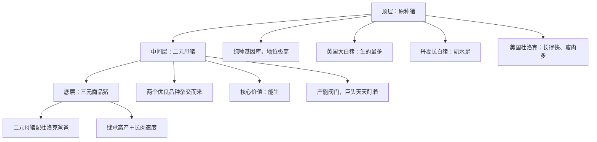
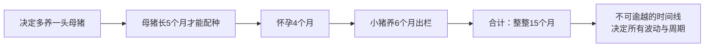
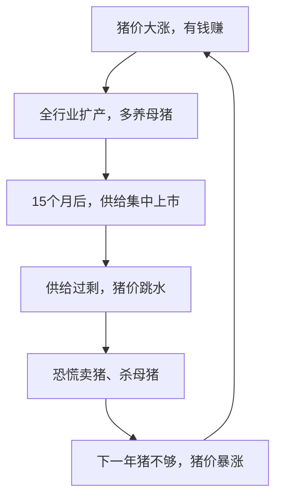
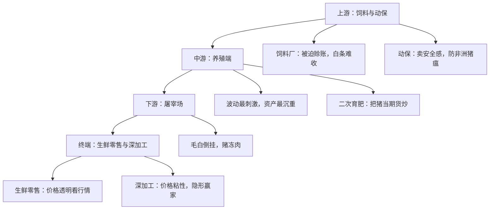
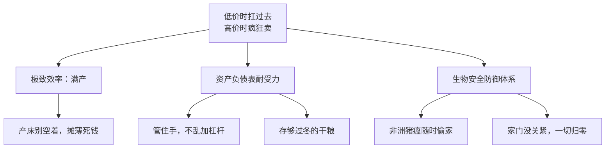
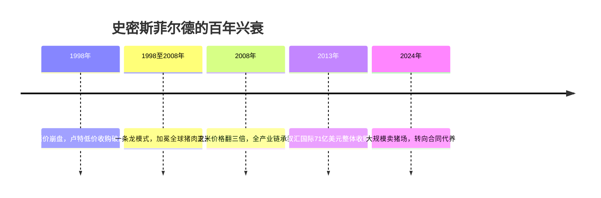
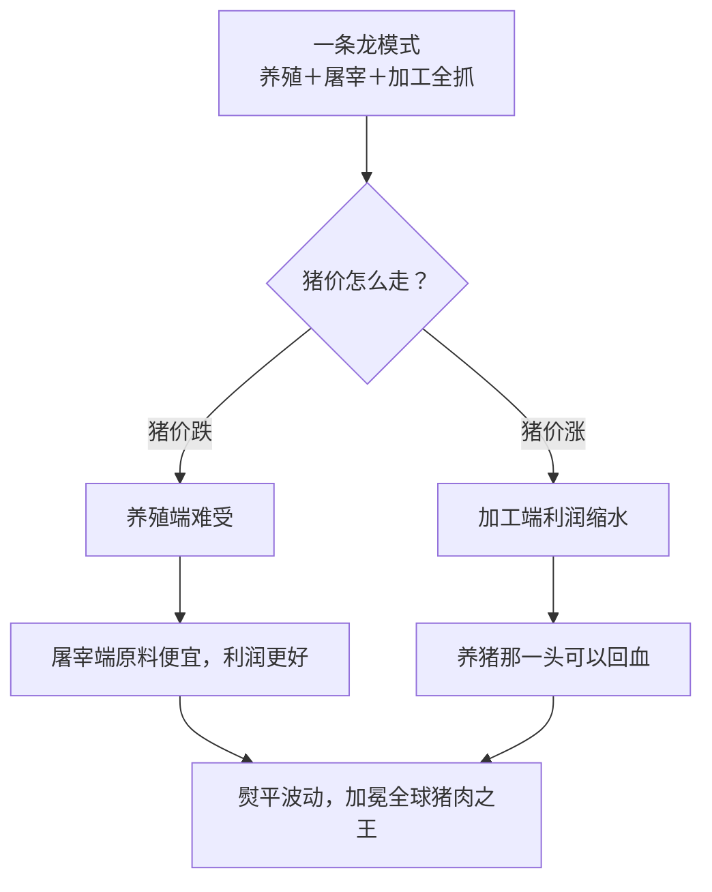

## 一、从一盘饺子到万亿生意

过年那盘猪肉大葱馅的饺子，背后连着的，其实是中国最庞大也最残酷的一门生意——养猪。2024年，中国一年出栏的猪有7亿多头。这是什么概念？全球一半的猪都在咱们这，市场规模是万亿级别，意味着每天都有几十亿的资金、饲料、产能和库存在这个链条里面狂奔。

今天的养猪业，早就不是那个靠经验碰运气的传统农业了，它已经摇身一变成了一台精密的金融机器。下面咱们就把这台机器拆开掰碎了，好好说道说道。

## 二、猪场里养的到底是什么猪

要拆开这台机器，得先搞清楚一件事：现在的猪场里养的到底是什么猪？很多人觉得二元猪是主流。确实，在猪场的账本里，二元猪是核心资产，但在咱们的餐桌上，三元猪才是真正的主角。简单来说，二元猪是生猪产业的母鸡，而三元猪才是咱们碗里的产品。

商品猪可不是随便配出来的，它背后是一座等级森严的繁育金字塔。

金字塔的最顶层叫原种猪，它们是纯种基因库，地位极高，几乎不进菜市场，主要负责改良基因。这里有三位国际大将：生的最多的英国大白猪，奶水足的丹麦长白猪，还有长得快、瘦肉多的美国杜洛克。

金字塔的中间层就是二元母猪，它们通常是那两个优良品种杂交出来的，核心价值就两个字——能生。它是养猪业最关键的资产，也是视频里面那些巨头们天天盯着的产能阀门。

而金字塔的最底层，才是我们吃到的三元商品猪。它通常就是让那些能生的二元妈妈，配上一个强壮的杜洛克爸爸生出来的孩子，既继承了妈妈的高产，又继承了爸爸的长肉速度。这种猪有多恐怖？它每吃2.5斤的饲料就能长一斤肉，只需要半年就能长到240斤左右，出栏速度是被压到了极致的。在资本的眼里，这不叫猪长得快，这叫资金周转高。同样的饲料，土猪吃下去会变成粪便，三元猪吃下去就会变成人民币——效率就是正义。

## 三、15个月：无法快进的生物时钟

但你得记住一个前提：从配种到出栏，这是一个生物学的过程，它没法快进，也没法跳过。哪怕你是身价千亿的巨头，也得老老实实地守着那个冷冰冰的生物时钟。

从你决定多养一头母猪开始，这头母猪自己得先长五个月才能配种，然后怀孕四个月，生下小猪后再养六个月才能出栏——整整15个月。这就是养猪业的底层逻辑，而正是这条不可逾越的时间线，决定了养猪业的所有波动风险，还有那个让人头大的周期。

## 四、猪周期：价格的过山车

说到这个周期，咱们经常听人说猪肉的价格在坐过山车。理解这个现象，其实只需要记住一句话：现在的价格信号指导的是未来的产能，但问题是供给永远是滞后的。价格该涨的时候涨过头了，该跌的时候又跌得太狠了，这就是经济学里那个著名的蛛网模型。

想象一下，你是个养猪户，今年的猪价大涨，你一看有钱赚，立马决定扩大规模。但因为那15个月的时钟是锁死的，当你扩充的产能终于上市时，你会发现全行业的人都和你做了一样的决策，猪一股脑的全出来了，供给瞬间过剩，价格立马跳水。大家一看亏钱了，又开始恐慌，集体卖猪、杀母猪。结果到了下一年，猪又不够了，价格再次暴涨。就这样反复拉扯一个循环，大概三到四年。

咱们从供需两个角度来看看这个死循环。先说需求，其实需求挺稳的。中国人爱吃猪肉，猪价跌了，你一天也吃不了十顿红烧肉；猪价涨了，你虽然会去买点鸡肉代替，但也很难彻底不吃。

真正要命的是供给，供给有两个毛病，一是慢，二是硬。慢，是咱们刚才说的生物学时差；硬，是因为现在的养猪是重资产——母猪、猪场、自动化设备，这些钱你一旦投下去，每天折旧费、电费、人工费都在烧，你一旦开了头，就根本没法随时踩刹车。很多时候，即便猪价已经跌破成本线了，企业也得硬着头皮继续养。为什么？不养，亏的是全部投入；继续养，起码还能回笼点现金，分摊一下那些已经投进去的死钱。说白了，不是养猪人不想停，而是他们已经被猪给绑架了。由于这种供给的刚性，猪周期的底部往往走得又长又痛。

而且你要注意，今天的猪周期正在发生微妙的变化：周期还在，但规矩变了。过去，市场是一盘散沙，大家习惯追涨杀跌；现在，舞台中心全是规模化的大猪场，他们看的不只是猪价，他们看的是现金流能不能撑住、银行给不给贷款、资产负债表够不够硬。于是，周期就变成了一场残酷的耐力赛。当猪价掉进泥潭，散户往往先被熬死，而那些手握重金的头部巨头，只要手里还有钱，甚至会选择逆势扩张，趁着别人倒下，用更便宜的价格抢地盘。这就是为什么在这一轮旷日持久的低谷里，即便大家都已经亏到怀疑人生了，依然在死扛——因为谁都没到资金链彻底断裂的那一刻。

## 五、抄底？先看懂能繁母猪的陷阱

你可能会问，既然有周期，那我提前判断位置去抄底行不行？以前有个黄金指标，叫能繁母猪存栏量。逻辑很简单：既然母猪决定了未来的供给，那母猪少了以后，猪价肯定涨。但现在这个指标只能当个参考，千万别当标准答案。

原因有两条。第一，供给不等于头数，还得看猪有多重。如果大家都在压栏，每头猪多养几十斤再卖，那就算猪的总数少了，市场上的肉也未必少。第二，产能不能只看数量，还得看质量。现在的技术进步太快了，同样是一头母猪，由于管理水平、防疫能力的提升，它一年能提供的仔猪数量——也就是所谓的PSY——可能完全不一样。管理好的公司，一头母猪顶别人两头。如果你只盯着头数看，那你肯定会被市场的真实产能给骗了。

所以现在聪明人看的是更贴近真实市场的信号，比如出栏的平均重量、冻入库里的库存变化，还有那个最让人不安的因素——二次育肥。

## 六、产业链：利润像水一样流动

理解了周期，咱们再顺着产业链走一遍。你会发现养猪业从来不是大家一起赚、一起亏，利润就像水一样在链条里来回流动。

上游是卖东西的饲料和药。表面上看，饲料厂赚的是加工费，但在猪周期里，饲料厂往往被迫成了养殖户的影子银行——猪价一跌，养殖户没钱买料，饲料厂只能让对方赊账，财报上看着有利润，其实全是收不回来的白条，一旦下游倒闭，这些账目可能瞬间蒸发。至于动保，也就是卖兽药的，他们卖的其实是安全感。养猪最大的黑天鹅就是非洲猪瘟，那玩意致死率极高，在猪场里消毒采样，那不是讲究，那是保命。

再看中游养殖端，这是波动最刺激、资产最沉重的环节。这里有个搅局者叫二次育肥。这群人很有意思，他们不养母猪，只买快出栏的商品猪，再多喂一两个月。他们本质上是把猪当成了期货在炒——猪价涨一点，加上三四百斤的体重，利润会被迅速放大。它就像个波动放大器，猪价涨的时候抢猪推得更高，猪价跌的时候抛售砸得更狠。

接着往下走，就是屠宰场。很多人觉得猪价跌了，屠宰场成本低了，肯定赚翻了。其实不然。为了维持开工率，他们有时候不得不加价收猪，这时候就会出现一种尴尬的现象——毛白倒挂，就是卖肉的钱还抵不上买生猪的钱。屠宰场也在赌：赌对了，冷库里的冻肉就是金山；赌错了，光是电费和存货减值就能让他们压力山大。

最后是咱们熟悉的终端，一个是生鲜零售，一个是深加工。零售端的价格是透明的，涨跌几乎全看行情。但深加工企业才是真正的隐形赢家。为什么？因为价格粘性——火腿肠的价格可不会因为猪价跌了就立马降。这就意味着，当上游养殖户在滴血的时候，深加工企业的成本在下降，毛利却在起飞。他们把周期吃成了利润。

## 七、商业模式：一套严密的生存系统

产业链决定了钱流向哪里，而商业模式决定了钱能不能留住。既然养猪企业没办法控制猪价，那他们的商业模式其实非常残酷，也非常纯粹：就是在低价的时候扛过去，在高价的时候疯狂卖。

为了在低价时扛过去，这些巨头早已进化出了一套严密的生存系统。

首先，他们会追求一种极致的效率模式。既然猪场和设备的折旧费、贷款的利息是死的，那我就让每一张产床都别空着，这就叫满产。通过把这些死钱摊薄到每一斤猪肉里，在低谷中寻找那点微薄的利润空间。这种对成本的极致压榨，是他们能留在牌桌上的入场券。

但光有效率还不够，这套模式里最关键的一环，其实是资产负债表的耐受力。很多公司不是死于猪价，而是死于贪婪。真正厉害的商业模式，是在行情好的时候能管住手，不乱加杠杆，把账上存够过冬的干粮。只有守住这条资本的红线，才能保证在别人资金链断裂的时候，自己依然稳稳地坐在位子上。

最后，在这个模式的底层，还必须有一套滴水不漏的防御体系。在这个非洲猪瘟随时可能偷家的时代，生物安全已经不再是附加题，而是所有商业逻辑得以成立的前提。一旦家门没关紧，无论你之前的效率有多高、资金有多厚，所有的商业模式都会在一夜之间归零。

## 八、史密斯菲尔德：用结构对抗周期

你敢信吗？全世界近一半的猪，其实都是咱们中国养出来的。但这事儿最稀奇的地方在于，如果你看谁能把猪肉做成出名的火腿肠、卖遍全世界，那头把交椅反倒不在中国，而在美国。这家公司叫史密斯菲尔德（Smithfield Foods）。这家在美国大平原上呼风唤雨的顶级玩家，后来被咱们国内的双汇国际（万洲国际）给整体收购了。

很多人觉得这只是有钱了、买个公司。但如果你深入史密斯菲尔德的百年兴衰，就会发现，这其实是一场关于如何用新结构去对抗老周期的长期实验。

你要知道，在全球任何一个地方，养猪都不是稳赚不赔的。无论是在美国的农场还是在欧洲的猪场，养猪人的头上都悬着同一个幽灵——猪周期。这猪周期到底是怎么来的？为啥全世界都躲不开呢？其实背后有一个特别简单的道理：猪肉是大家每天都要吃的，需求很稳；但生小猪、养大猪是需要时间的。猪价一涨，全社会的养猪人都兴奋了，大家拼命多养母猪，但从你决定多养一头母猪开始，到它的后代长成大猪，这15个月的生物时钟是很难被外力打破的。等这一年多的时间过去，大家扩产的猪正好挤在一起，出栏的时候猪太多了，价格立马跌惨了。价格一跌，大家又恐慌性地杀母猪、关猪场，结果一年多以后猪肉又供不应求了，价格再次起飞。就这样周而复始，在自由竞争的市场里，一个完整的循环通常在三到四年。

如果你把视野放大到全球，会发现所有养殖厉害的国家，都经历过一段长达20到30年的惨烈大戏，这其实就是一部试图用规模化去对抗周期波动的演化史。比如日本，日本养猪业的规模化，很大程度上是被老龄化给逼出来的——年轻人不愿回乡下，小散户后继无人，再加上日本非农收入高，大家觉得养猪太辛苦，赚的还不如去工厂多，于是散户大量退出，最后剩下的基本是那些高度自动化的巨型企业。再比如丹麦和英国，他们面临的是另一种困境——市场饱和了，老百姓每天吃的肉就那么多，猪肉消费甚至还在萎缩，为了在有限的市场里活下来，他们只能通过疯狂提升效率，去压榨那一点点微薄的利润空间。

全世界的路径虽然不同，但目的都一样：试图通过规模化和技术升级，让自己的成本跑赢行业的平均水平。而美国，则把这种规模化的残酷推到了极致。

咱们说回1998年，那是美国养猪人最想哭的一年。那年冬天，美国的猪价跌到了几毛钱一斤。这是什么概念？当时超市里一瓶最普通的矿泉水都要一美元，也就是说，你拿十斤的猪肉才能换回一瓶水。运费比猪贵，卖一头亏一头，活生生的猪在那个冬天成了很多人的负担。于是，在美国中西部的雪地里，出现了一幕极其荒诞又残酷的画面：无数农场主含着泪端起猎枪，对着自己辛辛苦苦养大的生猪开了火。枪声响过之后，推土机直接进厂，把这些死猪推进深坑给埋了。那场灾难直接让几万家小农场彻底消失。

但就在这时候，史密斯菲尔德的掌门人约瑟夫·卢特三世（Joseph W. Luter III）出手了。他趁着别人走投无路，用极低的价格收购了那些快破产的巨头——一美元的资产，他只花35美分就买下来了。这一战，让史密斯菲尔德变成了超级大地主。他搞了一套一条龙模式，从生小猪、喂饲料，到杀猪、做成肉制品，全抓在自己手里。

这背后的核心逻辑，其实就是一种天然对冲。

猪价跌的时候，养殖端难受，但屠宰端原料便宜，利润反倒更好；猪价涨的时候，加工端利润缩水，但养猪的那一头可以回血。靠着这种结构，史密斯菲尔德熨平了波动，加冕成了全球猪肉之王。

但你要注意，这种所谓的对冲结构，并不代表真的能够战胜周期。为啥现在的猪周期越来越让人看不懂呢？因为周期也在进化。以前咱们说周期是群体情绪，现在周期变成了资产负债表大战。过去市场里全是散户，一看亏钱立马卖猪走人，所以产能去化快，周期也短；但现在舞台中心全是规模化的大企业，这些巨头看的不只是猪价，他们看的是现金流能不能撑住、银行给不给贷款。于是原本三、四年的短周期，被拉成了一场持久的耐力赛。头部大户只要手里还有钱，甚至会选择逆势扩张，硬扛亏损也要把对手熬死。这就导致了周期变得更长、更钝、也更磨人。

史密斯菲尔德也感受到了这样的痛苦。2008年，当美国玉米价格翻了三倍时，全产业链模式也面临严峻的挑战，因为它能通过结构对冲价格，却对抗不了全行业的系统性成本上升。

就在史密斯菲尔德被债务憋得喘不过气的时候，转折点来了。2013年，来自中国的双汇国际（万洲国际）买下了它。这次收购让史密斯菲尔德学会了更高阶的本事——全球套利。当美国市场压力大的时候，产品能往中国跑；更绝的是，美国人原本不怎么吃的猪下水，在咱们这可是高毛利宝贝。同一头猪在不同市场实现了价值的最大化。史密斯菲尔德也从在周期里挣扎的选手，变成了一个在全球范围内调配资源的裁判。

但最稀奇的事还在后面。2024年，那个靠收购起家的史密斯菲尔德，竟然开始大规模地卖猪场了。它关掉几十个农场，把15万头母猪卖回给农场主，自己改做合同代养。因为他们算明白了一件事：重资产在特定的环境下，也可能变成一种沉重的负担。一边是通货膨胀带来的成本压力，一边是越来越严苛的监管——比如美国加州要求母猪住大平层的法案，这就意味着你要砸巨款重新改造猪场。史密斯菲尔德选择把风险最大的养殖环节外包出去，自己把资源集中在更稳定的屠宰和品牌上。

这个故事告诉我们一个道理：在这个行业，没有永恒的正确模式，只有在不同阶段更适合的结构。

## 九、中国养猪业的下半场

把视线说回到国内，咱们的巨头们现在也正处在同样的深水区。大家其实依然在赌猪价，只是博弈的手段变了。为了在这一轮旷日持久的低谷中活下来，这帮巨头其实是在用结构，给自己套上一层对抗周期的防弹衣。

首先，他们会追求一种极致的效率。虽然控制不了猪价，但可以让自己的成本比别人低——谁的饲料利用率更高、谁的出栏天数更短，这面成本之盾是这门生意的入场券。

其次，是严苛的资本纪律，这是在低谷里呼吸的氧气瓶。很多公司不一定是死于猪价，而是死于在顺风时期太贪婪。真正拉开差距的，其实是你懂不懂得在剧烈的周期里保持冷静。

最后，顶级玩家还会通过品牌和深加工，试图掌握一定的定价权。猪价跌了，他们不慌，因为深加工的利润反而在起飞。他们通过对供应链的调配，试图把波动的冲击力给化解掉。

当然，这所有逻辑的前提，都是要把自家大门关紧。在这个非洲猪瘟随时可能偷家的时代，生物安全一旦漏了风，所有的结构逻辑都会瞬间面临巨大的压力。

所以你看，养猪这门生意，到最后依然要面临那个变幻莫测的价格。猪价是天，谁也遮不住；周期是浪，谁也挡不住。但真正成熟的企业知道，既然躲不掉价格的博弈，那就给自己造一艘更坚固的船。拼成本，是看你的船板够不够厚；拼纪律，是看你的压舱石够不够稳；而拼对价差和规则的掌控，是看你能不能在风浪里，找到那条相对安全的航线。

这或许就是中国养猪业下半场的一个注脚。在这个行业，没有完美的避风港，只有不断进化的结构。每一个饺子背后的万亿生意，本质上都是一场关于效率、金钱与生存的长跑。看清了这一点，你也就读懂了这门生意背后的底层逻辑。
