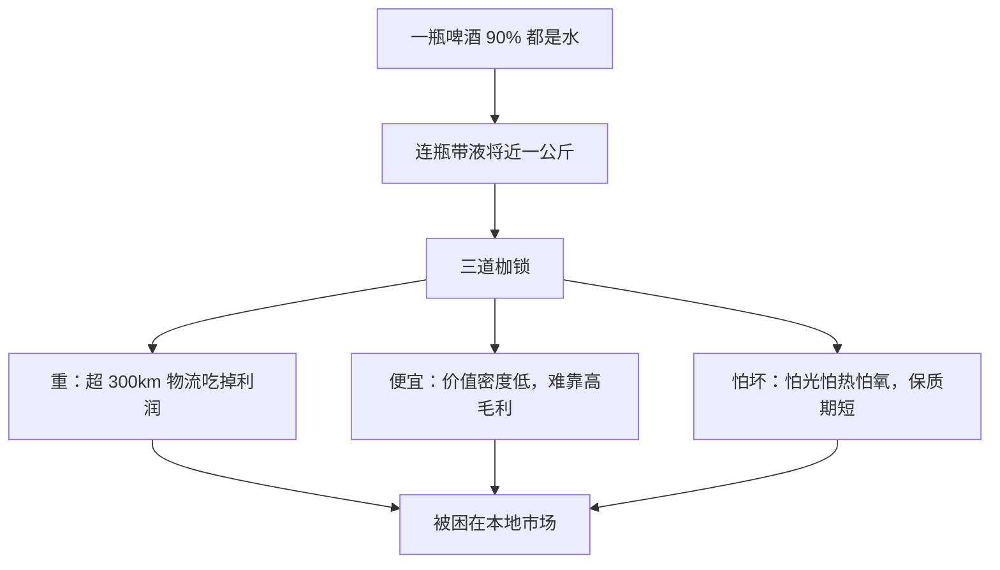
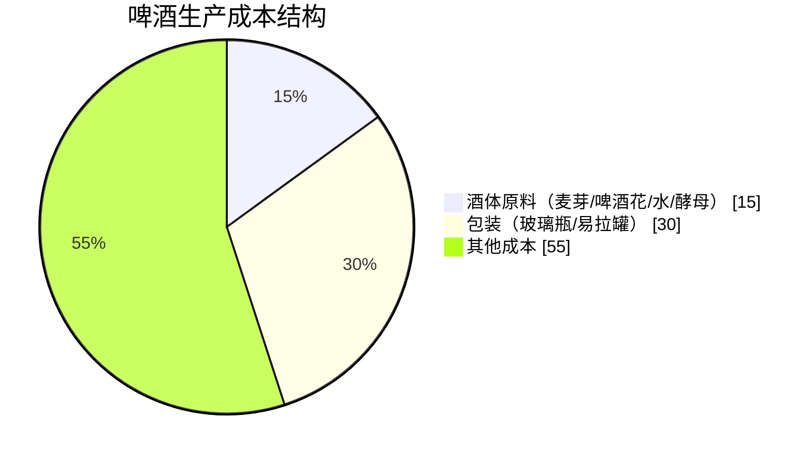
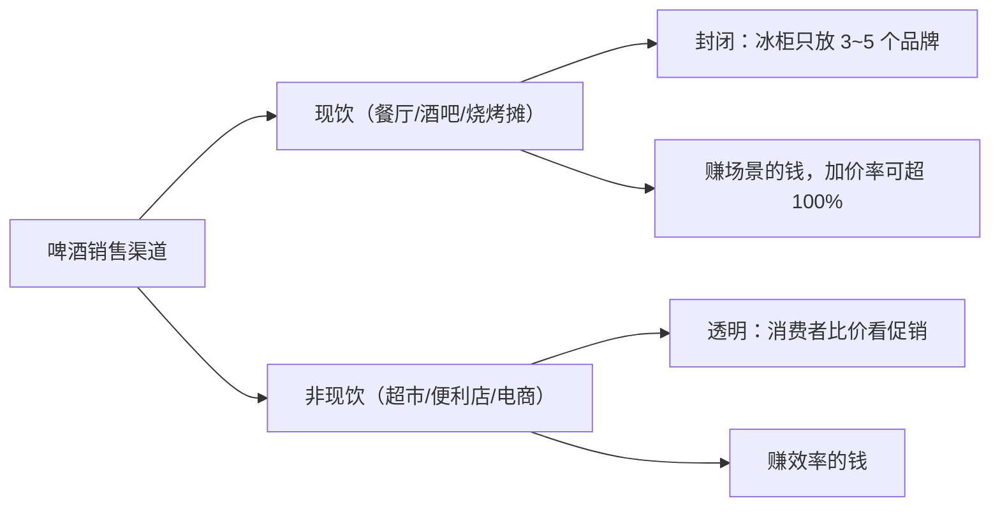
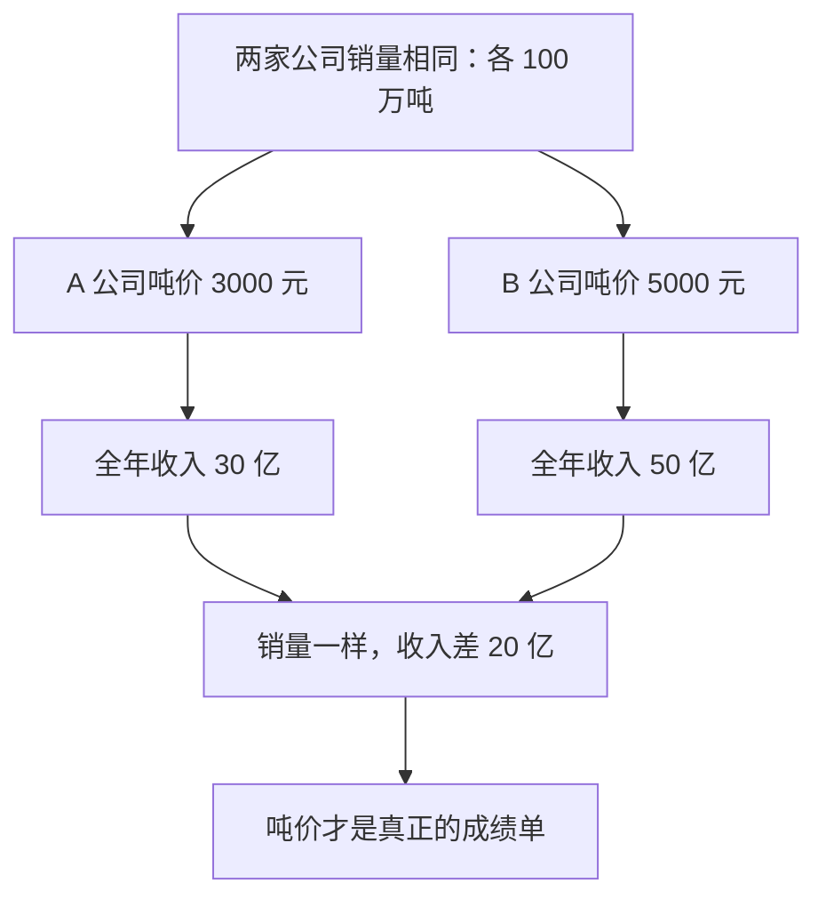
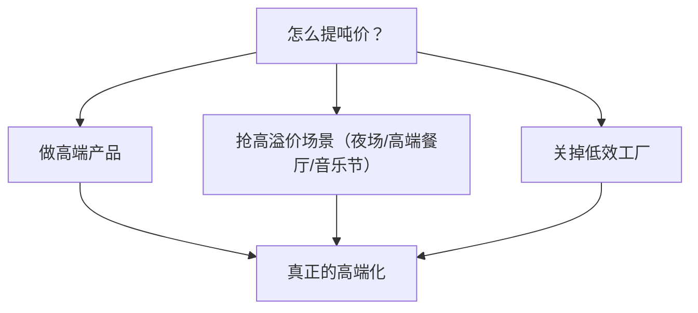
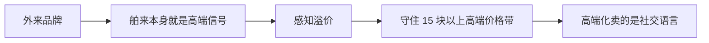
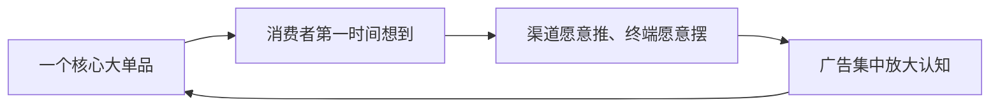
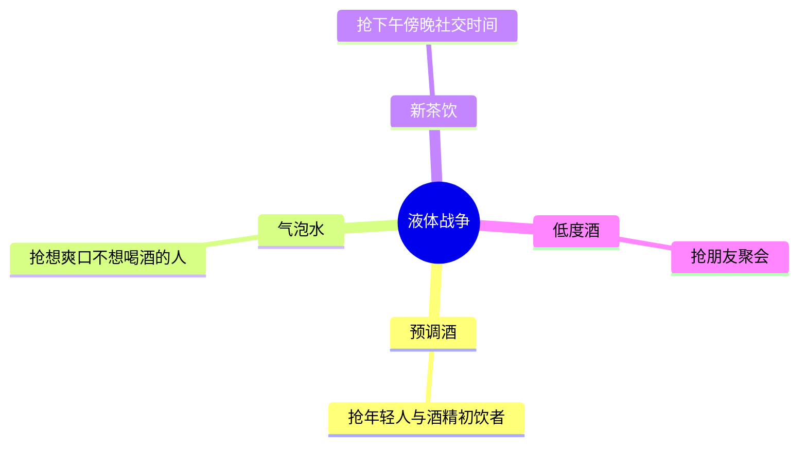

## 一、世界杯来了，啤酒产量却早已见顶

世界杯开始，球迷聚餐、大排档夜宵、酒吧看球，啤酒几乎是这些场景的情绪标配，按理说这该是啤酒公司最爽的时候，销量该起飞。但反直觉的是，中国啤酒真正开始赚钱，并不是因为大家越喝越多，恰恰相反——它的产量早在 2013 年就见顶了，之后一路下滑，现在产量距离高点少了将近三成。

酒明明卖少了，啤酒公司反而赚得更多了，这到底是为什么？啤酒看起来简单，其实要拆四笔账：物理账、成本账、地盘账、渠道账。把这四笔账算明白，才会知道啤酒公司到底靠什么赚钱。

## 二、物理账：三道枷锁，困在本地市场

一切啤酒的商业逻辑，都要从一个基本物理事实说起：一瓶啤酒有 90% 都是水。一瓶 500ml 的瓶装啤酒，连瓶带液将近一公斤。这个物理特性给啤酒生意套上了三道枷锁。

第一道枷锁是"重"。一瓶啤酒出厂价可能就几块钱，但难的是，你要把接近一公斤的东西从工厂运到超市、餐厅、烧烤摊。同样是运一吨货，白酒从贵州运到全国还是赚钱的，但啤酒不一样，超过 300km 物流成本就会明显吃掉利润。

第二道枷锁是"便宜"。啤酒的价值密度低，低酒精度让它更像带一点酒精的饮料或水。传统的拉格啤酒由于大规模生产的特点，价格甚至比不上特定水源地的矿泉水。同样一吨货白酒值钱，啤酒不值钱，所以啤酒没办法靠单凭高毛利赚钱，它必须靠规模、渠道和场景去挤利润。

第三道枷锁是"怕坏"。啤酒很娇嫩，怕光、怕热、怕氧气，尤其是高端生啤和原浆，保质期只有 7~21 天。白酒放着是在等升值，即便是自饮，也是越沉越香；而啤酒放着，就是在等过期。

三道枷锁叠在一起，啤酒就注定被困在了本地市场里，很难像白酒那样一个工厂迈向全国。

但这不代表啤酒是一门没前途的生意。啤酒最神奇的地方在于它是一个多面手：一边像矿泉水拼铺货、拼价格、拼运输效率，另一边又像白酒能卖情绪、卖场景、卖那一刻的氛围。真正赚钱的空间，藏在后半边。

在过去 20 年中，中国啤酒零售价的年均增速大约是 4.5%，长期跑赢了 CPI 的 2.5%。一个 90% 都是水的便宜东西，居然能持续提价，靠的就是踩在情绪赛道上——情绪有价值，价格就有弹性。

## 三、成本账：最贵的其实是瓶子

要看懂啤酒这门生意，得先看看它是怎么酿出来的，因为啤酒行业很多商业问题，其实在酿造环节就已经决定了。

啤酒最核心的粮食原料主要是麦芽，通常是大麦芽。酿酒的第一步是制麦，把大麦催醒，让它在温度湿度适宜的环境里发芽，激活里面的酶。大麦以为春天来了，一旦酶被激活，就立刻踩刹车停止发芽，把后面酿酒需要的能量锁住。不过这里有一个现实问题：中国啤酒用的大麦 90% 以上依赖进口，因为国产大麦在蛋白质含量和发酵稳定性上，跟进口大麦还是有差距的。也就是说，啤酒这门生意，从原料开始就受全球供应链的影响。

接下来是糖化，把磨碎的麦芽和热水混在一起，通过控制温度，让淀粉酶把大麦中的淀粉分解成酵母能吃的糖，得到一锅甜甜的麦汁。这一步就像泡茶，用不同温度的热水把麦芽精华泡出来，温度差一两度，甜度和口感就完全不同。

然后是高温煮沸，麦汁期间分批加入啤酒花。前面加的酒花主要是为了出苦味，因为里面的阿尔法酸在高温下会变成苦味物质；后期加的酒花提供香气，因为精油在低温时更容易保留。这一步像炖汤调味，先大火炖底味，临出锅撒香料。酒花什么时候加、加多少，决定了这瓶酒是更苦、更香还是更清爽。

再往后是发酵。酒厂往冷却后的麦汁中加入酵母，酵母开始吃麦汁中的糖，排出酒精和二氧化碳——啤酒的酒精和气泡就是这么来的。发酵路线有两种：一种是拉格啤酒，低温慢发酵，口感干净稳定，适合大规模工业生产，全球 76% 的啤酒都选它；另一种是艾尔啤酒，高温快发酵，果味浓、个性强，但稳定性更难控制，成了精酿的主场。

接着是过滤和杀菌。把酵母和悬浮物过滤干净后，再通过巴氏杀菌和无菌过滤延长保质期。生啤和熟啤的区别就在这里：生啤不杀菌，风味更鲜活，但保质期很短，必须依靠冷链和就近消费。这也解释了为什么高端啤酒爱讲"鲜"——听上去是口感，背后是冷链能力和渠道密度。最后进入灌装，现代啤酒产线一小时能灌 5 到 8 万瓶，但控氧要求极严，几乎接近无氧状态，但凡差一点，整瓶啤酒的风味和保质期都可能受影响。

到这里你会发现，啤酒厂每天忙活半天，好像都在研究怎么把酒酿得更好喝。但如果翻开财报，你会发现另一件更反直觉的事：啤酒行业最贵的东西，大概率是瓶子。

啤酒的酒体原料，包括麦芽、啤酒花、水和酵母，加起来只占生产总成本的 15%；啤酒花虽然叫啤酒的灵魂，在成本表上的存在感只有 1%。真正烧钱的是包装——玻璃瓶和易拉罐，能吃掉啤酒企业大约 30% 的主营业务成本。

行业里有一个调侃，叫"买瓶子送酒"，听起来像段子，但财报一摊开，你会发现这几乎就是事实。

这也解释了为什么啤酒公司这些年拼命推易拉罐。易拉罐的好处不只是轻，更关键的是它不用回收玻璃瓶。玻璃瓶卖出去以后，还要把空瓶收回来、清洗消毒、重新灌装，中间会丢、会碎，还会卡在渠道里周转不回来；但易拉罐卖出去就结束了。所以罐化率提高，省下来的不只是运费，还有回收、清洗、破损和周转成本。所以你看，啤酒加工和制造的每一项都在挤压利润，尤其是包装，彻底成了成本的主角。

可即便把成本压到极致，啤酒公司还是赚不到大钱，因为真正限制它的不只是工厂，而是地理。

## 四、地盘账：300km 半径与基地市场

啤酒有一条几乎铁打的规律：经济运输半径大约就是 300km，超过这个距离，物流成本就吃掉利润了。啤酒不像白酒，可以一个地方建超级工厂再慢慢卖全国，它更像外卖，超过配送范围就不好看了。所以大啤酒集团的全国版图，本质上不是一张品牌地图，而是一张工厂地图——每个工厂周围都画着一个 300km 的圆圈，每一家选址都在努力把啤酒的运输距离压到最短。

这里还有一个隐形壁垒是空瓶回收。玻璃瓶只有反复循环使用才能摊薄成本，回收率从 60% 提升到 90%，单品包装成本能降一半以上。但回收体系必须建在本地，你不可能把广东的空瓶运回山东来洗。所以外来的品牌打进一个地方，难的不是让消费者尝一瓶，而是让空瓶回得来、冰柜摆得进去、经销商愿意推、餐厅愿意卖——必须让这套本地系统赚起来。光是包装成本这一项，外来品牌就已经天然吃亏了。

但这条 300km 的线，正在被两件事悄悄往外推。第一件是罐化率在提升：中国啤酒现在的罐化率只有大约 30%，美国是 70%，我们还有很大提升空间。易拉罐比玻璃瓶轻 80%，更适合长途运输，不光减少了成本，更重要的是让啤酒对本地回收体系的依赖变弱。第二件是高端化：一瓶 15 元的啤酒和一瓶 3 元的啤酒，运费差不多，但 15 元一瓶的运费占销售价格的比例要低得多。换句话说，酒卖得越贵，越能抗住更远的运输距离。这两件事合在一起，意味着啤酒的地理牢笼正在松动。

不过能把酒运过去，不代表能赚到钱。真正决定利润厚度的，是酒最终出现在哪，也就是渠道。

## 五、渠道账：现饮赚场景，非现饮赚效率

啤酒的销售渠道分成两条截然不同的轨道：现饮和非现饮，大概各占一半的销量。

先说现饮，也就是餐厅、酒吧、烧烤摊。虽然现饮只贡献大约一半的销量，但现饮贡献的利润远高于这个比例。为什么现饮这么赚钱？因为这条渠道最核心的特点是封闭。餐厅冰柜里通常只放 3~5 个品牌，一旦某个品牌交了进场费、摆了冰柜、上了菜单，竞争对手就被物理性隔离在门外了。你坐在那张桌子前，也根本没有比价的机会。啤酒这瓶东西，越靠近消费者越能加价，也就是说餐厅比酒厂更能加价。

拿某经典啤酒来说，酒厂开票价 48 元一箱，经销商送进餐厅的进店价 56 元，餐饮终端的零售价是 96 元一箱——同一箱酒，餐厅加价 40 块，直接超过了酒厂的开票价。为什么餐厅敢这么加价？因为餐厅卖的不是啤酒，而是"你已经坐下来了"这件事。你点菜的时候，大概率不会因为啤酒贵两块钱而换一家饭店，这就是场景的力量。消费者在现饮场景里对价格极度不敏感。酒吧夜店更明显，啤酒加价率能到 100% 到 300%，你在夜店花 30 块钱买的那瓶啤酒，出厂价可能不到 5 块。你买的不是那 500ml 的液体，是灯光、是音乐、是你拿着酒瓶豪饮的潇洒姿态、是与朋友聚会碰杯的情绪火花。

所以行业里有一张渠道势能排序表，从高到低依次是：酒吧娱乐场所、餐饮、便利店商超、日杂店、电商。排序越靠前，消费者对价格越不敏感，品牌的加价空间就越大。这就是为什么大啤酒公司的销售，永远往夜场和高端餐饮冲——这是整条价值链上利润最厚的地方，一瓶啤酒能多卖几十块钱，而消费者不会多想一秒。

另一条是非现饮渠道，也就是超市、便利店和电商，占了另一半的销量。这条渠道更透明，消费者会比价、会看促销、会算一箱差多少；便利店冰柜的第一排货架高度、包装颜值，都在抢消费者那零点几秒的选择。所以现饮赚的是场景的钱，非现饮赚的是效率的钱。大啤酒公司必须同时在两条轨道上打，规则完全不同、策略完全不同。

现在你能理解了：啤酒这门生意，先算的是物理账——90% 都是水，又重又怕坏，天生被物流和库存锁死；再算成本账——你以为在喝麦芽和啤酒花，其实钱都花在瓶子罐子和回收体系上；再往下是地盘账——几百公里就是极限，市场天然被切成一块一块，本地王才是王；最后是渠道账——超市里拼价格，餐厅里加溢价，夜场里再翻一倍都有人买单。这四笔账叠在一起，就是啤酒能不能赚钱的底层逻辑。

## 六、卖得多不等于赚得多：吨价才是成绩单

卖得多不等于赚得多。全球啤酒卖得最多的品牌是中国的雪花啤酒，产量连续多年全球第一，但有段时间，国内上市啤酒公司净利润最高的，却是一家丹麦公司参控股的重庆企业——重庆啤酒。

你喝过乌苏、1664 吗？背后那家公司叫嘉士伯，通过控股一家中国本土企业，把西南市场的高端化做到了国产品牌都有点羡慕的程度。销量见顶的年代，啤酒巨头们到底是怎么让自己越来越赚钱的？

先搞清楚一件事：啤酒天生是割据生意，300km 是上限，超过这个范围物流就狂吃成本。但地图上不是每块地盘价值都一样。啤酒行业有一个词叫"基地市场"，说白了就是某个品牌在某个地区已经强到别人很难打进去了。

为什么啤酒货值低，不像互联网产品可以全国同步扩张——今天上线、明天全国用户都能用，边际成本接近零？啤酒不行，每进入一个新城市，就要在附近建工厂压缩运输距离来保持新鲜度，要一家一家地谈经销商让他们愿意推，要把冰柜一台一台地送进小餐馆、便利店、烧烤摊，要建空瓶回收体系让玻璃瓶能反复转起来，要让有限的货架一旦旺季动销起来就持续被自己的产品占满。这套体系的每一环都得砸钱。

所以啤酒公司打下一个基地市场，有点像古代打下一块粮仓。粮仓最重要的功能不是扩张，是供血。战争时期最重要的不是前线，而是后方粮仓——前线可以亏、可以拉锯、可以换防线，但粮仓必须稳；没有粮仓贡献，前线打多久都是在烧存粮。放到啤酒行业也是一样的：外地市场可以亏钱扩张、可以用优惠和低价撬开渠道，但基地市场必须赚钱，这里是整个公司利润的地基。

还有一件事让基地市场更难撬动，是品牌惯性——一个消费者从小喝惯了某个牌子，不是说换就换的。渠道加地理优势加消费者习惯，三道锁叠在一起，外面的人进不来，里面的人赚钱稳，这就是基地市场最深的护城河。

再说几个典型的"粮仓"。

山东是青岛啤酒的大本营，在这里渠道密度、品牌认知和工厂布局三张牌几乎全都握在手里，外来品牌进来很难——难的不只是多卖几箱酒，而是要同时突破品牌、渠道和消费者心智三道防线。

四川则是华润啤酒（华润雪花）的核心粮仓。华润当年拿下的不只是一个啤酒品牌，更是一整套本地生态，工厂、经销商、餐饮终端、冰柜投放、空瓶回收体系一起被收入囊中，短短几年，四川市场的份额就超过六成。这种强势直接让它的高溢价率、新品都能很顺利地推广、形成复购。

再往西南看，重庆、云南、宁夏则是嘉士伯的优势地带。这些市场体量没那么大，但是利润却相当漂亮，因为嘉士伯把最赚钱的高端产品牢牢种在自己最稳固的根据地里。别人能进来卖酒，却很难动销，更难撼动它的定价权。

所以你会发现，中国啤酒行业真正的竞争，从来不只是品牌竞争——每一家龙头企业都有自己的粮仓做根据地。

但问题来了：既然粮仓这么重要，为什么拿下四川、做到全国销量第一的华润啤酒，利润率却长期跑不过地盘更小的嘉士伯呢？这就要说另一个关键词了——吨价才是真正的成绩单。

以前看啤酒公司，大家喜欢看销量；现在更关键的指标叫吨价，也就是每吨啤酒能卖多少钱。举个最直接的例子：假设两家公司的销量完全一样，一年都卖出 100 万吨啤酒，A 公司的吨价是 3000 元，全年收入 30 亿；B 公司的吨价是 5000 元，全年收入 50 亿。销量一模一样，收入差了 20 亿。如果两家的生产成本差不多的话，B 公司的利润可能是 A 公司的好几倍。

这就是为什么今天很多啤酒公司已经不再把追销量增长当作第一目标了，追的是"今年我们的吨价能不能再往上走一段"。销量可以下滑一点，哪怕整体少卖了几万吨，但是吨价上来了、高效工厂留着、低效工厂关掉，这样往往还是变好看的。过去 10 年最重要的逻辑切换，就是从"卖多少"变成"卖多少钱"。

2017 年到 2023 年，几家主要酒企的吨价都在涨，但速度差很多。为什么有差距？因为吨价靠的不是销量，靠的是你卖的酒在哪个价格带。如果你卖的大部分是 3 块、5 块的便宜酒，吨价就是上不去；但你能把更多产品推到 8 块甚至 15 块，吨价就能往上走。同样是卖酒，产品结构不同，这笔账就完全不一样。这也是销量最大的华润啤酒，反而吨价追赶压力最大的原因。

## 七、高端化：三件事，以及外资为何守住高端

那怎么提吨价？核心就三件事。

第一，做高端产品，让消费者愿意在更贵的价位喝你的酒。

第二，抢高溢价场景。夜场、高端餐厅、音乐节，这些地方的消费者对价格不敏感，同一箱酒的终端价可以比出厂价高出一倍甚至更多。渠道势能排序是酒吧夜场高于餐饮、高于便利店、高于电商，越靠上的渠道议价空间就越大。

第三，关掉效率低的工厂，让产能聚焦在能赚钱的产品上。

这三件事加在一起，才是真正意义上的高端化。

但最离谱的是，尽管国内巨头已经拼命追了 10 年，外资早就把这块高端蛋糕吃掉了。中国啤酒市场 15 块以上的高端价格带，真正的守门人不是那些耳熟能详的本土品牌，而是一些国外品牌——福佳、科罗娜，这些百威英博旗下的经典产品守住了高端价格带，消费者在夜场和餐厅里认可它、愿意为它的高端路线买单。百威在中国的吨价常年在国内酒企里靠前。

还有嘉士伯，通过控股一家重庆公司，在中国拿下了西南市场，同时把 1664、乐堡这类高端单品推进来，利润率因此在国内上市啤酒企业里常年表现靓丽。

华润啤酒意识到这件事之后，与荷兰啤酒巨头喜力达成合作。喜力通过出售中国资产和品牌使用权，为华润品牌的高端线背书。

为什么外来品牌在高端这件事上更有优势？不是因为它们的酒一定更好喝，而是因为"舶来"这件事本身，在消费者心里就是高端的信号。以前喝酒是功能消费——解暑、过瘾、聚会桌上摆着方便，好不好喝、能不能用，差不多就行；现在喝酒越来越像消费升级，在产品丰富的年代，需要不同的品牌调性来定义品酒的理念和个人的偏好。喝什么酒和穿什么鞋、开什么车、用什么手机，开始传递同一种信号：我是什么样的人、我在过什么样的生活。

高端化真正卖的不是酒体本身的升级，而是社交语言。这也解释了外来品牌为什么能守住高端价格带——因为"进口啤酒"这个标签，天然带着一层感知溢价。

感知溢价不是靠工厂建出来的，靠的是品牌认知长期积累出来的。国产巨头追赶的这段路走了快 10 年，现在才算刚刚缩短了一点差距。

格局的胜负现在已经很清楚了，赢家有三个共同点：粮仓稳、吨价高、高端布局早。

乌苏和 1664 背后的重庆啤酒，靠嘉士伯背书，西南基地利润率在国内酒企里一直很好，但跨区域的销售难度很大，在依赖乌苏大单品全国化的能力上有待观察。

百威守住了 15 块以上的高端价格带，单位利润最高。青岛啤酒的山东粮仓稳、品牌认知扎实，高端化追赶的步子可以说很稳，但在长期品牌份额和短期利润率之间还需要找到平衡点。

华润啤酒是另一种处境，虽然销量天下第一，但是产品结构里低价产品占大头，高端化是眼下最重要的战略课题。

燕京啤酒过去几年凭借 U8 这一大单品的爆发，一举扭转基地市场规模偏小、巨头环伺的竞争格局，重新走上全国化的扩张路径。在国企改革推进的背景下，它的渠道利润和单品复购依然很稳。放在头部啤酒品牌里，过去 3 年品牌势能最强的就是它。

## 八、大单品：高端化的核心武器

可以说，大单品是啤酒高端化最核心的武器。因为消费者不会记住一家啤酒公司有多少 SKU，也不会关心背后有多少产品经理，真正决定胜负的，是当他走进饭店的时候，脑子里能不能第一时间蹦出一个名字。

所以真正成功高端化的公司都有一个共同点：它们不是产品很多，而是有一个被反复点名的核心单品。一旦大单品跑出来，后面的事情就变简单了——渠道愿意推它、终端愿意摆它，广告也可以集中火力去放大它的认知，而不是分散在十几个 SKU 之间做无效传播。

从青岛啤酒的经典，到燕京啤酒的 U8，这场大单品的卡位战，决定了哪家公司能在高端化里站稳脚跟，哪家公司还在找方向。这就是大单品的意义。

## 九、液体战争：新对手与边界的模糊

不过就算赢了这场内部仗，啤酒巨头也没有睡安稳觉。以前啤酒行业看竞争对手，看的是隔壁的啤酒厂；今天不一样了，今天看竞争对手，要看的是消费者的选择。

预调酒在抢年轻人和酒精初饮者，气泡水在抢想要爽口但不想喝酒的人，新茶饮在抢下午和傍晚的社交时间，低度酒在抢朋友聚会——这就叫"液体战争"。

酒水大战比啤酒内战更难对付。啤酒内战里大家都在争同一批喝酒的人，你的动作我看得见，我的反制你也看得见；液体战争的对手是消费者——每一个人今天不想喝酒，而这个念头在年轻人里越来越常见。年轻一代的酒精消费意愿总体上比上一代更低，他们喝酒是因为那个场景让他们想喝，而不是因为习惯喝。

所以啤酒巨头们开始做很多看起来不像啤酒的事情。无醇啤酒瞄准的是开车前、健身后、上班午餐这些想喝酒但不能喝的场景；低卡啤酒瞄准的是减脂期不想完全戒酒的人；果味啤酒和白啤瞄准的是不爱苦味但愿意尝试的消费者，逐步跨入精酿的领域。

这些都是啤酒巨头们的自我觉醒，去提供更高品质或者差异化的酒体，来留住或者吸引新的消费者。这些产品本质上不是在跟另一个啤酒品牌抢市场，而是在跟气泡水、预调酒、新茶饮抢场景入口。所以巨头们的边界也在变模糊——它们不只是想要成为一家啤酒公司，而是想成为"你每一次想喝点什么的时候，最先想到的那家公司"。

## 十、结尾

现在你知道了，啤酒巨头在销量下滑的年代，是怎么反而越来越赚钱的：圈地建粮仓，稳住基本盘；提价，用吨价代替销量，让每一瓶多赚一点；做高端，把产品单价往 15 块推、把场景往夜场音乐节里放。

未来真正的赢家，也许靠的不是酒有多好喝，而是你刚好想喝的时候，它们刚好出现。
