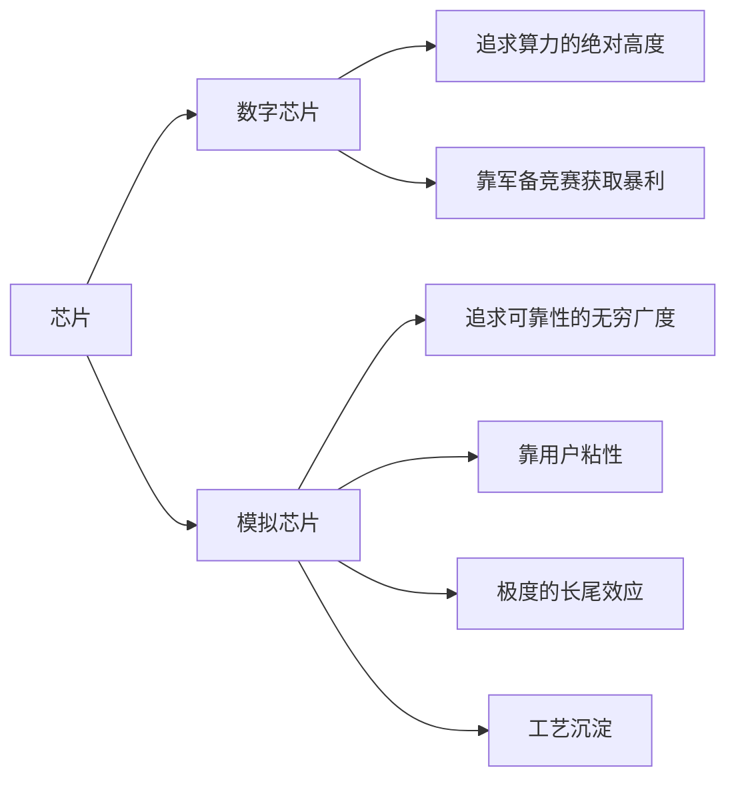
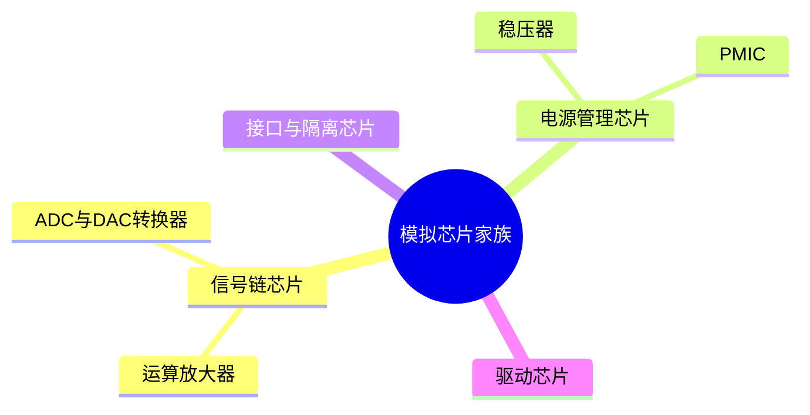
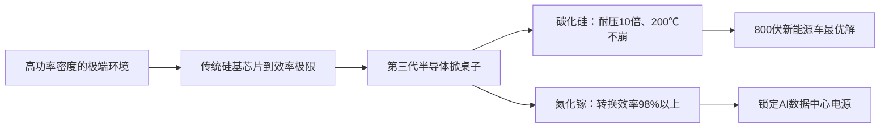

## 一、60年前的芯片，今天还在卖

你敢信吗？诞生于 1967 年的模拟芯片，居然到今天还在卖。那一年，阿姆斯特朗还没登月，波音 747 还只是一张图纸。在那个电子工业还是真空管余晖的年代诞生的芯片——比如经典的 VA723 高精度稳压器，或者被印在每一本教科书里的 LM101 运算放大器——直到快 60 年后的今天，你依然能在德州仪器的官网上买到它们的现役型号。

在数字芯片主导的半导体语境中，科技产品只要迭代慢一步，似乎就会被淘汰。那为什么模拟芯片反而越老越稳呢？

答案很简单：虽然都叫芯片，但数字芯片和模拟芯片是两个完全不同的商业物种。

数字芯片追求的是算力的绝对高度，通过不断的军备竞赛获取暴利；而模拟芯片追求的是可靠性的无穷广度，它靠的是用户粘性、极度的长尾效应和工艺沉淀。

## 二、模拟芯片家族：数字大脑的"五官"与"肌肉"

在理解模拟芯片的逻辑前，要先搞清楚模拟芯片家族到底有谁、都有什么分工。

如果把电子设备比作一个人，数字芯片就是那个冷酷的精算大师，而模拟芯片则是这个身体所有的非逻辑环节。

家族的第一大势力，叫信号链芯片，它们是电子设备的五官。这里面最核心的成员是运算放大器：现实世界里的声音、压力信号极其微弱，微弱到只有几毫伏，运算放大器负责把它们放大成百上千倍。接着，转换器芯片——也就是 ADC 和 DAC——登场了，它们是翻译官，负责把现实的物理波动翻译成数字大脑能懂的 0 和 1。

家族的第二大势力，是目前市场占比最大的电源管理芯片，它们是电子设备的血管和内分泌系统。电池只提供一个固定电压，但设备里每个模块需要的规格都不一样，稳压器负责把电压精准转换成各元件所需的规格；而电源管理集成电路 PMIC 则像一个大管家，坐在 CPU 旁边，负责全局的供电调度。

剩下的成员，还包括负责数据传输和安全保护的接口与隔离芯片，它们是系统的神经防火墙。特别是在 2026 年主流的 800 伏电动车平台上，隔离芯片利用磁场或光信号，在物理断开的情况下传数据，防止高压电直接烧毁控制大脑。

最后还有负责把指令化为动作的驱动芯片，它们就是机器人的肌肉。没有这些模拟家族成员的协作，数字大脑就是一个既听不见也看不见、没有任何行动力的植物人。

## 三、第一张底牌：收"信任税"

理解了分工，再看模拟芯片的第一张商业底牌，也是最劝退新玩家的一点：它极其便宜，但它保护的设备极其昂贵。

在 2026 年，如果你拆开一台价值几十万的工业机器人，或者一辆顶级的新能源车，你会发现里面那颗决定生死、管理电池或电机的模拟芯片，单价可能只要几美元，是整台设备里最不起眼的那个零头。但问题就在这：它虽然便宜，可它安装的设备实在是太贵了。

对于购买方来说，这简直是一场赌博。如果你为了省下那些微不足道的模拟芯片成本，去换一个没有经过长期验证的供应商，万一芯片出了问题，导致几十万的汽车在高速公路上自燃，或者几百万的生产线突然停工，那个损失谁能承担得起？

所以，模拟芯片收的是一种"信任税"。这种低价值占比、高关键的属性，导致了超强的供应商锁定效应。尤其是在汽车领域，换个零件就要重新来一次严苛到变态的车规级认证，一套流程走下来，少则一年半、多则 3 年。对厂商来说，为了省下那一点点成本，不仅要砸进去几百万美元的研发费，还要时刻担心系统失效带来的巨额索赔。

所以客户的决策其实很简单：只要不出错，这辈子都不换供应商。这种路径依赖，就是模拟芯片巨头最横的底气，也是那些诞生于 60 年代的古董芯片能一直卖到 2026 年的根本原因。

## 四、第二道护城河：料号墙

如果说信任税是客户心理上的门槛，那第二道护城河就是恐怖的料号墙。

数字芯片玩的是爆款逻辑，一颗旗舰 AI 芯片卖几万美元，那是赢者通吃的游戏；而模拟芯片走的是完全相反的路子，它玩的是蚁多咬死象——单价可能低得惊人，但品类一定多到离谱。全球龙头德州仪器手里的产品库超过 8 万种。

为什么这么多？因为现实世界太碎片化了。同样是一个放大器，用在助听器里追求的是极低功耗，用在战斗机雷达里追求的是极致速度，这完全是两个不同的料号，所以需要完全不同的特调配方。

而且根据行业巨头亚德诺的官方披露，他们约有 50% 的收入，竟然是靠发布已经超过 10 年的老家伙们赚回来的。这些产品的研发成本早就在 10 年前摊销完了，现在的维护成本几乎为零，卖一颗赚一颗。在数字芯片每天焦虑产品明年会不会过时的时候，模拟巨头们却在稳稳地收取这些 10 年前就种下的时间福利。

这种游击战士式的长尾布局，让任何初创团队都感到绝望。这些长尾芯片散落在深海钻井平台、核磁共振仪、甚至航天仪表里，每个细分市场一年的采购额可能也就几十万美元。没有哪个创业团队会脑子发热，砸几千万去为一个采购额只有几十万的市场流片——划不来，也没必要。结果就是在这些隐秘的角落里，老牌巨头根本没有对手。

## 五、第三张底牌：工厂本身就是核心技术

这时候你可能会问：既然模拟芯片那么赚钱，为什么其他芯片设计公司不干脆找个代工厂，直接把这块业务抢过来？

这就涉及到了模拟芯片的第三张底牌：工厂本身就是核心技术。

在数字芯片公司都在拼命搞轻资产的时候，模拟巨头却坚持自己建厂、自己造。这种 IDM 模式，是他们保住秘方的终极武器。模拟芯片追求的是极致精准、低失真和高信噪比，制程的缩小反而可能是它的敌人，因为它需要足够大的面积来保证信号的纯净。

这里必须提到一个核心黑科技叫 BCD 工艺，它把高精度、低功耗和高耐压这三种完全不同的工艺强行揉在了一块晶圆上。这种工艺极其刁钻，加上工艺细节通用，代工线很难通吃，只能靠厂家自己在生产线上一点点磨出专属配方。

这就像高端餐厅的招牌菜：菜谱是绝活，主厨必须是自己人。一旦找人代工，味道变了不说，压箱底的秘方也保不住。

德州仪器通过 12 英寸大晶圆厂，将单颗成本压到极致。在行业下行时，这种成本优势就变成了刺刀，硬生生把二三线厂家挤出市场，而自己的毛利率还能坚守在 50% 以上。老牌巨头的围墙依然很硬。

## 六、天变了：第三代半导体掀桌子

但就在大家都以为这行一眼望到头的时候，天变了。

新能源车的 800 伏高压平台，加上 AI 数据中心的超高密度供电，强行撕开了老牌巨头的防线。在这些高功率密度的极端环境下，传统的硅基芯片到了效率极限——它会发热、会崩溃，就像普通的轿车发动机拉不动几十吨的重载货车。

这时候，第三代半导体，也就是碳化硅和氮化镓，带着掀桌子的姿态冲了进来。

碳化硅像一辆重型坦克，耐压能力是普通硅的十倍以上，在 200 度高温下依然稳如泰山，一举成为了 800 伏新能源车平台的最优解。以前巨头们靠几十年的硅基工艺卡位，现在赛道换了，旧配方在碳化硅面前优势失灵了。

而氮化镓则以高频高效率见长，直接锁定了 AI 数据中心的电源系统，把转换效率提升到 98% 以上；而在传统硅基电源系统中，实际运行效率通常是 90% 到 94%。别小看这几个点的差距，在烧钱如流水的计算中心里，这几个点就意味着一年几亿的电费。

新玩家不打算硬碰硬，他们直接绕后，转向第三代半导体材料，换了个战场玩。这也给本土的一批先锋厂商最好的超车机会——既然传统规矩的料号墙太厚，那就在新材料的荒原上重新圈地。

## 七、底层逻辑：只卷不可替代性

聊了这么多，你会发现模拟芯片其实只有一条底层逻辑：它不跟你卷速度，它只跟你卷不可替代性。

真正赚大钱的，往往不是干活最累的人，而是那些占着坑位、坐着收租的人。

数字芯片代表了人类文明向往虚拟极限的智商，而模拟芯片则代表了人类文明对物理现实的敬畏。在芯片这个万亿级的赛道里，模拟巨头们宁愿背负沉重的工厂折旧，也要坚持自主制造，因为不掌握火炉的人，永远无法掌握配方的灵魂。

这就是为什么一颗 1967 年的稳压器芯片，能卖到今天的根本原因。
