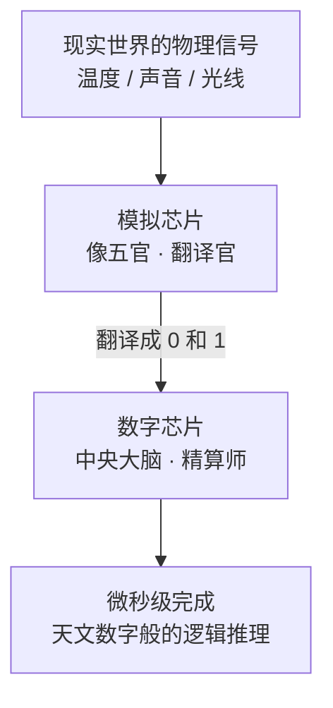
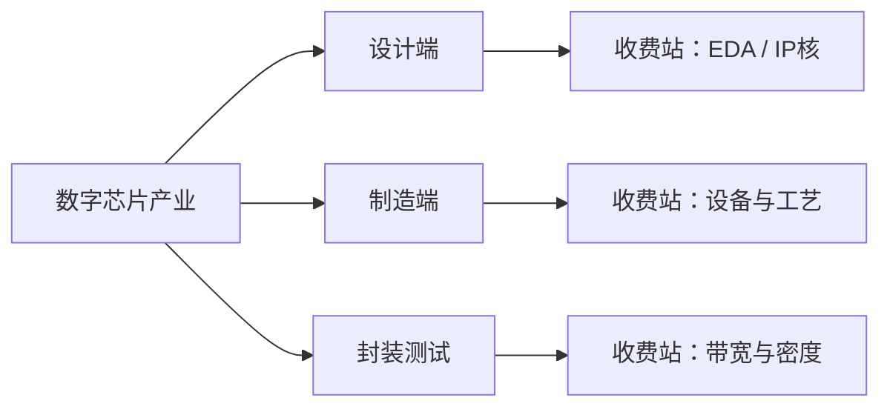
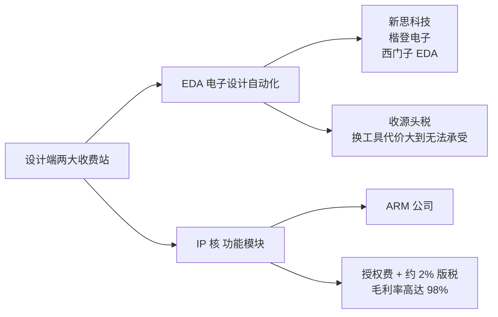
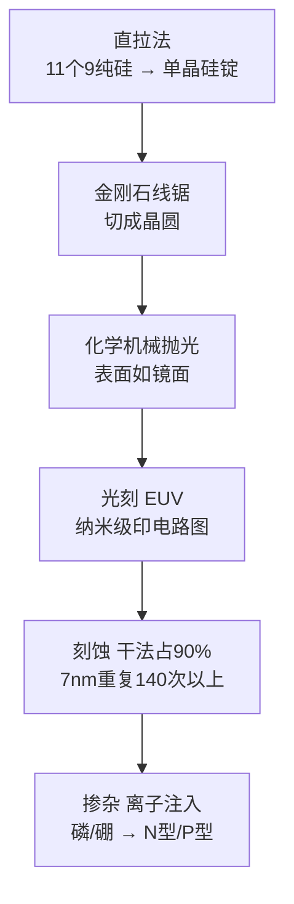
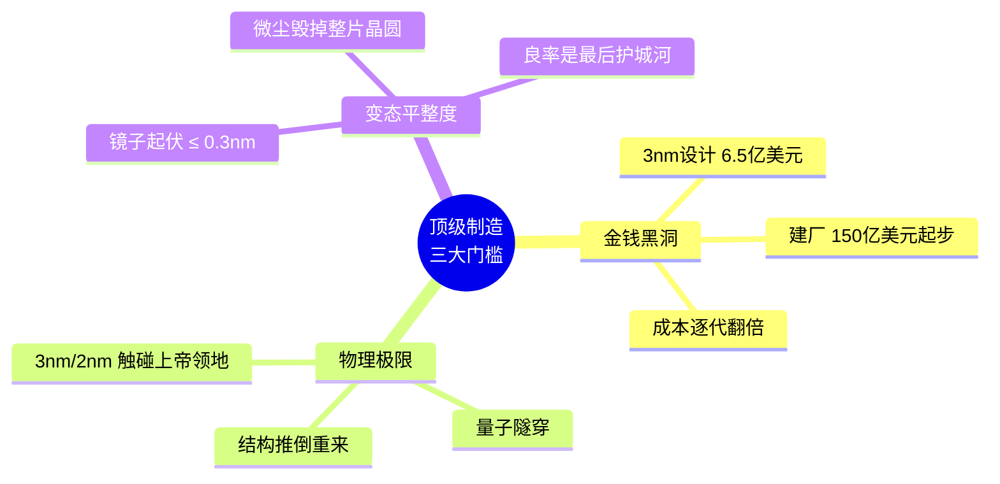
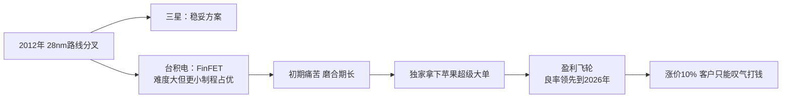
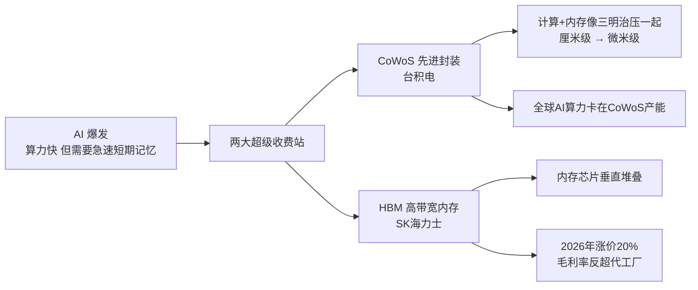
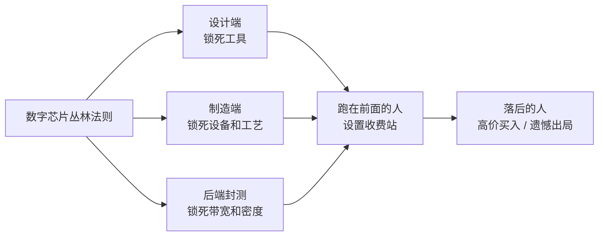

## 一、引言：一块硅片，凭什么拿捏手机厂商

你知道你的手机用的是什么芯片吗？你知道一台一万块钱的旗舰机，绝大多数的利润却是被芯片厂商赚走了吗？这块一平方厘米的硅片，到底为什么能拿捏无数的手机厂商？这背后隐藏着怎样的商业秘密，今天咱们就来拆解一下数字芯片的商业逻辑。

芯片的世界其实只讲两种语言。一种叫数字信号，它只认识零和一，冷酷精准、非黑即白，是现代所有逻辑运算的基石；另一种叫模拟信号，就像我们感受到的温度、听到的声音、捕捉到的光线，这些信号在现实中是连续变化的，充满了灰度。

在 2026 年这个数字化巅峰时代，为了处理这两套语言，芯片世界分裂成了两套完全不同的体系。一边是负责感受世界的模拟芯片，它们像五官、作为翻译官，把现实中的物理波动翻译成零和一；另一边则是我们今天要重点聊的主角——数字芯片，他是芯片界的中央大脑、是精算师，从不负责直接接触世界，只负责根据翻译好的信号，在微秒之间完成天文数字般的逻辑推理。

## 二、万亿蛋糕的分配悖论：钱和货是两套逻辑

现在全球半导体市场正狂飙着，冲向 1 万亿美元的年产值大关。但这块万亿蛋糕的分配极其不均——以英伟达为代表的算力芯片，拿走了将近一半的收入，但实际出货量连全球芯片总量的 0.2% 都做不到。这意味着，在芯片的世界里，钱和货完全是两套逻辑。

真正的暴力和权利，全被藏在产业链深处的几个关键收费站里。按照芯片从无到有的顺序，数字芯片的产业可以分成三段：设计端、制造端，还有后端的封装测试。每一段都有它自己极其强势的收费站。

## 三、设计端：EDA 与 IP 核，两个源头收费站

一颗芯片的旅程是从一张白纸开始的。但你要知道，现在的顶级处理器动不动就是几百亿个晶体管，如果你想靠人工去排布电线，全人类的工程师加起来画到下个世纪也画不完。所以设计师必须得用一种叫 EDA、也就是电子设计自动化的软件，你可以把它理解成芯片界的超级建筑设计软件。

目前全球这个市场被新思科技、楷登电子和西门子 EDA 三巨头死死掐住，他们收的是源头税。一旦你用习惯了这套工具链，你就几乎不可能换掉它——因为你所有的设计文件、验证数据，全都是基于这套体系开发的，换掉它的代价大到没有任何一家公司能承受。

如果说 EDA 是设计师手里的笔，那 IP 核就是笔下的万能模板。现在的芯片设计，已经不再从每一个晶体管画起了。为了效率，设计师会直接购买成熟的功能模块，比如 USB 接口模块、无线连接模块。而这个领域最霸道的存在就是 ARM 公司——ARM 自己不造芯片，它只卖芯片的"地基设计图"。全球 99% 以上的智能手机，背后全是 ARM 的影子。

它的毛利率竟然高达 98%，逻辑很简单：先收授权费，然后你每卖出一颗芯片，他再抽走 2% 左右的版税。

## 四、制造端：在针尖上盖摩天大楼

图纸画好了，接下来进入整个芯片制造最核心、最神秘的阶段——那就是制造前道环节。这是在硅晶圆上形成基本电路结构的过程，是一场在针尖上盖摩天大楼的极限运动。

模拟芯片追求的是稳定和精准，可能还在用十几年前的老工艺；但数字芯片追求的是极致算力，所以它必须遵循摩尔定律，用最先进的制程，比如 3nm、2nm。这一切，都始于一块高质量的半导体。

制造会通过一种叫直拉法的工艺，在高温坩埚里融化纯度高达 11 个 9 的纯硅，像拉麦芽糖一样，拉出一根粗壮的单晶硅锭；接着用金刚石线锯，把这些硅锭切成薄如蝉翼的晶圆；这些晶圆要经过化学机械抛光，直到表面像镜面一样光滑，才能进入下一关。

接下来就是光刻，这是最关键也是最贵的一步。极紫外光刻机，也就是 EUV，是人类精密工业的巅峰。它精细到什么程度呢？这里有一个著名的比喻——这相当于你站在地球上用手电筒照射月球，光斑的大小不能超过一枚硬币。在 2026 年，一台最新的高数值孔径 EUV 光刻机，重达 300 吨，需要 250 个集装箱运输。它把复杂的电路图精准地印在光刻胶上，精度达到了纳米级。

印好图案后，要把多余的部分去掉，这就是刻蚀。现在的主流是干法，刻蚀占比高达 90%。为什么不用湿法呢？因为湿法像洗澡、液体会四处渗透，而干法像手术刀、只垂直往下切，能保证极细的线条不走样。在 7nm 制程里，这种雕刻动作要重复 140 次以上。

刻好了沟槽，还得给硅片注入灵魂，这就是掺杂。要通过离子注入，把磷或者硼这些杂质强行打进硅的晶格里，从而形成 N 型或 P 型区域，赋予芯片电学特性。

## 五、为什么顶级制造公司越来越少：三大诅咒

既然流程都清楚了，为什么全世界能做这种顶级制造的公司越来越少？到现在只有台积电、三星和英特尔还排得上号，而且台积电还遥遥领先？因为这已经不仅仅是技术活了，这是一场关于物理极限与金钱黑洞的终极博弈。

第一是金钱黑洞效应。在数字芯片行业，制程每前进一步，投入的成本都是翻倍增加的。设计一颗 3nm 芯片，光给工程师发工资和买软件授权，就要花掉 6.5 亿美元；而盖一个先进制程的工厂，造价要 150 亿美元起步——这相当于建设 20 个世界顶级的体育场，或者几艘航空母舰。这种烧钱的速度，让绝大多数国家和公司只能望洋兴叹。

第二是物理极限的诅咒。当晶体管缩小到 3nm 甚至 2nm 的时候，我们已经触碰到了"上帝的领地"。这时候会出现一种诡异的现象，叫量子隧穿。简单理解，就是房间的墙壁做得太薄了，电子不再乖乖听话地在路线上跑，而是会像穿墙术一样直接漏出来。为了堵住这些漏洞，工程师必须改变晶体管的形状，而每一次结构的改变，都是对材料科学和制造工艺的推倒重来。

第三是近乎变态的平整度。要求用于光刻反射的镜子，表面起伏不能超过 0.3nm，这相当于从北京到上海的铁轨，起伏不能超过一毫米。在这种极限要求下，只要有一颗肉眼完全看不见的微尘落在晶圆上，整片价值数万美元的晶圆就全废了。良率，就是这门生意最后的护城河。

## 六、台积电为什么是"唯一选"：2012 年的路线分叉

咱们把话题拉回到台积电。为什么在真正顶尖客户眼里，台积电是唯一选？这要追溯到 2012 年那个著名的路线分叉。

当时在 28nm 节点上，三星选了一个比较稳妥的方案，而台积电选择了难度极大、但在更小制程下更有优势的 FinFET 路线。刚开始的时候台积电非常痛苦，磨合期极长，但他们扛下来了。正是这次压注，为台积电后来独家拿下苹果超级大单打下了地基。从此台积电就进入了盈利飞轮，良率一直领先到 2026 年——哪怕台积电涨价 10%，客户也只能一边叹气，一边打钱。

电路盖好了，但芯片内部的几百亿个房间还没通电呢。这就进入了制造环节的后道工艺：需要在芯片里铺设多层金属互联线，通常用铜或者铝。这就像是在摩天大楼里布电线，每一层金属沉淀完都要进行一次化学机械抛光，如果表面不平，下一层的电线就会乱套。

## 七、后端封测逆袭：CoWoS 与 HBM

制造端造好了晶圆，这事还没完。在以前，大家觉得后端封装就是给芯片套个壳，是个没什么技术含量的打工活；但到了 2026 年，情况完全反转了——后端封测正在成为整个产业链最紧缺、最贵的收费站。这全是因为 AI 的爆发。

AI 芯片像个超级大脑，运算极快，但它需要一个急速的短期记忆来配合。如果数据传输慢了，大脑就会空转。为了解决这个矛盾，行业诞生了两个超级收费站：CoWoS 先进封装和 HBM（也叫高带宽内存）。

先说 CoWoS 先进封装，这是台积电的另一张神牌。它的原理是：既然数据在主板上传输太慢，那我干脆把计算芯片和内存芯片，像三明治一样紧紧地压在一起，封装在一个极小的空间里，这样数据传输距离从厘米级变成了微米级，速度瞬间起飞。现在全球的 AI 算力，就卡在台积电的 CoWoS 产能上。

有了封装技术，还得有专门的"口粮"，这就是 HBM 高带宽内存。它通过把内存芯片像盖楼一样垂直堆叠，提供了普通内存无法企及的带宽。这个领域的霸主是 SK 海力士——在 2026 年的合同谈判里，海力士非常强势，直接要求涨价 20%。更有意思的是，HBM 的毛利率现在已经反超了代工厂。这说明 AI 时代的瓶颈，已经从晶体管能做多小，变成了数据能跑多快。

在 2026 年，如果你抢不到台积电的封装产能，或者买不到海力士的 HBM，你的 AI 芯片即便设计得再好，也只是一块昂贵的砖头。

## 八、严苛的出厂考核

在芯片离开工厂前，还必须经过最严苛的考核。首先是参数测试，测量电压、电流；接着是老化测试，让芯片在高温高压下超负荷运行，提前把那些身体弱的次品揪出来；最后是失效分析——哪怕只有一个芯片坏了，工程师也要像法医一样把它切开，用电子显微镜找到病根，反过去优化制造流程。

## 九、丛林法则：跑在前面的人设收费站

看完这整套流程，你会发现芯片行业早已不是简单的制造业，它是一场关于专利与资本的残酷博弈。每一个环节都在做同一件事情：寻找一个别人绕不开的位置，把它做到无可替代，然后安静地坐在那里收钱。

设计端锁死工具，制造端锁死设备和工艺，后端封测锁死带宽和密度。在这个万亿级的博弈场里，跑在最前面的人设置收费站，而稍微落后的人，要么付出高昂的代价买入，要么遗憾出局。这就是 2026 年属于数字芯片的丛林法则。

