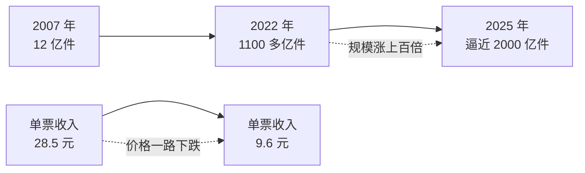
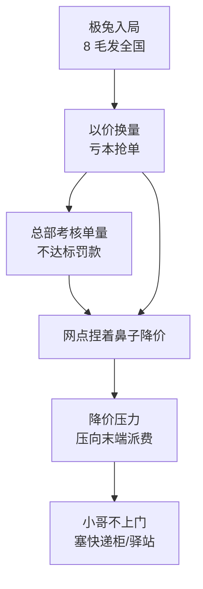
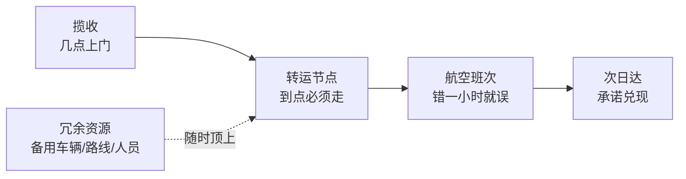
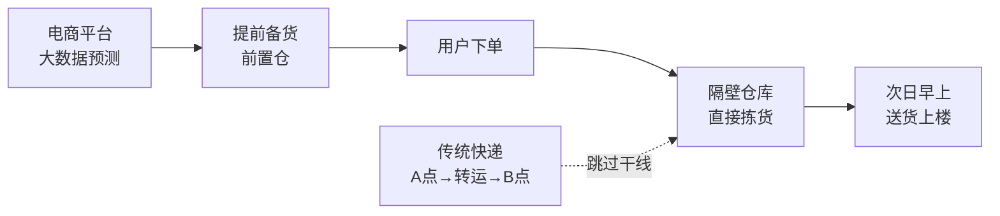
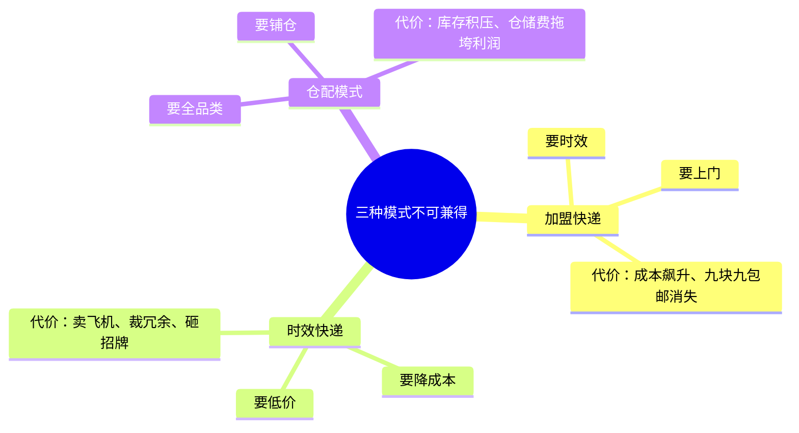
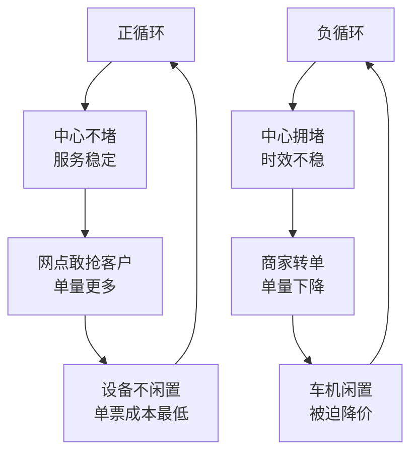

有没有想过，在网上买个九块九、甚至一分钱的小商品，商家都能乐呵呵地给你包邮到家；可轮到你自己拿着一个差不多大的纸箱子去寄件，小哥一扫码——二十块。明明都是差不多大的包裹，凭什么商家寄件像白送，你寄件却被刺客？

在这个年收入高达 1.5 万亿的快递江湖里，其实一直同时存在着两套完全互斥的玩法——一个叫**加盟快递**，一个叫**时效快递**。本篇文章重点解析这两种快递公司到底是怎么赚钱的，同时分享过去十几年来中国快递行业的成长案例。

```markmap
# 快递这门生意

## 加盟快递
- 代表：中通、圆通、申通、韵达
- 核心逻辑：必须塞满
- 本质：一条分钱链
- 定位：低价电商件

## 时效快递
- 代表：顺丰
- 核心逻辑：到点必须走
- 本质：确定性承诺
- 定位：高时效商务件

## 仓配模式
- 代表：京东物流
- 核心逻辑：预测前置
- 本质：不搬包裹、搬仓库
- 定位：电商仓配一体
```

## 一、一个反常的数据：量涨了上百倍，价却跌了七成

这里有一个极其反常识的数据。2007 年，全国一年只有 12 亿件快递；到 2022 年，这个数字干到了 1100 多亿件；再到 2025 年，直接逼近 2000 亿件。十几年时间，规模涨了上百倍。按理说盘子这么大，大家都应该赚麻了吧？错——全行业的平均单票收入，反而从 28.5 元一路跌到了 9.6 元。

换句话说，快递行业增长最猛的这些年，涌进来的根本不是赚钱的高端商务件，全是海量廉价、甚至亏本在跑的电商包裹。



## 二、为什么时效快递没被卷死

低价快递已经铺得漫山遍野，为什么更贵的那批时效快递没有被卷死？因为大家虽然寄的都是纸箱子，但花钱买的根本不是同一种承诺。

你网购一包抽纸，今天到还是后天到，对你没有任何影响，加钱寄简直是冤大头。但如果你寄的是第二天必须交到客户手里的招标书呢？晚一天，黄的可能是几百万的生意。这时候，包裹出了问题有没有人管，比省内十几块的运费重要一万倍。

这种晚到带来的额外损失，在商业上就叫**误时成本**。看 2024 年的数据：从上海寄个散件到北京，时效快递首重大约 18 到 23 块，加盟快递只要 12 到 14 块，路程一模一样。你多掏的那十来块钱，买的是小哥几点上门、大约几点送到、由谁签收的确定性；而便宜的那一方，通常只能给你一个预计的时间。说白了，一类首先要便宜，一类首先要准时。承诺写在页面上容易，但要让全国几十万网点、几十万辆车一起兑现，背后的网络怎么织，就完全不同了。

## 三、加盟快递：一条分钱链，核心逻辑"必须塞满"

搞清楚这个大前提，我们先把第一种玩法——死磕低价的加盟快递——彻底拆开。

加盟网络是怎么运转的？上市总部只负责打品牌、搞系统、建巨型转运中心，以及跑转运中心之间的大干线；地方上的加盟商自己掏钱租场地、买小卡车、招快递小哥，自负盈亏。这套模式最大的好处就是铺网快——总部不用砸多少钱，就能把触角伸到全国每一个村镇。但麻烦也在这里：收件的、运件的、最后送件的，根本不是同一个老板。

所以加盟网络的本质，就是一条**分钱链**：商家把钱交给始发地的揽件网点，揽件网点抽走自己的利润，把剩下的“过路费"交上去；总部拿到钱后，扣掉自己的干线运输费和分拣费，最后再把一笔派费结算给目的地网点，让小哥去跑完最后一公里。总部赚不赚钱，跟每个网点赚不赚钱，完全是两本不同的账。


在这条分钱链上，核心的运转逻辑就四个字：**必须塞满**。加盟公司的干线运输成本和转运中心成本，是总部最主要的两项成本，一个占五成、一个占三成，本质上绝大部分都是固定资产的折旧与摊销。转运中心的地已经买了、自动化设备已经装了、15 到 17 米的大卡车已经到位了——哪怕今天一件货不送，这些固定资产折旧费天天都在扣。所以只要时间不晚得太离谱，大卡车必须等：一包纸巾进了网点，可以先等一等，跟同一方向的几百件货凑够了再发车。同一套固定资产处理的包裹越多，摊到每一票上的折旧成本才越薄。

这种极致的利用率逻辑，在义乌和广东表现得最淋漓尽致。在普通城市，小哥可能要跑好几条街、爬好几栋楼，才能收满一三轮车的货；但在义乌这种小商品产业带，商家挨着商家，车停在街口，扫码声跟机关枪一样根本停不下来，货一集中、收件快、干线车很容易就装满了，转运中心的机器一刻都没闲着。包裹喂饱了设备，自动化才能真的省钱。

以中通为例，从 2017 年到 2023 年，它的自动化分拣线从 58 套狂增到 464 套，结果就是单票分拣成本从 4 毛 3 降到了 2 毛 7，足足降了 37%。但这里有一个最残酷的商业真相：成本降下来了，不代表快递公司会主动把利润让给商家。

## 四、价格战与"快递不上门"的真相

前几年大家看到的白菜价快递，全是被极其血腥的价格战逼出来的。行业里杀进了一条以极兔为代表的鲶鱼，直接打出了8 毛发全国的极端价格。8 毛钱连油钱和高速过路费都不够，但资本的逻辑是：只要我亏得起，我就能靠亏本把你的单量全部抢走。

这时候，原本的加盟巨头们陷入了死局。总部那些花了几百亿建的转运中心绝对不能闲着，机器一停，折旧费就能把财报拖垮。所以在过去，总部会死命给地方网点压件量指标，考核全看单量——单量达标给奖金，不达标就罚款。网点为了完成指标、为了不让客户被竞争对手抢走，只能捏着鼻子跟着降价。这就叫"以价换量"。



可这场价格战最可怕的后遗症，全砸在了普通人身上——也就是这两年大家最关心的痛点：为什么快递再也不上门了？前端为了抢单打价格战打爽了，但末端送一个包裹的物理成本是降不下来的。当总部把自动化能省的钱都榨干了，降价的压力只能顺着这条分钱链往最底层压。

早些年，送一个快递，末端网点的派费能有一块五，小哥勤快点，一天送一百件上门，能赚 150 块。价格战打响后，末端被压到 6 毛钱，这时候小哥如果还坚持挨个爬楼送上门，一天最多还是只能送一百个件，累死累活一天只挣 60 块。这时候快递柜和菜鸟驿站正好出现了——小哥花 3 毛钱把快递塞进去，虽然一单只赚 3 毛，但不用爬楼了，一天能放 800 件进去，乘以 3 毛，一天就能赚 240 块。

看懂了吗？快递不上门，根本不是小哥变懒了，而是这套加盟制的商业模式在极端价格战下的必然产物。

## 五、反内卷：行业逻辑的剧烈震荡

但转折点发生在 2025 年下半年到 2026 年——监管部门全面叫停以价换量，行业正式进入**反内卷时代**。反内卷政策落地后，加盟快递的底层逻辑发生了剧烈震荡。

第一，总部彻底改变了对加盟网点的考核机制。以前死考单量，单量不够就罚款；现在单量考核被大幅放松，改考服务质量——坏件率高不高、投诉率高不高、不上门被投诉了怎么整改。第二，严禁低于成本价的恶性竞争，8 毛发全国这种赔本买卖彻底退出江湖。反内卷不是不让快递便宜，而是要求便宜必须来自于自动化和网络效率，不能再去抠末端小哥的派费去换单量。

## 六、加盟长跑：固定资产投产节奏的预判

在加盟制这场长跑里，为什么几家上市公司的差距被拉开了？看历史就会发现，关键就在于对固定资产投产节奏的预判。

当年，圆通错配了资产，过早跑去买飞机、拉便宜电商件，导致成本过高，丢了龙头；申通和韵达则在转运中心的投产节奏上失过手——单量还没增长起来，巨额的分拣中心折旧就把利润吃光了。只有中通预判相对精准，建了全国最多的 91 个大型转运中心，全换成了 15 到 17 米的大卡车，让规模刚好卡在了件量爆发的点上，把单票干线成本和分拣成本压到了全行业最低。

## 七、时效快递：到点必须走，重资产上天

了解了加盟快递这场卷到极致的生死局，我们再来看主打准时保命的时效快递。

以顺丰为代表的时效件玩法，跟加盟快递完全是两个世界的物种。绝大部分的网点、人员、车辆全握在总部自己手里，几点收件、哪班车走，全盘统一安排，客户付的钱基本也是进同一家大公司的口袋。如果说加盟快递的调度逻辑是必须塞满才走，那时效快递的死规矩就是**到点必须走**。

还是以寄合同标书为例，这种快递时效第一，它必须赶上固定的转运节点：网点晚收半小时，就错过夜班车；转运晚一小时，就错过航空班次；目的地错一步，第二天上午的承诺就得砸牌子。所以哪怕这辆载重 10 吨的大卡车里今晚只装了 1 吨的货，时间一到，一脚油门也必须发车，哪怕这一趟血亏也得发。



在服务标准上，时效快递也有硬性红线。比如顺丰强制要求小哥派送前必须给客户打电话确认，询问是送上门还是放驿站——这在加盟快递里几乎是不可能实现的。不仅如此，为了做到确定性，时效快递在背后砸下的重资产，是普通人根本想象不到的：地上的大货车跑得再快，也跑不过高速公路的限速，要跨省做到次晨达或者次日达，只有一个办法——上天。

你以为你花 20 块钱寄的是一个纸箱，其实你是给这家快递公司的机队凑了分子钱。某直营头部巨头手里倒腾着 90 多架的飞机，甚至专门参股建了全亚洲第一个专业货运枢纽机场。上半夜你还在睡觉的时候，全国各地的包裹被运到这个机场，在凌晨两三个小时内完成拆包、分拣、重新装机，然后赶在天亮前飞往全国各个城市——这才是“时效"两个字背后真正的护城河。

不仅如此，为了应对天气、旺季或者突发状况，时效快递公司还得花着天价养着一批你看不到的冗余资源——备用车辆、备用路线和备用人员就闲着，一旦主干线出问题，系统立马报警，这批"救火队员"必须随时顶上。每花出去两块钱成本，有一块多全砸在了养人上。你多付的那十几块钱，买的不只是飞机上的一个位置，更是一张万无一失的安全网。

## 八、仓配模式：不搬包裹，搬仓库

讲到这里，中国快递的版图还没有完全拼完，因为在这个江湖的幕后，还藏着一套极其残暴的模式——以京东物流为代表的**仓配模式**。

无论是死磕低价的加盟快递，还是重资产上天的时效快递，它们做的其实都是"网络模式"，也就是包裹从 A 点揽收、通过转运中心送到 B 点。但仓配模式是"我不搬包裹，我直接搬仓库"：通过电商平台的大数据系统，早就预测到了你们这个小区最近肯定有人要买洗衣液和手机，所以早在你下单之前，大货车就已经把这些商品批量拉到了离你家只有不到十公里的前置仓。

等你晚上在网上一付钱，不是由远方发货，而是直接从你家隔壁的仓库把货捡出来，第二天早上小哥骑着小三轮就给你送货上楼了。传统快递拼的是路上的速度，而仓配模式拼的是预测的准度——这直接跳过了长途干线运输这一步，在消费者体验上形成了绝对的降维打击。



## 九、终极规律：不存在既要又要还要

把这三种模式拆开看，你会发现一个终极的商业规律：在这个世界上，根本不存在"既要、又要、还要"的完美快递公司。

加盟快递想要提高时效、想要挨个送货上门，可以，那你就得增加卡车班次、保留备用运力、给小哥翻倍派费，成本立马飙升，你九块九包邮的快乐瞬间灰飞烟灭。时效快递想要拼低价，可以，那你就得卖掉飞机、裁掉那些保命的冗余人员、不再保证明天上午必达——一旦你跟别人一样慢了，你那高高在上的招牌当场就得砸手里。仓配模式想要什么都能送，可以，那你就得建无数个巨型仓库、承担极其恐怖的库存积压风险，一旦算法算错、货卖不出去，光是仓储费就能把利润拖垮。

说到底，你想拿走对方的优势，就必须接过对方那沉甸甸的账单。



## 十、夺嫡大战：产能与单量的精准匹配

如果给你一家全国最赚钱的快递公司，摆在你面前有两条路：第一，把现金趴在账上，等订单真的爆了再去扩产；第二，提前买地建转运中心、上自动化设备、买大卡车，赌几年后的包裹量还会继续暴涨。你会怎么选？是不是感觉第一种更稳，第二种听起来有很大赌的成分？

几年以后，结果揭晓：那个提前重投入的追赶者坐上了行业第一，原来的冠军却一路掉到了第四。但这场换位，真的只是一个敢花钱、一个不敢花吗？根本不是。在这个重资产江湖里，光靠砸钱等包裹是会死人的。加盟快递真正博弈的核心指标只有一个——**产能与单量能否做到精准匹配**。

很多人以为加盟快递比的就是谁便宜、谁单量大，但便宜只是结果。真正决定胜负的，是谁的网络容量能刚好接住暴涨的包裹，既不爆仓、也不空转。快递行业最残酷的地方是：需求来得太快，产能却来得太慢——消费者下单只要几秒钟，可一座转运中心从选址、施工到设备安装、线路调试，可能要花上几年。也就是说，快递老板今天花出去的钱，服务的是几年以后才会出现的包裹。

更难的是，你不只要猜包裹会增加多少，还要猜它们从哪里来、到哪里去。假如新增的包裹集中在华南，你却把大中心建在华东，总产能看上去够了，但真正需要处理能力的地方照样会堵；一条线路去程装得满满当当、回程却一路空车，这样照样不好看。所以这不是一道"要不要扩张"的简单选择题，而是快递老板天天在做的判断题——如何踩准节奏，把产能精准地压在正确的时间、正确的地方，让明天上线的产能，能刚好接住明天爆发的单量。

当年，前冠军申通在关键转型里慢了一拍。2013年和 2014 年，它都是行业第一，2014 年的市场份额达到 16.5%。它的打法也很好理解：总部负责品牌、系统，加盟商自己租场地、买车、招人，把揽件和派送做起来，总部不用自己挨个城市砸钱，就能把网铺得又快又全。这套打法在"先把网铺开"的阶段，让它的扩张速度与初期的电商单量完美匹配，几乎无敌。

可行业很快变了。以前比的是你的网有没有覆盖全国，后来比的是你这张网能不能把越来越多的包裹又快又稳地吞下去。网点多并不代表关键节点够强，当要吞的单量陡增，网络的关键资产却没有跟上，产能就会失衡。申通早期靠轻资产和加盟商出钱赢过一次又一次，现在要上关键资产，就得重新买地、建转运中心、买设备，还要重新协调一大群加盟商的利益——这不是多花一笔钱那么简单。原来的方法明明赢过，管理层自然更难下决心换成一套更重、更贵的打法。有时候，公司越成功，转弯反而越慢，而一家成立更晚的追赶者中通，就没有这个包袱。

再来看另一个案例中通，它没有那么强的先发优势，想反超前冠军，就不能沿着前冠军走过的路再走一遍。中通看透了这个致命的时间差，在行业仍然高速增长的时候提前下注，把更重资金投到车队、转运中心、自动化设备和干线车辆上。这笔投入有多大？2014 年，中通的资本开支大约是申通的 3 倍；到 2022 年，它的固定资产金额已经达到 288 亿元，约为申通的 3.3 倍。

这不是报表上的数字游戏——288 亿，是全长十几公里的全自动化分拣线，是几千辆能在高速上跑出残影的重卡。中通对中国电商大盘的预测极其精准，它的产能扩张曲线硬是完美贴合了行业爆发的曲线。平时包裹不多，这些投入看上去甚至有点浪费；可一到旺季，差距会突然被放大：别人还在临时找场地、加人手、调车辆，提前匹配好增量的网络完全不慌不忙，稳稳地按节奏把货分完、运走。

你可以把它理解成两家餐厅同时突然来了十倍客人：一家提前预判了客流，厨房、桌子和后厨通道都扩建得刚好能容纳这些订单，忙起来只是金钱更多；另一家平时看着也能正常营业，但一来客人太多、上菜太慢、通道太窄，客人一多就抓瞎。快递也一样——转运中心一堵，始发网点就不敢无限收件，因为它多抢一票客户，就可能多一票延误、多一次投诉；反过来，总部能稳定把货运出去，地方网点才敢继续抢客户。这才是产能精准匹配真正值钱的地方：它不只是多了一堆资产，而是让整张网络敢把更多包裹接进来。



不过，这可不是一道"舍得砸钱就一定能赢"的鸡汤题。如果后来电商单量没有继续增长，中通的选择完全可能变成一场灾难——所谓"提前布局"和"提前浪费"之间，往往只隔着一个错误的预测。而当时中国电商单量确实持续爆发，中通压对了。

更关键的是，一旦接住第一波增长，领先就会自己滚起来：中心不容易堵，旺季服务更稳定；服务稳定，加盟网点更敢抢客户；单量更多，车辆和设备更不容易闲着，高昂的自动化流水线前期投入被更多包裹分摊，单票成本降到最低，总部又有钱继续扩建——这是一张网络的正循环。反过来，一张已经产能失衡、陷入拥堵的网络，也会掉进另一种循环：中心越堵、时效越不稳，商家越容易把订单转走；单量下降，车和机器就更闲置、跑空；为了把单量追回来，公司又可能只能继续降价；可价格越低，网点越难赚钱，服务压力反而越大。所以，一次产能判断影响的远不止一年的市场份额，它可能决定一家公司接下来进入哪一个循环。

所以，2016 年中通成为行业第一，并不是那一年突然多送了几个包裹，而是前几年规划的产能终于和暴增的包裹完美匹配上了。到 2017 年，前冠军申通的市场份额已经降到 10% 以下，排名第四。

## 十一、协同难题：有偿派费与加盟商股东化

讲到这里，很容易得出一个过于简单的结论：原来快递就是谁砸钱多谁赢？还真不是。因为加盟快递不是一家直营公司从头管到尾，而是总部和成千上万个加盟商共同经营。总部把转运中心建得再漂亮，也只解决了中间一段——如果始发网点没有足够的车辆和场地，包裹就进不来；如果目的地网点不认真送货，中间包裹分得再快，最后也只能在末端堆成山。总部想跑得更快，几千个加盟商得一起动起来。

所以加盟快递最难的不是产能，而是**协同**。因为总部和加盟商算的根本不是同一笔账：总部看的是几年后的全网单量和效率，加盟商关心的是自己这个月要花多少钱、这单到底赚不赚钱。总部觉得值得做的升级，加盟商未必乐意。这也是申通面对的第二个难题——早期靠加盟商快速铺网当然是优势，可到了全网要同步升级的时候，总部就得把一帮各自算账的地方老板拉到同一张谈判桌上，说服他们一起出钱、一起升级。

一个在西北县城网点的加盟商，他今天去村里送一个件只赚 8 毛钱，连油钱都不够，还得自己掏钱交罚款，这时候总部在大老板群里喊话：兄弟们我们要放眼未来，大家一人再掏一百万把转运中心升级一下。他只会骂娘——明天的送件三轮车还不知道在哪儿充电呢。到了 2019 年，申通仍在年报中提出要减少加盟层级，让总部指令更快地传到地方、真正执行下去。说白了，当时的申通总部根本指挥不动，没法让几千个网点同步行动。

中通则更早做了两件事，专门解决加盟商之间怎么分钱、怎么长期合作的问题。

第一件事叫**有偿派费**。说白了，就是谁揽到这个包裹，谁就要拿出一部分钱，付给最后负责派送的“苦力网点”。因为有些地方揽件多、天然赚钱，有些地方派件多、揽件少，天天干的是最后一公里的苦活，如果派件网点一直拿不到足够的收入，它就没有动力帮你把服务守住。2008 年，中通开始推行这套机制，尽量让承担派送任务更多的网点能分到更合理的收入，让末端网点的付出和收入匹配了起来。

第二套，是让部分主要加盟商成为公司股东。这不是让加盟商立刻多赚一笔钱那么简单，它是在告诉这些地方老板：你不只是在给总部打工，你把自己的网点经营好、跟着总部一起扩张，也有机会分享到未来的收益。这样一来，主要加盟商不会只盯着这个月的利润，还会关心这张网络以后值不值钱。

总结起来就是：有偿派费匹配了今天的劳动力，解决"今天谁干活谁拿钱"的问题；加盟商持股匹配了明天的长期投入，解决"明天为什么愿意一起投入"的问题。所以中通真正下注的，不只是转运中心和车队，它还在下注——能不能让总部的判断，最终变成几千个加盟商的共同动作。这不仅做到了物理机器上的产能匹配，更做到了几千个"诸侯"网点在利益和人心上的匹配，这才是竞争对手最难复制的地方。

当然，前冠军申通也没有彻底退出牌桌。到 2024 年，它一年处理了 227 亿件快递，市场份额回升到 13%，净利润达到 10.4 亿元，同比增长大约两倍。这些说明申通的单量和盈利能力都在恢复，但恢复只是一个信号，还不是最终答案。设备不够可以继续买，中心不够可以重新建，真正难恢复的是客户习惯和加盟商信心——一家网点曾经因为爆仓、延误、投诉，下一次再请客户的时候就会更谨慎；一个商家已经把订单交给了另一张更稳定的网络，也不会因为一次降价就全部回来。

所以申通接下来要证明的，不只是把单量追回来，而是这些包裹能不能稳定赚钱、地方网点能不能一起赚钱、全网协同能不能做到无缝匹配。这也让这个故事比简单的"成王败寇"更真实：前冠军曾经在关键转型里慢了一步，不代表永远追不回来；追赶者曾经压对高增长，也不代表过去的打法能一直有效。

回头看这场夺嫡大战，真正决定胜负的，从来不是盲目的赌博式扩产，而是谁能在需求到来之前，用超前的产能去完美接住爆发的增量，又能让几千个加盟商相信、并愿意一起投入这张网。当年比别人更早做的那件事——用产能去匹配未来的包裹，让利益绑在同一张网上——才是胜负的分水岭。

所以，加盟快递公司不是输在了某一个包裹送慢了，而是它整张网络早就失去了与时代包裹量相匹配的能力。而作为普通人的我们，在屏幕前点下九块九包邮的那个瞬间，背后其实是几百亿的固定资产在精准咬合，是几万个网点老板在生死存亡间博弈。那张跨越了十年的快递网络，早就替你把所有的产能和效率，算得明明白白。

我们抱怨快递变慢了、不上门了，或者嫌弃某家寄件太贵的时候，其实真正面对的，不是快递员的偷懒，而是现代商业机器运转到极致之后最冰冷的成本法则：你愿意为你的每一次确定性付多少钱，这庞大的快递网络就会给你匹配什么样的配送体验。
